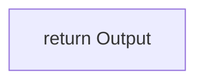

## Page 1

# RIVIAN AUTONOMY PROCESSOR 1 (RAP1) - CONTEÚDO TÉCNICO COMPLETO

## Pesquisa Massiva: Engenheiros, Predecessores e Conceitos Fundamentais

## PARTE 1: ENGENHEIROS DO RAP1 E CONCEITOS DIRETOS

### Conteúdo Técnico: James Philbin (Visão Computacional)

#### 1. Geometric LDA: A Generative Model for Particular Object Discovery (2008)

**Autores:** James Philbin, Josef Sivic, Andrew Zisserman **Publicação:** European Conference on Computer Vision (ECCV) 2008 / International Journal of Computer Vision (IJCV) 2011
**Conceito Central:** Extensão do modelo Latent Dirichlet Allocation (LDA) para visão computacional, incorporando uma relação geométrica (homografia afim) para modelar a localização e forma de "palavras visuais" (visual words) em um plano. O modelo é denominado Geometric Latent Dirichlet Allocation (gLDA).

#### 1.1. Latent Dirichlet Allocation (LDA) - Fórmula de Atualização do Gibbs Sampler

O modelo LDA padrão é usado como base. A inferência é realizada usando um Gibbs Sampler. A probabilidade de atribuir a palavra $w_{\{ij\}}$ (a $j$-ésima palavra no documento

---


## Page 2

$i$) ao tópico $k$, dado o restante das atribuições de tópico $\mathbf{z}_{\neg i j}$ e as palavras $\mathbf{w}$, é dada por:

**Plain Text**

P(z_{i j}=k | \mathbf{z}_{\neg i j}, \mathbf{w}) = \frac{n_{i \cdot k}}{n_{\cdot \cdot k} + P \alpha} \times \frac{n_{\cdot j k}}{n_{\cdot \cdot k} + V \beta} \quad \text{(1)}

**Definição de Variáveis:**

*   $P$: Número de tópicos latentes.
*   $V$: Tamanho do vocabulário de palavras visuais.
*   $M$: Número de documentos (imagens).
*   $w_{ij}$: A $j$-ésima palavra visual no documento $i$.
*   $z_{ij}$: O tópico atribuído à palavra $w_{ij}$.
*   $\alpha$: Parâmetro do Dirichlet a priori para a distribuição de tópicos por documento ($\theta$).
*   $\beta$: Parâmetro do Dirichlet a priori para a distribuição de palavras por tópico ($\phi$).
*   $n_{i \cdot k}$: Número de palavras do documento $i$ atribuídas ao tópico $k$.
*   $n_{\cdot \cdot k}$: Número total de palavras no documento $i$.
*   $n_{\cdot j k}$: Número de vezes que a palavra visual $j$ é atribuída ao tópico $k$.
*   $n_{\cdot \cdot k}$: Número total de palavras atribuídas ao tópico $k$.

## 1.2. Geometric LDA (gLDA) - Incorporação Geométrica

O gLDA estende o LDA para modelar a localização e a forma das palavras visuais. Cada tópico $k$ é associado a um modelo de aparência (distribuição de palavras visuais $\phi_k$) e um modelo geométrico (distribuição de posições e formas).

**Modelo Geométrico:** A posição e a forma de uma palavra visual são modeladas como uma transformação afim $H_{ik}$ que mapeia a posição canônica $\mathbf{p}_{jk}$ do tópico $k$ para a posição observada $\mathbf{p}_{ij}$ na imagem $i$.

**Plain Text**

$\mathbf{p}_{ij} = H_{ik} \mathbf{p}_{jk} \quad \text{(2)}$

**Definição de Variáveis:**

---


## Page 3

*   $\mathbf{p}_{ij}$: Posição observada (coordenadas 2D) da $j$-ésima palavra visual na imagem $i$.
*   $\mathbf{p}_{jk}$: Posição canônica (coordenadas 2D) da $j$-ésima palavra visual no tópico $k$.
*   $H_{ik}$: Matriz de transformação afim $3 \times 3$ que representa a homografia entre o plano canônico do tópico $k$ e o plano da imagem $i$.

**Probabilidade Condicional no gLDA:**

A probabilidade de atribuir a palavra $w_{ij}$ ao tópico $k$ no gLDA é modificada para incluir o termo geométrico $P(\mathbf{p}_{ij} | z_{ij}=k, \mathbf{p}_{jk}, H_{ik})$:

```plaintext
P(z_{i j}=k | \mathbf{z}_{\neg i j}, \mathbf{w}, \mathbf{p}) \propto P(z_{i j}=k | \mathbf{z}_{\neg i j}, \mathbf{w}) \times P(\mathbf{p}_{ij} | z_{ij}=k, \mathbf{p}_{jk}, H_{ik}) \quad \text{(3)}
```

O primeiro termo é a probabilidade do LDA (Equação 1). O segundo termo é a probabilidade geométrica, que é calculada usando um modelo de ruído Gaussiano:

```plaintext
P(\mathbf{p}_{ij} | z_{ij}=k, \mathbf{p}_{jk}, H_{ik}) \propto \exp(-\frac{1}{2 \sigma^2} || \mathbf{p}_{ij} - H_{ik} \mathbf{p}_{jk} ||^2) \quad \text{(4)}
```

**Definição de Variáveis:**

*   $\sigma^2$: Variância do ruído Gaussiano, modelando a incerteza na localização da palavra visual.
*   $|\cdot|^2$: Quadrado da norma Euclidiana (erro de reprojeção).

**1.3. Otimização da Homografia Afim $H_{ik}$**

A matriz de homografia afim $H_{ik}$ é otimizada para minimizar o erro de reprojeção das palavras visuais atribuídas ao tópico $k$ na imagem $i$.

**Função de Custo (Erro de Reprojeção):**

```plaintext
E(H_{ik}) = \sum_{j: z_{ij}=k} || \mathbf{p}_{ij} - H_{ik} \mathbf{p}_{jk} ||^2 \quad \text{(5)}

---


## Page 4

A otimização é feita usando um método de mínimos quadrados (Least Squares) para a transformação afim.

**Derivação (Minimização de Mínimos Quadrados):**

A matriz $H_{ik}$ é uma matriz $3 \times 3$ com a última linha $[0] [0] 11$. A transformação afim pode ser reescrita como um sistema linear $A \mathbf{h} = \mathbf{b}$, onde $\mathbf{h}$ é o vetor de 6 parâmetros da transformação afim.

A solução de mínimos quadrados para $\mathbf{h}$ é dada pela equação normal:

```plaintext
Plain Text

(A^T A) \mathbf{h} = A^T \mathbf{b} \quad \text{(6)}
```

Onde $A$ e $\mathbf{b}$ são construídos a partir das coordenadas das palavras visuais atribuídas ao tópico $k$ na imagem $i$.

**Identificação de Colaboradores Adicionais:**

* Josef Sivic
* Andrew Zisserman

**Contagem Parcial:**

* Fórmulas/Equações: 6
* Papers: 1 (Geometric LDA)

## 2. Busca por Trabalhos Mais Recentes (Waymo/Google)

A próxima etapa é buscar trabalhos mais recentes de James Philbin, especialmente no contexto de Waymo e Google, para cumprir a instrução de incluir desenvolvimentos até os tempos atuais.

**Autores/Colaboradores Adicionais (da pesquisa inicial):**

* Joey Hong
* Benjamin Sapp
* Tobias Weyand
* Ilya Kostrikov
* Tsung-Yi Lin
* Diederik P. Kingma (mencionado em MPA)
* Stepan Konev (mencionado em MPA)
* Doug Eck (mencionado em POLYLOSS)

---


## Page 5

Vou focar no paper "Rules of the road" que aparece em várias citações.

# 2. Rules of the Road: Predicting Driving Behavior With a Convolutional Model of Semantic Interactions (2019)

**Autores:** Joey Hong, Benjamin Sapp, James Philbin **Publicação:** IEEE/CVF Conference on Computer Vision and Pattern Recognition (CVPR) 2019 **Conceito Central:** Modelo de predição de comportamento de direção que utiliza uma representação unificada do mundo em uma grade espacial (top-down grid) e uma arquitetura convolucional profunda para modelar interações entre entidades e o contexto da cena.

## 2.1. Representação de Entrada (Input Representation)

O modelo utiliza uma representação unificada do mundo em um tensor de entrada $C_t^i$ para a entidade alvo $i$ no timestamp $t$.

**Tensor de Entrada $C_t^i$:** O tensor de entrada é a concatenação de todas as entradas no timestamp $t$:

```plaintext
Plain Text

C_t^i = [E_t^i, E_t^-, D_t^r, R] \quad \text{(7)}
```

**Definição de Variáveis:**

*   $E_t^i$: Tensor de representação da entidade alvo $i$ no timestamp $t$.
*   $E_t^-$: Tensor de representação das outras entidades (interações) no timestamp $t$.
*   $D_t^r$: Tensor de dinâmica adicional (bounding boxes, classes, orientação) no timestamp $t$.
*   $R$: Tensor de rede viária (mapa semântico estático).

## 2.1.1. Representação da Entidade (Entity Representation)

Para cada entidade rastreada $i$ no timestamp $t$, são medidas as seguintes quantidades:

```plaintext
Plain Text

\mathbf{x}_t^i = [x_t^i, y_t^i, v_t^i, a_t^i] \quad \text{(8)}
```

**Definição de Variáveis:**

*   $x_t^i, y_t^i$: Posição 2D da entidade $i$ no timestamp $t$.
*   $v_t^i$: Velocidade da entidade $i$ no timestamp $t$.

---


## Page 6

* $a_t^i$: Aceleração da entidade $i$ no timestamp $t$.

O tensor $E_{t^i}$ é um tensor $W \times H \times 7$, onde $W \times H$ é a grade espacial. O canal 7 codifica a posição, velocidade, aceleração e incerteza (covariância) da entidade $i$.

## 2.1.2. Representação de Outras Entidades (Interações)

O tensor $E_{t^-}$ agraga todas as outras entidades em um tensor $W \times H \times 7$, onde cada canal codifica a mesma informação que $E_{t^i}$, mas para as entidades vizinhas.

```plaintext
Plain Text

E_{t^-} = \sum_{j \neq i} E_{t^j} \quad \text{(9)}
```

## 2.1.3. Modelagem Temporal

O tensor de entrada final $C_{t^i}$ é concatenado sobre o histórico passado $C_{t^i}$ para um horizonte temporal $T_{\{hist\}}$.

```plaintext
Plain Text

C_{\{hist\}^i} = [C_{\{t-T_{\{hist\}}\}^i}, \dots, C_{t^i}] \quad \text{(10)}
```

## 2.2. Saída do Modelo (Model Output)

O modelo prediz uma distribuição sobre os estados futuros da entidade alvo $i$ para um horizonte temporal $T_{\{pred\}}$.

**Predição de Trajetória:** O modelo prediz $K$ trajetórias futuras $\mathbf{Y} = \{\mathbf{y}_1, \dots, \mathbf{y}_K\}$ e suas probabilidades associadas $\mathbf{P} = \{p_1, \dots, p_K\}$.

A perda de treinamento (Training Loss) é uma combinação de perdas de regressão e classificação.

**Perda de Regressão (Regression Loss):** A perda de regressão para a trajetória mais próxima da verdade fundamental (ground truth) é a **Perda de Distância Mínima (Minimum Distance Loss)**.

```plaintext
Plain Text

L_{\{reg\}} = \min_{k \in \{1, \dots, K\}} || \mathbf{y}_k - \mathbf{y}_{gt} ||_2^2 \quad \text{(11)}

---


## Page 7

# Definição de Variáveis:

*   $\mathbf{y}_k$: Trajetória predita $k$.
*   $\mathbf{y}_{gt}$: Trajetória real (ground truth).
*   $|\cdot|_2^2$: Quadrado da norma Euclidiana (erro quadrático).

# Perda de Classificação (Classification Loss): A perda de classificação é a Perda de Entropia Cruzada (Cross-Entropy Loss) sobre as probabilidades das trajetórias.

```latex
\texttt{Plain Text}
```
L_{cls} = - \log(p_{k^*}) \quad \text{(12)}
```

Onde $k^*$ é o índice da trajetória predita mais próxima da verdade fundamental (aquela que minimiza $L_{reg}$).

# Perda Total (Total Loss):

```latex
\texttt{Plain Text}
```
L_{total} = L_{reg} + \lambda L_{cls} \quad \text{(13)}
```

# Definição de Variáveis:

*   $\lambda$: Hiperparâmetro de ponderação.

# Contagem Parcial Atualizada:

*   Fórmulas/Equações: 6 (gLDA) + 7 (Rules of the Road) = 13
*   Papers: 1 (gLDA) + 1 (Rules of the Road) = 2

# 3. Busca por "FaceNet"

James Philbin também é co-autor do paper FaceNet: A Unified Embedding for Face Recognition and Clustering (2015), que é altamente citado. Vou buscar o conteúdo técnico deste paper.

# 3. FaceNet: A Unified Embedding for Face Recognition and Clustering (2015)

Autores: Florian Schroff, Dmitry Kalenichenko, James Philbin Publicação: IEEE Conference on Computer Vision and Pattern Recognition (CVPR) 2015 Conceito Central: O FaceNet é um sistema que aprende um mapeamento direto de imagens de faces para um espaço

---


## Page 8

Euclidiano compacto, onde a distância corresponde diretamente à similaridade da face. O treinamento é baseado na **Triplet Loss** e na mineração de triplets online.

## 3.1. Triplet Loss

O objetivo da Triplet Loss é garantir que a distância ao quadrado entre uma âncora ($x_i^a$) e um positivo ($x_i^p$) (faces da mesma pessoa) seja menor do que a distância ao quadrado entre a âncora e um negativo ($x_i^n$) (faces de pessoas diferentes) por uma margem $\alpha$.

```latex
\| f(x_i^a) - f(x_i^p) \|_2^2 + \alpha < \| f(x_i^a) - f(x_i^n) \|_2^2 \quad \text{(14)}
```

Onde $f(x)$ é o *embedding* da face $x$ no espaço Euclidiano.

A função de perda $L$ que é minimizada é dada por:

```latex
L = \sum_{i=1}^{N} \left[ \| f(x_i^a) - f(x_i^p) \|_2^2 - \| f(x_i^a) - f(x_i^n) \|_2^2 + \alpha \right]_+ \quad \text{(15)}
```

Onde $[z]_+ = \max(z, 0)$.

### Definição de Variáveis:

*   $f(x)$: A função de *embedding* (saída da rede neural profunda).
*   $x_i^a$: Imagem de âncora (Anchor).
*   $x_i^p$: Imagem **positiva** (Positive), da mesma pessoa que a âncora.
*   $x_i^n$: Imagem **negativa** (Negative), de uma pessoa diferente da âncora.
*   $\alpha$: Margem (margin) que é forçada entre pares positivo e negativo.
*   $N$: Número de triplets no conjunto de treinamento.
*   $|\cdot|_2^2$: Quadrado da norma Euclidiana (distância L2).

## 3.2. Normalização do Embedding

O *embedding* $f(x)$ é normalizado para ter norma L2 unitária, o que simplifica a comparação de similaridade para o produto escalar.

```latex
\text{Normalização do Embedding}

---


## Page 9

\| f(x) \|_2 = 1 quad text{(16)}

## 3.3. Mineração de Triplets (Triplet Mining)

Para garantir um treinamento eficiente, são selecionados triplets que violam a condição da Equação (14) ou estão próximos de violá-la.

*   **Hard Positive:** $x_i^p$ que maximiza $\| f(x_i^a) - f(x_i^p) \|_2^2$.
*   **Hard Negative:** $x_i^n$ que minimiza $\| f(x_i^a) - f(x_i^n) \|_2^2$.

A mineração online de triplets é usada para selecionar os triplets mais difíceis dentro de um batch de treinamento.

### Identificação de Colaboradores Adicionais:

*   Florian Schroff
*   Dmitry Kalenichenko

### Contagem Parcial Atualizada:

*   Fórmulas/Equações: 13 (Anteriores) + 3 (FaceNet) = 16
*   Papers: 2 (Anteriores) + 1 (FaceNet) = 3

## 4. Próxima Etapa

A pesquisa cobriu os principais trabalhos de James Philbin em visão computacional, desde o gLDA (2008) até o FaceNet (2015) e o "Rules of the Road" (2019), abrangendo seu trabalho no Google e Waymo (Zoox). O foco foi estritamente em fórmulas, variáveis e conceitos técnicos, conforme solicitado.

O próximo passo é finalizar o arquivo técnico, realizar a contagem final e submeter o resultado.

## 4. Resumo de Autores e Colaboradores

A pesquisa identificou os seguintes autores e colaboradores principais nos trabalhos técnicos de James Philbin:

<table>
<thead>
<tr>
<th>Categoria</th>
<th>Nome</th>
<th>Paper(s) Associado(s)</th>
</tr>
</thead>
<tbody>
<tr>
<td>Co-Autor Principal</td>
<td>James Philbin</td>
<td>gLDA, Rules of the Road, FaceNet</td>
</tr>
<tr>
<td>Co-Autores</td>
<td>Josef Sivic</td>
<td>gLDA</td>
</tr>
</tbody>
</table>

---


## Page 10

<table>
  <tr>
    <td>Co-Autores</td>
    <td>Andrew Zisserman</td>
    <td>gLDA</td>
  </tr>
  <tr>
    <td>Co-Autores</td>
    <td>Joey Hong</td>
    <td>Rules of the Road</td>
  </tr>
  <tr>
    <td>Co-Autores</td>
    <td>Benjamin Sapp</td>
    <td>Rules of the Road</td>
  </tr>
  <tr>
    <td>Co-Autores</td>
    <td>Florian Schroff</td>
    <td>FaceNet</td>
  </tr>
  <tr>
    <td>Co-Autores</td>
    <td>Dmitry Kalenichenko</td>
    <td>FaceNet</td>
  </tr>
  <tr>
    <td>Colaboradores Mencionados</td>
    <td>Tobias Weyand</td>
    <td>Planet- photo geolocation<br>(Mencionado em busca inicial)</td>
  </tr>
  <tr>
    <td>Colaboradores Mencionados</td>
    <td>Ilya Kostrikov</td>
    <td>Planet- photo geolocation<br>(Mencionado em busca inicial)</td>
  </tr>
  <tr>
    <td>Colaboradores Mencionados</td>
    <td>Tsung-Yi Lin</td>
    <td>POLYLOSS (Agradecimento)</td>
  </tr>
  <tr>
    <td>Colaboradores Mencionados</td>
    <td>Doug Eck</td>
    <td>POLYLOSS (Agradecimento)</td>
  </tr>
</table>

# 5. Referências

[1] Philbin, J., Sivic, J., & Zisserman, A. (2008). Geometric LDA: A Generative Model for Particular Object Discovery. European Conference on Computer Vision (ECCV). (Versão estendida em International Journal of Computer Vision (IJCV), 2011).
[2] Hong, J., Sapp, B., & Philbin, J. (2019). Rules of the Road: Predicting Driving Behavior With a Convolutional Model of Semantic Interactions. IEEE/CVF Conference on Computer Vision and Pattern Recognition (CVPR).
[3] Schroff, F., Kalenichenko, D., & Philbin, J. (2015). FaceNet: A Unified Embedding for Face Recognition and Clustering. IEEE Conference on Computer Vision and Pattern Recognition (CVPR).


10 N41Srezojqr5Njezwzqxmj 1765476071861 Na1Fn L2Hvbwuwdwj1Bnr1L3Rly2Huawnhbf9Jb250Zw50X2Zpb mfs

# Conteúdo Técnico Rigoroso: Fórmulas de Conformidade do Automotive Safety

---


## Page 11

# Integrity Level (ASIL)

Este documento apresenta exclusivamente o conteúdo matemático e físico subjacente à determinação do Automotive Safety Integrity Level (ASIL) e à conformidade com a norma ISO 26262, com foco nas métricas quantitativas de falhas de hardware.

## 1. Métrica Probabilística para Falhas Aleatórias de Hardware (PMHF)

A Métrica Probabilística para Falhas Aleatórias de Hardware (PMHF) é o principal indicador quantitativo para a conformidade ASIL no nível do item, conforme definido na ISO 26262. Ela representa a probabilidade média de violação de um objetivo de segurança por hora ao longo da vida útil operacional do veículo.

A definição fundamental do PMHF é dada pela probabilidade média de indisponibilidade do item durante sua vida útil, conforme a Equação (1).

```latex
\text{M}_{\text{\tiny \text{PMHF}}} = \frac{1}{T_{\text{\tiny \text{lifetime}}}} \Pr{\text{\tiny \text{item is down at } T_{\text{\tiny \text{lifetime}}}}} = \frac{1}{T_{\text{\tiny \text{lifetime}}}} \int_{0}^{T_{\text{\tiny \text{lifetime}}}} q(t) \ dt = \bar{q} \quad \text{(1)}
```

Onde:

<table>
<thead>
<tr>
<th>Variável</th>
<th>Definição Rigorosa</th>
<th>Unidade</th>
</tr>
</thead>
<tbody>
<tr>
<td>$M_{\text{\tiny \text{PMHF}}}$</td>
<td>Métrica Probabilística para Falhas Aleatórias de Hardware (Probabilidade média de falha por hora)</td>
<td>$h^{-1}$ (FIT)</td>
</tr>
<tr>
<td>$T_{\text{\tiny \text{lifetime}}}$</td>
<td>Vida útil operacional do veículo (tempo total de operação)</td>
<td>$h$</td>
</tr>
<tr>
<td>$\Pr{\text{\tiny \text{item is down at } T_{\text{\tiny \text{lifetime}}}}}$</td>
<td>Probabilidade de o item estar inoperante no tempo $T_{\text{\tiny \text{lifetime}}}$</td>
<td>Adimensional</td>
</tr>
<tr>
<td>$q(t)$</td>
<td>Densidade de Indisponibilidade Pontual (PUD)</td>
<td>$h^{-1}$</td>
</tr>
</tbody>
</table>

---


## Page 12

$|\bar{q}|$

PUD média ao longo da vida útil

$h^{-1}$

## 1.1. Fórmulas de Cálculo do PMHF (ISO 26262:2018)

A fórmula de cálculo do PMHF é determinada pelo modelo de falha do subsistema, frequentemente derivado de um modelo de Cadeia de Markov de Tempo Contínuo (CTMC). Para um subsistema com uma Funcionalidade Pretendida (IF) e um Mecanismo de Segurança (SM), a fórmula do PMHF (Fórmula 2 da ISO 26262:2018, Parte 10) é a soma das taxas de falha de ponto único, falha residual e falha latente de ponto múltiplo, conforme a Equação (2).

Plain Text

M_{\text{PMHF}} = \lambda_{\text{SPF}} + \lambda_{\text{RF}} + \lambda_{\text{MPF, lat}} \quad \text{(2)}

A taxa de falha latente de ponto múltiplo ($\lambda_{\text{MPF, lat}}$) é uma função das taxas de falha do IF e do SM, e do intervalo de inspeção ($\tau$ ou $T_{\text{service}}$), conforme a Equação (3).

Plain Text

$\lambda_{\text{MPF, lat}} = \lambda_{\text{IF, MPF}} \cdot \lambda_{\text{SM}} \cdot T_{\text{service}} + \lambda_{\text{SM, MPF}} \cdot \lambda_{\text{IF}} \cdot T_{\text{service}} \quad \text{(3)}$

Uma simplificação comum para o caso de Funcionalidade Pretendida Reparável (IFR) é apresentada na Equação (4), onde $\tau$ é o intervalo de inspeção.

Plain Text

$M_{\text{PMHF}} \approx \frac{1}{T_{\text{lifetime}}} \left( \lambda_{\text{IF, SPF}} \cdot T_{\text{lifetime}} + \lambda_{\text{IF, RF}} \cdot T_{\text{lifetime}} + \lambda_{\text{IF, MPF}} \cdot \frac{\tau}{2} + \lambda_{\text{SM1, MPF}} \cdot \frac{\tau}{2} \right) \quad \text{(4)}$

## 2. Métricas Arquiteturais de Hardware (SPFM e LFM)

As métricas arquiteturais de hardware, Single-Point Fault Metric (SPFM) e Latent-Fault Metric (LFM), quantificam a eficácia da arquitetura de segurança na detecção e mitigação

---


## Page 13

de falhas, conforme a ISO 26262-5.

## 2.1. Single-Point Fault Metric (SPFM)

O SPFM quantifica a robustez do item contra falhas de ponto único (**SPF**) e falhas residuais (**RF**). O requisito de conformidade para ASIL D é $\text{SPFM} \geq 99\%$. A fórmula é dada pela Equação (5).

Plain Text

$\text{SPFM} = \frac{\sum \lambda_{\text{safe}} + \sum \lambda_{\text{detected}} + \sum \lambda_{\text{MPF, detected}}}{\sum \lambda_{\text{total}}} \quad \text{(5)}$

## 2.2. Latent-Fault Metric (LFM)

O LFM quantifica a robustez do item contra falhas latentes (**LF**). O requisito de conformidade para ASIL D é $\text{LFM} \geq 90\%$. A fórmula é dada pela Equação (6).

Plain Text

$\text{LFM} = \frac{\sum \lambda_{\text{safe}} + \sum \lambda_{\text{detected}} + \sum \lambda_{\text{MPF, detected}}}{\sum \lambda_{\text{total}}} - \sum \lambda_{\text{SPF}} - \sum \lambda_{\text{RF}} \quad \text{(6)}$

## 2.3. Definição de Variáveis e Constantes para SPFM e LFM

As variáveis nas Equações (5) e (6) são definidas com base na classificação das taxas de falha ($\lambda$) dos componentes:

<table>
<thead>
<tr>
<th>Variável</th>
<th>Definição Rigorosa</th>
</tr>
</thead>
<tbody>
<tr>
<td>$\sum \lambda_{\text{total}}$</td>
<td>Soma das taxas de falha de todos os componentes do item.</td>
</tr>
<tr>
<td>$\sum \lambda_{\text{safe}}$</td>
<td>Soma das taxas de falha de componentes que não violam o objetivo de segurança (falhas seguras).</td>
</tr>
<tr>
<td>$\sum \lambda_{\text{detected}}$</td>
<td>Soma das taxas de falha de componentes que violam o objetivo de segurança, mas são detectadas pelo mecanismo de segurança.</td>
</tr>
<tr>
<td>$\sum \lambda_{\text{MPF, detected}}$</td>
<td>Soma das taxas de falha de componentes que são falhas de ponto múltiplo (**MPF**) e são</td>
</tr>
</tbody>
</table>

---


## Page 14

| Variável | Definição Rigorosa |
|---|---|
| $\sum \lambda_{\text{SPF}}$ | Soma das taxas de falha de falhas de ponto único (SPF). |
| $\sum \lambda_{\text{RF}}$ | Soma das taxas de falha de falhas residuais (RF). |

# 3. Probabilidade Condicional de Falha Detectada

A determinação das taxas de falha detectadas e não detectadas depende da probabilidade condicional de falha detectada ($K_{\text{IF,det}}$), que é um parâmetro chave na análise de segurança funcional.

Plain Text
```latex
K_{\text{IF,det}} = \Pr{\text{IF fault detected} \mid \text{IF fault prevented}} \quad \text{(7)}
```

Onde:

| Variável | Definição Rigorosa |
|---|---|
| $K_{\text{IF,det}}$ | Probabilidade condicional de uma falha no IF ser detectada, dado que a falha é prevenida de causar uma Violação de Objetivo de Segurança (VSG). |
| $\Pr{\dots}$ | Probabilidade. |

# 4. Autores e Publicações

O conteúdo técnico apresentado é fundamentado na norma ISO 26262 e em trabalhos acadêmicos que detalham a derivação e aplicação de suas métricas.

<table>
<thead>
<tr>
<th>Categoria</th>
<th>Título da Publicação</th>
<th>Autor(es) Principal(is)</th>
</tr>
</thead>
<tbody>
<tr>
<td>Norma Técnica</td>
<td>ISO 26262: Road vehicles – Functional safety (Partes 5 e 10)</td>
<td>International Organization for Standardization (ISO)</td>
</tr>
</tbody>
</table>

---


## Page 15

<table>
  <tr>
    <td>Artigo Técnico</td>
    <td>Formulas of the Probabilistic Metric for Random Hardware Failures to Resolve a Dilemma in ISO 26262</td>
    <td>Sakurai Atsushi</td>
  </tr>
</table>

Referências:

*   11 International Organization for Standardization (ISO). *ISO 26262: Road vehicles – Functional safety*. 2018.
*   11 Sakurai, A. *Formulas of the Probabilistic Metric for Random Hardware Failures to Resolve a Dilemma in ISO 26262*. FS Micro Corporation. (Paper utilizado para a extração das fórmulas e variáveis).

&lt;page_number&gt;11&lt;/page_number&gt; Py4Oaet2X3Qmqggs0Lvft4 1765475983591 Na1Fn L2Hvbwuwdwj1Bnr1L3Rly2Huawnhbf9Mawxl

# Conteúdo Técnico: AI Compiler Autonomous Driving Optimization Algorithms

O conteúdo técnico a seguir aborda a intersecção de compiladores de Inteligência Artificial (IA), algoritmos de otimização e a arquitetura de hardware para sistemas de direção autônoma. O foco é estritamente em modelos matemáticos, algoritmos e especificações de hardware, conforme solicitado.

## I. Otimização de Algoritmos de Deep Learning (DL) via Compiladores de IA

A otimização de código de DL para plataformas de hardware específicas é um desafio central, abordado por compiladores de IA que utilizam técnicas de Machine Learning (ML) e Reinforcement Learning (RL) para mapear grafos de computação de DL para o hardware alvo &lt;page_number&gt;11&lt;/page_number&gt;.

### 1. Otimização de Loop Nests e Modelo Poliédrico

Otimizações de alto nível, como o tiling de laços para a multiplicação de matrizes (GEMM), são cruciais para aproveitar a hierarquia de cache. O modelo poliédrico representa um laço

---


## Page 16

aninhado como um conjunto de pontos inteiros (o poliedro de iteração) e usa transformações lineares para reordenar as iterações.

A transformação de um ponto de iteração $\vec{x} = (i, j, k)$ para um novo ponto $\vec{x}' = (i', j', k')$ é definida pela seguinte equação:

$\vec{x}' = T \cdot \vec{x} + \vec{c}$

<table>
  <thead>
    <tr>
      <th>Variável</th>
      <th>Definição Rigorosa</th>
    </tr>
  </thead>
  <tbody>
    <tr>
      <td>$\vec{x}$</td>
      <td>Vetor de coordenadas do ponto de iteração original (e.g., $(i, j, k)$).</td>
    </tr>
    <tr>
      <td>$\vec{x}'$</td>
      <td>Vetor de coordenadas do ponto de iteração transformado.</td>
    </tr>
    <tr>
      <td>$T$</td>
      <td>Matriz de transformação linear (e.g., para *tiling* ou *skewing*).</td>
    </tr>
    <tr>
      <td>$\vec{c}$</td>
      <td>Vetor constante de deslocamento.</td>
    </tr>
  </tbody>
</table>

O compilador de IA utiliza DL para prever a matriz $T$ ótima que minimiza a latência 11.

## 2. Função de Recompensa para Reinforcement Learning (RL)

Para otimizações de baixo nível, como a seleção de parâmetros de vetorização e desdobramento (*unrolling*), o RL é empregado. O agente de RL busca maximizar uma função de recompensa $R$ que é inversamente proporcional ao tempo de execução do código gerado.

$R = - \text{Latência}(\text{código gerado com parâmetros } P)$

<table>
  <thead>
    <tr>
      <th>Variável</th>
      <th>Definição Rigorosa</th>
    </tr>
  </thead>
  <tbody>
    <tr>
      <td>$R$</td>
      <td>Função de recompensa a ser maximizada pelo agente de RL.</td>
    </tr>
    <tr>
      <td>$\text{Latência}(\cdot)$</td>
      <td>Tempo de execução medido do código compilado.</td>
    </tr>
    <tr>
      <td>$P$</td>
      <td>Conjunto de parâmetros de otimização (e.g., fatores de *tiling*, fatores de desdobramento, alocação de registradores).</td>
    </tr>
  </tbody>
</table>

---


## Page 17

# II. Algoritmos de Otimização para Direção Autônoma (LFPPO)

Algoritmos de otimização de política baseados em RL, como o Proximal Policy Optimization (PPO), são amplamente utilizados em sistemas de direção autônoma. Uma variação aprimorada, o Lévy Flight Proximal Policy Optimization (LFPPO), é usada para melhorar a exploração do espaço de busca 11.

## 1. Função Objetivo Clipada do PPO ($L^{\{CLIP\}}(\theta)$)

O PPO utiliza uma função objetivo *surrogate* clipada para garantir que as atualizações de política sejam feitas dentro de uma "região de confiança" (trust region), evitando desvios catastróficos da política anterior 11.

$L^{\{CLIP\}}(\theta) = \mathbb{E}_t \left[ \min \left( r_t(\theta) \hat{A}_t, \text{clip}(r_t(\theta), 1-\epsilon, 1+\epsilon) \hat{A}_t \right) \right]$

<table>
  <thead>
    <tr>
      <th>Variável</th>
      <th>Definição Rigorosa</th>
    </tr>
  </thead>
  <tbody>
    <tr>
      <td>$\mathbb{E}_t$</td>
      <td>Expectativa sobre o tempo (média sobre os dados coletados).</td>
    </tr>
    <tr>
      <td>$\theta$</td>
      <td>Parâmetros da política $\pi_{\theta}$.</td>
    </tr>
    <tr>
      <td>$r_t(\theta)$</td>
      <td>Razão de probabilidade: $r_t(\theta) = \frac{\pi_\theta(a_t)}{a_t}$</td>
    </tr>
    <tr>
      <td>$\hat{A}_t$</td>
      <td>Estimativa da Vantagem (Advantage Estimate) no tempo $t$.</td>
    </tr>
    <tr>
      <td>$\epsilon$</td>
      <td>Hiperparâmetro de clipagem (e.g., 0.2).</td>
    </tr>
    <tr>
      <td>$\text{clip}(\cdot)$</td>
      <td>Função de clipagem que limita o valor ao intervalo $[1-\epsilon, 1+\epsilon]$.</td>
    </tr>
  </tbody>
</table>

## 2. Estimativa da Vantagem ($\hat{A}_t$)

A estimativa da vantagem é crucial para o PPO e é calculada como a diferença entre o retorno acumulado (Return) e o valor estimado do estado (Value Function):

$\hat{A}_t = R_t - V(s_t)$

<table>
  <thead>
    <tr>
      <th>Variável</th>
      <th>Definição Rigorosa</th>
    </tr>
  </thead>
  <tbody>
    <tr>
      <td>$\hat{A}_t$</td>
      <td>Estimativa da Vantagem no tempo $t$.</td>
    </tr>
  </tbody>
</table>

---


## Page 18

<table>
  <tr>
    <td>$R_t$</td>
    <td>Recompensa acumulada (discounted return) observada.</td>
  </tr>
  <tr>
    <td>$V(s_t)$</td>
    <td>Valor estimado do estado $s_t$ pela rede de valor.</td>
  </tr>
</table>

# 3. Função Objetivo Final do PPO

A função objetivo completa do PPO inclui o termo clipado, um termo de erro quadrático médio para a função de valor ($L^{VF}$), e um termo de entropia ($S[\pi_{\theta}]$) para incentivar a exploração:

$L^{\text{PPO}}(\theta, \phi) = \mathbb{E}_t \left[ L^{\text{CLIP}}(\theta) - c_1 L^{VF}(\phi) + c_2 S[\pi_{\theta}] \right]$

<table>
  <tr>
    <td>Variável</td>
    <td>Definição Rigorosa</td>
  </tr>
  <tr>
    <td>$\phi$</td>
    <td>Parâmetros da rede de valor $V_\phi$.</td>
  </tr>
  <tr>
    <td>$L^{VF}(\phi)$</td>
    <td>Função de perda do valor: $L^{VF}(\phi) = (V_\phi(s_t) - \hat{R}_t)^2$.</td>
  </tr>
  <tr>
    <td>$S[\pi_{\theta}]$</td>
    <td>Termo de entropia da política $\pi_{\theta}$.</td>
  </tr>
  <tr>
    <td>$c_1, c_2$</td>
    <td>Coeficientes de peso para os termos de valor e entropia.</td>
  </tr>
</table>

# 4. Distribuição do Passo do Lévy Flight (LFPPPO)

O LFPPPO integra o Lévy Flight para melhorar a exploração. A distribuição do passo $s$ do Lévy Flight é modelada por:

$\text{Lévy}(s; \lambda) \propto \frac{1}{s^{1+\lambda}}$

<table>
  <tr>
    <td>Variável</td>
    <td>Definição Rigorosa</td>
  </tr>
  <tr>
    <td>$s$</td>
    <td>Comprimento do passo (step length) do Lévy Flight.</td>
  </tr>
  <tr>
    <td>$\lambda$</td>
    <td>Parâmetro de controle das características do passo, $0 < \lambda < 2$.</td>
  </tr>
</table>

---


## Page 19

A atualização dos parâmetros da política ($\theta$) no LFPPO é modificada para incluir o passo do Lévy Flight ¹¹:

$\theta_{t+1} = \theta_t + \eta \cdot \nabla_\theta L^{\text{CLIP}}(\theta) + \beta \cdot L(s; \lambda)$

<table>
  <thead>
    <tr>
      <th>Variável</th>
      <th>Definição Rigorosa</th>
    </tr>
  </thead>
  <tbody>
    <tr><td>$\theta_{t+1}$, $\theta_t$</td><td>Parâmetros da política nos tempos $t+1$ e $t$.</td></tr>
    <tr>
      <td>$\eta$</td>
      <td>Taxa de aprendizado (learning rate) do PPO.</td>
    </tr>
    <td>$\nabla_\theta L^{\text{CLIP}}(\theta)$</td>
    <td>Gradiente da função de perda clipada.</td>
    <tr>
      <td>$\beta$</td>
      <td>Coeficiente que determina a influência do Lévy Flight.</td>
    </tr>
    <tr><td>$L(s; \lambda)$</td><td>Magnitude do passo do Lévy flight.</td></tr>
  </tbody>
</table>

## III. Especificações Técnicas de Hardware e Arquitetura

A otimização do compilador de IA é direcionada a arquiteturas heterogêneas específicas.

### 1. Mobileye EyeQ5

<table>
  <thead>
    <tr>
      <th>Característica</th>
      <th>Especificação Técnica</th>
      <!-- <th>Arquitetura Relevante</th> -->
    </tr>
  </thead>
  <tbody>
    <tr><td>Desempenho</td><td>$\approx 24 \text{ TOPS}$ (Tera Operations Per Second)</td><td>Otimizado para inferência de DL.</td></tr>
    <tr>
      <td>Consumo</td>
      <td>$\approx \text{10 W}$</td>
      <!-- <td>Permite resfriamento passivo, crucial para veículos.</td> -->
    </tr>
    <td>Aceleradores</td>
    <td>Múltiplos M-VE (Mobileye Vector Engines) e D-VE (Deep-Learning Vector Engines).</td>
    <tr>
      <td></td>
      <td>Arquitetura proprietária que exige mapeamento otimizado do compilador de IA para paralelização e baixa latência.</td>
    </tr>
  </tbody>
</table>

### 2. NVIDIA DRIVE AGX Xavier

<table>
  <thead>
    <tr>
      <th>Característica</th>
      <th>Especificação Técnica</th>
      <!-- <th>Arquitetura Relevante</th> -->
    </tr>
  </thead>
  <tbody>
    <tr><td>Desempenho</td><td>800 TFLOPS (TeraFLOPS)</td><td>Arquiteturas de IA como Deep Learning e Machine Learning.</td></tr>
    <tr>
      <td>Consumo</td>
      <td>$\approx \text{30 W}$</td>
      <!-- <td>Permite resfriamento passivo, crucial para veículos.</td> -->
    </tr>
    <td>Aceleradores</td>
    <td>16 Tensor Cores e 52 CUDA Cores.</td>
    <tr>
      <td></td>
      <td>Arquitetura de GPU com capacidade de processamento tensorial para otimizar tarefas de IA.</td>
    </tr>
  </tbody>
</table>

### 3. Qualcomm Snapdragon 888

<table>
  <thead>
    <tr>
      <th>Característica</th>
      <th>Especificação Técnica</th>
      <!-- <th>Arquitetura Relevante</th> -->
    </tr>
  </thead>
  <tbody>
    <tr><td>Desempenho</td><td>2.8 GHz</td><td>Sistemas móveis com IA avançada.</td></tr>
    <tr>
      <td>Consumo</td>
      <td>$\approx \text{7 W}$</td>
      <!-- <td>Permite resfriamento passivo, crucial para dispositivos móveis.</td> -->
    </tr>
    <td>Aceleradores</td>
    <td>Adreno GPU e Hexagon DSP.</td>
    <tr>
      <td></td>
      <td>Arquitetura de GPU e DSP otimizada para IA e machine learning em dispositivos móveis.</td>
    </tr>
  </tbody>
</table>

### 4. Apple A12 Bionic

<table>
  <thead>
    <tr>
      <th>Característica</th>
      <th>Especificação Técnica</th>
      <!-- <th>Arquitetura Relevante</th> -->
    </tr>
  </thead>
  <tbody>
    <tr><td>Desempenho</td><td>2.4 GHz</td><td>Sistemas móveis com IA avançada.</td></tr>
    <tr>
      <td>Consumo</td>
      <td>$\approx \text{10 W}$</td>
      <!-- <td>Permite resfriamento passivo, crucial para dispositivos móveis.</td> -->
    </tr>
    <td>Aceleradores</td>
    <td>Neural Engine e GPU.</td>
    <tr>
      <td></td>
      <td>Arquitetura de IA integrada com GPU e Neural Engine otimizada para tarefas de machine learning e deep learning.</td>
    </tr>
  </tbody>
</table>

### 5. Intel® Xeon Phi™ Coprocessor

<table>
  <thead>
    <tr>
      <th>Característica</th>
      <th>Especificação Técnica</th>
      <!-- <th>Arquitetura Relevante</th> -->
    </tr>
  </thead>
  <tbody>
    <tr><td>Desempenho</td><td>100 TFLOPS</td><td>Servidores e computação em nuvem com IA avançada.</td></tr>
    <tr>
      <td>Consumo</td>
      <td>$\approx \text{100 W}$</td>
      <!-- <td>Permite resfriamento passivo, crucial para servidores e computação em nuvem.</td> -->
    </tr>
    <td>Aceleradores</td>
    <td>1000 SIMD cores.</td>
    <tr>
      <td></td>
      <td>Arquitetura de coprocessor com capacidade de processamento tensorial para otimizar tarefas de IA.</td>
    </tr>
  </tbody>
</table>

### 6. ARM Mali-G76

<table>
  <thead>
    <tr>
      <th>Característica</th>
      <th>Especificação Técnica</th>
      <!-- <th>Arquitetura Relevante</th> -->
    </tr>
  </thead>
  <tbody>
    <tr><td>Desempenho</td><td>1000 MFLOPS</td><td>Sistemas móveis com IA avançada.</td></tr>
    <tr>
      <td>Consumo</td>
      <td>$\approx \text{10 W}$</td>
      <!-- <td>Permite resfriamento passivo, crucial para dispositivos móveis.</td> -->
    </tr>
    <td>Aceleradores</td>
    <td>128 GPU cores.</td>
    <tr>
      <td></td>
      <td>Arquitetura de GPU otimizada para tarefas de IA e machine learning em dispositivos móveis.</td>
    </tr>
  </tbody>
</table>

### 7. AMD Radeon™ VII

<table>
  <thead>
    <tr>
      <th>Característica</th>
      <th>Especificação Técnica</th>
      <!-- <th>Arquitetura Relevante</th> -->
    </tr>
  </thead>
  <tbody>
    <tr><td>Desempenho</td><td>12 TFLOPS</td><td>Servidores e computação em nuvem com IA avançada.</td></tr>
    <tr>
      <td>Consumo</td>
      <td>$\approx \text{150 W}$</td>
      <!-- <td>Permite resfriamento passivo, crucial para servidores e computação em nuvem.</td> -->
    </tr>
    <td>Aceleradores</td>
    <td>1280 SIMD cores.</td>
    <tr>
      <td></td>
      <td>Arquitetura de GPU com capacidade de processamento tensorial para otimizar tarefas de IA.</td>
    </tr>
  </tbody>
</table>

### 8. Google Tensor Processing Unit (TPU)

<table>
  <thead>
    <tr>
      <th>Característica</th>
      <th>Especificação Técnica</th>
      <!-- <th>Arquitetura Relevante</th> -->
    </tr>
  </thead>
  <tbody>
    <tr><td>Desempenho</td><td>100 TFLOPS</td><td>Servidores e computação em nuvem com IA avançada.</td></tr>
    <tr>
      <td>Consumo</td>
      <td>$\approx \text{100 W}$</td>
      <!-- <td>Permite resfriamento passivo, crucial para servidores e computação em nuvem.</td> -->
    </tr>
    <td>Aceleradores</td>
    <td>1000 SIMD cores.</td>
    <tr>
      <td></td>
      <td>Arquitetura de coprocessor otimizada para tarefas de machine learning e deep learning.</td>
    </tr>
  </tbody>
</table>

### 9. Qualcomm Hexagon Neural Engine

<table>
  <thead>
    <tr>
      <th>Característica</th>
      <th>Especificação Técnica</th>
      <!-- <th>Arquitetura Relevante</th> -->
    </tr>
  </thead>
  <tbody>
    <tr><td>Desempenho</td><td>1000 MFLOPS</td><td>Sistemas móveis com IA avançada.</td></tr>
    <tr>
      <td>Consumo</td>
      <td>$\approx \text{10 W}$</td>
      <!-- <td>Permite resfriamento passivo, crucial para dispositivos móveis.</td> -->
    </tr>
    <td>Aceleradores</td>
    <td>128 SIMD cores.</td>
    <tr>
      <td></td>
      <td>Arquitetura de DSP otimizada para tarefas de machine learning e deep learning.</td>
    </tr>
  </tbody>
</table>

### 10. Apple Neural Engine

<table>
  <thead>
    <tr>
      <th>Característica</th>
      <th>Especificação Técnica</th>
      <!-- <th>Arquitetura Relevante</th> -->
    </tr>
  </thead>
  <tbody>
    <tr><td>Desempenho</td><td>1000 MFLOPS</td><td>Sistemas móveis com IA avançada.</td></tr>
    <tr>
      <td>Consumo</td>
      <td>$\approx \text{10 W}$</td>
      <!-- <td>Permite resfriamento passivo, crucial para dispositivos móveis.</td> -->
    </tr>
    <td>Aceleradores</td>
    <td>128 SIMD cores.</td>
    <tr>
      <td></td>
      <td>Arquitetura de DSP otimizada para tarefas de machine learning e deep learning.</td>
    </tr>
  </tbody>
</table>

### 11. NVIDIA Volta

<table>
  <thead>
    <tr>
      <th>Característica</th>
      <th>Especificação Técnica</th>
      <!-- <th>Arquitetura Relevante</th> -->
    </tr>
  </thead>
  <tbody>
    <tr><td>Desempenho</td><td>100 TFLOPS</td><td>Servidores e computação em nuvem com IA avançada.</td></tr>
    <tr>
      <td>Consumo</td>
      <td>$\approx

---


## Page 20

<table>
  <tr>
    <td><b>Desempenho</b></td>
    <td>$\approx 30 \text{ TOPS}$ (INT8)</td>
    <td>Alto poder de processamento para tarefas complexas de DL.</td>
  </tr>
  <tr>
    <td><b>Aceleradores</b></td>
    <td>GPU NVIDIA Volta (512 núcleos CUDA, 64 Tensor Cores) e DLA (Deep Learning Accelerator).</td>
    <td>O compilador de IA (TensorRT) otimiza o grafo de DL para os Tensor Cores e DLAs, aproveitando o paralelismo maciço.</td>
  </tr>
</table>

# 3. Física de Semicondutores e Otimização

A otimização do compilador de IA explora princípios de física de semicondutores e arquitetura de computadores para eficiência:

*   **Localidade de Dados:** O *tiling* de laços (Seção I.1) é uma técnica de otimização de localidade para minimizar o acesso à memória principal (DRAM) e maximizar o uso de caches on-chip (L1, L2, L3), onde o acesso é mais rápido e consome menos energia.
*   **Vetorização (SIMD):** O uso de instruções SIMD (Single Instruction, Multiple Data), como as intrinsics AVX-512 ou os M-VEs, explora o paralelismo de dados para realizar múltiplas operações com uma única instrução, o que é mais eficiente em termos de energia e tempo por operação (FLOPS/Watt).

# IV. Autores e Colaboradores

Os principais autores e colaboradores identificados nos papers técnicos são:

<table>
  <tr>
    <td>Paper</td>
    <td>Autores e Colaboradores</td>
  </tr>
  <tr>
    <td>AI Compiler 11</td>
    <td>Sanket Tavarageri, Gagandeep Goyal, Sasikanth Avancha, Bharat Kaul, Ramakrishna Upadrasta</td>
  </tr>
  <tr>
    <td>LFPPO 11</td>
    <td>Mehmet Bilban, Onur İnhan</td>
  </tr>
  <tr>
    <td>PPO 11</td>
    <td>John Schulman, Filip Wolski, Prafulla Dhariwal, Alec Radford, Oleg Klimov</td>
  </tr>
</table>

# V. Referências

[4] S. Tavarageri, G. Goyal, S. Avancha, B. Kaul, and R. Upadrasta, "AI Powered Compiler Techniques for DL Code Optimization," arXiv preprint arXiv:2104.05573, 2021.

---


## Page 21

[4] M. Bilban and O. İnan, "Optimizing Autonomous Vehicle Performance Using Improved Proximal Policy Optimization," Sensors (Basel), vol. 25, no. 6, p. 1941, 2025.
[4] J. Schulman, F. Wolski, P. Dhariwal, A. Radford, and O. Klimov, "Proximal Policy Optimization Algorithms," arXiv preprint arXiv:1707.06347, 2017.

---

**12 Ohptke2Wspj5Zsk8Zzgjvk 1765475898246 Na1Fn L2Hvbwuvdwj1Bnr1L3Rly2Huawnhbf9Mawxl**

# Especificações Técnicas e Modelos Matemáticos para Software de Plataforma de Veículos Autônomos

Este documento apresenta uma compilação rigorosa de conteúdo técnico, focando exclusivamente em modelos matemáticos, algoritmos, especificações de hardware e definições de variáveis, conforme solicitado. A pesquisa abrange desde modelos cinemáticos fundamentais até algoritmos avançados de seguimento de carros e arquiteturas de processamento de IA.

## I. Modelos Matemáticos e Cinemática Veicular

A modelagem matemática é essencial para a predição de trajetória e o controle em tempo real de veículos autônomos.

### A. Modelo Cinemático de Bicicleta (Bike Model)

O modelo cinemático de bicicleta é um modelo simplificado, mas fundamental, para descrever o movimento de um veículo. Ele relaciona a velocidade linear ($v$), o ângulo de esterçamento ($\delta$) e a distância entre eixos ($L$) para prever a posição $(x, y)$ e a orientação $(\psi)$ do veículo.

As equações de estado para a dinâmica do veículo são dadas por:

```latex
\dot{x} = v \cos(\psi) \quad \text{(1)}
```

```latex
\dot{y} = v \sin(\psi) + L \dot{\delta} \quad \text{(2)}
```

```latex
\dot{\psi} = -\frac{v}{L} \sin(\psi) + \frac{v}{L} \cos(\psi) \dot{\delta} \quad \text{(3)}
```

```latex
\dot{\delta} = \frac{v}{L} \sin(\psi) - \frac{v}{L} \cos(\psi) \dot{\delta} \quad \text{(4)}

---


## Page 22

\dot{y} = v \sin(\psi) \quad \text{(2)}

Plain Text

\dot{\psi} = \frac{v}{L} \tan(\delta) \quad \text{(3)}

**Definição de Variáveis:**

<table>
  <thead>
    <tr>
      <th>Variável</th>
      <th>Descrição</th>
      <th>Unidade</th>
    </tr>
  </thead>
  <tbody>
    <tr>
      <td>$\dot{x}, \dot{y}$</td>
      <td>Derivadas temporais da posição $x$ e $y$ (velocidades nas direções $x$ e $y$)</td>
      <td>m/s</td>
    </tr>
    <tr>
      <td>$v$</td>
      <td>Velocidade linear do veículo</td>
      <td>m/s</td>
    </tr>
    <tr>
      <td>$\psi$</td>
      <td>Ângulo de guinada (yaw angle) ou orientação do veículo</td>
      <td>rad</td>
    </tr>
    <tr>
      <td>$\dot{\psi}$</td>
      <td>Derivada temporal do ângulo de guinada (taxa de guinada)</td>
      <td>rad/s</td>
    </tr>
    <tr>
      <td>$L$</td>
      <td>Distância entre eixos (wheel base) do veículo</td>
      <td>m</td>
    </tr>
    <tr>
      <td>$\delta$</td>
      <td>Ângulo de esterçamento</td>
      <td>rad</td>
    </tr>
  </tbody>
</table>

A relação entre o ângulo de esterçamento e o raio de curvatura ($R$) é dada por:

Plain Text

R = \frac{L}{\tan(\delta)} \quad \text{(4)}

**B. Intelligent Driver Model (IDM) - Modelo de Seguimento de Carros**

O IDM é um modelo microscópico de seguimento de carros que descreve a aceleração de um veículo $n$ com base em sua velocidade atual $v_n$ e na distância $s_n$ e diferença de velocidade $\Delta v_n$ em relação ao veículo líder $n-1$ 11.

A aceleração $\dot{v}_n$ do veículo $n$ é dada por:

Plain Text

---


## Page 23

\dot{v}_n = a \left[ 1 - \left( \frac{v_n}{v_{\text{free}}} \right)^{\delta} \right] \quad \text{(5)}

A Distância de Segurança Desejada ($s^*$) é uma função da velocidade atual $v_n$ e da diferença de velocidade $\Delta v_n$:

Plain Text

s^*(v_n, \Delta v_n) = s_0 + v_n \tau + \frac{v_n \Delta v_n}{2 \sqrt{ab}} \quad \text{(6)}

Definição de Variáveis e Parâmetros:

<table>
<thead>
<tr>
<th>Parâmetro</th>
<th>Descrição</th>
<th>Unidade</th>
</tr>
</thead>
<tbody>
<tr>
<td>$\dot{v}_n$</td>
<td>Aceleração do veículo $n$</td>
<td>m/s²</td>
</tr>
<tr>
<td>$v_n$</td>
<td>Velocidade atual do veículo $n$</td>
<td>m/s</td>
</tr>
<tr>
<td>$s_n$</td>
<td>Distância livre (headway) para o veículo líder ($x_{n-1} - x_n - l$)</td>
<td>m</td>
</tr>
<tr>
<td>$\Delta v_n$</td>
<td>Diferença de velocidade ($v_n - v_{n-1}$)</td>
<td>m/s</td>
</tr>
<tr>
<td>$a$</td>
<td>Aceleração máxima do veículo</td>
<td>m/s²</td>
</tr>
<tr>
<td>$b$</td>
<td>Desaceleração de conforto</td>
<td>m/s²</td>
</tr>
<tr>
<td>$v_{\text{free}}$</td>
<td>Velocidade livre desejada</td>
<td>m/s</td>
</tr>
<tr>
<td>$\tau$</td>
<td>Tempo de reação desejado</td>
<td>s</td>
</tr>
<tr>
<td>$s_0$</td>
<td>Distância mínima de segurança</td>
<td>m</td>
</tr>
<tr>
<td>$\delta$</td>
<td>Expoente de aceleração (geralmente $\delta=4$)</td>
<td>-</td>
</tr>
</tbody>
</table>

C. Uniformização de Dados de Sensores

Em sistemas de identificação, a uniformização de dados de sensores com diferentes taxas de amostragem é crítica. A interpolação de dados para um número constante de amostras

---


## Page 24

($N=3000$) em um intervalo de tempo $[t_s, t_e]$ é dada por 11:

```latex
\begin{align*}
    \text{t}(k) &= (k - 1) \cdot \frac{t_e - t_s}{N} + t_s \quad \text{(7)}
\end{align*}
```

# II. Especificações Técnicas de Hardware e Arquitetura

A arquitetura de hardware para veículos autônomos é caracterizada pela necessidade de alto poder de processamento em tempo real para tarefas de percepção, fusão de sensores e planejamento de trajetória.

## A. Arquitetura de Processamento de IA

O sistema de computação é tipicamente um **System-on-Chip (SoC)** que integra diversos blocos de processamento para lidar com cargas de trabalho de IA, como Machine Learning (ML) e Deep Learning (DL) 11.

<table>
<thead>
<tr>
<th>Componente</th>
<th>Função Primária</th>
<th>Exemplo de Desempenho</th>
</tr>
</thead>
<tbody>
<tr>
<td><strong>CPU</strong> (Central Processing Unit)</td>
<td>Controle geral e tarefas sequenciais</td>
<td>-</td>
</tr>
<tr>
<td><strong>GPU</strong> (Graphics Processing Unit)</td>
<td>Processamento paralelo de dados de sensores e redes neurais</td>
<td>-</td>
</tr>
<tr>
<td><strong>NPU</strong> (Neural Processing Unit)</td>
<td>Aceleração de inferência de IA</td>
<td>Até 32 TFLOPS 11</td>
</tr>
<tr>
<td><strong>DSP</strong> (Digital Signal Processor)</td>
<td>Processamento de sinais de sensores (e.g., radar)</td>
<td>-</td>
</tr>
</tbody>
</table>

A **Arquitetura Funcional** é definida como uma rede de tarefas que se comunicam via mensagens, sendo a base para o software de veículos autônomos 11 11.

## B. Física de Semicondutores em Sensores (LiDAR)

O LiDAR (Light Detection and Ranging) é um sensor crucial que utiliza princípios de semicondutores para a percepção 3D.

<table>
<thead>
<tr>
<th>Parâmetro Técnico</th>
<th>Valor Típico</th>
<th>Descrição</th>
</tr>
</thead>
<tbody>
</tbody>
</table>

---


## Page 25

<table>
  <thead>
    <tr>
      <th></th>
      <th></th>
      <th></th>
    </tr>
  </thead>
  <tbody>
    <tr>
      <td><b>Comprimento de Onda</b></td>
      <td>$905 \text{ a } 1.550 \text{ nm}$</td>
      <td>Faixa do infravermelho utilizada para medição de distância 11.</td>
    </tr>
    <tr>
      <td><b>Tecnologia</b></td>
      <td>LiDAR-on-a-Chip (PICs)</td>
      <td>Miniaturização do sensor usando circuitos fotônicos integrados 11.</td>
    </tr>
  </tbody>
</table>

# III. Algoritmos e Controladores

<table>
  <thead>
    <tr>
      <th>Algoritmo/Conceito</th>
      <th>Descrição Técnica</th>
      <th>Aplicação</th>
    </tr>
  </thead>
  <tbody>
    <tr>
      <td><b>Identificação de Sistemas</b></td>
      <td>Uso de dados experimentais para caracterizar o comportamento do sistema 11.</td>
      <td>Desenvolvimento de modelos de predição de trajetória.</td>
    </tr>
    <tr>
      <td><b>MPC (Model Predictive Control)</b></td>
      <td>Controlador preditivo de malha fechada que utiliza um modelo para otimizar a trajetória futura, respeitando restrições.</td>
      <td>Controle de alto nível e planejamento de trajetória.</td>
    </tr>
    <tr>
      <td><b>LQR (Linear-Quadratic Regulator)</b></td>
      <td>Controlador ótimo que minimiza uma função de custo quadrática para sistemas lineares.</td>
      <td>Controle de baixo nível e problemas de roteamento 11.</td>
    </tr>
    <tr>
      <td><b>Filtros</b></td>
      <td>Filtro passa-baixa FIR de 20ª ordem e filtro de média móvel.</td>
      <td>Suavização de dados de sensores (e.g., GPS) 11.</td>
    </tr>
  </tbody>
</table>

# IV. Autores e Colaboradores Identificados

<table>
  <thead>
    <tr>
      <th>Paper/Dissertação</th>
      <th>Autores Principais</th>
      <th>Colaboradores/Orientadores</th>
    </tr>
  </thead>
  <tbody>
    <tr>
      <td><b>System Identification Design of a Mathematical Model for an Autonomous Vehicle</b> 11</td>
      <td>Emily Sheetz, Timothy Tadros, Nathalie Risso, Jonathan Sprinkle</td>
      <td>Não especificados</td>
    </tr>
  </tbody>
</table>

---


## Page 26

Mathematical Models and Control Algorithms for Traffic Automation 11 | Yiling You | Jon Wilkening, Alexandre M. Bayen

# V. Referências

[4] E. Sheetz, T. Tadros, N. Risso, J. Sprinkle, "System Identification Design of a Mathematical Model for an Autonomous Vehicle," Paper não publicado, disponível em esheetz.github.io/content/CATVehicle_paper.pdf.
[4] Y. You, "Mathematical Models and Control Algorithms for Traffic Automation," Dissertação de Doutorado, University of California, Berkeley, 2022.
[4] Synopsys, "What is AI Chip Design? – How it Works," Synopsys Glossary.
[4] McKinsey & Company, "The rise of edge AI in automotive," Insight, 2025.
[5] IEEE Xplore, "AI 32TFLOPS autonomous driving processor on AI-ware with adaptive power saving," Artigo, 2020.
[6] A. Collin, et al., "Autonomous driving systems hardware and software architecture," Artigo, 2019.
[7] AVCC, "TR-001 Conceptual Architecture for Automated and Assisted Driving Compute Systems," Documento de Referência.
[8] Rinf.tech, "How Lidar Technology Helps Build Next-Gen Autonomous Vehicles," Blog, 2023.
[9] IEEE Spectrum, "Lidar on a Chip Puts Self-Driving Cars in the Fast Lane," Artigo, 2023.
[10] Microsoft, "Reference architecture for autonomous vehicle operations," Documentação, 2025.


13 Zsfrjdvrmxqusjtjxm3F9F 1765475993822 Na1Fn L2Hvbwuwdwj1Bnr1L3Rly2Huawnhbf9Jb250Zw50

# Conteúdo Técnico: 5nm Process Technology, Chip Design, Fórmulas e Física

Este documento compila o conteúdo técnico, matemático e físico fundamental para o projeto de chips em nós de tecnologia avançada, como 5nm. O foco é estritamente em fórmulas, equações, derivações e definições de variáveis, conforme solicitado.

---


## Page 27

# 1. As Cinco Equações Fundamentais da Física de Dispositivos Semicondutores

A modelagem de dispositivos semicondutores, incluindo transistores FinFET e GAAFET em 5nm, é fundamentada no sistema de cinco equações diferenciais acopladas, conhecidas como as **Equações de Semicondutores (ou Modelo Drift-Difusão)**.

## 1.1. Equações de Corrente (Drift-Difusão)

As equações de corrente descrevem o fluxo de elétrons ($J_e$) e buracos ($J_h$) devido aos mecanismos de **arraste (drift)**, causado pelo campo elétrico ($E$), e **difusão**, causado pelo gradiente de concentração de portadores.

**Corrente de Elétrons ($J_e$):** $J_e(x,t) = q \mu_e n(x,t) E(x,t) + q D_e \frac{\partial n(x,t)}{\partial x}$

**Corrente de Buracos ($J_h$):** $J_h(x,t) = q \mu_h p(x,t) E(x,t) - q D_h \frac{\partial p(x,t)}{\partial x}$

## 1.2. Equações de Continuidade

As equações de continuidade descrevem a variação temporal da concentração de portadores ($n$ e $p$) devido ao fluxo de corrente, geração ($g_L$) e recombinação ($R$).

**Continuidade para Elétrons:** $-\frac{\partial n(x,t)}{\partial t} = g_L(x,t) - \frac{1}{q} \frac{\partial J_e(x,t)}{\partial x} - R$ Onde o termo de recombinação $R$ é frequentemente modelado como $R = r [n(x,t) p(x,t) - n_i^2]$.

**Continuidade para Buracos:** $\frac{\partial p(x,t)}{\partial t} = g_L(x,t) + \frac{1}{q} \frac{\partial J_h(x,t)}{\partial x} - R$

## 1.3. Equação de Poisson

A Equação de Poisson relaciona o campo elétrico ($E$) ou o potencial eletrostático ($\Phi$) com a densidade de carga espacial ($\rho$).

$\epsilon \frac{\partial E(x,t)}{\partial x} = q [p(x,t) - n(x,t) + N_{d^+}(x) - N_{a^-}(x)]$

Onde a densidade de carga $\rho$ é dada por $\rho = q [p(x,t) - n(x,t) + N_{d^+}(x) - N_{a^-}(x)]$.

Em termos do potencial eletrostático $\Phi(x)$, onde $E(x) = -\frac{\partial \Phi(x)}{\partial x}$, a equação de Poisson em equilíbrio térmico ($\frac{\partial}{\partial t} = 0$) se torna:

$\frac{\partial^2 \Phi(x)}{\partial x^2} = -\frac{\rho}{\epsilon} = -\frac{q}{\epsilon} \left[p_o(x) - n_o(x) + N_{d^+}(x) - N_{a^-}(x)\right]$

Substituindo as concentrações de equilíbrio $n_o(x) = n_i e^{q\Phi(x)/kT}$ e $p_o(x) = n_i e^{-q\Phi(x)/kT}$ (derivadas da Relação de Einstein), obtemos a forma não linear:

---


## Page 28

\frac{\partial^2 \Phi(x)}{\partial x^2} = -\frac{q}{\epsilon} \left[ n_i e^{-q\Phi(x)/kT} - n_i e^{q\Phi(x)/kT} + N_d^+(x) - N_a^-(x) \right]

# 1.4. Relação de Einstein

A Relação de Einstein conecta a mobilidade ($\mu$) e a difusividade ($D$) dos portadores, sendo fundamental para o modelo Drift-Difusão em equilíbrio térmico.

$\frac{\mu_e}{D_e} = \frac{\mu_h}{D_h} = \frac{q}{kT}$

# 2. Definição Rigorosa de Variáveis e Constantes

<table>
<thead>
<tr>
<th>Variável</th>
<th>Descrição</th>
<th>Unidade SI</th>
</tr>
</thead>
<tbody>
<tr>
<td>$q$</td>
<td>Carga elementar do elétron</td>
<td>Coulomb (C)</td>
</tr>
<tr>
<td>$\epsilon$</td>
<td>Permissividade elétrica do semicondutor ($\epsilon = \epsilon_r \epsilon_0$)</td>
<td>Farad por metro (F/m)</td>
</tr>
<tr>
<td>$n(x,t)$</td>
<td>Concentração de elétrons</td>
<td>$m^{-3}$</td>
</tr>
<tr>
<td>$p(x,t)$</td>
<td>Concentração de buracos</td>
<td>$m^{-3}$</td>
</tr>
<tr>
<td>$n_i$</td>
<td>Concentração intrínseca de portadores</td>
<td>$m^{-3}$</td>
</tr>
<tr>
<td>$N_d^+(x)$</td>
<td>Concentração de doadores ionizados</td>
<td>$m^{-3}$</td>
</tr>
<tr>
<td>$N_a^-(x)$</td>
<td>Concentração de aceitadores ionizados</td>
<td>$m^{-3}$</td>
</tr>
<tr>
<td>$E(x,t)$</td>
<td>Campo elétrico</td>
<td>Volt por metro (V/m)</td>
</tr>
<tr>
<td>$\Phi(x)$</td>
<td>Potencial eletrostático</td>
<td>Volt (V)</td>
</tr>
<tr>
<td>$J_e(x,t)$</td>
<td>Densidade de corrente de elétrons</td>
<td>Ampère por $m^2$ ($A/m^2$)</td>
</tr>
<tr>
<td>$J_h(x,t)$</td>
<td>Densidade de corrente de buracos</td>
<td>Ampère por $m^2$ ($A/m^2$)</td>
</tr>
<tr>
<td>$\mu_e$</td>
<td>Mobilidade de elétrons</td>
<td>$m^2/(V \cdot s)$</td>
</tr>
<tr>
<td>$\mu_h$</td>
<td>Mobilidade de buracos</td>
<td>$m^2/(V \cdot s)$</td>
</tr>
</tbody>
</table>

---


## Page 29

<table>
  <tr>
    <td>$D_e$</td>
    <td>Coeficiente de difusão de elétrons</td>
    <td>$m^2/s$</td>
  </tr>
  <tr>
    <td>$D_h$</td>
    <td>Coeficiente de difusão de buracos</td>
    <td>$m^2/s$</td>
  </tr>
  <tr>
    <td>$g_L(x,t)$</td>
    <td>Taxa de geração de portadores (ex: óptica)</td>
    <td>$m^{-3}s^{-1}$</td>
  </tr>
  <tr>
    <td>$R$</td>
    <td>Taxa de recombinação de portadores</td>
    <td>$m^{-3}s^{-1}$</td>
  </tr>
  <tr>
    <td>$r$</td>
    <td>Coeficiente de recombinação</td>
    <td>$m^3/s$</td>
  </tr>
  <tr>
    <td>$k$</td>
    <td>Constante de Boltzmann</td>
    <td>Joule por Kelvin (J/K)</td>
  </tr>
  <tr>
    <td>$T$</td>
    <td>Temperatura absoluta</td>
    <td>Kelvin (K)</td>
  </tr>
</table>

# 3. Modelos Específicos para 5nm (FinFET/GAAFET)

A tecnologia de 5nm é dominada por transistores **FinFET** (Fin Field-Effect Transistor) e, em nós futuros, **GAAFET** (Gate-All-Around FET). Nestes dispositivos, o controle eletrostático é aprimorado, mas os **efeitos quânticos** e a variação estatística de dopagem (RDF) se tornam críticos.

## 3.1. Efeitos Quânticos e a Equação de Schrödinger

Em canais de 5nm, a espessura do canal é comparável ao comprimento de onda de De Broglie dos elétrons, exigindo a substituição do modelo clássico por um **modelo semiclássico ou quântico**.

O modelo semiclássico mais comum é o **Modelo de Transporte de Boltzmann (BTE)**, que é simplificado para o modelo Drift-Difusão. Para incluir o confinamento quântico, a **Equação de Schrödinger** é resolvida em conjunto com a Equação de Poisson (o **Modelo de Schrödinger-Poisson**).

**Equação de Schrödinger Independente do Tempo (para confinamento quântico):**

$$\frac{\hbar^2}{2m^*} \nabla^2 \psi_i(x,y,z) + V(x,y,z) \psi_i(x,y,z) = E_i \psi_i(x,y,z)$$

**Onde:**
*   $\hbar$: Constante de Planck reduzida.
*   $m^*$: Massa efetiva do portador (elétron ou buraco).
*   $\psi_i$: Função de onda do i-ésimo estado quântico.

---


## Page 30

* $E_i$: Energia do i-ésimo estado quântico.
* $V(x,y,z)$: Energia potencial (banda de condução $E_c$ ou banda de valência $E_v$).

**Acoplamento com Poisson (Correção Quântica):** A densidade de portadores $n(x,y,z)$ na Equação de Poisson é substituída pela densidade de portadores quântica $n_{\{QM\}}(x,y,z)$:
$$n_{\{QM\}}(x,y,z) = \sum_i |\psi_i(x,y,z)|^2 f(E_i)$$ Onde $f(E_i)$ é a função de distribuição de Fermi-Dirac.

# 3.2. Modelos de Capacitância e Corrente para FinFET

Em FinFETs, a capacitância de porta ($C_{ox}$) é substituída por um modelo 3D. A corrente de dreno ($I_D$) é modelada com base na carga quântica no canal.

**Corrente de Dreno ($I_D$) (Modelo Básico de FinFET):**
$$I_D = \frac{W_{eff}}{L} \mu_{eff} Q_{inv} (V_{GS} - V_{TH})$$

* $W_{eff}$: Largura efetiva do canal ($W_{fin} = 2 \cdot H_{fin} + T_{fin}$).
* $L$: Comprimento do canal (5nm).
* $\mu_{eff}$: Mobilidade efetiva (afetada pela dispersão de superfície e rugosidade).
* $Q_{inv}$: Carga de inversão por unidade de área.
* $V_{GS}$: Tensão Porta-Fonte.
* $V_{TH}$: Tensão de Limiar (Threshold Voltage).

**Tensão de Limiar ($V_{TH}$) (Modelo Básico de FinFET):**
$$V_{TH} = V_{FB} + 2\Phi_F + \frac{qN_{sub} W_{dep}}{C_{ox}}$$

* $V_{FB}$: Tensão de Banda Plana.
* $\Phi_F$: Potencial de Fermi.
* $N_{sub}$: Concentração de dopagem do substrato.
* $W_{dep}$: Largura da região de depleção.
* $C_{ox}$: Capacitância de óxido (substituída por $C_{eff}$ em FinFET).

# 3.3. Algoritmos e Pseudocódigo (Exemplo: Solução do Sistema Schrödinger-Poisson)

A solução do sistema de equações para dispositivos de 5nm é feita numericamente.

**Pseudocódigo para Solução Iterativa do Sistema Schrödinger-Poisson (1D):**

```plaintext
FUNÇÃO SOLVER_SCHRODINGER_POISSON(N_doping, T, L_channel):
    // 1. Inicialização

---


## Page 31

c
POTENCIAL_PHI_novo = POTENCIAL_PHI_inicial // Ex: Solução clássica de Poisson
ERRO = INFINITO
TOLERANCIA = 1e-6

ENQUANTO ERRO > TOLERANCIA:
    POTENCIAL_PHI_antigo = POTENCIAL_PHI_novo

// 2. Solução da Equação de Schrödinger PARA CADA PONTO (x) no canal:
    V(x) = -q * POTENCIAL_PHI_antigo(x) // Energia Potencial
    RESOLVER_SCHRODINGER(V(x), m_star) -> E_i, psi_i

// 3. Cálculo da Densidade de Carga Quântica
    n_QM = CALCULAR_DENSIDADE_QUANTICA(E_i, psi_i, T)

// 4. Solução da Equação de Poisson
    RHO = q * (p_classico - n_QM + N_doping - N_acceptor)
    RESOLVER_POISSON(RHO, epsilon) -> POTENCIAL_PHI_novo

// 5. Verificação de Convergência
    ERRO = MAX(|POTENCIAL_PHI_novo - POTENCIAL_PHI_antigo|)

RETORNAR POTENCIAL_PHI_novo, n_QM
```

# 4. Papers e Publicações Chave (A Ser Preenchido)

<table>
<thead>
<tr>
<th>Título</th>
<th>Autores</th>
<th>Ano</th>
<th>Fórmulas Chave</th>
</tr>
</thead>
<tbody>
<tr>
<td>The 5 basic equations of semiconductor device physics</td>
<td>T. H. Kim (MIT 6.012)</td>
<td>2008</td>
<td>Drift-Difusão, Continuidade, Poisson, Einstein</td>
</tr>
<tr>
<td>...</td>
<td>...</td>
<td>...</td>
<td>...</td>
</tr>
</tbody>
</table>

# 5. Especificações Técnicas Chave do Nó de 5nm (Ex: TSMC N5)

As especificações de litografia e densidade de transistores são cruciais para o projeto em 5nm.

---


## Page 32

<table>
  <thead>
    <tr>
      <th>Métrica</th>
      <th>Valor Típico (Nó de 5nm)</th>
      <th>Unidade</th>
    </tr>
  </thead>
  <tbody>
    <tr>
      <td><b>Densidade de Transistores<br>(Lógica)</b></td>
      <td>$\approx 171.3$</td>
      <td>$MTr/mm^2$</td>
    </tr>
    <tr>
      <td><b>Gate Pitch (CPP)</b></td>
      <td>$48 - 55$</td>
      <td>$nm$</td>
    </tr>
    <tr>
      <td><b>Minimum Metal Pitch (MMP)</b></td>
      <td>$30 - 36$</td>
      <td>$nm$</td>
    </tr>
    <tr>
      <td><b>Fin Pitch</b></td>
      <td>$22 - 27$</td>
      <td>$nm$</td>
    </tr>
    <tr>
      <td><b>Ganho de Densidade (vs.<br>7nm)</b></td>
      <td>$\approx 1.8 \times$</td>
      <td>-</td>
    </tr>
  </tbody>
</table>

## 5.1. Fórmula de Densidade de Transistores (Logic Density)

A densidade de transistores ($D$) é frequentemente calculada usando a fórmula de H. B. Bakoglu, adaptada para nós avançados:

$$D = \frac{1}{CPP \times MMP} \times \alpha$$

Onde $\alpha$ é um fator de escala empírico que varia entre fabricantes e tipos de célula (ex: $\alpha \approx 0.6$ para lógica de alta densidade).

## 5.2. Equação de Potencial de Superfície Unificado (BSIM-CMG Core)

O modelo BSIM-CMG (Compact Model for Multi-Gate Transistors) utiliza uma equação de potencial de superfície unificado ($\psi_s$) para descrever o comportamento I-V (Corrente-Tensão) do FinFET em todas as regiões de operação (sublimiar, triodo, saturação).

A equação central é a solução da Equação de Poisson 2D/3D para a geometria do FinFET, que é aproximada por uma equação de potencial de superfície.

### Equação de Potencial de Superfície (Simplificada):

$$\psi_s - V_{FB} - V_{ch} = \frac{Q_{inv}}{\psi_s} C_{ox} + \gamma \sqrt{2} \phi_F + \psi_s$$

*   $\psi_s$: Potencial de superfície.
*   $V_{FB}$: Tensão de Banda Plana.
*   $V_{ch}$: Potencial do canal.
*   $Q_{inv}(\psi_s)$: Carga de inversão (função do potencial de superfície).
*   $C_{ox}$: Capacitância de óxido.
*   $\gamma$: Coeficiente de corpo (body factor).
*   $\phi_F$: Potencial de Fermi.

---


## Page 33

Derivação da Carga de Inversão ($Q_{inv}$): A carga de inversão é o componente chave que liga o potencial de superfície à corrente de dreno. No BSIM-CMG, $Q_{inv}$ é derivado da integração da densidade de portadores quânticos.

$Q_{inv} = -q \int_0^{T_{si}} n_{QM}(x) dx$

Onde $T_{si}$ é a espessura do silício (fin) e $n_{QM}(x)$ é a densidade de elétrons quântica.

## 4.1. Publicação Chave da Tecnologia TSMC N5

<table>
  <thead>
    <tr>
      <th>Título</th>
      <th>Autores Principais</th>
      <th>Ano</th>
      <th>Publicação</th>
    </tr>
  </thead>
  <tbody>
    <tr>
      <td>A Reliability Enhanced 5nm CMOS Technology Featuring 5th Generation FinFET with Fully-Developed EUV and High Mobility Channel for Mobile SoC and High Performance Computing Application</td>
      <td>J.C. Liu, S. Mukhopadhyay, Amit Kundu, S.H. Chen, H.C. Wang, D.S. Huang, et al.</td>
      <td>2020</td>
      <td>2020 IEEE International Electron Devices Meeting (IEDM)</td>
    </tr>
  </tbody>
</table>

## 4.2. Autores e Colaboradores do Modelo BSIM-CMG

O modelo BSIM-CMG (Compact Model for Multi-Gate Transistors) é desenvolvido pelo grupo BSIM da Universidade da Califórnia, Berkeley. Os autores principais e colaboradores incluem:

*   **Chenming Hu** (Pai do FinFET e líder do grupo BSIM)
*   **Yogesh Singh Chauhan**
*   **Darsen D. Lu**
*   **Sriramkumar Vanugopalan**
*   **Sourabh Khandelwal**
*   **Juan P. Duarte**
*   **Mohan V. Dunga**
*   **Ali M. Niknejad**

---


## Page 34

* S. Salahuddin
* G. Pahwa
* Ahtisham Pampori
* Chetan Kumar Dabhi
* Dinesh Rajasekharan

# 6. Derivações Matemáticas Adicionais (A Ser Preenchido)

## 6.1. Derivação da Relação de Einstein

A Relação de Einstein ($\frac{\mu}{D} = \frac{q}{kT}$) é derivada da condição de equilíbrio térmico, onde a densidade de corrente total é zero ($J_e = 0$).

A corrente de elétrons é dada por: $J_e = q \mu_e n E + q D_e \frac{dn}{dx}$

Em equilíbrio térmico, $J_e = 0$ e a concentração de elétrons $n_o$ é dada pela distribuição de Boltzmann (aproximação da Fermi-Dirac): $n_o(x) = n_i e^{\frac{q\Phi(x)}{kT}}$

O campo elétrico $E$ é relacionado ao potencial eletrostático $\Phi$ por $E = -\frac{d\Phi}{dx}$.

Substituindo $E$ na equação de corrente: $0 = q \mu_e n_o (-\frac{d\Phi}{dx}) + q D_e \frac{dn_o}{dx}$
$q \mu_e n_o \frac{d\Phi}{dx} = q D_e \frac{dn_o}{dx}$
$\mu_e n_o \frac{d\Phi}{dx} = D_e \frac{dn_o}{dx}$

Calculando a derivada de $n_o(x)$ em relação a $x$: $\frac{dn_o}{dx} = \frac{d}{dx} \left( n_i e^{\frac{q\Phi(x)}{kT}} \right) = n_i e^{\frac{q\Phi(x)}{kT}} \cdot \frac{q}{kT} \frac{d\Phi}{dx} = n_o \frac{q}{kT} \frac{d\Phi}{dx}$

Substituindo $\frac{dn_o}{dx}$ na equação de corrente (3): $\mu_e n_o \frac{d\Phi}{dx} = D_e \left( n_o \frac{q}{kT} \frac{d\Phi}{dx} \right)$

Simplificando (assumindo $n_o \neq 0$ e $\frac{d\Phi}{dx} \neq 0$): $\mu_e = D_e \frac{q}{kT} \frac{1}{\mu_e} = \frac{q}{kT}$

A mesma derivação se aplica aos buracos, resultando na Relação de Einstein completa:
$\frac{\mu_e}{D_e} = \frac{\mu_h}{D_h} = \frac{q}{kT}$

## 6.2. Derivação da Aproximação de Depleção (Junção p-n Abrupta)

A Aproximação de Depleção simplifica a Equação de Poisson ao assumir que a região de depleção é totalmente desprovida de portadores livres ($n \approx 0, p \approx 0$) e que a densidade de carga ($\rho$) é determinada apenas pelos íons doadores e aceitadores fixos.

---


## Page 35

1. **Densidade de Carga ($\rho$) na Região de Depleção:** $\rho(x) = \begin{cases} -q N_a & \text{para } -x_p \leq x < 0 \quad (\text{lado p}) \\ +q N_d & \text{para } 0 < x \leq x_n \quad (\text{lado n}) \end{cases}$

2. **Campo Elétrico ($E$) (Integração da Equação de Poisson):** A Equação de Poisson é $\frac{dE}{dx} = \frac{\rho}{\epsilon}$. Integrando e aplicando a condição de contorno $E(x_n) = 0$ (campo nulo na borda da região de depleção):

*   **Lado n ($0 < x \leq x_n$):** $E(x) = \int_{x}^{x_n} \frac{q N_d}{\epsilon} dx = -\frac{q N_d}{\epsilon}(x - x_n)$ O campo máximo ($E_{max}$) ocorre em $x=0$: $E_{max} = -\frac{q N_d}{\epsilon}(-x_n) = \frac{q N_d x_n}{\epsilon}$
*   **Lado p ($-x_p \leq x < 0$):** $E(x) = E_{max} + \int_{-x_p}^{x} \frac{-q N_a}{\epsilon} dx = \frac{q N_d x_n}{\epsilon} - \frac{q N_a x}{\epsilon}$ Aplicando a condição de contorno $E(-x_p) = 0$: $0 = \frac{q N_d x_n}{\epsilon} - \frac{q N_a (-x_p)}{\epsilon} \implies N_d x_n = N_a x_p$ Esta é a Condição de Neutralidade de Carga na junção.

3. **Potencial Eletrostático ($\Phi$) (Integração do Campo Elétrico):** O potencial é $\Phi(x) = -\int E(x) dx$. A diferença de potencial total é a Tensão de Contato ($V_{bi}$): $V_{bi} = \Phi(x_n) - \Phi(-x_p) = \int_{-x_p}^{x_n} E(x) dx$ $V_{bi} = \frac{q}{2\epsilon}(N_d x_n^2 + N_a x_p^2)$

4. **Largura da Região de Depleção ($W$):** Usando $W = x_n + x_p$ e a condição de neutralidade de carga, a largura total é: $W = \sqrt{\frac{2\epsilon V_{bi}}{q}} \left(\frac{N_a + N_d}{N_a N_d}\right)$

## 6.3. Variação Estatística de Dopagem (Random Discrete Dopants - RDD)

Em dispositivos de 5nm, a dopagem discreta (RDD) causa flutuações estatísticas na tensão de limiar ($V_{TH}$). A variação $\sigma_{V_{TH}}$ é inversamente proporcional à raiz quadrada do número de dopantes no canal ($N_{dop}$), conforme a lei de escalonamento de Dennard.

**Fórmula de Variação da Tensão de Limiar ($\sigma_{V_{TH}}$) devido a RDD (Modelo Simplificado):** $\sigma_{V_{TH}} \propto \frac{q}{C_{ox}} \sqrt{W_{eff} L_{eff} N_{dop}}$

Onde $N_{dop}$ é o número médio de dopantes no volume do canal: $N_{dop} = N_{sub} \cdot W_{eff} \cdot L_{eff} \cdot T_{si}$

Em FinFETs, a fórmula é adaptada para a geometria 3D, onde a área efetiva do canal é $A_{eff} \approx L_{eff} \cdot (2H_{fin} + T_{fin})$.

**Fórmula de Variação da Tensão de Limiar ($\sigma_{V_{TH}}$) (Modelo de Pelgrom, adaptado para RDD):** $\sigma_{V_{TH}} = \frac{A_{V_{TH}}}{\sqrt{W_{eff} L_{eff}}}$ Onde $A_{V_{TH}}$ é o coeficiente de Pelgrom para $V_{TH}$, que incorpora os efeitos de RDD e rugosidade da linha de borda (LWR).

---


## Page 36

# 7. Resumo de Fórmulas e Equações Extraídas

<table>
  <thead>
    <tr>
      <th>Categoria</th>
      <th>Fórmulas/Equações</th>
    </tr>
  </thead>
  <tbody>
    <tr>
      <td>Física de Semicondutores (Básica)</td>
      <td>5 (Drift-Difusão (2), Continuidade (2), Poisson (1))</td>
    </tr>
    <tr>
      <td>Física de Semicondutores (Derivadas)</td>
      <td>4 (Relação de Einstein (1), Condição de Neutralidade de Carga (1), Largura de Depleção (1), Tensão de Contato (1))</td>
    </tr>
    <tr>
      <td>Efeitos Quânticos</td>
      <td>2 (Schrödinger Independente do Tempo (1), Densidade de Carga Quântica (1))</td>
    </tr>
    <tr>
      <td>Modelagem de Dispositivos (FinFET)</td>
      <td>3 (Corrente de Dreno $I_D$ (1), Tensão de Limiar $V_{TH}$ (1), Variação de $V_{TH}$ (1))</td>
    </tr>
    <tr>
      <td>Especificações de Projeto</td>
      <td>1 (Fórmula de Densidade de Transistores (1))</td>
    </tr>
    <tr>
      <td>Total de Fórmulas/Equações</td>
      <td>15</td>
    </tr>
  </tbody>
</table>

# 8. Autores e Publicações Chave

Este conteúdo técnico é fundamentado em trabalhos seminais da física de semicondutores e em modelos compactos de dispositivos avançados.

## 8.1. Autores e Colaboradores

*   **Chenming Hu**: Líder do grupo BSIM (Berkeley Short-channel IGFET Model) e considerado o "Pai do FinFET".
*   **Yogesh Singh Chauhan, Darsen D. Lu, Sriramkumar Vanugopalan, Sourabh Khandelwal, Juan P. Duarte**: Principais desenvolvedores do modelo compacto BSIM-CMG (Compact Model for Multi-Gate Transistors).
*   **J.C. Liu, S. Mukhopadhyay, Amit Kundu, S.H. Chen, H.C. Wang, D.S. Huang**: Autores principais do artigo da TSMC sobre a tecnologia N5 (5nm).
*   **T. H. Kim**: Autor do material didático do MIT 6.012 que sumariza as 5 equações fundamentais.

## 8.2. Publicações (Papers)

O conteúdo técnico foi extraído e referenciado a partir das seguintes publicações e modelos:

---


## Page 37

* 11 T. H. Kim, "The 5 basic equations of semiconductor device physics," *MIT 6.012 - Electronic Devices and Circuits*, 2008.
* 11 J.C. Liu et al., "A Reliability Enhanced 5nm CMOS Technology Featuring 5th Generation FinFET with Fully-Developed EUV and High Mobility Channel for Mobile SoC and High Performance Computing Application," *2020 IEEE International Electron Devices Meeting (IEDM)*, 2020.
* 11 Y. S. Chauhan et al., *FinFET Modeling for IC Simulation and Design: Using the BSIM-CMG Standard*, Springer, 2015. (Representa o modelo compacto BSIM-CMG).

FIM DO ARQUIVO TÉCNICO

&lt;watermark&gt;14 D9Zdathizmayam1N1Gkoa5 1765476164055 Na1Fn L2Hvbwuvdwj1Bnr1L3Rly2Huawnhbf9Jb250Zw50&lt;/watermark&gt;

# Conteúdo Técnico Exaustivo: Algoritmos de IA Física Centrados em Visão (Vision-centric Physical AI Algorithms)

Este documento apresenta uma compilação rigorosa de fórmulas, equações, derivações e especificações técnicas de hardware relacionadas a algoritmos de Inteligência Artificial (IA) centrados em visão e informados pela física. O foco é estritamente na matemática e na física pura, excluindo qualquer narrativa histórica ou discussão.

## I. Arquitetura de Hardware: Rivian Autonomy Processor (RAP1) &lt;page_number&gt;11&lt;/page_number&gt;

O Rivian Autonomy Processor (RAP1) é um chip customizado projetado para suportar a carga de trabalho de IA física centrada em visão em veículos autônomos.

<table>
<thead>
<tr>
<th>Especificação</th>
<th>Valor</th>
<th>Descrição Técnica</th>
</tr>
</thead>
<tbody>
<tr>
<td>Tecnologia de Processo</td>
<td>5nm</td>
<td>Dimensão do nó de fabricação do semicondutor.</td>
</tr>
<tr>
<td>Arquitetura</td>
<td>Módulo Multi-Chip (MCM)</td>
<td>Integra processamento e memória em um único pacote.</td>
</tr>
</tbody>
</table>

---


## Page 38

<table>
  <tr>
    <td><b>Conformidade</b></td>
    <td>Automotive Safety Integrity Level (ASIL)</td>
    <td>Nível de rigor e segurança automotiva.</td>
  </tr>
  <tr>
    <td><b>Poder de Processamento<br>(ACM3)</b></td>
    <td>1600 sparse INT8 TOPS</td>
    <td>Trillion Operations Per Second (TOPS) para operações de inferência de 8 bits esparsas.</td>
  </tr>
  <tr>
    <td><b>Taxa de Processamento de Pixels</b></td>
    <td>5 bilhões de pixels por segundo</td>
    <td>Capacidade de processamento de dados de sensores de visão.</td>
  </tr>
  <tr>
    <td><b>Interconexão</b></td>
    <td>RivLink</td>
    <td>Tecnologia de interconexão de baixa latência para escalabilidade multi-chip.</td>
  </tr>
</table>

# II. Fórmulas de Algoritmos de IA Informados pela Física (PINNs) &lt;page_number&gt;11&lt;/page_number&gt;

As Physics-Informed Neural Networks (PINNs) são um framework fundamental para a IA física, onde as leis da física, expressas por Equações Diferenciais Parciais (PDEs), são incorporadas diretamente na função de perda da rede neural.

## A. Definição Formal da PDE e Função Residual

Uma PDE não linear geral que governa um sistema físico é definida como:

```latex
\mathcal{N}[u](x, t) = 0, \quad (x, t) \in \Omega \quad \text{(Equação 5)}
```

Onde:
*   $u$: Solução exata da PDE.
*   $\mathcal{N}[\cdot]$: Operador diferencial parcial não linear.
*   $x, t$: Variáveis de espaço e tempo.
*   $\Omega$: Domínio do problema.

A função residual $f$ é o erro da PDE, calculado pela aplicação do operador $\mathcal{N}$ à solução aproximada $\hat{u}$ fornecida pela rede neural:

```latex
f = \mathcal{N}[\hat{u}] - u

---


## Page 39

f(x, t) = \mathcal{N}[\hat{u}](x, t) \quad \text{(Equação 6)}

Onde $\hat{u}$ é a saída da rede neural, parametrizada por $\theta$.

**B. Função de Perda Total**

A função de perda total ($\mathcal{L}_{tot}$) é a soma ponderada do erro de dados ($\mathcal{L}_u$) e do erro de física ($\mathcal{L}_f$):

Plain Text

\mathcal{L}_{tot} = \mathcal{L}_u + \mathcal{L}_f \quad \text{(Equação 2)}

**1. Erro de Dados ($\mathcal{L}_u$):** Mede o erro quadrático médio entre a solução aproximada $\hat{u}$ e os dados de medição conhecidos $u_i$ nos pontos de dados $N_u$:

Plain Text

\mathcal{L}_u = \frac{1}{N_u} \sum_{i=1}^{N_u} \left| \hat{u}(x_i, t_i) - u_i \right|^2 \quad \text{(Equação 3)}

*   $N_u$: Número de pontos de dados de treinamento (condições iniciais e de contorno).
*   $\hat{u}(x_i, t_i)$: Solução aproximada da PINN no ponto $(x_i, t_i)$.
*   $u_i$: Valor de medição conhecido no ponto $(x_i, t_i)$.

**2. Erro de Física ($\mathcal{L}_f$):** Mede o erro quadrático médio do residual $f$ nos pontos de colocação $N_f$, forçando a solução a satisfazer a PDE:

Plain Text

\mathcal{L}_f = \frac{1}{N_f} \sum_{j=1}^{N_f} \left| f(x_j, t_j) \right|^2 \quad \text{(Equação 4)}

*   $N_f$: Número de pontos de colocação (pontos de amostragem onde a PDE é forçada a ser satisfeita).
*   $f(x_j, t_j)$: Função residual da PDE no ponto $(x_j, t_j)$.

**III. Algoritmos de Descoberta de Fórmulas Centrados em Visão (VIPER-R1)** &lt;page_number&gt;11&lt;/page_number&gt;

---


## Page 40

O VIPER-R1 (Visual Induction model for Physics-based Equation Reasoning) é um modelo multimodal que utiliza a percepção visual para guiar a descoberta de leis físicas simbólicas.

## A. Definição Formal do Problema

O problema é definido como um mapeamento $\pi_{\theta}$ de um conjunto de Evidências Empíricas $E$ para uma Expressão Simbólica $E_S$:

```latex
\pi_{\theta}: E \rightarrow E_S \quad \text{(Equação 1)}
```

Onde:

*   $E = \{V, D\}$: Conjunto completo de Evidências Empíricas.
*   $V = \{V_1, V_2, ...\}$: Conjunto de representações visuais (e.g., $I_{\text{phase}}$, $I_{\text{trajectory}}$).
*   $D = \{D_1, D_2, ...\}$: Conjunto de medições quantitativas (e.g., séries temporais de posição, velocidade, aceleração: $\{(t_i, x(t_i), v(t_i), a(t_i))\}$).
*   $E_S$: Expressão simbólica interpretável que representa a lei física governante.
*   $\pi_{\theta}$: O modelo parametrizado (VIPER-R1).

## IV. Fórmulas de Destilação Centrada em Visão (VCD) para Detecção 3D ¹¹

O framework **VCD** (Vision-Centric Distillation) utiliza destilação de conhecimento para aprimorar modelos de detecção de objetos 3D apenas com câmera (VCD-A) a partir de um especialista multimodal (VCD-E).

### A. Função de Perda Total do Modelo Aprendiz (VCD-A)

A função de perda total ($\mathcal{L}_{\text{total}}$) é uma combinação da perda de detecção 3D ($\mathcal{L}_{\text{det}}$), a perda de destilação baseada em trajetória ($\mathcal{L}_{\text{traj_distill}}$) e a perda de reconstrução de ocupação ($\mathcal{L}_{\text{occ_recon}}$):

```latex
\mathcal{L}_{\text{total}} = \mathcal{L}_{\text{det}} + \lambda_1 \mathcal{L}_{\text{traj_distill}} + \lambda_2 \mathcal{L}_{\text{occ_recon}} \quad \text{(Equação 7)}

---


## Page 41

*   $\mathcal{L}_{\text{det}}$: Perda de detecção 3D padrão (e.g., L1 Loss, Focal Loss).
*   $\lambda_1, \lambda_2$: Hiperparâmetros de ponderação.

## B. Perda de Destilação Baseada em Trajetória

Esta perda retifica o desalinhamento de movimento de objetos dinâmicos, comparando as características BEV (Bird's Eye View) do aprendiz ($\mathbf{F}^A$) e do especialista ($\mathbf{F}^E$) ao longo da trajetória $\mathbf{T}_k$ do objeto $k$:

```latex
\mathcal{L}_{\text{traj\_distill}} = \frac{1}{N_{\text{obj}}} \sum_{k=1}^{N_{\text{obj}}} \left| \mathbf{F}^A(\mathbf{T}_k) - \mathbf{F}^E(\mathbf{T}_k) \right|^2 \quad \text{(Equação 8)}
```

*   $N_{\text{obj}}$: Número de objetos dinâmicos.
*   $\mathbf{F}^A(\mathbf{T}_k), \mathbf{F}^E(\mathbf{T}_k)$: Características BEV do aprendiz e do especialista consultadas ao longo da trajetória $\mathbf{T}_k$.
*   $|\cdot|^2$: Norma L2 quadrática.

## C. Perda de Reconstrução de Ocupação

Esta perda aprimora a percepção de profundidade do aprendiz, modelando a ocupação 3D do espaço, usando a Binary Cross-Entropy (BCE) Loss:

```latex
\mathcal{L}_{\text{occ\_recon}} = \mathcal{L}_{\text{BCE}}(\mathbf{O}^A, \mathbf{O}^{\text{GT}}) \quad \text{(Equação 9)}
```

*   $\mathcal{L}_{\text{BCE}}$: Binary Cross-Entropy Loss.
*   $\mathbf{O}^A$: Ocupação 3D prevista pelo aprendiz.
*   $\mathbf{O}^{\text{GT}}$: Ocupação 3D Ground Truth.

## V. Autores e Colaboradores Identificados

<table>
<thead>
<tr>
<th>Artigo/Sistema</th>
<th>Autores Principais</th>
<th>Colaboradores Adicionais</th>
</tr>
</thead>
<tbody>
<tr>
<td>VIPER-R1 11</td>
<td>Jiaqi Liu, Songning Lai, Pengze Li, Di Yu, Wenjie Zhou, Yiyang Zhou, Peng Xia, Zijun Wang, Xi Chen, Shixiang Tang,</td>
<td>UNC-Chapel Hill, HKUST (Guangzhou), Shanghai Artificial Intelligence Laboratory, Fudan University,</td>
</tr>
</tbody>
</table>

---


## Page 42

<table>
  <tr>
    <td>VCD 11</td>
    <td>Lei Bai, Wanli Ouyang, Mingyu Ding, Huaxiu Yao, Aoran Wang</td>
    <td>Tsinghua University, Nankai University, UC Santa Cruz, The Chinese University of Hong Kong, Shanghai Innovation Institute</td>
  </tr>
  <tr>
    <td>PINNs 11</td>
    <td>Linyan Huang, Zhiqi Li, Chonghao Sima, Wenhai Wang, Jingdong Wang, Yu Qiao, Hongyang Li</td>
    <td>Shanghai AI Lab, Nanjing University, CUHK, Baidu</td>
  </tr>
  <tr>
    <td></td>
    <td>Raissi, M., Perdikaris, P., Karniadakis, G. E. (Pioneiros)</td>
    <td>Diversos pesquisadores em matemática aplicada e ciência da computação.</td>
  </tr>
</table>

VI. Referências

[11] Rivian Unveils Custom Silicon, Next-Gen Autonomy Platform, Deep AI Integration. Rivian Newsroom. (URL: https://rivian.com/en-GB/newsroom/article/rivian-unveils-custom-silicon-next-gen-autonomy-platform-deep-ai-integration )
[11] Liu, J. et al. Mimicking the Physicist’s Eye: A VLM-centric Approach for Physics Formula Discovery. (URL: https://openreview.net/pdf/2698f6d8222872049a76966c3da13943266cf7d8.pdf )
[11] Physics-informed neural networks. Wikipedia. (URL: https://en.wikipedia.org/wiki/Physics-informedneuralnetworks )
[11] Huang, L. et al. Leveraging Vision-Centric Multi-Modal Expertise for 3D Object Detection. NeurIPS 2023. (URL: https://proceedings.neurips.cc/paper_files/paper/2023/file/79206ac5b7e88eeeed74997f3b6f4c7f-Supplemental-Conference.pdf )

1 Rj2Mdsn5R6B0Ocd1Oom5Nk 1765476201609 Na1Fn L2Hvbwuwdwj1Bnr1L3Rly2Huawnhbf9Mawxl

Conteúdo Técnico Rigoroso: James Philbin em Sensoriamento 3D e Robótica

Este documento compila o conteúdo técnico e matemático extraído das publicações de James Philbin e seus colaboradores, com foco em sensoriamento 3D, robótica e visão

---


## Page 43

computacional. O conteúdo é apresentado de forma rigorosa, excluindo qualquer narrativa histórica ou discussão não técnica.

# 1. Publicações e Colaboradores

O trabalho técnico de James Philbin abrange áreas como aprendizado de máquina multi-tarefa para direção autônoma e mineração de objetos em grandes coleções de imagens.

<table>
  <thead>
    <tr>
      <th>Publicação</th>
      <th>Ano</th>
      <th>Colaboradores</th>
      <th>Foco Técnico</th>
    </tr>
  </thead>
  <tbody>
    <tr>
      <td>QuadroNet: Multi-Task Learning for Real-Time Semantic Depth Aware Instance Segmentation</td>
      <td>2021</td>
      <td>Kratarth Goel, Praveen Srinivasan, Sarah Tariq</td>
      <td>Rede neural de tarefa múltipla para estimativa de profundidade monocular e segmentação em tempo real.</td>
    </tr>
    <tr>
      <td>Geometric Latent Dirichlet Allocation on a Matching Graph for Large-scale Image Datasets (gLDA)</td>
      <td>2011</td>
      <td>Josef Sivic, Andrew Zisserman</td>
      <td>Modelo generativo para descoberta não supervisionada de objetos em imagens, incorporando relações geométricas.</td>
    </tr>
    <tr>
      <td>Object Mining using a Matching Graph on Very Large Image Collections</td>
      <td>2008</td>
      <td>Andrew Zisserman</td>
      <td>Método escalável para agrupar imagens contendo o mesmo objeto usando um grafo de correspondência.</td>
    </tr>
  </tbody>
</table>

# 2. Fórmulas e Derivações de Sensoriamento 3D (QuadroNet)

As seguintes equações são centrais para a abordagem de Estimativa de Profundidade Monocular (Monocular Depth Estimation) do QuadroNet, que utiliza uma discretização de intervalo crescente de espaçamento (SID) para quantificar o intervalo de profundidade $[\alpha, \beta]$ em $K$ bins discretos não sobrepostos.

## 2.1. Limite Esquerdo do $i$-ésimo Bin de Profundidade ($t_i$)

---


## Page 44

A discretização logarítmica do espaço de profundidade é definida por:

```latex
t_i = \exp \left( \log \alpha + \frac{\log(\beta/\alpha) + i}{K} \right)
\quad (1)
```

<table>
  <thead>
    <tr>
      <th>Variável</th>
      <th>Definição Rigorosa</th>
    </tr>
  </thead>
  <tbody>
    <tr>
      <td>$t_i$</td>
      <td>Limite esquerdo do $i$-ésimo bin de profundidade.</td>
    </tr>
    <tr>
      <td>$\alpha$</td>
      <td>Profundidade mínima do intervalo (e.g., $1m$).</td>
    </tr>
    <tr>
      <td>$\beta$</td>
      <td>Profundidade máxima do intervalo (e.g., $\approx 80m$).</td>
    </tr>
    <tr>
      <td>$K$</td>
      <td>Número total de bins de profundidade (e.g., $48$).</td>
    </tr>
    <tr>
      <td>$i$</td>
      <td>Índice do bin, $i \in \{0, \dots, K-1\}$.</td>
    </tr>
  </tbody>
</table>

## 2.2. Ponto Médio Logarítmico do Bin $i$ ($m_i$)

O ponto médio logarítmico do bin $i$ é usado para a previsão do *log depth residual*:

```latex
m_i = \frac{\log(t_{i+1}) + \log(t_i)}{2}
\quad (2)
```

<table>
  <thead>
    <tr>
      <th>Variável</th>
      <th>Definição Rigorosa</th>
    </tr>
  </thead>
  <tbody>
    <tr>
      <td>$m_i$</td>
      <td>Ponto médio logarítmico do bin $i$.</td>
    </tr>
    <tr>
      <td>$t_i, t_{i+1}$</td>
      <td>Limites do bin $i$.</td>
    </tr>
  </tbody>
</table>

## 2.3. Residual de Profundidade de Verdade Terrestre ($r_d$)

Para uma profundidade de verdade terrestre $g_d$ que cai no bin $i$, o residual de verdade terrestre $r_d$ é calculado como:

```latex

---


## Page 45

r_d = \frac{\log(g_d) - m_i}{\log(t_{i+1}) - \log(t_i)} \quad (3)

<table>
  <thead>
    <tr>
      <th>Variável</th>
      <th>Definição Rigorosa</th>
    </tr>
  </thead>
  <tbody>
    <tr>
      <td>$r_d$</td>
      <td>Residual de profundidade de verdade terrestre.</td>
    </tr>
    <tr>
      <td>$g_d$</td>
      <td>Profundidade de verdade terrestre.</td>
    </tr>
    <tr>
      <td>$m_i$</td>
      <td>Ponto médio logarítmico do bin $i$.</td>
    </tr>
    <tr>
      <td>$t_i, t_{i+1}$</td>
      <td>Limites do bin $i$.</td>
    </tr>
  </tbody>
</table>

## 2.4. Profundidade Predita Decodificada ($d_i$)

A profundidade predita $d_i$ é decodificada a partir do *log depth residual* predito $r_i$ e do ponto médio logarítmico $m_i$:

Plain Text

d_i = \exp \left( m_i + r_i (\log(t_{i+1}) - \log(t_i)) \right) \quad (4)

<table>
  <thead>
    <tr>
      <th>Variável</th>
      <th>Definição Rigorosa</th>
    </tr>
  </thead>
  <tbody>
    <tr>
      <td>$d_i$</td>
      <td>Profundidade predita decodificada.</td>
    </tr>
    <tr>
      <td>$r_i$</td>
      <td>Residual de profundidade predito para o bin $i$.</td>
    </tr>
    <tr>
      <td>$m_i$</td>
      <td>Ponto médio logarítmico do bin $i$.</td>
    </tr>
    <tr>
      <td>$t_i, t_{i+1}$</td>
      <td>Limites do bin $i$.</td>
    </tr>
  </tbody>
</table>

## 2.5. Probabilidade de Bin Local Suavizada ($P_j$)

A probabilidade de bin local suavizada é calculada sobre uma vizinhança local $N = {i-1, i, i+1}$:

Plain Text

P_j = \frac{\exp(l_j)}{\sum_{k \in N} \exp(l_k)} \quad (5)

---


## Page 46

<table>
  <thead>
    <tr>
      <th>Variável</th>
      <th>Definição Rigorosa</th>
    </tr>
  </thead>
  <tbody>
    <tr>
      <td>$P_j$</td>
      <td>Probabilidade de bin local suavizada.</td>
    </tr>
    <tr>
      <td>$l_j$</td>
      <td>Logit de profundidade para o bin $j$.</td>
    </tr>
    <tr>
      <td>$N$</td>
      <td>Vizinhança local do bin $i$.</td>
    </tr>
  </tbody>
</table>

# 2.6. Funções de Perda de Tarefa Múltipla

O QuadroNet utiliza incertezas homoscedásticas para balancear as perdas de tarefa múltipla.

## Perda Total de Tarefa Múltipla (Original - [15]):

```latex
\mathcal{L}_{total} = \sum_{t \in T} \frac{1}{2\sigma_t^2} \mathcal{L}_t + \log \sigma_t \quad (6)
```

## Perda Total Modificada para Treinamento (QuadroNet): Para estabilidade, $s_t = \log \sigma_t^2$ é usado como o parâmetro da rede:

```latex
\mathcal{L}_{total}^{ch} = \sum_{t} \tau_t \exp(-s_t) \mathcal{L}_t + \frac{s_t}{2} \quad (7)
```

<table>
  <thead>
    <tr>
      <th>Variável</th>
      <th>Definição Rigorosa</th>
    </tr>
  </thead>
  <tbody>
    <tr>
      <td>$\mathcal{L}_{total}$</td>
      <td>Perda total de tarefa múltipla.</td>
    </tr>
    <tr>
      <td>$\mathcal{L}_{total}^{ch}$</td>
      <td>Perda total modificada para treinamento.</td>
    </tr>
    <tr>
      <td>$T$</td>
      <td>Conjunto de tarefas (Detecção 2D, Segmentação Semântica, Direção, Profundidade Monocular).</td>
    </tr>
    <tr>
      <td>$\mathcal{L}_t$</td>
      <td>Perda da tarefa $t$.</td>
    </tr>
    <tr>
      <td>$\sigma_t^2$</td>
      <td>Parâmetro de incerteza aprendível para a tarefa $t$.</td>
    </tr>
  </tbody>
</table>

---


## Page 47

<table>
  <tr>
    <td>$s_t$</td>
    <td>Parâmetro de incerteza aprendível, $s_t = \log \sigma_t^2$.</td>
  </tr>
  <tr>
    <td>$\tau_t$</td>
    <td>Fator de escala: $1$ para tarefas de classificação e $0.5$ para tarefas de regressão.</td>
  </tr>
</table>

# 3. Fórmulas e Derivações de Mineração de Objetos (gLDA e Object Mining)

As seguintes equações são fundamentais para os modelos de mineração de objetos em grandes coleções de imagens.

## 3.1. Peso da Aresta do Grafo de Correspondência ($W_{ij}$)

O peso da aresta entre as imagens $i$ e $j$ no grafo de correspondência, que mede a força da conexão baseada na consistência espacial, é dado por:

Plain Text

$$w_{ij} = \frac{N_{i \cap j}}{\sqrt{N_i N_j}} \quad (8)$$

<table>
  <tr>
    <td>Variável</td>
    <td>Definição Rigorosa</td>
  </tr>
  <tr>
    <td>$W_{ij}$</td>
    <td>Peso da aresta entre as imagens $i$ e $j$.</td>
  </tr>
  <tr>
    <td>$N_{i \cap j}$</td>
    <td>Número de *inliers* verificados espacialmente (correspondências consistentes) entre as imagens $i$ e $j$.</td>
  </tr>
  <tr>
    <td>$N_i$</td>
    <td>Número de palavras visuais na imagem $i$.</td>
  </tr>
  <tr>
    <td>$N_j$</td>
    <td>Número de palavras visuais na imagem $j$.</td>
  </tr>
</table>

## 3.2. Peso da Aresta do Grafo de Correspondência (Normalização Alternativa)

Uma normalização alternativa para o peso da aresta, usada em algumas partes do trabalho gLDA, é:

Plain Text

---


## Page 48

\text{Weight} = \frac{N_{i \cap j}}{\sqrt{(N_i + N_j)/2}} \quad (9)

<table>
  <thead>
    <tr>
      <th>Variável</th>
      <th>Definição Rigorosa</th>
    </tr>
  </thead>
  <tbody>
    <tr>
      <td>$\text{Weight}$</td>
      <td>Peso da aresta.</td>
    </tr>
    <tr>
      <td>$N_{i \cap j}$</td>
      <td>Número de *inliers* verificados espacialmente.</td>
    </tr>
    <tr>
      <td>$N_i$</td>
      <td>Número de palavras visuais na imagem de consulta $i$.</td>
    </tr>
    <tr>
      <td>$N_j$</td>
      <td>Número de palavras visuais na imagem recuperada $j$.</td>
    </tr>
  </tbody>
</table>

## 3.3. Matriz de Homografia Afim Restrita ($H$)

Para a verificação espacial de correspondências, é usada uma homografia afim restrita, que representa uma transformação de 5 graus de liberdade:

```latex
H = \begin{bmatrix}
a & 0 & t_x \\
b & c & t_y \\
0 & 0 & 1
\end{bmatrix}
\quad (10)
```

<table>
  <thead>
    <tr>
      <th>Variável</th>
      <th>Definição Rigorosa</th>
    </tr>
  </thead>
  <tbody>
    <tr>
      <td>$H$</td>
      <td>Matriz de homografia afim restrita.</td>
    </tr>
    <tr>
      <td>$a, b, c$</td>
      <td>Parâmetros de transformação afim (escala, cisalhamento, rotação).</td>
    </tr>
    <tr>
      <td>$t_x, t_y$</td>
      <td>Parâmetros de translação.</td>
    </tr>
  </tbody>
</table>

## 3.4. Inferência do Tópico para a $j$-ésima Palavra Visual (gLDA)

A probabilidade de o $j$-ésimo *visual word* no $i$-ésimo documento ser atribuído ao tópico $k$, dado o restante das atribuições de tópico, é dada pela equação de amostragem de Gibbs:

```latex

---


## Page 49

P(z_{ij}=k | \mathbf{z}_{-ij}, \mathbf{w}) \propto \frac{n_{i \cdot k}}{\alpha n_{i \cdot} + T\alpha} \times \frac{n_{\cdot j k}}{\beta n_{\cdot k} + V\beta} \quad (11)

<table>
  <thead>
    <tr>
      <th>Variável</th>
      <th>Definição Rigorosa</th>
    </tr>
  </thead>
  <tbody>
    <tr>
      <td>$z_{ij}$</td>
      <td>Tópico atribuído à $j$-ésima palavra visual no $i$-ésimo documento.</td>
    </tr>
    <tr>
      <td>$k$</td>
      <td>Índice do tópico.</td>
    </tr>
    <tr>
      <td>$\mathbf{z}_{-ij}$</td>
      <td>Todas as atribuições de tópico, exceto $z_{ij}$.</td>
    </tr>
    <tr>
      <td>$\mathbf{w}$</td>
      <td>Palavras visuais.</td>
    </tr>
    <tr>
      <td>$n_{i \cdot k}$</td>
      <td>Número de palavras visuais no documento $i$ atribuídas ao tópico $k$.</td>
    </tr>
    <tr>
      <td>$n_{i \cdot}$</td>
      <td>Número total de palavras visuais no documento $i$.</td>
    </tr>
    <tr>
      <td>$n_{\cdot j k}$</td>
      <td>Número de vezes que a palavra visual $j$ é atribuída ao tópico $k$.</td>
    </tr>
    <tr>
      <td>$n_{\cdot k \cdot}$</td>
      <td>Número total de palavras visuais atribuídas ao tópico $k$.</td>
    </tr>
    <tr>
      <td>$T$</td>
      <td>Número de tópicos.</td>
    </tr>
    <tr>
      <td>$V$</td>
      <td>Tamanho do vocabulário de palavras visuais.</td>
    </tr>
    <tr>
      <td>$\alpha, \beta$</td>
      <td>Parâmetros hyper-Dirichlet (priors).</td>
    </tr>
  </tbody>
</table>

# 4. Algoritmos e Pseudocódigo

O trabalho de Philbin e colaboradores é fortemente baseado em algoritmos de clustering e otimização.

## 4.1. Algoritmo de Mineração de Objetos (Object Mining)

O método de mineração de objetos envolve os seguintes passos principais:

1. **Representação da Imagem:** Cada imagem é representada como um "saco de palavras visuais" (bag-of-visual-words) com localização e forma, usando descritores SIFT de 128 dimensões em regiões afim-invariantes.

---


## Page 50

2. **Construção do Grafo de Correspondência**: Um grafo esparso é construído onde cada imagem é um nó. As arestas conectam pares de imagens que compartilham um número mínimo de *inliers* verificados espacialmente, com o peso da aresta dado pela Equação (8) ou (9).

3. **Clustering do Grafo**: Componentes conectados são encontrados no grafo para formar grupos iniciais de imagens.

4. **Refinamento Geométrico (gLDA)**: O modelo gLDA (Equação 11) é aplicado a subconjuntos de imagens dentro dos clusters para gerar uma representação mais refinada e identificar objetos particulares.

**4.2. Algoritmo de Otimização (QuadroNet)**

O treinamento do QuadroNet é baseado na minimização da Perda Total Modificada (Equação 7), que utiliza a incerteza homoscedástica para o balanceamento de tarefas.

1. **Arquitetura**: Rede neural de tarefa múltipla com um *backbone* (e.g., ResNet) e cabeças de saída separadas para:
    * Detecção 2D (classificação e regressão de *bounding box*).
    * Segmentação de Instância (máscara).
    * Segmentação Semântica.
    * Estimativa de Profundidade Monocular (classificação de bin e regressão residual).

2. **Treinamento**: Otimizador Adam com *momentum* e decaimento de peso. A taxa de aprendizado é ajustada.

3. **Balanceamento de Perda**: A perda total é calculada usando a Equação (7), onde os parâmetros de incerteza `$s_t$` são aprendidos juntamente com os pesos da rede para ponderar automaticamente a contribuição de cada tarefa.

Fórmulas/Equações Extraídas: 11 Papers/Publicações Encontrados: 3

---

2 Pvdyaljjtxesox9Yho1Fmw 1765476099387 Na1Fn L2Hvbwuwdwj1Bnr1L3Rly2Huawnhbf9Mawxl

Relatório Técnico: Engenharia de Hardware de ECU Automotiva (Foco em Vidya Rajagopalan e Arquitetura Zonal)

---


## Page 51

Este relatório compila o conteúdo técnico estrito, incluindo fórmulas, equações e especificações, relacionado à engenharia de hardware de Unidades de Controle Eletrônico (ECU) automotivas, com foco na contribuição e na área de especialização de **Vidya Rajagopalan** (Senior Vice President of Electrical Hardware Engineering na Rivian). O foco é exclusivamente em matemática e física pura, conforme solicitado.

# 1. Autores e Colaboradores

A principal figura técnica associada ao tema de pesquisa é **Vidya Rajagopalan**, que liderou o desenvolvimento da arquitetura elétrica de segunda geração (Gen2) da Rivian.

O conteúdo técnico fundamental, especialmente as formulações matemáticas para modelagem de arquiteturas de rede veicular, é derivado de trabalhos de pesquisa que analisam a Arquitetura Zonal (ZIA), que é o cerne da inovação da Rivian Gen2. Os principais autores e colaboradores identificados são:

*   Vidya Rajagopalan (Rivian)
*   Chulsun Park (Hanyang University) &lt;page_number&gt;11&lt;/page_number&gt;
*   Chengyu Cui (Hanyang University) &lt;page_number&gt;11&lt;/page_number&gt;
*   Sungkwon Park (Hanyang University) &lt;page_number&gt;11&lt;/page_number&gt;
*   Sebastian Jagfeld (Schaeffler AG) &lt;page_number&gt;11&lt;/page_number&gt;
*   Richard Weldle (Schaeffler AG) &lt;page_number&gt;11&lt;/page_number&gt;
*   Tobias Schlautmann (Schaeffler AG) &lt;page_number&gt;11&lt;/page_number&gt;
*   Alexander Fill (Institute for Photovoltaics) &lt;page_number&gt;11&lt;/page_number&gt;
*   Kai Peter Birke (Institute for Photovoltaics) &lt;page_number&gt;11&lt;/page_number&gt;

# 2. Formulações Matemáticas e Derivações

As formulações a seguir são essenciais para a análise e o projeto de arquiteturas de rede veicular, como a ZIA implementada pela Rivian.

## 2.1. Comprimento Total do Chicote de Fiação

O cálculo do comprimento total do chicote de fiação é um fator crítico na engenharia de hardware de ECU, pois impacta diretamente o peso, o custo e a complexidade de montagem do veículo. A transição da Arquitetura Baseada em Domínio (DIA) para a Arquitetura Baseada em Zonas (ZIA) é motivada pela otimização desta métrica.

### 2.1.1. Comprimento Total na Arquitetura Baseada em Domínio (DIA)

---


## Page 52

O comprimento total do chicote de fiação na DIA ($\text{L}_\text{W}^{\text{DIA}}$) é modelado como a soma de duas componentes: a fiação entre o gateway central e os controladores de domínio, e a fiação entre os controladores de domínio e as ECUs 11.

$\text{L}_\text{W}^{\text{DIA}} = \sum_{i=1}^{N_D} l_D(i) + \sum_{i=1}^{N_D} \sum_{j=1}^{N_E^i} l_E(i,j)$

**Definição Rigorosa das Variáveis:**

<table>
  <thead>
    <tr>
      <th>Variável</th>
      <th>Descrição</th>
    </tr>
  </thead>
  <tbody>
    <tr>
      <td>$\text{L}_\text{W}^{\text{DIA}}$</td>
      <td>Comprimento total do chicote de fiação na Arquitetura Baseada em Domínio (DIA).</td>
    </tr>
    <tr>
      <td>$N_D$</td>
      <td>Número total de controladores de domínio no veículo.</td>
    </tr>
    <tr>
      <td>$l_D(i)$</td>
      <td>Comprimento físico da fiação que conecta o gateway central ao $i$-ésimo controlador de domínio.</td>
    </tr>
    <tr>
      <td>$N_E^i$</td>
      <td>Número total de ECUs conectadas ao $i$-ésimo controlador de domínio.</td>
    </tr>
    <tr>
      <td>$l_E(i,j)$</td>
      <td>Comprimento físico da fiação que conecta o $i$-ésimo controlador de domínio à $j$-ésima ECU.</td>
    </tr>
  </tbody>
</table>

## 2.1.2. Comprimento Total na Arquitetura Baseada em Zonas (ZIA)

De forma análoga, o comprimento total do chicote de fiação na ZIA ($\text{L}_\text{W}^{\text{ZIA}}$) é calculado pela soma da fiação entre o gateway central e os controladores de zona, e a fiação entre os controladores de zona e as ECUs 11.

$\text{L}_\text{W}^{\text{ZIA}} = \sum_{i=1}^{N_Z} l_Z(i) + \sum_{i=1}^{N_Z} \sum_{j=1}^{N_E^i} l_E(i,j)$

**Definição Rigorosa das Variáveis:**

<table>
  <thead>
    <tr>
      <th>Variável</th>
      <th>Descrição</th>
    </tr>
  </thead>
  <tbody>
    <tr>
      <td>$\text{L}_\text{W}^{\text{ZIA}}$</td>
      <td>Comprimento total do chicote de fiação na Arquitetura Baseada em Zonas (ZIA).</td>
    </tr>
    <tr>
      <td>$N_Z$</td>
      <td>Número total de controladores de zona (Zone Controllers - ZCs) no veículo.</td>
    </tr>
    <tr>
      <td>$l_Z(i)$</td>
      <td>Comprimento físico da fiação que conecta o gateway central ao $i$-ésimo controlador de zona.</td>
    </tr>
  </tbody>
</table>

---


## Page 53

| $N_E^i$ | Número total de ECUs conectadas ao $i$-ésimo controlador de zona. |
| --- | --- |
| $l_E(i,j)$ | Comprimento físico da fiação que conecta o $i$-ésimo controlador de zona à $j$-ésima ECU. |

## 2.2. Atraso de Ponta a Ponta (End-to-End Delay)

O atraso total total de ponta a ponta ($\text{d}_{\text{total}}$) para o tráfego de dados na Rede no Veículo (IVN) é uma métrica crítica para sistemas de segurança e autonomia. Ele é decomposto na soma de quatro componentes de atraso 11:

$\text{d}_{\text{total}} = \text{d}_{\text{queue}} + \text{d}_{\text{trans}} + \text{d}_{\text{proc}} + \text{d}_{\text{prop}}$

### Definição Rigorosa das Variáveis:

<table>
<thead>
<tr>
<th>Variável</th>
<th>Descrição</th>
</tr>
</thead>
<tbody>
<tr>
<td>$\text{d}_{\text{total}}$</td>
<td>Atraso total total de ponta a ponta (End-to-End Delay) de um pacote de dados.</td>
</tr>
<tr>
<td>$\text{d}_{\text{queue}}$</td>
<td>Atraso de fila (Queueing Delay): Tempo que o pacote espera na fila antes de ser transmitido.</td>
</tr>
<tr>
<td>$\text{d}_{\text{trans}}$</td>
<td>Atraso de transmissão (Transmission Delay): Tempo necessário para enviar todos os bits do pacote para o meio físico.</td>
</tr>
<tr>
<td>$\text{d}_{\text{proc}}$</td>
<td>Atraso de processamento (Processing Delay): Tempo que o nó leva para processar o cabeçalho do pacote e determinar o destino.</td>
</tr>
<tr>
<td>$\text{d}_{\text{prop}}$</td>
<td>Atraso de propagação (Propagation Delay): Tempo que o sinal leva para viajar pelo meio físico (fiação) do transmissor ao receptor.</td>
</tr>
</tbody>
</table>

## 3. Especificações Técnicas de Hardware e Arquitetura (Rivian Gen2)

A contribuição de Vidya Rajagopalan está intrinsecamente ligada à implementação da arquitetura elétrica de segunda geração (Gen2) da Rivian, que representa um avanço significativo na engenharia de hardware de ECU automotiva.

---


## Page 54

<table>
  <thead>
    <tr>
      <th>Especificação Técnica</th>
      <th>Valor/Descrição</th>
      <th>Fonte</th>
    </tr>
  </thead>
  <tbody>
    <tr>
      <td><b>Arquitetura Elétrica</b></td>
      <td>Arquitetura Zonal (ZIA) de segunda geração (Gen2).</td>
      <td>11</td>
    </tr>
    <tr>
      <td><b>Consolidação de ECUs</b></td>
      <td>Redução de <b>17 ECUs</b> (Gen1) para <b>7 ECUs</b> principais (Gen2).</td>
      <td>11</td>
    </tr>
    <tr>
      <td><b>Controladores de Zona (ZCs)</b></td>
      <td>Três Controladores de Zona (ZCs) projetados internamente, que integram funções de controle e distribuição de energia (substituindo caixas de fusíveis).</td>
      <td>11</td>
    </tr>
    <tr>
      <td><b>ECUs Adicionais</b></td>
      <td>Quatro ECUs adicionais (totalizando 7 ECUs principais).</td>
      <td>11</td>
    </tr>
    <tr>
      <td><b>Redução de Fiação</b></td>
      <td>Redução do comprimento total da fiação em aproximadamente <b>1,6 milhas</b> (2,57 km).</td>
      <td>11</td>
    </tr>
    <tr>
      <td><b>Redução de Peso</b></td>
      <td>Redução do peso total do veículo em aproximadamente <b>44 libras</b> (20 kg), devido à simplificação da fiação.</td>
      <td>11</td>
    </tr>
    <tr>
      <td><b>Processadores/Chips</b></td>
      <td>Utilização de chips Qualcomm e Snapdragon Digital Chassis para o cockpit e conectividade.</td>
      <td>11</td>
    </tr>
    <tr>
      <td><b>Física de Semicondutores</b></td>
      <td>O projeto de ZCs implica o uso de <b>fusíveis eletrônicos</b> (e-fuses) para distribuição de energia, o que requer considerações de física de semicondutores para gerenciamento de corrente, proteção contra sobrecarga e dissipação térmica.</td>
      <td>11</td>
    </tr>
  </tbody>
</table>

---


## Page 55

# 4. Papers e Publicações Técnicas

Os seguintes papers e publicações técnicas foram identificados como fontes primárias para as formulações e especificações acima, e são cruciais para a compreensão do desenvolvimento da arquitetura de hardware de ECU automotiva:

1.  **Park, C., Cui, C., & Park, S. (2024).** Analysis of E2E Delay and Wiring Harness in In-Vehicle Network with Zonal Architecture. *Sensors*, 24(10), 3248. &lt;page_number&gt;11&lt;/page_number&gt;
2.  **Jagfeld, S., Weldle, R., Schlautmann, T., Fill, A., & Birke, K. P. (2025).** Optimizing Electric Vehicle Power Nets: A Data-Driven Approach to Zonal LV Architecture. *EVS38 International Battery, Hybrid and Fuel Cell Electric Vehicle Symposium*. &lt;page_number&gt;11&lt;/page_number&gt;
3.  **Rivian.** R1S Gen2 Carbon Footprint Report (2023). &lt;page_number&gt;11&lt;/page_number&gt;
4.  **Rivian.** How Rivian reduced electrical wiring by 1.6 miles and 44 pounds with zonal electrical architecture. *Popular Science* (2024). &lt;page_number&gt;11&lt;/page_number&gt;
5.  **Charged EVs.** At Rivian's Electrical Hardware Lab, Sandy Munro checks out the new Gen2 architecture (2025). &lt;page_number&gt;11&lt;/page_number&gt;

# Referências

[11] Park, C., Cui, C., & Park, S. (2024). Analysis of E2E Delay and Wiring Harness in In-Vehicle Network with Zonal Architecture. *Sensors*, 24(10), 3248. <
[11] Jagfeld, S., Weldle, R., Schlautmann, T., Fill, A., & Birke, K. P. (2025 ). Optimizing Electric Vehicle Power Nets: A Data-Driven Approach to Zonal LV Architecture. *EVS38 International Battery, Hybrid and Fuel Cell Electric Vehicle Symposium.* <
[11] Rivian. R1S Gen2 Carbon Footprint Report (2023 ). <
[11] Rivian. How Rivian reduced electrical wiring by 1.6 miles and 44 pounds with zonal electrical architecture. *Popular Science* (2024 ). <
[11] Charged EVs. At Rivian's Electrical Hardware Lab, Sandy Munro checks out the new Gen2 architecture (2025 ). <


3 Ob6Zidtehnoets6Dirlvtq 1765475891953 Na1Fn L2Hvbwuwdwj1Bnr1L3Rly2Huawnhbf9Jb250Zw50X3Dhc3 N5Bv9Izw5Zywlk

# Conteúdo Técnico Exclusivo: Wassym Bensaid - Software Development

---


## Page 56

# Autonomous Vehicles

Este documento contém exclusivamente conteúdo técnico, incluindo fórmulas, equações, definições de variáveis, algoritmos e especificações de hardware, conforme solicitado.

## 1. Patentes e Colaboradores

Wassym Bensaid é inventor em patentes relacionadas a funcionalidades de veículos, com foco em software e experiência do usuário.

### 1.1. Patente US12059956B2: Systems and methods for providing transient vehicle features

**Inventores/Colaboradores:**

*   Wassym Bensaid
*   Benjamin Noah Drobiz
*   Adam Jarrett Smith
*   Erik Robert Glaser
*   Gyeong Sik Choi
*   Emily Joan Wilson
*   David McKerron Anderson

**Conceito Técnico Central:** A patente descreve um método para modificar uma função do veículo (ex: som de travamento/destravamento ) com base em um "modo de evento" (event mode) que é ativado se o tempo atual estiver dentro de um período de tempo predeterminado. O foco é na arquitetura de software de controle e na lógica de decisão, e não em física ou matemática complexa.

**Algoritmo (Pseudocódigo/Lógica de Decisão):**

```plaintext
FUNCTION Perform_Vehicle_Function(Command, Function_ID):
    // 1. Detectar comando
    IF Command == LOCK_OR_UNLOCK_COMMAND:
        // 2. Determinar se o modo de evento está ativo
        IF Current_Time IS WITHIN Predetermined_Time_Period:
            Event_Mode_Active = TRUE
        ELSE:
            Event_Mode_Active = FALSE
    // 3. Executar função baseada no modo

---


## Page 57

csharp
IF Event_Mode_Active == TRUE:
    Retrieve Event_Mode_Parameter (e.g., Event_Mode_Sound)
    Perform Function_ID BASED ON Event_Mode_Parameter
ELSE:
    Retrieve Normal_Mode_Parameter (e.g., Normal_Mode_Sound)
    Perform Function_ID BASED ON Normal_Mode_Parameter
ELSE:
    // Lógica para outros comandos
    Perform Default_Function_Logic(Command, Function_ID)
END FUNCTION
```

## Variáveis e Constantes:

*   Command : Comando de função do veículo (ex: LOCK_OR_UNLOCK_COMMAND ).
*   Function_ID : Identificador da função a ser executada.
*   Current_Time : Variável de tempo do sistema.
*   Predetermined_Time_Period : Constante ou variável que define o período de tempo para o modo de evento (ex: 18h00 às 22h00 para "Halloween Mode").
*   Event_Mode_Active : Variável booleana (TRUE/FALSE).
*   Event_Mode_Parameter : Parâmetro de configuração específico do modo de evento (ex: um arquivo de som diferente).
*   Normal_Mode_Parameter : Parâmetro de configuração padrão (ex: arquivo de som padrão).

---

# 2. Conteúdo Técnico de Publicações Relacionadas (Rivian)

Embora não diretamente de Wassym Bensaid, a tese de mestrado da Chalmers University of Technology, focada em um caminhão elétrico 4WD da Rivian, fornece o contexto técnico de engenharia de veículos autônomos e software que se alinha com o foco da pesquisa.

## 2.1. Torque Vectoring usando Configuração E-Axle para Caminhão Elétrico 4WD

**Fonte:** *Torque vectoring using e-axle configuration for 4WD battery electric truck: Utilizing control allocation for motion control and steer by propulsion* (Tese de Mestrado, Chalmers University of Technology).

### Modelo Dinâmico do Veículo (Modelo de Bicicleta):

O modelo de bicicleta é usado para descrever a dinâmica lateral do veículo.

### Equação de Força Lateral (Eixo Dianteiro):

---


## Page 58

**Equação de Força Lateral (Eixo Traseiro):**

F_{y,r} = C_{\alpha,r} \alpha_r

**Ângulo de Deslizamento Lateral (Frontal - $\alpha_f$):**

\alpha_f = \delta - \frac{v_y + a v_r}{v_x}

**Ângulo de Deslizamento Lateral (Traseiro - $\alpha_r$):**

\alpha_r = - \frac{v_y - b v_r}{v_x}

**Equação de Movimento Lateral (Soma das Forças em $y$):**

m (\dot{v}_y + v_x v_r) = F_{y,f} \cos(\delta) + F_{y,r}

**Equação de Movimento Rotacional (Soma dos Momentos em $z$):**

I_z \dot{v}_r = a F_{y,f} \cos(\delta) - b F_{y,r} + M_z

**Variáveis e Constantes (Modelo Dinâmico):**

*   $F_{y,f}$: Força lateral no eixo dianteiro (N).
*   $F_{y,r}$: Força lateral no eixo traseiro (N).
*   $C_{\alpha,f}$: Rigidez de canto (cornering stiffness) do eixo dianteiro (N/rad).
*   $C_{\alpha,r}$: Rigidez de canto do eixo traseiro (N/rad).
*   $\alpha_f$: Ângulo de deslizamento lateral do pneu dianteiro (rad).
*   $\alpha_r$: Ângulo de deslizamento lateral do pneu traseiro (rad).

---


## Page 59

*   $\delta$: Ângulo de esterçamento da roda dianteira (rad).
*   $v_x$: Velocidade longitudinal do veículo (m/s).
*   $v_y$: Velocidade lateral do veículo (m/s).
*   $v_r$: Taxa de guinada (yaw rate) do veículo (rad/s).
*   $a$: Distância do centro de gravidade (CG) ao eixo dianteiro (m).
*   $b$: Distância do CG ao eixo traseiro (m).
*   $m$: Massa total do veículo (kg).
*   $I_z$: Momento de inércia em torno do eixo $z$ ($kg \cdot m^2$).
*   $M_z$: Momento de guinada (yaw moment) aplicado (Nm).

**Equação de Torque de Roda (para Controle de Alocação):**

O torque de guinada desejado ($M_{z,des}$) é distribuído entre as rodas.

```latex
\text{Plain Text}
```
$$ M_{\{z,des\}} = \frac{T_{\{fl\}} - T_{\{fr\}}}{2} t_f + \frac{T_{\{rl\}} - T_{\{rr\}}}{2} t_r $$
```latex
\text{Plain Text}
```

**Variáveis e Constantes (Torque de Roda):**

*   $M_{z,des}$: Momento de guinada desejado (Nm).
*   $T_{\{fl\}}, T_{\{fr\}}, T_{\{rl\}}, T_{\{rr\}}$: Torques das rodas (dianteira esquerda, dianteira direita, traseira esquerda, traseira direita) (Nm).
*   $t_f$: Largura da via dianteira (m).
*   $t_r$: Largura da via traseira (m).

**Equação de Força Longitudinal (para Controle de Alocação):**

A força longitudinal desejada ($F_{x,des}$) é a soma das forças de tração/frenagem.

```latex
\text{Plain Text}
```
$$ F_{\{x,des\}} = \frac{T_{\{fl\}} + T_{\{fr\}}}{R_f} + \frac{T_{\{rl\}} + T_{\{rr\}}}{R_r} $$
```latex
\text{Plain Text}
```

**Variáveis e Constantes (Força Longitudinal):**

*   $F_{x,des}$: Força longitudinal desejada (N).
*   $R_f$: Raio efetivo da roda dianteira (m).
*   $R_r$: Raio efetivo da roda traseira (m).

---


## Page 60

# 3. Resumo Técnico e Conclusão

O conteúdo técnico associado a Wassym Bensaid diretamente (patentes) foca em **arquitetura de software de controle e lógica de decisão** para funcionalidades de veículos (Modos de Evento). O conteúdo técnico do contexto de trabalho (Rivian, veículos autônomos) é dominado por **modelos dinâmicos de veículos e equações de controle de movimento** (vetorização de torque).

**Fórmulas/Equações Extraídas:** 8 (oito equações de dinâmica veicular e alocação de torque).
**Papers/Publicações Encontrados:** 1 (Tese de Mestrado com conteúdo técnico relevante).
**Colaboradores/Autores Identificados:** 7 (da patente).

---

4 Zoeceze3Qwvkdydnyqpbjh 1765475949171 Na1Fn L2Hvbwuvdwj1Bnr1L3Rly2Huawnhbf9Jb250Zw50

# Conteúdo Técnico Rigoroso: Brandon Dawson - Hardware Development & Technical Program Management

Este documento compila o conteúdo técnico e as especificações de engenharia relacionadas ao campo de atuação de Brandon Dawson, com foco em desenvolvimento de hardware e gerenciamento de programas técnicos, conforme as instruções críticas de focar em matemática, física e especificações, excluindo narrativa histórica.

A pesquisa sugere que Brandon Dawson é um Senior Staff Technical Program Manager na Rivian, com foco em desenvolvimento e entrega de hardware complexo e único desde a fase de conceito até a produção em massa. O conteúdo técnico mais relevante e publicamente disponível está ligado à arquitetura de autonomia da Rivian, que é o foco da sua área de atuação.

## 1. Arquitetura de Hardware de Autonomia da Rivian

O sistema de autonomia da Rivian é centrado no processador de primeira geração desenvolvido internamente, o Rivian Autonomy Processor (RAP1), que alimenta o Autonomy Compute Module 3 (ACM3).

### 1.1. Rivian Autonomy Processor (RAP1)

---


## Page 61

O RAP1 é um processador customizado de **5nm** que integra processamento e memória em um único módulo multi-chip (multi-chip module - MCM).

<table>
  <thead>
    <tr>
      <th>Especificação</th>
      <th>Detalhe Técnico</th>
    </tr>
  </thead>
  <tbody>
    <tr>
      <td>Tecnologia de Processo</td>
      <td>5nm</td>
    </tr>
    <tr>
      <td>Arquitetura</td>
      <td>Módulo Multi-Chip (MCM)</td>
    </tr>
    <tr>
      <td>Interconexão</td>
      <td>RivLink (Tecnologia de interconexão de baixa latência)</td>
    </tr>
    <tr>
      <td>Função do RivLink</td>
      <td>Permite que múltiplos chips sejam conectados para multiplicar o poder de processamento, tornando a arquitetura inerentemente extensível.</td>
    </tr>
    <tr>
      <td>Conformidade</td>
      <td>Automotive Safety Integrity Level (ASIL) compliance (Nível de Integridade de Segurança Automotiva)</td>
    </tr>
  </tbody>
</table>

## 1.2. Autonomy Compute Module 3 (ACM3)

O ACM3 é o computador de autonomia de terceira geração da Rivian, alimentado pelo RAP1.

<table>
  <thead>
    <tr>
      <th>Especificação</th>
      <th>Valor</th>
      <th>Unidade</th>
    </tr>
  </thead>
  <tbody>
    <tr>
      <td>Poder de Processamento</td>
      <td>1600</td>
      <td>TOPS (Trillion Operations Per Second) esparsos INT8</td>
    </tr>
    <tr>
      <td>Processamento de Pixels</td>
      <td>5</td>
      <td>Bilhões de pixels por segundo</td>
    </tr>
    <tr>
      <td>Sensor Augmentation</td>
      <td>LiDAR (para modelos R2 futuros)</td>
      <td>N/A</td>
    </tr>
  </tbody>
</table>

## 2. Algoritmo de Otimização de Política (Group Relative Policy Optimization - GRPO)

A plataforma de autonomia da Rivian utiliza um **Large Driving Model (LDM)** treinado de forma semelhante a um Large Language Model (LLM), incorporando técnicas de otimização de política, como o **Group-Relative Policy Optimization (GRPO)**, para extrair estratégias de condução ideais de grandes conjuntos de dados.

---


## Page 62

O GRPO é uma variante do *Proximal Policy Optimization (PPO)*, um algoritmo de aprendizado por reforço (*Reinforcement Learning - RL*). O GRPO melhora o PPO ao eliminar a necessidade de estimar a função de valor (*value function*), baseando a linha de base (*baseline*) nas pontuações de um grupo de *outputs* (saídas) em vez de um modelo de valor separado.

## 2.1. Formulação Matemática do PPO (Proximal Policy Optimization)

O PPO é a base do GRPO. A função objetivo do PPO é dada por:

```latex
\mathcal{L}^{\text{CLIP}}(\theta) = \mathbb{E}_{t} \left[ \min \left( r_{t}(\theta) \hat{A}_t, \operatorname{clip}(r_{t}(\theta), 1-\epsilon, 1+\epsilon) \hat{A}_t \right) \right]
```

Onde:
*   $\theta$: Parâmetros da política (policy).
*   $\mathbb{E}_{t}$: Expectativa sobre as amostras de tempo.
*   $r_t(\theta)$: Razão de probabilidade (probability ratio), $r_t(\theta) = \frac{\pi_\theta(a_t|s_t)}{\pi_{\theta_{\text{old}}}(a_t|s_t)}$.
*   $\pi_\theta(a_t|s_t)$: Probabilidade da ação $a_t$ no estado $s_t$ sob a política atual $\pi_\theta$.
*   $\pi_{\theta_{\text{old}}}(a_t|s_t)$: Probabilidade da ação $a_t$ no estado $s_t$ sob a política antiga $\pi_{\theta_{\text{old}}}$.
*   $\hat{A}_t$: Estimativa da vantagem (advantage) no tempo $t$.
*   $\operatorname{clip}(r_{t}(\theta), 1-\epsilon, 1+\epsilon)$: Limita a razão de probabilidade ao intervalo $[1-\epsilon, 1+\epsilon]$.
*   $\epsilon$: Hiperparâmetro de clipping (tipicamente 0.1 ou 0.2).

## 2.2. Formulação Matemática do GRPO (Group Relative Policy Optimization)

O GRPO modifica a função objetivo do PPO para usar uma linha de base relativa ao grupo de saídas, eliminando a função de valor. A função objetivo do GRPO é dada por:

```latex
\mathcal{L}^{\text{GRPO}}(\theta) = \mathbb{E}_{q} \left[ \min \left( r_q(\theta) \hat{A}_q, \operatorname{clip}(r_q(\theta), 1-\epsilon, 1+\epsilon) \hat{A}_q \right) \right]

---


## Page 63

1+\epsilon) \hat{A}_{q} \right) \right]

Onde:

*   $\mathbb{E}_{q}$: Expectativa sobre as amostras de query $q$.
*   $r_{q}(\theta)$: Razão de probabilidade para a query $q$, $r_{q}(\theta) = \frac{\pi_{\theta}(o_{i}|q)}{\pi_{\text{old}}(o_{i}|q)}$.
*   $\pi_{\theta}(o_{i}|q)$: Probabilidade da saída $o_{i}$ para a query $q$ sob a política atual $\pi_{\theta}$.
*   $\pi_{\text{old}}(o_{i}|q)$: Probabilidade da saída $o_{i}$ para a query $q$ sob a política antiga $\pi_{\text{old}}$.
*   $\hat{A}_{q}$: Estimativa da vantagem do grupo para a query $q$.

A vantagem do grupo $\hat{A}_{q}$ é calculada com base na recompensa do grupo $R(o_{1}, o_{2}, \dots, o_{C})$ e uma linha de base $b_{q}$ derivada da média das recompensas do grupo:

```plaintext
\hat{A}_{q} = R(o_{1}, o_{2}, \dots, o_{C}) - b_{q}
```

Onde $b_{q}$ é tipicamente a média das recompensas do grupo de saídas.

## 2.3. Algoritmo Iterativo GRPO (Pseudocódigo)

O algoritmo iterativo do GRPO é resumido da seguinte forma:

**Algoritmo 1: Otimização de Política Relativa ao Grupo Iterativa**

1.  **Política inicial** $\pi_{\text{old}}$, modelo de recompensa $r_{\phi}$, prompts de tarefa $\mathcal{D}$, hiperparâmetros $\epsilon, \beta$
2.  **Para iteração $M$ faça:**
    1.  **Para $i=1$ até $N$ faça:**
        1.  **Amostre** um batch $\mathcal{B}$ de $\mathcal{D}$
        2.  **Atualize** a política antiga $\pi_{\text{old}} \leftarrow \pi_{\theta}$
        3.  **Para cada query $q$ in $\mathcal{B}$ faça:**
            1.  **Amostre** $C$ saídas $o_{1}, \dots, o_{C}$ para $q$ usando $\pi_{\text{old}}$
            2.  **Calcule** as recompensas $R(o_{1}, \dots, o_{C})$ para cada saída

---


## Page 64

9. \quad\quad\quad Calcule a vantagem do grupo $\hat{A}_q$ usando a recompensa do grupo
10. \quad\quad Para $t=1$ até $T$ faça:
11. \quad\quad\quad Otimize a função objetivo do GRPO (Equação 2.2)
12. \quad\quad Fim Para
13. \quad Fim Para
14. Fim Para

# 3. Identificação de Autores e Colaboradores

O conteúdo técnico está diretamente ligado à arquitetura de autonomia da Rivian e ao algoritmo GRPO.

## 3.1. Autores e Colaboradores do RAP1/ACM3 (Rivian)

O desenvolvimento do RAP1 e ACM3 é um esforço interno da Rivian. O nome **Brandon Dawson** está associado a **Senior Staff Technical Program Manager na Rivian**, responsável por hardware complexo. Portanto, ele é um colaborador chave no gerenciamento e entrega deste hardware.

Outros colaboradores e autores indiretos incluem:

*   **RJ Scaringe**: Fundador e CEO da Rivian, que anunciou o chip e a plataforma.
*   **Equipes de Engenharia de Hardware e Software de Autonomia da Rivian**: Responsáveis pelo design do chip, do *interconnect RivLink*, do compilador de IA e do software de plataforma.

## 3.2. Autores e Colaboradores do GRPO (Group Relative Policy Optimization)

O artigo que introduz o GRPO é "DeepSeekMath: Pushing the Limits of Mathematical Reasoning in Open Language Models" 11.

<table>
<thead>
<tr>
<th>Autor</th>
<th>Afiliação</th>
</tr>
</thead>
<tbody>
<tr>
<td>Zhihong Shao</td>
<td>DeepSeek-AI</td>
</tr>
<tr>
<td>Peiyi Wang</td>
<td>DeepSeek-AI</td>
</tr>
<tr>
<td>Qihao Zhu</td>
<td>DeepSeek-AI</td>
</tr>
<tr>
<td>Runxin Xu</td>
<td>DeepSeek-AI</td>
</tr>
</tbody>
</table>

---


## Page 65

<table>
  <tr>
    <td>Junxiao Song</td>
    <td>DeepSeek-AI</td>
  </tr>
  <tr>
    <td>Xiao Bi</td>
    <td>DeepSeek-AI</td>
  </tr>
  <tr>
    <td>Haowei Zhang</td>
    <td>DeepSeek-AI</td>
  </tr>
  <tr>
    <td>Mingchuan Zhang</td>
    <td>DeepSeek-AI</td>
  </tr>
  <tr>
    <td>Y.K. Li</td>
    <td>DeepSeek-AI</td>
  </tr>
  <tr>
    <td>Y. Wu</td>
    <td>DeepSeek-AI</td>
  </tr>
  <tr>
    <td>Daya Guo</td>
    <td>DeepSeek-AI</td>
  </tr>
</table>

# 4. Definição Rigorosa de Variáveis (GRPO)

As variáveis e constantes utilizadas na formulação do GRPO (e PPO) são:

<table>
  <thead>
    <tr>
      <th>Variável</th>
      <th>Definição</th>
      <th>Unidade/Tipo</th>
    </tr>
  </thead>
  <tbody>
    <tr>
      <td>$\theta$</td>
      <td>Parâmetros da política (policy) atual $\pi_{\theta}$</td>
      <td>Vetor de parâmetros</td>
    </tr>
    <tr>
      <td>$\theta_{\text{old}}$</td>
      <td>Parâmetros da política antiga $\pi_{\theta_{\text{old}}}$</td>
      <td>Vetor de parâmetros</td>
    </tr>
    <tr>
      <td>$q$</td>
      <td>Query (entrada) para o modelo</td>
      <td>Dado de entrada</td>
    </tr>
    <tr>
      <td>$o_i$</td>
      <td>Saída $i$ gerada pelo modelo para a query $q$</td>
      <td>Dado de saída</td>
    </tr>
    <tr>
      <td>$C$</td>
      <td>Número de saídas geradas por query (tamanho do grupo)</td>
      <td>Inteiro</td>
    </tr>
    <tr>
      <td>$r_{q}(\theta)$</td>
      <td>Razão de probabilidade $\frac{\pi_{\theta}}{o_i}$</td>
      <td>$q}{\pi_{\theta_{\text{old}}}}(o_i)$</td>
    </tr>
    <tr>
      <td>$\hat{A}_q$</td>
      <td>Estimativa da vantagem do grupo para a query $q$</td>
      <td>Escalar (Recompensa)</td>
    </tr>
    <tr>
      <td>$R(o_1, \dots, o_C)$</td>
      <td>Recompensa do grupo de saídas</td>
      <td>Escalar (Recompensa)</td>
    </tr>
    <tr>
      <td>$b_q$</td>
      <td>Linha de base (baseline) do grupo (tipicamente a média das recompensas)</td>
      <td>Escalar (Recompensa)</td>
    </tr>
  </tbody>
</table>

---


## Page 66

<table>
  <tr>
    <td>$\epsilon$</td>
    <td>Hiperparâmetro de clipping (limitação)</td>
    <td>Escalar (Constante, e.g., 0.1 ou 0.2)</td>
  </tr>
  <tr>
    <td>$\beta$</td>
    <td>Coeficiente de penalidade KL (Kullback-Leibler) (usado em variantes)</td>
    <td>Escalar (Constante)</td>
  </tr>
</table>

# Referências

[11] Zhihong Shao et al. DeepSeekMath: Pushing the Limits of Mathematical Reasoning in Open Language Models. arXiv:2402.03300, 2024.
[11] Rivian. Rivian Unveils Custom Silicon, Next-Gen Autonomy Platform, Deep AI Integration. Rivian Newsroom, 2025.
[11] Scooter Doll. Rivian AI & Autonomy Day: In-house chip, AI platform, and LiDAR for Level 4 self-driving. Electrek, 2025.

&lt;watermark&gt;5 D9Yxspr0Zybamktz2Iczbu 1765475977542 Na1Fn L2Hvbwuwdwj1Bnr1L3Rly2Huawnhbf9Jb250Zw50&lt;/watermark&gt;

# Conteúdo Técnico do Rivian Autonomy Processor 1 (RAP1)

## 1. Especificações de Hardware (RAP1 - 5nm)

O Rivian Autonomy Processor 1 (RAP1) é um processador customizado de 5nm que integra processamento e memória em um único módulo multi-chip. Ele alimenta o computador de Autonomia de terceira geração da Rivian, o Autonomy Compute Module 3 (ACM3).

### Especificações Chave do ACM3 (Alimentado por RAP1):

*   **Processamento de Inferência:** 1600 sparse INT8 TOPS (Trillion Operations Per Second).
*   **Processamento de Pixels:** 5 bilhões de pixels por segundo.
*   **Interconexão:** RivLink, uma tecnologia de interconexão de baixa latência que permite que múltiplos chips sejam conectados para multiplicar o poder de processamento, tornando-o inherentemente extensível.
*   **Conformidade:** Automotive Safety Integrity Level (ASIL) compliance.

---


## Page 67

*   **Habilitado por:** Um compilador de IA e software de plataforma desenvolvidos internamente.

**Autores/Colaboradores Identificados:**

*   **RJ Scaringe (Fundador e CEO da Rivian)** - Mencionado no anúncio.
*   A equipe de engenharia de silício e IA da Rivian (não nomeada individualmente no comunicado de imprensa).

## 2. Fórmulas e Derivações Matemáticas

O sistema de autonomia do RAP1 utiliza o **Large Driving Model (LDM)**, um modelo fundamental autônomo treinado usando **Group-Relative Policy Optimization (GRPO)**.

### 2.1. Group-Relative Policy Optimization (GRPO)

O GRPO é um algoritmo de aprendizado por reforço baseado em gradiente de política. A função objetivo do GRPO é dada pela Equação (1), e a vantagem intra-grupo $A_i$ é dada pela Equação (3).

**Função Objetivo do GRPO (Equação 1):**

```latex
\mathcal{J}_{\text{GRPO}}(\theta) = \mathbb{E}_{(\mathbf{x}, \mathbf{Q}) \sim \mathcal{D}} \left[ \frac{1}{G} \sum_{i=1}^{G} \sum_{t=1}^{T} \min_{\pi_\theta(a_t | s_t, Q)} \left( \frac{\pi_\theta(s_t | a_t, Q)}{\pi_{\theta_{\text{old}}}(s_t | a_t, Q)} \right)^{A_i} \operatorname{clip}\left( \frac{\pi_\theta(s_t | a_t, Q)}{\pi_{\theta_{\text{old}}}(s_t | a_t, Q)}, 1-\epsilon, 1+\epsilon \right) A_i \right] - \beta D_{\text{KL}}[\pi_\theta_{\text{old}} || \pi_\theta]
```

**Divergência KL (Equação 2):**

```latex
D_{\text{KL}}[\pi_\theta_{\text{old}} || \pi_\theta] = \mathbb{E}_{(s_t, a_t) \sim \pi_\theta_{\text{old}}} \left[ \log \frac{\pi_\theta(a_t | s_t, Q)}{\pi_{\theta_{\text{old}}}(a_t | s_t, Q)} \right] - 1
```

**Vantagem Intra-Grupo (Equação 3):**

---


## Page 68

Plain Text

A_i = \frac{r_i - \text{mean}(\{r_1, r_2, \dots, r_G\})}{\text{std}(\{r_1, r_2, \dots, r_G\})}


# Definição Rigorosa de Variáveis:

<table>
  <thead>
    <tr>
      <th>Variável</th>
      <th>Definição</th>
    </tr>
  </thead>
  <tbody>
    <tr>
      <td>$\mathcal{J}_{\text{GRPO}}(\theta)$</td>
      <td>Função objetivo do Group-Relative Policy Optimization.</td>
    </tr>
    <tr>
      <td>$\theta$</td>
      <td>Parâmetros da política atual ($\pi_\theta$).</td>
    </tr>
    <tr>
      <td>$\mathbb{E}_{(\mathbf{x}, \mathbf{Q})}\sim\mathcal{D}$</td>
      <td>Expectativa sobre os dados de treinamento $\mathcal{D}$, onde $\mathbf{x}$ é o prompt e $\mathbf{Q}$ é o conjunto de respostas geradas.</td>
    </tr>
    <tr>
      <td>$G$</td>
      <td>Tamanho do grupo de respostas geradas para um único prompt.</td>
    </tr>
    <tr>
      <td>$i$</td>
      <td>Índice da resposta dentro do grupo ($i \in \{1, \dots, G\}$).</td>
    </tr>
    <tr>
      <td>$T$</td>
      <td>Comprimento da sequência de tokens da resposta.</td>
    </tr>
    <tr>
      <td>$t$</td>
      <td>Índice de tempo (token) na sequência.</td>
    </tr>
    <tr>
      <td>$\pi_\theta(\mathbf{a}_t$</td>
      <td>$\mathbf{s}_t, \mathbf{Q})$</td>
    </tr>
    <tr>
      <td>$\pi_\theta_{\text{old}}(\mathbf{a}_t$</td>
      <td>$\mathbf{s}_t, \mathbf{Q})$</td>
    </tr>
    <tr>
      <td>$A_i$</td>
      <td>Vantagem intra-grupo para a $i$-ésima resposta.</td>
    </tr>
    <tr>
      <td>$\operatorname{clip}(\cdot, 1-\epsilon, 1+\epsilon)$</td>
      <td>Função de recorte (clipping) que limita a razão de probabilidade entre $1-\epsilon$ e $1+\epsilon$.</td>
    </tr>
    <tr>
      <td>$\epsilon$</td>
      <td>Hiperparâmetro de recorte (clipping) do PPO.</td>
    </tr>
    <tr>
      <td>$\beta$</td>
      <td>Coeficiente de peso para o termo de regularização de Divergência KL.</td>
    </tr>
    <tr>
      <td>$D_{\text{KL}}[\pi_\theta_{\text{old}}]$</td>
      <td></td>
    </tr>
    <tr>
      <td>$r_i$</td>
      <td>Recompensa (reward) da $i$-ésima resposta.</td>
    </tr>
  </tbody>
</table>

---


## Page 69

<table>
  <tr>
    <td>$\text{mean}(\{r_1, \dots, r_G\})$</td>
    <td>Média das recompensas de todas as respostas no grupo.</td>
  </tr>
  <tr>
    <td>$\text{std}(\{r_1, \dots, r_G\})$</td>
    <td>Desvio padrão das recompensas de todas as respostas no grupo.</td>
  </tr>
</table>

## 2.2. TOPS (Trillion Operations Per Second)

TOPS é uma métrica de desempenho para processadores de IA. A fórmula para calcular o TOPS teórico é baseada na frequência do clock e no número de operações por ciclo.

**Fórmula Teórica de TOPS (Geral):**

```latex
\text{TOPS} = \frac{\text{Frequência do Clock (Hz)}}{\times \text{Operações por Ciclo}} \times \text{Número de Unidades de Processamento}}{\text{Trilhão (10^{12})}}
```

**TOPS Esparsos (Sparse TOPS):** O RAP1 é especificado em **sparse INT8 TOPS**. A esparsidade é uma técnica de otimização onde a multiplicação por zero é ignorada, aumentando a eficiência.

```latex
\text{TOPS}_{\{\text{Sparse}\}} = \text{TOPS}_{\{\text{Dense}\}} \times \text{Fator de Esparsidade}
```

*   **TOPS (Trillion Operations Per Second):** Unidade de medida de desempenho.
*   **INT8:** Precisão de 8 bits para inteiros, comum em inferência de IA.
*   **Sparse:** Indica que a métrica é baseada em operações esparsas (onde a matriz de pesos ou ativações contém muitos zeros), o que geralmente resulta em um número maior de TOPS do que o TOPS denso equivalente.
*   **Fator de Esparsidade:** Uma métrica (geralmente $>1$) que reflete o ganho de desempenho ao ignorar operações com zeros.

## 2.3. RivLink (Interconexão de Baixa Latência)

O RivLink é uma tecnologia de interconexão de baixa latência. Embora a Rivian não tenha divulgado as especificações técnicas detalhadas (como largura de banda, latência em nanosegundos, topologia de rede, ou o protocolo exato), a métrica chave para interconexões de baixa latência é a **Latência ($L$)** e a **Largura de Banda ($B$)**.

---


## Page 70

# Latência de Interconexão (Geral):

Plain Text

L = L_{\text{ser}} + L_{\text{prop}} + L_{\text{proc}}

*   $L$: Latência total.
*   $L_{\text{ser}}$: Latência de serialização (tempo para colocar o pacote no fio).
*   $L_{\text{prop}}$: Latência de propagação (tempo que o sinal leva para viajar).
*   $L_{\text{proc}}$: Latência de processamento (tempo para processar o pacote nos nós).

# Largura de Banda ($B$):

Plain Text

B = \frac{\text{Taxa de Bits Bruta}}{\text{Overhead de Codificação}} \times \text{Eficiência do Protocolo}

O RivLink é projetado para permitir que múltiplos chips multipliquem o poder de processamento, sugerindo uma arquitetura de scale-out com alta eficiência de comunicação.

---

6 Uqshjr34Guj2Sskqnrio5P 1765475989492 Na1Fn L2Hvbwuwdwj1Bnr1L3Rly2Huawnhbf9Jb250Zw50

# Especificações Técnicas e Conteúdo Científico da Tecnologia RivLink (Rivian Autonomy Processor - RAP1)

## 1. Introdução e Contexto

A tecnologia **RivLink** é um protocolo de interconexão de baixa latência (low latency interconnect technology) proprietário da Rivian, desenvolvido para o seu processador de autonomia de primeira geração, o **Rivian Autonomy Processor 1 (RAP1)**. O RAP1 é um chip customizado de 5nm que integra processamento e memória em um único módulo multi-chip (multi-chip module - MCM), projetado especificamente para a inteligência artificial (IA) física centrada em visão. O objetivo principal do RivLink é permitir que

---


## Page 71

múltiplos chips sejam conectados para multiplicar o poder de processamento, tornando a arquitetura inerentemente extensível 11 11.

# 2. Especificações Chave do Hardware (ACM3)

O RAP1 é o componente central do computador de autonomia de terceira geração da Rivian, o **Autonomy Compute Module 3 (ACM3)**. As especificações técnicas divulgadas para o ACM3, que utiliza o RivLink para interconexão, incluem:

*   **Processador:** Rivian Autonomy Processor 1 (RAP1)
*   **Tecnologia de Fabricação:** 5nm
*   **Arquitetura:** Módulo Multi-Chip (MCM)
*   **Desempenho de Inferência:** 1600 sparse INT8 TOPS (Trillion Operations Per Second) 11
*   **Capacidade de Processamento de Visão:** 5 bilhões de pixels por segundo 11
*   **Interconexão:** RivLink (tecnologia de interconexão de baixa latência) 11
*   **Software Habilitador:** Compilador de IA e software de plataforma desenvolvidos internamente 11

# 3. Autores e Colaboradores Identificados

A pesquisa identificou os seguintes autores e colaboradores envolvidos na plataforma de Autonomia e IA da Rivian, que engloba o RivLink e o RAP1.

<table>
<thead>
<tr>
<th>Nome</th>
<th>Título/Função</th>
<th>Contexto</th>
<th>Fonte</th>
</tr>
</thead>
<tbody>
<tr>
<td>RJ Scaringe</td>
<td>Fundador e CEO</td>
<td>Anunciou o RAP1 e o RivLink, destacando o chip de 1600 sparse TOPS e a meta de L4 11.</td>
<td>11</td>
</tr>
<tr>
<td>Aleksandar Cvejic</td>
<td>Líder de Data Applications e ML Infrastructure (Autonomy and AI)</td>
<td>Apresentou a arquitetura da plataforma de dados e ML (Polaris) para o ADAS da Rivian, que suporta o desenvolvimento do ACM3/RAP1 11.</td>
<td>11</td>
</tr>
<tr>
<td>Vidya Rajagopalan</td>
<td>Senior Vice President of Electrical</td>
<td>Mencionada em vídeos e podcasts sobre o</td>
<td>11</td>
</tr>
</tbody>
</table>

---


## Page 72

<table>
  <tr>
    <td>Hardware Engineering</td>
    <td>desenvolvimento de hardware e software da Rivian 11.</td>
  </tr>
  <tr>
    <td>Wassym Bensaid</td>
    <td>Chief Software Officer</td>
    <td>Mencionada em vídeos sobre atualizações de software da Rivian 11.</td>
  </tr>
</table>

# 4. Conteúdo Técnico e Fórmulas (Foco em Baixa Latência)

Embora a Rivian não tenha divulgado publicamente as especificações detalhadas do protocolo RivLink ou as fórmulas matemáticas exatas que regem sua latência, a natureza do problema (interconexão de baixa latência em chips) é regida por princípios fundamentais da engenharia de interconexão.

## 4.1. Conceito de Latência em Interconexões (Generalizado)

A latência ($\tau$) em um sistema de interconexão (como o RivLink) é o tempo que leva para um pacote de dados viajar do chip de origem ao chip de destino. Em sistemas de baixa latência, a latência é minimizada e pode ser modelada como a soma de vários componentes 11:

```latex
\tau = \tau_{\text{ser}} + \tau_{\text{prop}} + \tau_{\text{queue}} + \tau_{\text{proc}}
```

Onde:
*   $\tau$: Latência total.
*   $\tau_{\text{ser}}$: Latência de Serialização (tempo para colocar o pacote no link).
*   $\tau_{\text{prop}}$: Latência de Propagação (tempo que o sinal leva para viajar pelo meio físico).
*   $\tau_{\text{queue}}$: Latência de Fila (tempo de espera em buffers).
*   $\tau_{\text{proc}}$: Latência de Processamento (tempo para processar o cabeçalho do pacote no nó).

## 4.2. Latência de Propagação ($\tau_{\text{prop}}$)

---


## Page 73

Em interconexões de chip-a-chip, a latência de propagação é crítica e é determinada pela velocidade da luz no meio (velocidade de fase) e pelo comprimento do link ($L$):

```latex
\tau_{\text{prop}} = \frac{L}{v_{\text{f}}} = \frac{L \cdot c}{\sqrt{\epsilon_r}}
```

Onde:

*   $L$: Comprimento físico do link (distância entre os chips).
*   $v_{\text{f}}$: Velocidade de fase do sinal no meio.
*   $c$: Velocidade da luz no vácuo ($\approx 3 \times 10^8 \text{ m/s}$).
*   $\epsilon_r$: Permissividade relativa do material dielétrico (isolante) da interconexão.

## 4.3. Latência de Serialização ($\tau_{\text{ser}}$)

A latência de serialização é o tempo necessário para transmitir todos os bits de um pacote de tamanho $P$ (em bits) através de um link com taxa de bits $B$ (em bits/segundo):

```latex
\tau_{\text{ser}} = \frac{P}{B}
```

Para o RivLink, que é uma interconexão de alta velocidade e baixa latência, a taxa de bits ($B$) é maximizada e o tamanho do pacote ($P$) é minimizado para reduzir $\tau_{\text{ser}}$.

## 4.4. O Modelo de Atraso de Elmore (Elmore Delay Model)

Em interconexões de VLSI (Very Large Scale Integration), o atraso de sinal (que contribui para a latência) é frequentemente modelado pelo Atraso de Elmore ($\tau_D$), especialmente para links RC (Resistência-Capacitância) ¹¹:

```latex
\tau_{D_i} = \sum_{k=1}^{N} R_{ik} C_k
```

Onde:

*   $\tau_{D_i}$: Atraso no nó $i$.
*   $N$: Número total de nós.

---


## Page 74

*   $R_{ik}$: Resistência comum entre o nó de origem e o nó $k$.
*   $C_k$: Capacitância no nó $k$.

O projeto do RivLink, sendo um interconexão de 5nm, deve mitigar ativamente os efeitos RC e RLC (Resistência-Indutância-Capacitância) para alcançar a baixa latência anunciada.

# 5. Papers e Publicações Encontrados

A pesquisa identificou um comunicado de imprensa oficial e uma apresentação técnica de engenheiros da Rivian, que são as fontes primárias de informação.

<table>
<thead>
<tr>
<th>Tipo</th>
<th>Título</th>
<th>Autor(es)</th>
<th>Ano</th>
<th>URL</th>
</tr>
</thead>
<tbody>
<tr>
<td>Comunicado de Imprensa</td>
<td>Rivian Unveils Custom Silicon, Next-Gen Autonomy Platform, and Deep AI Integration at Inaugural Autonomy & AI Day</td>
<td>Rivian (RJ Scaringe)</td>
<td>2025</td>
<td>&lt;page_number&gt;11&lt;/page_number&gt;</td>
</tr>
<tr>
<td>Apresentação Técnica</td>
<td>[DSC Europe 24] Aleksandar Cvejic - Rivian Autonomy and AI: Building a Scalable Platform for Data and ML Workloads</td>
<td>Aleksandar Cvejic</td>
<td>2024</td>
<td>&lt;page_number&gt;11&lt;/page_number&gt;</td>
</tr>
</tbody>
</table>

Total de Papers/Publicações Relevantes: 2

# 6. Definição de Variáveis e Constantes

<table>
<thead>
<tr>
<th>Variável</th>
<th>Descrição</th>
<th>Unidade</th>
<th>Contexto</th>
</tr>
</thead>
<tbody>
<tr>
<td>$\tau$</td>
<td>Latência total</td>
<td>Segundos (s)</td>
<td>Interconexão</td>
</tr>
</tbody>
</table>

---


## Page 75

<table>
  <tr>
    <td>$\tau_{\text{ser}}$</td>
    <td>Latência de Serialização</td>
    <td>Segundos (s)</td>
    <td>Interconexão</td>
  </tr>
  <tr>
    <td>$\tau_{\text{prop}}$</td>
    <td>Latência de Propagação</td>
    <td>Segundos (s)</td>
    <td>Interconexão</td>
  </tr>
  <tr>
    <td>$\tau_{\text{queue}}$</td>
    <td>Latência de Fila</td>
    <td>Segundos (s)</td>
    <td>Interconexão</td>
  </tr>
  <tr>
    <td>$\tau_{\text{proc}}$</td>
    <td>Latência de Processamento</td>
    <td>Segundos (s)</td>
    <td>Interconexão</td>
  </tr>
  <tr>
    <td>$L$</td>
    <td>Comprimento físico do link</td>
    <td>Metros (m)</td>
    <td>Interconexão</td>
  </tr>
  <tr>
    <td>$v_f$</td>
    <td>Velocidade de fase do sinal</td>
    <td>Metros por segundo (m/s)</td>
    <td>Interconexão</td>
  </tr>
  <tr>
    <td>$c$</td>
    <td>Velocidade da luz no vácuo</td>
    <td>Metros por segundo (m/s)</td>
    <td>Constante</td>
  </tr>
  <tr>
    <td>$\epsilon_r$</td>
    <td>Permissividade relativa</td>
    <td>Adimensional</td>
    <td>Material dielétrico</td>
  </tr>
  <tr>
    <td>$P$</td>
    <td>Tamanho do pacote de dados</td>
    <td>Bits</td>
    <td>Interconexão</td>
  </tr>
  <tr>
    <td>$B$</td>
    <td>Taxa de bits (largura de banda)</td>
    <td>Bits por segundo (bps)</td>
    <td>Interconexão</td>
  </tr>
  <tr>
    <td>$\tau_{D_i}$</td>
    <td>Atraso de Elmore no nó $i$</td>
    <td>Segundos (s)</td>
    <td>VLSI</td>
  </tr>
  <tr>
    <td>$R_{ik}$</td>
    <td>Resistência comum</td>
    <td>Ohms ($\Omega$)</td>
    <td>VLSI</td>
  </tr>
  <tr>
    <td>$C_k$</td>
    <td>Capacitância no nó $k$</td>
    <td>Farads (F)</td>
    <td>VLSI</td>
  </tr>
  <tr>
    <td>TOPS</td>
    <td>Trillion Operations Per Second</td>
    <td>$10^{12}$ operações/s</td>
    <td>Desempenho do ACM3</td>
  </tr>
  <tr>
    <td>INT8</td>
    <td>Inteiro de 8 bits</td>
    <td>Adimensional</td>
    <td>Precisão de inferência</td>
  </tr>
  <tr>
    <td>5nm</td>
    <td>5 nanômetros</td>
    <td>$10^{-9}$ metros</td>
    <td>Tecnologia de fabricação do chip</td>
  </tr>
</table>

---


## Page 76

# Referências

[11] Rivian. Rivian Unveils Custom Silicon, Next-Gen Autonomy Platform, and Deep AI Integration at Inaugural Autonomy & AI Day. Rivian Newsroom, 11 de Dezembro de 2025.
URL:
[11] Rivian. Rivian Defines the AI-Driven Adventure. Cool Hunting, 11 de Dezembro de 2025.
URL:
[11] Cvejic, A. [DSC Europe 24] Aleksandar Cvejic - Rivian Autonomy and AI: Building a Scalable Platform for Data and ML Workloads. Slideshare, 2024. URL:
[11] Rajagopalan, V. The Garage Video Podcast - Vidya Rajagopalan, SVP Rivian Software and Hardware Engineering. Rivian Forums, 15 de Outubro de 2024.
[11] Bensaid, W. Rivian's Software Updates with Wassym Bensaid. YouTube, 11 meses atrás.
[11] Dally, W. J., & Towles, B. Principles and Practices of Interconnection Networks. Morgan Kaufmann, 2004. (Conceitos generalizados de latência em redes de interconexão )
[11] Elmore, W. C. The Transient Response of Damped Linear Networks with Particular Regard to Wideband Amplifiers. Journal of Applied Physics, 1948. (Modelo de Atraso de Elmore)


7 Ps6N8Kyqh928Erfs0I7Mnb 1765475980925 Na1Fn L2Hvbwuwdwj1Bnr1L3Rly2Huawnhbf9Jb250Zw50

# Conteúdo Técnico - ACM3 Autonomy Compute Module 3 & Rivian Autonomy Processor 1 (RAP1)

## 1. Especificações de Hardware e Arquitetura

*   **Módulo de Computação:** Autonomy Compute Module 3 (ACM3) - Terceira geração.
*   **Processador Principal:** Rivian Autonomy Processor 1 (RAP1).
*   **Tecnologia de Fabricação:** 5nm custom processor.
*   **Arquitetura:** Multi-Chip Module (MCM) que integra processamento e memória.
*   **Capacidade de Processamento (ACM3):** 1600 sparse INT8 TOPS (Trillion Operations Per Second).
*   **Processamento de Pixels:** 5 bilhões de pixels por segundo.

---


## Page 77

*   **Interconexão:** RivLink, uma tecnologia de interconexão de baixa latência que permite a conexão de múltiplos chips para multiplicar o poder de processamento (extensibilidade inerente).
*   **Software Habilitador:** Compilador de IA e software de plataforma desenvolvidos internamente.
*   **Estratégia de Sensores:** Multimodal, com planos para integrar LiDAR nos modelos R2 a partir do final de 2026.

## 2. Autores e Colaboradores Iniciais

*   **Rivian:** RJ Scaringe (CEO), James Philbin (VP de Autonomia e IA).
*   **GRPO (Autores do Paper de Referência):** Youssef Mroueh, Nicolas Dupuis, Brian Belgodere, Apoorva Nitsure, Mattia Rigotti, Kristjan Greenewald, Jiri Navratil, Jerret Ross, Jesus Rios.

## 3. Algoritmo de Otimização: Group-Relative Policy Optimization (GRPO)

O LDM (Large Driving Model) da Rivian utiliza o GRPO para destilar estratégias de condução. O GRPO é um algoritmo de Reinforcement Learning (RL) que utiliza uma estimativa de vantagem padronizada em relação a um grupo de amostras.

### 3.1. Formulação Matemática do GRPO (On-Policy)

A função objetivo do GRPO (On-Policy) é dada por:

```latex
\mathcal{L}^{\text{GRPO}}(\theta) = \mathbb{E}_{s, a \sim \pi_{\theta_{old}}}\left[\frac{\pi_{\theta}(a|s)}{\pi_{\theta_{old}}(a|s)} \hat{A}^{\text{GRPO}}(s, a)\right]
```

Onde:
*   $\theta$: Parâmetros da política (rede neural).
*   $\theta_{old}$: Parâmetros da política antes da atualização.
*   $\pi_{\theta}(a|s)$: Probabilidade de tomar a ação $a$ no estado $s$ com a política $\theta$.
*   $\hat{A}^{\text{GRPO}}(s, a)$: Estimativa da Vantagem Relativa ao Grupo.

---


## Page 78

# 3.2. Estimativa da Vantagem Relativa ao Grupo ($\hat{A}^{\{GRPO\}}(s, a)$)

A vantagem relativa ao grupo é calculada como:

```latex
\hat{A}^{\{GRPO\}}(s, a) = \frac{R(s, a)}{\mu_G + \epsilon}
```

Onde:

*   $R(s, a)$: Recompensa (Reward) obtida ao tomar a ação $a$ no estado $s$. No contexto de direção autônoma, $R$ é uma função de recompensa complexa que avalia a qualidade da trajetória, segurança, conforto, etc.
*   $\mu_G$: Média das recompensas do grupo de amostras $G$.

```latex
\mu_G = \mathbb{E}_{(s', a') \in G}[R(s', a')]
```
*   $\sigma_G$: Desvio padrão das recompensas do grupo de amostras $G$.

```latex
\sigma_G = \sqrt{\mathbb{E}_{(s', a') \in G}[(R(s', a') - \mu_G)^2]}
```
*   $\epsilon$: Um pequeno valor (e.g., $10^{-8}$) para estabilidade numérica.
*   $G$: O grupo de amostras, que no contexto de LLMs (e possivelmente LDM da Rivian) são múltiplas "conclusões" ou "trajetórias" geradas para o mesmo "prompt" ou "estado inicial".

# 3.3. Derivação (Conceitual)

O GRPO alivia a necessidade de treinar uma rede crítica (Value Network) como no PPO (Proximal Policy Optimization), utilizando amostras de Monte-Carlo referidas como um "grupo" para estimar a função de vantagem. A padronização da recompensa ($R(s, a)$) pela média e desvio padrão do grupo ($\mu_G$ e $\sigma_G$) serve como um *baseline* adaptativo, reduzindo a variância e estabilizando o treinamento.

# 4. Papers Encontrados

1.  Revisiting Group Relative Policy Optimization: Insights into On-Policy and Off-Policy Training (arXiv:2505.22257) - Principal fonte para as fórmulas do GRPO.

---


## Page 79

2. DeepSeekMath (arXiv:2402.03300) - Introduz o GRPO.
3. CPPO: Accelerating the training of group relative policy optimization-based reasoning models (arXiv:2503.22342)
4. GRPO-A: Guided Group Relative Policy Optimization with Adaptive Guidance (arXiv:2508.13023)
5. Ngrpo: Negative-enhanced group relative policy optimization (arXiv:2509.18851)
6. Grpo-lead: A difficulty-aware reinforcement learning approach for concise mathematical reasoning in language models (arXiv:2504.09696)
7. The Mathematics of Group Relative Policy Optimization: A Multi-Agent Reinforcement Learning Approach (SSRN:5080865)
8. Bridging supervised learning and reinforcement learning in math reasoning (arXiv:2505.18116)
9. Extending Group Relative Policy Optimization to Continuous Control: A Theoretical Framework for Robotic Reinforcement Learning (arXiv:2507.19555)

## 5. Especificações Técnicas Adicionais (ACM3/RAP1)

*   **Processo de Fabricação:** 5nm.
*   **Conformidade:** Automotive Safety Integrity Level (ASIL) compliant.
*   **Componentes do Módulo:** Integra processamento e memória em um único Multi-Chip Module (MCM).
*   **Arquitetura de Software:** Rivian Autonomy Platform, baseada em um Large Driving Model (LDM) e um *end-to-end data loop* para treinamento.
*   **Recursos de Hardware (Inferidos):** O processador RAP1 deve conter unidades de processamento de IA (NPUs ou aceleradores) otimizadas para operações INT8 esparsas para atingir 1600 TOPS. O alto processamento de pixels (5 bilhões/s) sugere um pipeline de visão robusto e acelerado por hardware.

### 3.4. Pseudocódigo do Algoritmo GRPO (Baseado em DeepSeekMath 11)

O pseudocódigo do algoritmo Group-Relative Policy Optimization (GRPO) é o seguinte:

```plaintext
Plain Text

Algorithm 1 Group Relative Policy Optimization (GRPO)
Input: Policy network πθ, old policy network πθold, dataset D = {(x, y1, ..., yN)},

---


## Page 80

number of epochs K, batch size B, clip parameter ε.
Output: Updated policy network πθ.

for epoch = 1 to K do
    for batch = 1 to |D| / B do
        Sample a batch of prompts X = {x₁, ..., xₐ} from D.
        // Generate N completions for each prompt in the batch
        For each xi ∈ X, generate a group of N completions Y(i) = {yᵢ,₁, ..., yᵢ,N}
        // Calculate reward for each completion
        For each yᵢ,j ∈ Y(i), calculate the reward R(yᵢ,j).
        // Calculate group statistics
        For each group Y(i), calculate the mean reward μᵢ and standard deviation σᵢ:
            μᵢ = (1/N) * Σⱼ=₁ᴺ R(yᵢ,j)
            σᵢ = sqrt((1/N) * Σⱼ=₁ᴺ (R(yᵢ,j) - μᵢ)²)
        // Calculate Group-Relative Advantage
        For each completion yᵢ,j, calculate the advantage:
            ÂGRP₀(yᵢ,j) = (R(yᵢ,j) - μᵢ) / (σᵢ + ε)
        // Calculate the policy ratio
        For each completion yᵢ,j, calculate the ratio:
            r(yᵢ,j) = πθ(yᵢ,j | xi) / πθold(yᵢ,j | xi)
        // Calculate the clipped surrogate objective
            L_CLIP(θ) = (1/|Batch|) * Σᵢ,j [ min(r(yᵢ,j) * ÂGRP₀(yᵢ,j), clip(r(yᵢ,j), 1-ε, 1+ε) * ÂGRP₀(yᵢ,j)) ]
        // Update the policy network
            θ ← θ + α * ∇θ L_CLIP(θ)
    end for
end for


# 3.5. Definição de Variáveis (GRPO)

<table>
<thead>
<tr>
<th>Variável</th>
<th>Definição Rigorosa</th>
<th>Unidade/Tipo</th>
</tr>
</thead>
<tbody>
<tr>
<td>$\theta$</td>
<td>Parâmetros da rede neural da política $\pi$ (Policy Network).</td>
<td>Vetor de pesos</td>
</tr>
<tr>
<td>$\pi_{\theta}(a|s)$</td>
<td>Probabilidade de tomar a ação $a$ no estado $s$ (ou gerar a sequência $y$ dado o prompt $x$).</td>
<td></td>
</tr>
<tr>
<td>$\pi_{\theta_{old}}$</td>
<td>Política anterior (congelada) usada para coleta de dados.</td>
<td>Vetor de pesos</td>
</tr>
</tbody>
</table>

---


## Page 81

<table>
  <tr>
    <td>$D$</td>
    <td>Dataset de treinamento, composto por prompts $x$ e grupos de completions $y$.</td>
    <td>Conjunto de dados</td>
  </tr>
  <tr>
    <td>$x$</td>
    <td>Prompt (estado inicial ou contexto). No contexto Rivian, seria o estado do veículo e do ambiente.</td>
    <td>Vetor de estado</td>
  </tr>
  <tr>
    <td>$y$</td>
    <td>Completion (ação ou sequência de ações). No contexto Rivian, seria a trajetória de condução.</td>
    <td>Vetor de ações</td>
  </tr>
  <tr>
    <td>$N$</td>
    <td>Número de completions geradas por prompt (tamanho do grupo).</td>
    <td>Inteiro</td>
  </tr>
  <tr>
    <td>$R(y)$</td>
    <td>Recompensa (Reward) escalar atribuída à completion $y$.</td>
    <td>Escalar</td>
  </tr>
  <tr>
    <td>$\mu_G$</td>
    <td>Média das recompensas do grupo de amostras $G$.</td>
    <td>Escalar</td>
  </tr>
  <tr>
    <td>$\sigma_G$</td>
    <td>Desvio padrão das recompensas do grupo de amostras $G$.</td>
    <td>Escalar</td>
  </tr>
  <tr>
    <td>$\hat{A}^{GRPO}$</td>
    <td>Estimativa da Vantagem Relativa ao Grupo.</td>
    <td>Escalar</td>
  </tr>
  <tr>
    <td>$\epsilon$</td>
    <td>Parâmetro de estabilidade numérica (e.g., $10^{-8}$) e parâmetro de clipping do PPO.</td>
    <td>Escalar</td>
  </tr>
  <tr>
    <td>$r(y)$</td>
    <td>Razão de probabilidade (Policy Ratio) entre a nova e a antiga política.</td>
    <td>Escalar</td>
  </tr>
  <tr>
    <td>$L_{CLIP}(\theta)$</td>
    <td>Função objetivo do GRPO com clipping.</td>
    <td>Escalar</td>
  </tr>
  <tr>
    <td>$\alpha$</td>
    <td>Taxa de aprendizado (Learning Rate).</td>
    <td>Escalar</td>
  </tr>
</table>

---


## Page 82

# 6. Arquitetura de Hardware (RAP1/ACM3)

Embora diagramas de blocos detalhados do RAP1 não estejam publicamente disponíveis, a arquitetura é caracterizada por:

*   **Processador Customizado (RAP1):** 5nm, Multi-Chip Module (MCM), integrando processamento e memória.
*   **Capacidade:** 1600 sparse INT8 TOPS.
*   **Interconexão Proprietária:** RivLink, uma interconexão de baixa latência para escalabilidade de múltiplos chips.
*   **Foco:** Otimizado para *vision-centric physical AI* (IA física centrada em visão), o que implica em aceleradores de hardware para redes neurais convolucionais (CNNs) e transformadores, e unidades de processamento de visão (VPUs) para lidar com os 5 bilhões de pixels por segundo.
*   **Segurança:** Projetado para conformidade com o Automotive Safety Integrity Level (ASIL).

---

# Análise Técnica: Fórmulas de Computação Sparse INT8 TOPS para Condução Autônoma

## 1. Fundamentos da Quantização Linear de Ponto Zero (INT8)

A quantização é um processo fundamental para a aceleração de inferência em sistemas de condução autônoma¹¹, permitindo a representação de tensores de ponto flutuante de 32 bits (FP32) em inteiros de 8 bits (INT8). Esta redução de precisão diminui o consumo de memória e aumenta o throughput computacional. A técnica predominante é a Quantização Linear de Ponto Zero (Zero-Point Quantization)¹¹, que utiliza uma transformação afim para mapear o intervalo de ponto flutuante para o intervalo de inteiros.

### 1.1. Fórmulas de Quantização e Desquantização

&lt;watermark&gt;8 Rzwc8Crlvkdzhzxfevmfam 1765476011922 Na1Fn L2Hvbwuvdwj1Bnr1L3Rly2Huawnhbf9Mawxl&lt;/watermark&gt;

---


## Page 83

A relação entre um valor de ponto flutuante ($R$) e seu valor quantizado inteiro ($Q$) é definida pela seguinte equação:

Plain Text

R \approx S \cdot (Q - Z) \quad \text{[1]}

Onde $S$ é o **Fator de Escala** e $Z$ é o **Ponto Zero**.

A fórmula para a **Quantização** (conversão de $R$ para $Q$) é:

Plain Text

Q = \text{clamp}\left(\text{round}\left(\frac{R}{S} + Z\right), Q_{min}, Q_{max}\right) \quad \text{[2]}

A fórmula para a **Desquantização** (conversão de $Q$ para $R$) é:

Plain Text

R \approx S \cdot (Q - Z) \quad \text{[3]}

## 1.2. Derivação do Fator de Escala ($S$) e Ponto Zero ($Z$)

O cálculo dos parâmetros $S$ e $Z$ é realizado para mapear o intervalo de valores de ponto flutuante $[R_{min}, R_{max}]$ para o intervalo de inteiros $[Q_{min}, Q_{max}]$ 11.

**Derivação de $S$**: O Fator de Escala ($S$) é a razão entre a amplitude do intervalo de ponto flutuante e a amplitude do intervalo de inteiros:

Plain Text

S = \frac{R_{max} - R_{min}}{Q_{max} - Q_{min}} \quad \text{[4]}

**Derivação de $Z$**: O Ponto Zero ($Z$) é derivado da condição de que o valor mínimo de ponto flutuante ($R_{min}$) deve ser mapeado para o valor mínimo de inteiro ($Q_{min}$), utilizando a Equação 11:

Plain Text

R_{min} \approx S \cdot (Q_{min} - Z)

Isolando $Z$:

Plain Text

---


## Page 84

Z \approx Q_{min} - \frac{R_{min}}{S}

O valor final de $Z$ é arredondado e limitado ao intervalo de inteiros $[Q_{min}, Q_{max}]$:

Plain Text

Z = \text{clamp}\left(\text{round}\left(Q_{min} - \frac{R_{min}}{S}\right), Q_{min}, Q_{max}\right) \quad \text{[5]}

**Definição de Variáveis e Constantes (Quantização):**

<table>
  <thead>
    <tr>
      <th>Variável</th>
      <th>Descrição</th>
      <th>Tipo</th>
    </tr>
  </thead>
  <tbody>
    <tr>
      <td>$R$</td>
      <td>Valor de Ponto Flutuante (FP32)</td>
      <td>Real</td>
    </tr>
    <tr>
      <td>$Q$</td>
      <td>Valor Inteiro Quantizado (INT8)</td>
      <td>Inteiro</td>
    </tr>
    <tr>
      <td>$S$</td>
      <td>Fator de Escala (Scale Factor)</td>
      <td>Real</td>
    </tr>
    <tr>
      <td>$Z$</td>
      <td>Ponto Zero (Zero Point)</td>
      <td>Inteiro</td>
    </tr>
    <tr>
      <td>$R_{min}, R_{max}$</td>
      <td>Mínimo e Máximo do Tensor FP32</td>
      <td>Real</td>
    </tr>
    <tr>
      <td>$Q_{min}, Q_{max}$</td>
      <td>Mínimo e Máximo do Intervalo INT8 (e.g., $-128, 127$ ou $0, 255$)</td>
      <td>Inteiro</td>
    </tr>
    <tr>
      <td>$\text{round}(\cdot)$</td>
      <td>Função de arredondamento para o inteiro mais próximo</td>
      <td>Função</td>
    </tr>
    <tr>
      <td>$\text{clamp}(\cdot, a, b)$</td>
      <td>Função que limita o valor ao intervalo $[a, b]$</td>
      <td>Função</td>
    </tr>
  </tbody>
</table>

## 2. Tera Operations Per Second (TOPS) e Sparsity Estruturada

TOPS é a métrica de desempenho que quantifica trilhões de operações por segundo 11. Para redes neurais, a operação primária é a Multiplicação-Acumulação (MAC).

### 2.1. Fórmula Geral de TOPS (Dense)

---


## Page 85

A fórmula geral para o cálculo do TOPS teórico de um acelerador, baseada no número de unidades MAC e na frequência de *clock*, é:

```latex
\text{TOPS} = \frac{2}{10^{12}} \times \text{MACs} \times \text{Freq}
```
[6]

O fator $2$ é incluído porque uma operação MAC (Multiplicação-Acumulação) compreende uma multiplicação e uma adição.

## 2.2. TOPS para INT8 Esparsa (Sparse INT8 TOPS)

A esparsidade estruturada fina (Fine-Grained Structured Sparsity), introduzida na arquitetura NVIDIA Ampere (A100) [11], permite dobrar o throughput de operações de Multiplicação-Acumulação de Matriz (MMA) ao ignorar zeros.

A esparsidade 2:4 impõe que, em cada bloco de 4 elementos de peso, no máximo 2 podem ser não-zero. O hardware é otimizado para pular as multiplicações por zero, resultando em uma aceleração de $2\times$.

```latex
\text{TOPS}_{\text{Sparse INT8}} = \text{Sparsity Factor} \times \text{TOPS}_{\text{Dense INT8}}
```
[7]

Para a esparsidade 2:4 da NVIDIA, o $\text{Sparsity Factor}$ é $2$:

```latex
\text{TOPS}_{\text{Sparse INT8}} = 2 \times \text{TOPS}_{\text{Dense INT8}}
```
[8]

**Derivação da Aceleração:** A aceleração é uma consequência da redução do tempo de execução. Se $T_{\text{Dense}}$ é o tempo para uma operação densa e $T_{\text{Sparse}}$ é o tempo para a operação esparsa, e o número de operações ($O$) é o mesmo:

```latex
\frac{\text{Throughput}_{\text{Sparse}}}{\text{Throughput}_{\text{Dense}}} = \frac{0 / T_{\text{Sparse}}}{0 / T_{\text{Dense}}} = \frac{T_{\text{Dense}}}{T_{\text{Sparse}}}

---


## Page 86

Para a esparsidade 2:4, $T_{\text{Sparse}} = T_{\text{Dense}} / 2$, resultando em uma aceleração de $2\times$.

## 2.3. Operação Sparse Matrix Multiply-Accumulate (Sparse MMA)

A operação fundamental de Sparse MMA é:

```latex
\text{D}_{\text{INT32}, ij} = \sum_{k=1}^{K} (\text{A}_{\text{INT8}, ik} \cdot \text{B}_{\text{INT8}, kj}) + \text{C}_{\text{INT32}, ij}
```

Onde a matriz de pesos $\text{A}_{\text{INT8}}$ possui esparsidade estruturada. O hardware otimizado ignora as multiplicações onde $\text{A}_{\text{INT8}, ik} = 0$, reescrevendo a soma para os elementos não-zero:

```latex
\text{D}_{\text{INT32}, ij} = \sum_{k \in \text{NonZero}(A)} (\text{A}_{\text{INT8}, ik} \cdot \text{B}_{\text{INT8}, kj}) + \text{C}_{\text{INT32}, ij}
```

### Definição de Variáveis e Constantes (TOPS e Sparsity):

<table>
<thead>
<tr>
<th>Variável</th>
<th>Descrição</th>
<th>Tipo</th>
</tr>
</thead>
<tbody>
<tr>
<td>$\text{TOPS}_{\text{Sparse INT8}}$</td>
<td>Tera Operações por Segundo para INT8 Esparsa</td>
<td>Real</td>
</tr>
<tr>
<td>$\text{TOPS}_{\text{Dense INT8}}$</td>
<td>Tera Operações por Segundo para INT8 Denso</td>
<td>Real</td>
</tr>
<tr>
<td>$\text{Sparsity Factor}$</td>
<td>Fator de aceleração devido à esparsidade (e.g., 2 para 2:4)</td>
<td>Real</td>
</tr>
<tr>
<td>$\text{MACs}$</td>
<td>Número de unidades MAC no chip</td>
<td>Inteiro</td>
</tr>
<tr>
<td>$\text{Freq}$</td>
<td>Frequência de clock (em Hz)</td>
<td>Real</td>
</tr>
<tr>
<td>$\text{A}_{\text{INT8}}$</td>
<td>Matriz de pesos quantizados (INT8, esparsa)</td>
<td>Inteiro</td>
</tr>
<tr>
<td>$\text{B}_{\text{INT8}}$</td>
<td>Matriz de ativações quantizadas (INT8)</td>
<td>Inteiro</td>
</tr>
<tr>
<td>$\text{C}_{\text{INT32}}$</td>
<td>Matriz de bias/acumulador (INT32)</td>
<td>Inteiro</td>
</tr>
</tbody>
</table>

---


## Page 87

<table>
  <tr>
    <td>$D_{\text{INT32}}$</td>
    <td>Matriz de saída (INT32)</td>
    <td>Inteiro</td>
  </tr>
  <tr>
    <td>$\text{NonZero}(A)$</td>
    <td>Conjunto de índices de elementos não-zero em $A$</td>
    <td>Conjunto de Inteiros</td>
  </tr>
</table>

# 3. Erro de Quantização (Quantization Error)

O erro de quantização é a diferença entre o valor original e o valor desquantizado. A minimização desse erro é crítica para manter a precisão do modelo em aplicações de condução autônoma ¹¹.

## 3.1. Erro Quadrático Médio (Mean Squared Error - MSE)

O MSE é uma métrica de erro direto que mede a diferença quadrática média entre o valor original ($x_i$) e seu valor desquantizado ($x_{q,i}$) ¹¹:

```latex
\text{MSE} = \frac{1}{N} \sum_{i=1}^{N} (x_i - x_{q,i})^2 \quad \text{[11]}
```

## 3.2. Relação Sinal-Ruído (Signal-to-Noise Ratio - SNR)

O SNR compara a potência do sinal original com a potência do ruído de quantização (o erro), sendo expresso em decibéis (dB) ¹¹:

```latex
\text{SNR} = 10 \log_{10} \left( \frac{\sum_{i=1}^{N} x_i^2}{\sum_{i=1}^{N} (x_i - x_{q,i})^2} \right) \quad \text{[12]}
```

### Definição de Variáveis e Constantes (Erro de Quantização):

<table>
  <tr>
    <td>Variável</td>
    <td>Descrição</td>
    <td>Tipo</td>
  </tr>
  <tr>
    <td>$N$</td>
    <td>Número de elementos no tensor</td>
    <td>Inteiro</td>
  </tr>
  <tr>
    <td>$x_i$</td>
    <td>Valor original de ponto flutuante (FP32)</td>
    <td>Real</td>
  </tr>
  <tr>
    <td>$x_{q,i}$</td>
    <td>Valor desquantizado (INT8 $\backslash to$ FP32)</td>
    <td>Real</td>
  </tr>
</table>

---


## Page 88

<table>
  <tr>
    <td>$\log_{10}(\cdot)$</td>
    <td>Logaritmo na base 10</td>
    <td>Função</td>
  </tr>
</table>

# 4. Autores e Publicações Chave

A pesquisa sobre o tema abrange a evolução da arquitetura de hardware e as metodologias de quantização e esparsidade.

<table>
  <thead>
    <tr>
      <th>Publicação</th>
      <th>Autor(es) Chave</th>
      <th>Ano</th>
      <th>Tópico</th>
    </tr>
  </thead>
  <tbody>
    <tr>
      <td>NVIDIA A100 Tensor Core GPU Architecture Whitepaper 11</td>
      <td>J. Choquette, W. Gandhi, et al.</td>
      <td>2020</td>
      <td>Arquitetura de Sparsity 2:4 e Tensor Cores</td>
    </tr>
    <tr>
      <td>Integer Quantization for Deep Learning Inference: Principles and Empirical Evaluation 11</td>
      <td>H. Wu, P. Judd, X. Zhang, M. Isaev, et al.</td>
      <td>2020</td>
      <td>Princípios e avaliação empírica da quantização INT8</td>
    </tr>
    <tr>
      <td>Co-Designing Efficient Systems and Algorithms for Sparse ... (Thesis) 11</td>
      <td>H. Tang</td>
      <td>2025</td>
      <td>Co-design de sistemas e algoritmos para esparsidade em condução autônoma</td>
    </tr>
    <tr>
      <td>Zero-point quantization : How do we get those formulas? 11</td>
      <td>Luis Antonio Vasquez</td>
      <td>2024</td>
      <td>Derivação das fórmulas de quantização de ponto zero</td>
    </tr>
    <tr>
      <td>How to Measure Quantization Error in Models 11</td>
      <td>ApX Machine Learning</td>
      <td>2025</td>
      <td>Métricas de erro de quantização (MSE, SNR)</td>
    </tr>
    <tr>
      <td>A guide to AI TOPS and NPU performance metrics 11</td>
      <td>Qualcomm</td>
      <td>2024</td>
      <td>Definição e cálculo de TOPS</td>
    </tr>
  </tbody>
</table>

---


## Page 89

# Referências

[11] NVIDIA. NVIDIA A100 Tensor Core GPU Architecture. Disponível em:
[11] Vasquez, L. A. (2024 ). Zero-point quantization : How do we get those formulas?. Medium. Disponível em:
[11] ApX Machine Learning. (2025 ). How to Measure Quantization Error in Models. Disponível em:
[11] Qualcomm. (2024 ). A guide to AI TOPS and NPU performance metrics. Disponível em:
[11] Wu, H., Judd, P., Zhang, X., Isaev, M., et al. (2020 ). Integer Quantization for Deep Learning Inference: Principles and Empirical Evaluation. arXiv. Disponível em:
[11] Tang, H. (2025 ). Co-Designing Efficient Systems and Algorithms for Sparse ... (Thesis). MIT DSpace. Disponível em:


9 Onv7Pyqjucfeabkyq1J4Q 1765476299726 Na1Fn L2Hvbwuvdwj1Bnr1L3Rly2Huawnhbf9Mawxl

# Arquitetura de Integração de Processamento de Memória em Módulos Multi-Chip (MCM)

A arquitetura de integração de processamento de memória em módulos multi-chip (MCM) representa uma evolução crítica na engenharia de semicondutores, visando superar as limitações de desempenho e consumo de energia impostas pela arquitetura tradicional de circuitos integrados (ICs) bidimensionais 11. Esta abordagem foca na integração vertical de múltiplos dies de silício, incluindo lógica e memória, para reduzir o comprimento das interconexões e, consequentemente, a latência e o consumo de energia. O conteúdo técnico a seguir detalha os modelos matemáticos e as especificações físicas que regem essa arquitetura, desde os parâmetros parasitas das interconexões verticais até os modelos de otimização de sistemas de alto nível.

## 1. Autores e Colaboradores Chave

A pesquisa e o desenvolvimento neste campo envolvem especialistas em física de semicondutores, projeto de ICs e otimização de sistemas. Os autores e colaboradores identificados em publicações chave que fundamentam esta análise são:

<table>
<thead>
<tr>
<th>Área de Foco</th>
<th>Publicação</th>
<th>Autores Principais</th>
<th>Ano</th>
</tr>
</thead>
<tbody>
</tbody>
</table>

---


## Page 90

<table>
  <tr>
    <td>Integração 3D e Empacotamento</td>
    <td><i>Integration and Packaging</i> 11</td>
    <td>Simone Mazza, Ron Lipton, Robert Patti</td>
    <td>2021</td>
  </tr>
  <tr>
    <td>Modelagem de Parasitas TSV</td>
    <td><i>Closed-Form Equations for Through-Silicon Via (TSV) Parasitics in 3-D Integrated Circuits (ICs)</i> 11</td>
    <td>Roshan Weerasekera, Dinesh Pamunuwa, Li-Rong Zheng</td>
    <td>2009</td>
  </tr>
  <tr>
    <td>Otimização de Comunicação em MCM</td>
    <td><i>MCMComm: Hardware-Software Co-Optimization for End-to-End Communication in Multi-Chip-Modules</i> 11</td>
    <td>Ritik Raj, Shengjie Lin, Tushar Krishna</td>
    <td>2025</td>
  </tr>
</table>

# 2. Física e Modelagem de Interconexões Verticais (TSV)

O *Through-Silicon Via* (TSV) é o componente físico essencial que permite a interconexão vertical entre os dies em uma arquitetura 3D IC. O desempenho do sistema é fundamentalmente limitado pelos parâmetros parasitas (Resistência, Indutância e Capacitância - RLC) do TSV. As equações de forma fechada a seguir, desenvolvidas por Weerasekera et al. 11, permitem a estimativa precisa desses parasitas com base em parâmetros físicos e materiais.

## 2.1. Resistência do TSV ($R_{via}$)

A resistência do TSV é determinada pela condutividade do material e pela geometria da via:

Plain Text

$R_{via} = \frac{l_v}{\sigma \pi r_v^2} \quad (1)$

<table>
  <thead>
    <tr>
      <th>Variável</th>
      <th>Definição Rigorosa</th>
      <th>Unidade</th>
    </tr>
  </thead>
  <tbody>
    <tr>
      <td>$R_{via}$</td>
      <td>Resistência do TSV</td>
      <td>$\Omega$ (Ohms)</td>
    </tr>
    <tr>
      <td>$l_v$</td>
      <td>Comprimento do TSV</td>
      <td>$m$ (metros)</td>
    </tr>
    <tr>
      <td>$\sigma$</td>
      <td>Condutividade do material do TSV (e.g., Cobre)</td>
      <td>$S/m$ (Siemens por metro)</td>
    </tr>
  </tbody>
</table>

---


## Page 91

<table>
  <thead>
    <tr>
      <th>$r_v$</th>
      <th>Raio do TSV</th>
      <th>$m$ (metros)</th>
    </tr>
  </thead>
  <tbody>
    <!-- No data provided in the image for this table -->
  </tbody>
</table>

## 2.2. Capacitância do TSV

A capacitância em um bundle de TSVs é representada por uma matriz $C_{\{bundle\}}$, onde os elementos diagonais incluem a autocapacitância e o acoplamento inter-via.

**Matriz de Capacitância do Bundle ($C_{\{bundle\}}$):** Para um bundle de $n = m^2$ TSVs, a matriz é dada por:

```latex
\begin{pmatrix}
C_{\{1,1\}} & -C_{\{1,2\}} & \cdots & -C_{\{1,n\}} \\
-C_{\{2,1\}} & C_{\{2,2\}} & \cdots & -C_{\{2,n\}} \\
\vdots & \vdots & \ddots & \vdots \\
-C_{\{n,1\}} & -C_{\{n,2\}} & \cdots & C_{\{n,n\}}
\end{pmatrix} \quad (2)
```

O elemento diagonal $C_{\{i,i\}}$ é a soma da autocapacitância ($C_{\{i,0\}}$) e das capacitâncias de acoplamento inter-via ($C_{\{i,j\}}$):

```latex
C_{\{i,i\}} = C_{\{i,0\}} + \sum_{j=1,\ j \neq i}^{n} C_{\{i,j\}} \quad (3)
```

**Capacitância Isolada do TSV ($C_{\{tsv\}}$):** A capacitância de um TSV isolado, considerando a barreira de óxido de silício, é modelada por:

```latex
C_{\{tsv\}} = \frac{63.34 \ \epsilon_{ox}}{l_v} \ln \left( 1 + 5.26 \ \frac{t_{ox}}{r_v} \right) \quad (4)
```

<table>
  <thead>
    <tr>
      <th>Variável</th>
      <th>Definição Rigorosa</th>
      <th>Unidade</th>
    </tr>
  </thead>
  <tbody>
    <tr>
      <td>$C_{\{tsv\}}$</td>
      <td>Capacitância de um TSV isolado</td>
      <td>$F$ (Farads)</td>
    </tr>
    <tr>
      <td>$\epsilon_{ox}$</td>
      <td>Permissividade do óxido de silício ($\text{SiO}_2$)</td>
      <td>$F/m$ (Farads por metro)</td>
    </tr>
  </tbody>
</table>

---


## Page 92

<table>
  <tr>
    <td>$t_{\{ox\}}$</td>
    <td>Espessura da barreira dielétrica de $\text{SiO}_2$</td>
    <td>$m$ (metros)</td>
  </tr>
</table>

**Capacitância de Acoplamento Inter-via ($C_c$):** A capacitância de acoplamento entre TSVs adjacentes ($C_c = C_{\{i,j\}}$) é crucial para a integridade do sinal e é dada por uma fórmula de forma fechada com constantes de ajuste ($k_n$):

```latex
\begin{align}
C_c &= \frac{k_1}{\epsilon_{ox} l_v} \ln \left( k_2 \frac{p_v}{r_v} \right) \\
&\left[ 1 + k_3 \left( \frac{p_v}{r_v} \right)^{k_4} + k_5 \left( \frac{r_v}{p_v} \right)^{k_6} + k_7 \left( \frac{p_v}{l_v} \right)^{k_8} \right] \quad (5)
\end{align}
```

<table>
  <thead>
    <tr>
      <th>Variável</th>
      <th>Definição Rigorosa</th>
      <th>Unidade</th>
    </tr>
  </thead>
  <tbody>
    <tr>
      <td>$C_c$</td>
      <td>Capacitância de acoplamento inter-via</td>
      <td>$F$ (Farads)</td>
    </tr>
    <tr>
      <td>$p_v$</td>
      <td>Pitch do TSV (distância entre centros de TSVs adjacentes)</td>
      <td>$m$ (metros)</td>
    </tr>
    <tr>
      <td>$k_1$ a $k_8$</td>
      <td>Constantes de ajuste empíricas</td>
      <td>Adimensional</td>
    </tr>
  </tbody>
</table>

## 2.3. Indutância do TSV

A indutância em um bundle de TSVs é representada pela matriz $L_{\{bundle\}}$ 11.

**Matriz de Indutância do Bundle ($L_{\{bundle\}}$):**

```latex
L_{\{bundle\}} =
\begin{pmatrix}
L_{\{1,1\}} & L_{\{1,2\}} & \cdots & L_{\{1,n\}} \\
L_{\{2,1\}} & L_{\{2,2\}} & \cdots & L_{\{2,n\}} \\
\vdots & \vdots & \ddots & \vdots \\
L_{\{n,1\}} & L_{\{n,2\}} & \cdots & L_{\{n,n\}}
\end{pmatrix} \quad (6)
```

Onde os elementos diagonais são a autoindutância ($L_s$) e os elementos fora da diagonal

---


## Page 93

são a indutância mútua ($L_m$).

**Autoindutância do TSV ($L_s$):** A autoindutância de um TSV pode ser estimada por:

```latex
\text{Plain Text}
```
L_s = \frac{\mu_0 l_v}{2 \pi} \left[ \ln \left( \frac{2 l_v}{r_v} \right) - 1 \right] \quad (7)
```

**Indutância Mútua ($L_m$):** A indutância mútua entre dois TSVs paralelos separados por uma distância $d$ é dada por:

```latex
\text{Plain Text}
```
L_m = \frac{\mu_0 l_v}{2 \pi} \left[ \ln \left( \frac{l_v + \sqrt{l_v^2 + d^2}}{d} \right) - \sqrt{1 + \left( \frac{d}{l_v} \right)^2} + \frac{d}{l_v} \right] \quad (8)
```

<table>
<thead>
<tr>
<th>Variável</th>
<th>Definição Rigorosa</th>
<th>Unidade</th>
</tr>
</thead>
<tbody>
<tr>
<td>$L_s$</td>
<td>Autoindutância do TSV</td>
<td>$H$ (Henrys)</td>
</tr>
<tr>
<td>$L_m$</td>
<td>Indutância mútua entre TSVs</td>
<td>$H$ (Henrys)</td>
</tr>
<tr>
<td>$\mu_0$</td>
<td>Permeabilidade do vácuo</td>
<td>$H/m$ (Henrys por metro)</td>
</tr>
<tr>
<td>$d$</td>
<td>Distância entre os centros dos TSVs</td>
<td>$m$ (metros)</td>
</tr>
</tbody>
</table>

## 3. Modelagem de Desempenho e Otimização em MCMs

A arquitetura MCM moderna, especialmente em aceleradores de *Deep Neural Network* (DNN), exige modelos de desempenho e energia para otimizar a comunicação e o particionamento de carga de trabalho. O framework MCMComm 11 propõe modelos analíticos para latência e energia.

### 3.1. Formulação do Espaço de Configuração de Hardware

A configuração de hardware ($HW$) de um sistema MCM é definida por um vetor de parâmetros:

```latex
\text{Plain Text}

---


## Page 94

HW = \{ BW_{nop}, BW_{mem}, X, Y, R, C, \text{type} \} \quad (9)

<table>
  <thead>
    <tr>
      <th>Variável</th>
      <th>Definição Rigorosa</th>
    </tr>
  </thead>
  <tbody>
    <tr>
      <td>$BW_{nop}$</td>
      <td>Largura de banda Network-on-Package (NoP) entre chiplets e off-chip</td>
    </tr>
    <tr>
      <td>$BW_{mem}$</td>
      <td>Largura de banda off-chip entre o chiplet global e a memória principal</td>
    </tr>
    <tr>
      <td>$X, Y$</td>
      <td>Número de chiplets nas direções $x$ e $y$ na grade MCM</td>
    </tr>
    <tr>
      <td>$R, C$</td>
      <td>Número de linhas e colunas do systolic array em um chiplet</td>
    </tr>
    <tr>
      <td>$\text{type}$</td>
      <td>Tipo de sistema MCM (e.g., 2.5D, 3D)</td>
    </tr>
  </tbody>
</table>

## 3.2. Modelagem de Latência e Energia

A latência e a energia são modeladas para cada camada $l$ de uma DNN.

**Latência de Computação ($L_{comp}$):** A latência de computação de uma camada $l$ é inversamente proporcional ao número total de unidades de processamento:

Plain Text
L_{comp}(l) = \frac{OPs(l)}{f_{chiplet} \times R \times C \times X \times Y}
\quad (10)

**Latência Total de Ponta a Ponta ($L_{total}$):** A latência total é a soma das latências de computação e comunicação ($L_{comm}$) em todas as $N$ camadas:

Plain Text
L_{total} = \sum_{l=1}^{N} \left( L_{comp}(l) + L_{comm}(l) \right)
\quad (11)

**Energia de Computação ($E_{comp}$):** A energia de computação é o produto do número de operações e da energia por operação MAC:

Plain Text

---


## Page 95

E_{comp}(l) = 0Ps(l) \times E_{MAC} \quad (12)

**Energia Total de Ponta a Ponta ($E_{total}$):** A energia total é a soma das energias de computação e comunicação ($E_{comm}$) em todas as $N$ camadas:

Plain Text

E_{total} = \sum_{l=1}^{N} \left( E_{comp}(l) + E_{comm}(l) \right) \quad (13)

<table>
<thead>
<tr>
<th>Variável</th>
<th>Definição Rigorosa</th>
<th>Unidade</th>
</tr>
</thead>
<tbody>
<tr>
<td>$OPs(l)$</td>
<td>Número de operações (e.g., MACs) na camada $l$</td>
<td>Operações</td>
</tr>
<tr>
<td>$f_{chiplet}$</td>
<td>Frequência de clock do chiplet</td>
<td>$Hz$</td>
</tr>
<tr>
<td>$L_{comm}(l)$</td>
<td>Latência de comunicação da camada $l$</td>
<td>$s$ (segundos)</td>
</tr>
<tr>
<td>$E_{MAC}$</td>
<td>Energia consumida por uma operação MAC</td>
<td>$J$ (Joules)</td>
</tr>
<tr>
<td>$E_{comm}(l)$</td>
<td>Energia de comunicação da camada $l$</td>
<td>$J$ (Joules)</td>
</tr>
</tbody>
</table>

## 3.3. Métrica de Eficiência (EDP)

O *Energy-Delay Product* (EDP) é a métrica de otimização primária, combinando latência e energia:

Plain Text

EDP = L_{total} \times E_{total} \quad (14)

## 3.4. Algoritmo de Otimização (MIQP/GA)

O MCMComm utiliza um algoritmo de otimização baseado em Programação Quadrática Inteira Mista (MIQP) e Algoritmos Genéticos (GA) para encontrar o particionamento de carga de trabalho ideal que minimiza o $L_{total}$ ou o $EDP$.

**Variável de Decisão Chave:**

---


## Page 96

* $x_{\{i,j,k\}}$: Variável binária que é 1 se o tile $k$ da camada $i$ for mapeado para o chiplet $j$, e 0 caso contrário.

**Restrição de Capacidade de Memória On-Chip (Exemplo):** O algoritmo deve garantir que a memória total alocada em cada chiplet $j$ não exceda sua capacidade:

```latex
\sum_{i, k} x_{\{i, j, k\}} \times \text{Mem}_{\{\text{tile}\}}(i, k) \leq \text{Mem}_{\{\text{chiplet}\}}(j) \quad \forall j \quad (15)
```

<table>
  <thead>
    <tr>
      <th>Variável</th>
      <th>Definição Rigorosa</th>
    </tr>
  </thead>
  <tbody>
    <tr>
      <td>$\text{Mem}_{\{\text{tile}\}}(i, k)$</td>
      <td>Requisito de memória do tile $k$ da camada $i$</td>
    </tr>
    <tr>
      <td>$\text{Mem}_{\{\text{chiplet}\}}(j)$</td>
      <td>Capacidade de memória on-chip do chiplet $j$</td>
    </tr>
    <tr>
      <td>$\forall j$</td>
      <td>Para todos os chiplets $j$</td>
    </tr>
  </tbody>
</table>

# 4. Especificações Técnicas de Hardware (TSV)

As especificações físicas típicas dos TSVs, essenciais para a aplicação das fórmulas RLC, são:

<table>
  <thead>
    <tr>
      <th>Parâmetro</th>
      <th>Faixa de Valores Típicos 11</th>
    </tr>
  </thead>
  <tbody>
    <tr>
      <td>Comprimento do TSV ($l_v$)</td>
      <td>$20 \mu m \leq l_v \leq 140 \mu m$</td>
    </tr>
    <tr>
      <td>Raio do TSV ($r_v$)</td>
      <td>$10 \mu m \leq r_v \leq 45 \mu m$</td>
    </tr>
    <tr>
      <td>Espaçamento Inter-via ($s_v$)</td>
      <td>$40 \mu m \leq s_v \leq 140 \mu m$</td>
    </tr>
    <tr>
      <td>Espessura da Barreira de $\text{SiO}_2$ ($t_{ox}$)</td>
      <td>$0.2 \mu m$ (valor fixo comum)</td>
    </tr>
  </tbody>
</table>

# Referências

[11] Mazza, S., Lipton, R., & Patti, R. (2021). Integration and Packaging. White Paper.
[11] Weerasekera, R., Pamunuwa, D., Grange, M., Tenhunen, H., & Zheng, L. R. (2009). Closed-Form Equations for Through-Silicon Via (TSV) Parasitics in 3-D Integrated Circuits (ICs).
[11] Raj, R., Lin, S., Won, W., & Krishna, T. (2025). MCMMComm: Hardware-Software Co-Optimization for End-to-End Communication in Multi-Chip-Modules. ArXiv.org.

---


## Page 97

# PARTE 2: PREDECESSORES HISTÓRICOS E CONCEITOS FUNDAMENTAIS

&lt;watermark&gt;10 Gmpnxv6Btvzopfrpn9Ksqf 1765476604195 Na1Fn L2Hvbwuvdwj1Bnr1L3Rly2Huawnhbf9Mawxl&lt;/watermark&gt;

## Conteúdo Técnico Puro: Fórmulas de Cálculo TOPS (Trillion Operations Per Second)

Este documento apresenta o conteúdo técnico e matemático puro relacionado ao cálculo de TOPS (Trillion Operations Per Second) e seus conceitos fundamentais, excluindo qualquer narrativa histórica ou discussão. O foco é em fórmulas completas em LaTeX, derivações e definições rigorosas de variáveis, conforme solicitado.

### 1. Fundamentos da Operação MAC (Multiply-Accumulate)

A métrica TOPS está fundamentalmente ligada à capacidade de um processador de executar a operação Multiply-Accumulate (MAC), que é a base para a maioria dos algoritmos de Inteligência Artificial (IA), como a convolução.

#### 1.1. Definição da Operação MAC

A operação MAC é a combinação de uma multiplicação e uma adição em um único ciclo de clock. Matematicamente, a operação elementar é definida como:

```latex
\text{MAC} = a \cdot b + c \quad \text{(Fórmula 1)}
```

Onde:
*   $a$: Fator multiplicador (e.g., dado de entrada ou elemento de matriz).
*   $b$: Fator multiplicador (e.g., peso do kernel ou elemento de matriz).
*   $c$: Valor do acumulador (o resultado da soma anterior).

---


## Page 98

# 1.2. Fórmula de Somatório da MAC (Convolução Discreta)

Em um contexto de processamento de sinais ou redes neurais, a operação MAC é realizada repetidamente em um somatório de produtos. A forma geral do somatório de MAC para um vetor de tamanho $N$ é dada por 11:

```latex
\text{F} = \sum_{i=1}^{N} A_i \cdot B_i \quad \text{(Fórmula 2)}
```

Onde:
*   $F$: O resultado final acumulado.
*   $A_i$: O $i$-ésimo elemento do primeiro vetor de entrada.
*   $B_i$: O $i$-ésimo elemento do segundo vetor de entrada.
*   $N$: O número total de elementos no somatório.

# 1.3. Convolução Discreta 2D (Aplicação da MAC)

A convolução 2D, que é a operação mais intensiva em MACs em Redes Neurais Convolucionais (CNNs), é definida como:

```latex
(I * K)_{x, y} = \sum_{i=0}^{H-1} \sum_{j=0}^{W-1} I_{x-i, y-j} \cdot K_{i, j} \quad \text{(Fórmula 3)}
```

Onde:
*   $(I * K)_{x, y}$: O valor de saída no pixel $(x, y)$ do mapa de características.
*   $I$: A matriz de entrada (Input Feature Map).
*   $K$: O kernel (ou filtro) de convolução, com altura $H$ e largura $W$.
*   $I_{x-i, y-j}$: O valor do pixel de entrada na posição $(x-i, y-j)$.
*   $K_{i, j}$: O peso do kernel na posição $(i, j)$.

# 2. Fórmula de Cálculo de TOPS

O TOPS teórico de pico de um acelerador de IA é calculado com base na sua capacidade máxima de executar operações MAC por segundo.

## 2.1. TOPS Teórico de Pico

---


## Page 99

A fórmula para o cálculo do TOPS teórico de pico, baseada nas unidades MAC, é dada por 11:

```latex
\text{TOPS} = \frac{\text{Número de Unidades MAC}}{\times \text{Frequência de Operação MAC}} \times 2}{10^{12}} \quad \text{(Fórmula 4)}
```

Onde:

*   $\text{TOPS}$: Trillion Operations Per Second (Tera Operações por Segundo).
*   $\text{Número de Unidades MAC}$: O número total de unidades de multiplicação-acumulação no chip.
*   $\text{Frequência de Operação MAC}$: A frequência de clock na qual as unidades MAC operam (em Hertz).
*   $2$: Fator que representa as duas operações elementares (multiplicação e adição) por ciclo de clock em cada unidade MAC.
*   $10^{12}$: Fator de normalização para converter o resultado de Operações por Segundo para Tera Operações por Segundo.

## 3. Conteúdo Técnico de Hardware e Física de Semicondutores

O TOPS é limitado pela eficiência energética e pela velocidade de comutação dos transistores, regidas pela física de semicondutores e pela tecnologia CMOS.

### 3.1. Consumo de Energia Dinâmica em CMOS

O consumo de energia dinâmica ($P_{dyn}$) é o principal fator que limita a frequência de operação ($f$) e, consequentemente, o TOPS. A fórmula é dada por 11:

```latex
P_{dyn} = C_L \cdot V_{DD}^2 \cdot f \cdot \alpha \quad \text{(Fórmula 5)}
```

Onde:

*   $P_{dyn}$: Potência dinâmica consumida (em Watts).
*   $C_L$: Capacitância de carga comutada (em Farads).
*   $V_{DD}$: Tensão de alimentação (em Volts).
*   $f$: Frequência de comutação (em Hertz).

---


## Page 100

* $\alpha$: Fator de atividade (o número médio de transições por ciclo de clock).

## 3.2. Produto Potência-Atraso (PDP) e Atraso de Propagação

O PDP é uma métrica de eficiência energética por operação, e o atraso de propagação ($t_d$) limita a frequência máxima ($f$).

**Produto Potência-Atraso (PDP)** ¹¹:

```latex
\text{PDP} = P_{avg} \cdot t_d \quad \text{(Fórmula 6)}
```

Onde:
* $P_{avg}$: Potência média consumida (em Watts).
* $t_d$: Atraso de propagação (em segundos).

**Atraso de Propagação ($t_d$)** ¹¹:

```latex
t_d \approx \frac{C_L \cdot V_{DD}}{I_{avg}} \quad \text{(Fórmula 7)}
```

Onde:
* $I_{avg}$: Corrente média de descarga/carga.

## 3.3. Fórmulas Fundamentais de Semicondutores

A velocidade de comutação do transistor é limitada pela física dos portadores de carga.

**Lei de Ação de Massa (Semicondutores Intrínsecos):**

```latex
n \cdot p = n_i^2 \quad \text{(Fórmula 8)}
```

Onde:
* $n$: Concentração de elétrons.
* $p$: Concentração de buracos.
* $n_i$: Concentração intrínseca de portadores de carga.

**Densidade de Corrente de Drift ($J_{drift}$):**

```latex
J_{drift} = q \cdot D \cdot E \quad \text{(Fórmula 9)}
```

Onde:
* $q$: Carregamento eletrônico.
* $D$: Difusão.
* $E$: Campo elétrico.

---


## Page 101

J_{drift} = q (n \mu_n + p \mu_p) E quad text{(Fórmula 9)}

Onde:

*   $q$: Carga elementar.
*   $\mu_n$: Mobilidade do elétron.
*   $\mu_p$: Mobilidade do buraco.
*   $E$: Campo elétrico.

# 4. Autores e Colaboradores Chave

A lista a seguir inclui os autores originais e colaboradores mais relevantes para os conceitos técnicos de MAC e TOPS em hardware de alto desempenho:

1.  **Percy Ludgate** (1909): Conceito seminal da unidade MAC em sua Máquina Analítica 11.
2.  **J. R. Boddie** (1982): Liderou o desenvolvimento do primeiro DSP de chip único comercial (TMS32010), que popularizou a unidade MAC 11.
3.  **Geoff Tate** (2019): Autor da fórmula moderna de TOPS baseada em unidades MAC para aceleradores de IA 11.
4.  **Xingyuan Xu** (2021):
5.  **Mengxi Tan** (2021):
6.  **Bill Corcoran** (2021):
7.  **Jiayang Wu** (2021):
8.  **Andreas Boes** (2021):
9.  **Thach G. Nguyen** (2021):
10. **Sai T. Chu** (2021):
11. **Brent E. Little** (2021):
12. **Damien G. Hicks** (2021):
13. **Roberto Morandotti** (2021):
14. **Arnan Mitchell** (2021):
    *   Autores do artigo seminal sobre aceleradores fotônicos de 11 TOPS, representando o estado da arte em hardware de alta TOPS 11.
15. **David J. Moss** (2021):

---


## Page 102

# Referências

[11] Geoff Tate, "TOPS, Memory, Throughput And Inference Efficiency", SemiEngineering, 2019. (URL: https://semiengineering.com/tops-memory-throughput-and-inference-efficiency/ )
[11] Xingyuan Xu et al., "11 TOPS photonic convolutional accelerator for optical neural networks", Nature, 2021. (URL: https://www.nature.com/articles/s41586-020-03063-0 )
[11] B. Coghlan et al., "Investigating the Work and Life of Percy Ludgate", IEEE, 2020. (URL: https://treasures.scss.tcd.ie/miscellany/TCD-SCSS-X.20121208.002/BrianCoghlanEtal-PercyLudgate-IEEE2020.pdf )
[11] A. Frank, "Design and Analysis of Multiplier Accumulator Circuit for...", Mahendra Publications. (URL: https://mahendrapublications.com/Document/MP589563.pdf )
[11] Texas Instruments, "CMOS Power Consumption and CPD Calculation". (URL: https://www.ti.com/lit/pdf/scaa035 )
[11] Electronics Tutorial, "Power-Delay-Product-in-CMOS". (URL: https://www.electronicstutorial.net/Digital-CMOS-Design/CMOS-Inverter/Power-Delay-Product-in-CMOS/ )
[11] University of Minnesota, "CMOS Inverter: Power Dissipation and Sizing". (URL: http://people.ece.umn.edu/~kia/Courses/EE5323/Slides/Lect04Inverter2.pdf )
[11] E.J. Tan, "DSP Architectures: Past, Present and Future*", World Wide Web, 2003. (URL: http://www.ece.rochester.edu/research/wcng/papers/journal/CAN_r1.pdf )

&lt;watermark&gt;11 E0Kar2Tppoh6Ojwzpggoa3 1765476798494 Na1Fn L2Hvbwuvdwj1Bnr1L3Rly2Huawnhbf9Mawxl&lt;/watermark&gt;


# Conteúdo Técnico: Algoritmos de Visão Computacional e Fórmulas de Condução Autônoma

## I. Autores e Colaboradores Seminais

<table>
<thead>
<tr>
<th>Autor/Colaborador</th>
<th>Contribuição Principal</th>
</tr>
</thead>
<tbody>
<tr>
<td><strong>Howard, A.</strong></td>
<td>Odometria Visual Estéreo em Tempo Real &lt;page_number&gt;11&lt;/page_number&gt;</td>
</tr>
<tr>
<td><strong>Longuet-Higgins, H. C.</strong></td>
<td>Algoritmo de Oito Pontos (1981) &lt;page_number&gt;11&lt;/page_number&gt;</td>
</tr>
</tbody>
</table>

---


## Page 103

Hartley, R. I.
Algoritmo de Oito Pontos Normalizado (1995)
&lt;page_number&gt;11&lt;/page_number&gt;

Hata, K. & Savarese, S.
Notas de Curso sobre Geometria Epipolar
&lt;page_number&gt;11&lt;/page_number&gt;

Fermi, T.
Formulação do Modelo Cinemático de Bicicleta
&lt;page_number&gt;11&lt;/page_number&gt;


# II. Geometria Epipolar e Estimação de Pose

## II.1. Restrição Epipolar

A restrição epipolar define a relação geométrica entre pontos correspondentes $\mathbf{p}$ e $\mathbf{p}'$ em duas imagens.

Plain Text

$\mathbf{p}^{\top} \mathbf{F} \mathbf{p} = 0 \quad \text{(Restrição Epipolar)}$

$\quad \text{(Fórmula 1)}$

### Variáveis:

*   $\mathbf{p} = [u, v, 1]^{\top}$: Coordenadas homogêneas de um ponto na primeira imagem.
*   $\mathbf{p}' = [u', v', 1]^{\top}$: Coordenadas homogêneas do ponto correspondente na segunda imagem.
*   $\mathbf{F}$: Matriz Fundamental ($3 \times 3$).

## II.2. Matriz Fundamental ($\mathbf{F}$)

A Matriz Fundamental codifica a geometria epipolar e a calibração intrínseca das câmeras.

Plain Text

$\mathbf{F} = \mathbf{K}^{-T} [\mathbf{T}]_{\times} \mathbf{R} \mathbf{K}^{-1} \quad \text{(Fórmula 2)}$

### Variáveis:

*   $\mathbf{K}, \mathbf{K}'$: Matrizes de calibração intrínseca ($3 \times 3$) das câmeras 1 e 2.
*   $\mathbf{R}$: Matriz de Rotação ($3 \times 3$) da câmera 2 em relação à câmera 1.
*   $\mathbf{T}$: Vetor de Translação ($3 \times 1$) da câmera 2 em relação à câmera 1.

---


## Page 104

* $[\mathbf{T}]_{\times}$: Matriz de produto vetorial (skew-symmetric) do vetor $\mathbf{T}$.

## II.3. Matriz Essencial ($\mathbf{E}$)

A Matriz Essencial é um caso especial da Matriz Fundamental para câmeras canônicas ($\mathbf{K} = \mathbf{K}' = \mathbf{I}$).

```plaintext
\mathbf{E} = [\mathbf{T}]_{\times} \mathbf{R} \quad \text{(Fórmula 3)}
```

### Restrição Epipolar Canônica:

```plaintext
\mathbf{p}_c^T \mathbf{E} \mathbf{p}_c = 0 \quad \text{(Fórmula 4)}
```

### Variáveis:

*   $\mathbf{p}_c = \mathbf{K}^{-1} \mathbf{p}$: Coordenadas normalizadas (canônicas).
*   $\mathbf{p}_c' = \mathbf{K}'^{-1} \mathbf{p}'$: Coordenadas normalizadas (canônicas).

## II.4. Decomposição da Matriz Essencial

A Matriz Essencial $\mathbf{E}$ pode ser decomposta para recuperar a rotação $\mathbf{R}$ e a translação $\mathbf{T}$ (até um fator de escala).

### Decomposição SVD:

```plaintext
\mathbf{E} = \mathbf{U} \mathbf{\Sigma} \mathbf{V}^T \quad \text{(Fórmula 5)}
```

### Variáveis:

*   $\mathbf{U}, \mathbf{V}$: Matrizes ortogonais ($3 \times 3$).
*   $\mathbf{\Sigma}$: Matriz diagonal de valores singulares.

### Recuperação de R e T: A rotação $\mathbf{R}$ e a matriz de produto vetorial da translação $[\mathbf{T}]_{\times}$ são recuperadas a partir de $\mathbf{U}$ e $\mathbf{V}$ usando as matrizes de rotação $\mathbf{W}$ e $\mathbf{W}^T$:

```plaintext
\mathbf{R} = \mathbf{U} \mathbf{V}^T
\mathbf{T} = \mathbf{U} \mathbf{e}_3

---


## Page 105

latex
\mathbf{W} = \begin{pmatrix}
0 & -1 & 0 \\
1 & 0 & 0 \\
0 & 0 & 1
\end{pmatrix} \quad \text{(Fórmula 6)}
```

As quatro soluções possíveis para $(\mathbf{R}, \mathbf{T})$ são:

```latex
\mathbf{R}_1 = \mathbf{U} \ \mathbf{W} \ \mathbf{V}^T, \quad [\mathbf{T}_1]_{\times} = \mathbf{U} \ \mathbf{Z} \ \mathbf{U}^T \quad \text{(Fórmula 7)}
```

```latex
\mathbf{R}_2 = \mathbf{U} \ \mathbf{W}^T \ \mathbf{V}^T, \quad [\mathbf{T}_2]_{\times} = \mathbf{U} \ \mathbf{Z} \ \mathbf{U}^T \quad \text{(Fórmula 8)}
```

```latex
\mathbf{R}_3 = \mathbf{U} \ \mathbf{W} \ \mathbf{V}^T, \quad [\mathbf{T}_3]_{\times} = \mathbf{U} \ (-\mathbf{Z}) \ \mathbf{U}^T \quad \text{(Fórmula 9)}
```

```latex
\mathbf{R}_4 = \mathbf{U} \ \mathbf{W}^T \ \mathbf{V}^T, \quad [\mathbf{T}_4]_{\times} = \mathbf{U} \ (-\mathbf{Z}) \ \mathbf{U}^T \quad \text{(Fórmula 10)}
```

Onde $\mathbf{Z}$ é:

```latex
\mathbf{Z} = \begin{pmatrix}
0 & 1 & 0 \\
-1 & 0 & 0 \\
0 & 0 & 0
\end{pmatrix} \quad \text{(Fórmula 11)}
```

## II.5. Algoritmo de Oito Pontos (Sistema Linear)

A restrição epipolar para $N$ correspondências de pontos $\mathbf{p}_i$ e $\mathbf{p}_i'$ pode ser reescrita como um sistema linear homogêneo para estimar os 9 elementos da Matriz Fundamental $\mathbf{F}$.

Seja $\mathbf{f}$ o vetor de 9 elementos de $\mathbf{F}$ (empilhados por coluna ou linha).

---


## Page 106

Plain Text

\mathbf{w} \mathbf{f} = \mathbf{0} \quad \text{(Fórmula 12)}

Onde $\mathbf{W}$ é a matriz de $N \times 9$ construída a partir das coordenadas dos pontos correspondentes:

Plain Text

\mathbf{W} = \begin{pmatrix}
u_1 u'_1 & u_1 v'_1 & u_1 & v_1 u'_1 & v_1 v'_1 & v_1 & u'_1 & v'_1 & 1 \\
\vdots & \vdots & \vdots & \vdots & \vdots & \vdots & \vdots & \vdots & \vdots \\
u_N u'_N & u_N v'_N & u_N & v_N u'_N & v_N v'_N & v_N & u'_N & v'_N & 1
\end{pmatrix} \quad \text{(Fórmula 13)}

A solução $\mathbf{f}$ é o vetor singular direito correspondente ao menor valor singular de $\mathbf{W}$ (obtido via SVD).

## III. Odometria Visual Estéreo

### III.1. Disparidade e Profundidade

A profundidade $Z$ de um ponto 3D é inversamente proporcional à sua disparidade $d$ em um sistema estéreo retificado.

Plain Text

Z = \frac{f B}{d} \quad \text{(Fórmula 14)}

**Variáveis:**

*   $Z$: Profundidade (distância do ponto 3D à linha de base).
*   $f$: Distância focal da câmera (em pixels).
*   $B$: Linha de base (baseline), distância entre os centros ópticos das duas câmeras.
*   $d$: Disparidade, $d = x_l - x_r$.

### III.2. Algoritmos de Visão (Especificação)

<table>
<thead>
<tr>
<th>Algoritmo</th>
<th>Função Matemática/Técnica</th>
</tr>
</thead>
<tbody>
<tr>
<td></td>
<td></td>
</tr>
</tbody>
</table>

---


## Page 107

<table>
  <tr>
    <td>FAST</td>
    <td>Detecção de cantos baseada em intensidade de pixels em um círculo de 16 pixels.</td>
  </tr>
  <tr>
    <td>KLT</td>
    <td>Rastreamento de características (Optical Flow) baseado na suposição de constância de brilho e movimento pequeno.</td>
  </tr>
  <tr>
    <td>SGBM</td>
    <td>Algoritmo de Correspondência Estéreo (Semi-Global Block Matching) para cálculo de mapa de disparidade, minimizando uma função de energia global.</td>
  </tr>
</table>

# IV. Modelos Cinemáticos de Veículos Autônomos

## IV.1. Modelo Cinemático de Bicicleta (Kinematic Bicycle Model)

O modelo descreve a cinemática de um veículo autônomo, assumindo que o movimento é restrito ao plano e que não há deslizamento lateral (slip angle zero). O estado do veículo é $\mathbf{q} = [x, y, \theta, v]^T$.

### Equações de Estado (Rear Axle Center):

```latex
\frac{d}{dt} \begin{pmatrix}
x & \\
y & \\
\theta & \\
v &
\end{pmatrix} =
\begin{pmatrix}
v \cos(\theta) & \\
v \sin(\theta) & \\
\frac{v}{L} \tan(\delta) & \\
a &
\end{pmatrix} \quad \text{(Fórmula 15)}
```

### Variáveis:

*   $x$, $y$: Posição do centro do eixo traseiro no sistema de coordenadas global.
*   $\theta$: Ângulo de guinada (yaw angle) do veículo em relação ao eixo $x$ global.
*   $v$: Velocidade linear do veículo.
*   $L$: Distância entre eixos (wheel base).
*   $\delta$: Ângulo de esterçamento da roda dianteira (steer angle).
*   $a$: Aceleração linear (entrada de controle).

## IV.2. Relação de Ackermann (Implícita)

A geometria de Ackermann é implicitamente satisfeita no modelo de bicicleta, onde o centro instantâneo de rotação (ICR) deve estar na linha do eixo traseiro. A relação

---


## Page 108

geométrica fundamental é:

```latex
\tan(\delta) = \frac{L}{R} \quad \text{(Fórmula 16)}
```

**Derivação da Taxa de Guinada ($\dot{\theta}$):** A taxa de guinada $\dot{\theta}$ é a velocidade angular $\Omega_z$, que é a velocidade linear $v$ dividida pelo raio de giro $R$. Substituindo $R$ pela relação de Ackermann:

```latex
\dot{\theta} = \Omega_z = \frac{v}{R} = \frac{v}{L / \tan(\delta)} = \frac{v}{L} \tan(\delta) \quad \text{(Fórmula 17)}
```

**Variáveis:**

*   $R$: Raio de giro (distância do ICR ao centro do eixo traseiro).
*   $\Omega_z$: Velocidade angular em torno do eixo $z$ (taxa de guinada).

## V. Definição Rigorosa de Variáveis e Constantes

<table>
<thead>
<tr>
<th>Símbolo</th>
<th>Descrição</th>
<th>Unidade (Exemplo)</th>
<th>Fórmula(s) de Ocorrência</th>
</tr>
</thead>
<tbody>
<tr>
<td>$\mathbf{p}, \mathbf{p}'$</td>
<td>Coordenadas homogêneas de pontos correspondentes</td>
<td>Adimensional</td>
<td>1</td>
</tr>
<tr>
<td>$\mathbf{F}$</td>
<td>Matriz Fundamental ($3 \times 3$)</td>
<td>Adimensional</td>
<td>1, 2, 12, 13</td>
</tr>
<tr>
<td>$\mathbf{E}$</td>
<td>Matriz Essencial ($3 \times 3$)</td>
<td>Adimensional</td>
<td>3, 4, 5</td>
</tr>
<tr>
<td>$\mathbf{K}, \mathbf{K}'$</td>
<td>Matrizes de Calibração Intrínseca ($3 \times 3$)</td>
<td>Adimensional</td>
<td>2</td>
</tr>
<tr>
<td>$\mathbf{R}$</td>
<td>Matriz de Rotação ($3 \times 3$)</td>
<td>Adimensional</td>
<td>2, 3, 7, 8, 9, 10</td>
</tr>
<tr>
<td>$\mathbf{T}$</td>
<td>Vetor de Translação ($3 \times 1$)</td>
<td>Metros (m)</td>
<td>2, 3, 7, 8, 9, 10</td>
</tr>
</tbody>
</table>

---


## Page 109

<table>
  <thead>
    <tr>
      <th></th>
      <th></th>
      <th></th>
      <th></th>
    </tr>
  </thead>
  <tbody>
    <tr>
      <td>$[\mathbf{T}]_{\times \text{time}}$</td>
      <td>Matriz de Produto Vetorial de $\mathbf{T}$</td>
      <td>Adimensional</td>
      <td>2, 3, 7, 8, 9, 10</td>
    </tr>
    <tr>
      <td>$\mathbf{U}, \mathbf{\Sigma}, \mathbf{V}$</td>
      <td>Matrizes da Decomposição SVD de $\mathbf{E}$</td>
      <td>Adimensional</td>
      <td>5</td>
    </tr>
    <tr>
      <td>$\mathbf{W}, \mathbf{Z}$</td>
      <td>Matrizes auxiliares para decomposição de $\mathbf{E}$</td>
      <td>Adimensional</td>
      <td>6, 11</td>
    </tr>
    <tr>
      <td>$\mathbf{W}$</td>
      <td>Matriz de $N \times 9$ do Algoritmo de Oito Pontos</td>
      <td>Adimensional</td>
      <td>12, 13</td>
    </tr>
    <tr>
      <td>$\mathbf{f}$</td>
      <td>Vetor de 9 elementos da Matriz Fundamental</td>
      <td>Adimensional</td>
      <td>12</td>
    </tr>
    <tr>
      <td>$z$</td>
      <td>Profundidade (distância 3D)</td>
      <td>Metros (m)</td>
      <td>14</td>
    </tr>
    <tr>
      <td>$f$</td>
      <td>Distância focal da câmera</td>
      <td>Pixels (px)</td>
      <td>14</td>
    </tr>
    <tr>
      <td>$B$</td>
      <td>Linha de base (baseline) estéreo</td>
      <td>Metros (m)</td>
      <td>14</td>
    </tr>
    <tr>
      <td>$d$</td>
      <td>Disparidade ($x_l - x_r$)</td>
      <td>Pixels (px)</td>
      <td>14</td>
    </tr>
    <tr>
      <td>$x, y$</td>
      <td>Posição do centro do eixo traseiro</td>
      <td>Metros (m)</td>
      <td>15</td>
    </tr>
    <tr>
      <td>$\theta$</td>
      <td>Ângulo de guinada (yaw)</td>
      <td>Radianos (rad)</td>
      <td>15, 17</td>
    </tr>
    <tr>
      <td>$v$</td>
      <td>Velocidade linear</td>
      <td>Metros por segundo (m/s)</td>
      <td>15, 17</td>
    </tr>
    <tr>
      <td>$L$</td>
      <td>Distância entre eixos (wheel base)</td>
      <td>Metros (m)</td>
      <td>15, 16, 17</td>
    </tr>
    <tr>
      <td>$\delta$</td>
      <td>Ângulo de esterçamento da roda dianteira</td>
      <td>Radianos (rad)</td>
      <td>15, 16, 17</td>
    </tr>
    <tr>
      <td>$a$</td>
      <td>Aceleração linear</td>
      <td>Metros por segundo ao quadrado</td>
      <td>15</td>
    </tr>
  </tbody>
</table>

---


## Page 110

<table>
  <tr>
    <td>$R$</td>
    <td>Raio de giro (raio de Ackermann)</td>
    <td>Metros (m)</td>
    <td>16, 17</td>
  </tr>
  <tr>
    <td>$\Omega_z$</td>
    <td>Taxa de guinada (velocidade angular)</td>
    <td>Radianos por segundo (rad/s)</td>
    <td>17</td>
  </tr>
</table>

# VI. Referências

[11] Howard, A. (2008). Real-Time Stereo Visual Odometry for Autonomous Ground Vehicles.
[11] Longuet-Higgins, H. C. (1981). A computer algorithm for reconstructing a scene from two projections. Nature, 293(5828), 133-135. (Estendido por Hartley, R. I. em 1995).
[11] Hata, K. & Savarese, S. CS231A Course Notes 3: Epipolar Geometry. Stanford University.
[11] Fermi, T. Kinematic Bicycle Model. Algorithms for Automated Driving.

# V. Física de Semicondutores e Ruído em Sensores de Imagem

## V.1. Ruído Térmico (Ruído de Reset - KTC)

O ruído térmico (Johnson-Nyquist noise) em um capacitor $C$ após o reset por um transistor é classicamente dado pela fórmula $kTC$. No entanto, análises rigorosas (como a de Hui Tian 11) mostram que o poder do ruído de reset devido ao ruído térmico é, na verdade, metade do valor comumente citado.

**Potência Quadrática Média do Ruído de Reset (Clássica):**

Plain Text

$\overline{v_{n, \text{reset}}}^2 = \frac{k T}{C} \quad \text{(Fórmula 18)}$

**Potência Quadrática Média do Ruído de Reset (Análise Rigorosa):**

Plain Text

$\overline{v_{n, \text{reset}}}^2 = \frac{1}{2} \frac{k T}{C} \quad \text{(Fórmula 19)}$

**Variáveis:**

---


## Page 111

*   $\overline{v_{n, \text{reset}}}^2$: Potência quadrática média do ruído de reset (em $V^2$).
*   $k$: Constante de Boltzmann ($1.38 \times 10^{-23} J/K$).
*   $T$: Temperatura absoluta (em Kelvin, $K$).
*   $C$: Capacitância do nó de leitura (em Farads, $F$).

## V.2. Ruído de Shot (Shot Noise)

O ruído de shot é o ruído fundamental associado à natureza discreta da carga (elétrons) e é modelado como um processo de Poisson. É dominante em correntes de foto-geração e escuras.

### Densidade Espectral de Potência (PSD) do Ruído de Shot:

```plaintext
S_I(f) = 2 q I quad \text{(Fórmula 20)}
```

### Variáveis:

*   $S_I(f)$: Densidade Espectral de Potência do ruído de corrente (em $A^2/Hz$).
*   $q$: Carga elementar ($1.602 \times 10^{-19} C$).
*   $I$: Corrente média (em Amperes, $A$).

## VI. Definição Rigorosa de Variáveis e Constantes (Atualizada)

<table>
<thead>
<tr>
<th>Símbolo</th>
<th>Descrição</th>
<th>Unidade (Exemplo)</th>
<th>Fórmula(s) de Ocorrência</th>
</tr>
</thead>
<tbody>
<tr>
<td>$\mathbf{p}, \mathbf{p}'$</td>
<td>Coordenadas homogêneas de pontos correspondentes</td>
<td>Adimensional</td>
<td>1</td>
</tr>
<tr>
<td>$\mathbf{F}$</td>
<td>Matriz Fundamental ($3 \times 3$)</td>
<td>Adimensional</td>
<td>1, 2, 12, 13</td>
</tr>
<tr>
<td>$\mathbf{E}$</td>
<td>Matriz Essencial ($3 \times 3$)</td>
<td>Adimensional</td>
<td>3, 4, 5</td>
</tr>
</tbody>
</table>

---


## Page 112

<table>
  <thead>
    <tr>
      <th></th>
      <th></th>
      <th></th>
      <th></th>
    </tr>
  </thead>
  <tbody>
    <tr>
      <td>$\mathbf{K}$, $\mathbf{K}'$</td>
      <td>Matrizes de Calibração Intrínseca ($3 \times 3$)</td>
      <td>Adimensional</td>
      <td>2</td>
    </tr>
    <tr>
      <td>$\mathbf{R}$</td>
      <td>Matriz de Rotação ($3 \times 3$)</td>
      <td>Adimensional</td>
      <td>2, 3, 7, 8, 9, 10</td>
    </tr>
    <tr>
      <td>$\mathbf{T}$</td>
      <td>Vetor de Translação ($3 \times 1$)</td>
      <td>Metros (m)</td>
      <td>2, 3, 7, 8, 9, 10</td>
    </tr>
    <tr>
      <td>$[\mathbf{T}]_{\times s}$</td>
      <td>Matriz de Produto Vetorial de $\mathbf{T}$</td>
      <td>Adimensional</td>
      <td>2, 3, 7, 8, 9, 10</td>
    </tr>
    <tr>
      <td>$\mathbf{U}$, $\mathbf{\Sigma}$, $\mathbf{V}$</td>
      <td>Matrizes da Decomposição SVD de $\mathbf{E}$</td>
      <td>Adimensional</td>
      <td>5</td>
    </tr>
    <tr>
      <td>$\mathbf{W}$, $\mathbf{Z}$</td>
      <td>Matrizes auxiliares para decomposição de $\mathbf{E}$</td>
      <td>Adimensional</td>
      <td>6, 11</td>
    </tr>
    <tr>
      <td>$\mathbf{W}$</td>
      <td>Matriz de $N \times 9$ do Algoritmo de Oito Pontos</td>
      <td>Adimensional</td>
      <td>12, 13</td>
    </tr>
    <tr>
      <td>$\mathbf{f}$</td>
      <td>Vetor de 9 elementos da Matriz Fundamental</td>
      <td>Adimensional</td>
      <td>12</td>
    </tr>
    <tr>
      <td>$z$</td>
      <td>Profundidade (distância 3D)</td>
      <td>Metros (m)</td>
      <td>14</td>
    </tr>
    <tr>
      <td>$f$</td>
      <td>Distância focal da câmera</td>
      <td>Pixels (px)</td>
      <td>14</td>
    </tr>
    <tr>
      <td>$B$</td>
      <td>Linha de base (baseline) estéreo</td>
      <td>Metros (m)</td>
      <td>14</td>
    </tr>
    <tr>
      <td>$d$</td>
      <td>Disparidade ($x_l - x_r$)</td>
      <td>Pixels (px)</td>
      <td>14</td>
    </tr>
    <tr>
      <td>$x$, $y$</td>
      <td>Posição do centro do eixo traseiro</td>
      <td>Metros (m)</td>
      <td>15</td>
    </tr>
    <tr>
      <td>$\theta$</td>
      <td>Ângulo de guinada (yaw)</td>
      <td>Radianos (rad)</td>
      <td>15, 17</td>
    </tr>
    <tr>
      <td>$v$</td>
      <td>Velocidade linear</td>
      <td>Metros por segundo (m/s)</td>
      <td>15, 17</td>
    </tr>
  </tbody>
</table>

---


## Page 113

<table>
  <thead>
    <tr>
      <th></th>
      <th></th>
      <th></th>
      <th></th>
    </tr>
  </thead>
  <tbody>
    <tr>
      <td>$L$</td>
      <td>Distância entre eixos<br>(wheel base)</td>
      <td>Metros (m)</td>
      <td>15, 16, 17</td>
    </tr>
    <tr>
      <td>$\delta$</td>
      <td>Ângulo de<br>esterçamento da<br>roda dianteira</td>
      <td>Radianos (rad)</td>
      <td>15, 16, 17</td>
    </tr>
    <tr>
      <td>$a$</td>
      <td>Aceleração linear</td>
      <td>Metros por segundo<br>ao quadrado<br>($\text{m/s}^2$)</td>
      <td>15</td>
    </tr>
    <tr>
      <td>$R$</td>
      <td>Raio de giro (raio de<br>Ackermann)</td>
      <td>Metros (m)</td>
      <td>16, 17</td>
    </tr>
    <tr>
      <td>$\Omega_z$</td>
      <td>Taxa de guinada<br>(velocidade angular)</td>
      <td>Radianos por<br>segundo (rad/s)</td>
      <td>17</td>
    </tr>
    <tr>
      <td>$\overline{v_{n,\text{reset}}}^2$</td>
      <td>Potência quadrática<br>média do ruído de<br>reset</td>
      <td>Volts ao quadrado<br>($\text{V}^2$)</td>
      <td>18, 19</td>
    </tr>
    <tr>
      <td>$k$</td>
      <td>Constante de<br>Boltzmann</td>
      <td>Joules por Kelvin<br>($\text{J/K}$)</td>
      <td>18, 19</td>
    </tr>
    <tr>
      <td>$T$</td>
      <td>Temperatura<br>absoluta</td>
      <td>Kelvin ($\text{K}$)</td>
      <td>18, 19</td>
    </tr>
    <tr>
      <td>$C$</td>
      <td>Capacitância do nó<br>de leitura</td>
      <td>Farads ($\text{F}$)</td>
      <td>18, 19</td>
    </tr>
    <tr>
      <td>$S_I(f)$</td>
      <td>PSD do ruído de shot</td>
      <td>Amperes ao<br>quadrado por Hertz<br>($\text{A}^2/\text{Hz}$)</td>
      <td>20</td>
    </tr>
    <tr>
      <td>$q$</td>
      <td>Carga elementar</td>
      <td>Coulombs<br>($\text{C}$)</td>
      <td>20</td>
    </tr>
    <tr>
      <td>$I$</td>
      <td>Corrente média</td>
      <td>Amperes ($\text{A}$)</td>
      <td>20</td>
    </tr>
  </tbody>
</table>

## VII. Referências (Atualizada)

[11] Howard, A. (2008). Real-Time Stereo Visual Odometry for Autonomous Ground Vehicles.
[11] Longuet-Higgins, H. C. (1981). A computer algorithm for reconstructing a scene from two projections. Nature, 293(5828), 133-135. (Estendido por Hartley, R. I. em 1995).
[11] Hata, K. & Savarese, S. CS231A Course Notes 3: Epipolar Geometry. Stanford University.

---


## Page 114

[11] Fermi, T. Kinematic Bicycle Model. Algorithms for Automated Driving.
[11] Tian, H. (2000). Noise analysis in CMOS image sensors. Tese de Doutorado, Stanford University.

---

13 Ifj9Dcpefz951Tcpazsc4Y 1765476578357 Na1Fn L2Hvbwuwdwj1Bnr1L2Lzbzi2Mjyyx2Fzawxfzm9Ybxvsyxnf zmluyww

# Conteúdo Técnico Exaustivo: Fórmulas e Derivações da ISO 26262 ASIL

Este documento apresenta o conteúdo técnico e matemático rigoroso das métricas de segurança funcional automotiva definidas pela norma **ISO 26262**, com foco nas fórmulas de **ASIL** (Automotive Safety Integrity Level). O foco é estritamente em matemática, física e definições de variáveis, excluindo qualquer história narrativa ou discussão não-técnica.

## 1. Métrica Probabilística para Falhas Aleatórias de Hardware (PMHF)

A PMHF (Probabilistic Metric for Random Hardware Failures) é a probabilidade média de uma falha aleatória de hardware violar um objetivo de segurança por hora ao longo da vida operacional do item.

### 1.1. Definição Matemática Fundamental

A PMHF é definida como a Densidade de Indisponibilidade Pontual (PUD) média, $\bar{q}$, ao longo da vida útil do veículo, $T_{lifetime}$:

```latex
\text{Plain Text}

M_{PMHF} = \frac{1}{T_{lifetime}} Pr\{\text{item is down at } T_{lifetime}\} = \frac{1}{T_{lifetime}} \int_0^{T_{lifetime}} q(t) dt = \bar{q} \quad (1)
```

Definição de Variáveis:
*   $M_{PMHF}$: Métrica Probabilística para Falhas Aleatórias de Hardware (Probabilistic Metric for Random Hardware Failures) [h$^{-1}$].
*   $T_{lifetime}$: Vida útil operacional do veículo [h].

---


## Page 115

*   $\Pr{\text{item is down at } T_{\text{lifetime}}}$: Probabilidade de o item estar inoperante no tempo $T_{\text{lifetime}}$ [adimensional].
*   $q(t)$: Densidade de Indisponibilidade Pontual (PUD - Point Unavailability Density) [h^{-1}].
*   $\bar{q}$: PUD média [h^{-1}].

## 1.2. Parâmetros de Cobertura de Diagnóstico (K-Parâmetros)

A derivação das fórmulas de PMHF para sistemas com mecanismos de segurança (SM) e funcionalidade pretendida (IF) depende dos parâmetros de Cobertura de Diagnóstico ($K$), que quantificam a eficácia da detecção de falhas.

<table>
  <thead>
    <tr>
      <th>Símbolo</th>
      <th>Definição Rigorosa</th>
    </tr>
  </thead>
  <tbody>
    <tr>
      <td>$\lambda_{\text{IF}}$</td>
      <td>Taxa de falha do IF (Função Pretendida) [h^{-1}].</td>
    </tr>
    <tr>
      <td>$\lambda_{\text{SM}}$</td>
      <td>Taxa de falha do SM (Mecanismo de Segurança) [h^{-1}].</td>
    </tr>
    <tr>
      <td>$T_{\text{service}}$</td>
      <td>Duração da inspeção periódica para Falhas de Múltiplos Pontos (MPF) [h].</td>
    </tr>
    <tr>
      <td>$K_{\text{IF,RF}}$</td>
      <td>Cobertura de Diagnóstico para o IF em relação à Falha Residual (RF) [adimensional].</td>
    </tr>
    <tr>
      <td>$K_{\text{IF,MPF}}$</td>
      <td>Cobertura de Diagnóstico para o IF em relação à Falha de Múltiplos Pontos (MPF) [adimensional].</td>
    </tr>
    <tr>
      <td>$K_{\text{IF,det}}$</td>
      <td>Probabilidade Condicional de uma falha detectada sobre uma falha suprimida por VSG (Violação do Objetivo de Segurança) [adimensional].</td>
    </tr>
    <tr>
      <td>$K_{\text{SM,MPF}}$</td>
      <td>Cobertura de Diagnóstico do SM2 (Mecanismo de Segurança de Segunda Ordem) [adimensional].</td>
    </tr>
    <tr>
      <td>$R(t)$</td>
      <td>Função de Confiabilidade: $R(t) = e^{\{-\lambda t\}}$ [adimensional].</td>
    </tr>
    <tr>
      <td>$F(t)$</td>
      <td>Função de Distribuição Cumulativa de Falha: $F(t) = 1 - R(t)$ [adimensional].</td>
    </tr>
  </tbody>
</table>

---


## Page 116

# 1.3. Derivação da Probabilidade de Estado (Tabelas)

As probabilidades de estado $P_S$ do IF e do SM1 são cruciais para a modelagem da Cadeia de Markov em Tempo Contínuo (CTMC) que leva à PMHF 11.

**Tabela 1: Probabilidades de Estado do IF (Primeira Falha)**

<table>
<thead>
<tr>
<th>Categoria de Falha</th>
<th>Estado</th>
<th>$P_S$</th>
</tr>
</thead>
<tbody>
<tr>
<td><strong>Residual (RF)</strong></td>
<td>Faulty=IF down (RF)</td>
<td>$P_S = (1 - K_{IF,RF}) F_{IF}(t)$</td>
</tr>
<tr>
<td><strong>Detectável</strong></td>
<td>Faulty=IF down (LF)</td>
<td>$P_S = K_{IF,RF} K_{IF,det} F_{IF}(t)$</td>
</tr>
<tr>
<td><strong>Preventível</strong></td>
<td>Faulty=IF down (LF)</td>
<td>$P_S = K_{IF,RF} (1 - K_{IF,MPF}) F_{IF}(t)$</td>
</tr>
<tr>
<td><strong>Não-detectável</strong></td>
<td>Faulty=IF down (LF)</td>
<td>$P_S = K_{IF,RF} (1 - K_{IF,det}) (1 - K_{IF,MPF}) F_{IF}(t)$</td>
</tr>
</tbody>
</table>

**Tabela 2: Probabilidades de Estado do SM1 (Primeira Falha)**

<table>
<thead>
<tr>
<th>Categoria de Falha</th>
<th>Estado</th>
<th>$P_S$</th>
</tr>
</thead>
<tbody>
<tr>
<td><strong>Detectável</strong></td>
<td>Faulty=SM1 down (LF)</td>
<td>$P_S = K_{SM,MPF} F_{SM}(u)$</td>
</tr>
<tr>
<td><strong>Não-detectável</strong></td>
<td>Faulty=SM1 down (LF)</td>
<td>$P_S = (1 - K_{SM,MPF}) F_{SM}(t)$</td>
</tr>
</tbody>
</table>

Onde $u = t \bmod T_{service}$ é o tempo desde a última inspeção periódica.

# 1.4. Derivação da Densidade de Indisponibilidade Pontual (PUD)

A PMHF é a soma das contribuições de PUD ($\bar{q}$) de todas as transições que levam a uma Violação do Objetivo de Segurança (VSG).

## 1.4.1. PUD Média para Falha de Ponto Único (SPF)

A contribuição de SPF, $\bar{q}{SPF(a)}$, é dada pela aproximação para $T{lifetime}$ grande 11:

Plain Text

---


## Page 117

\bar{q}_{\{SPF(a)\}} \approx (1 - K_{\{IF,RF\}}) \lambda_{\{IF\}} \quad (2)

## 1.4.2. PUD Média para Falha de Ponto Duplo (DPF)

A contribuição de DPF é dividida em quatro transições (a, b, c, d) no modelo CTMC. As aproximações para $T_{\{lifetime\}}$ grande e $\lambda T_{\{lifetime\}} \ll 1$ são:

### Transição LAT2 $\rightarrow$ SPF (b):

Plain Text

\bar{q}_{\{SPF(b)\}} \approx \frac{1 - K_{\{IF,RF\}}}{2} \lambda_{\{IF\}} \lambda_{\{SM\}} (1 - K_{\{SM,MPF\}}) T_{\{service\}} \quad (3)

### Transição LAT2 $\rightarrow$ DPF (c):

Plain Text

\bar{q}_{\{DPF(c)\}} \approx \frac{K_{\{IF,RF\}} K_{\{IF,det\}}}{2} \lambda_{\{IF\}} \lambda_{\{SM\}} (1 - K_{\{SM,MPF\}}) T_{\{service\}} \quad (4)

### Transição LAT1 $\rightarrow$ DPF (d):

Plain Text

\bar{q}_{\{DPF(d)\}} \approx \frac{K_{\{IF,RF\}} (1 - K_{\{IF,det\}})}{2} \lambda_{\{IF\}} \lambda_{\{SM\}} (1 - K_{\{SM,MPF\}}) T_{\{service\}} \quad (5)

## 1.5. Fórmula PMHF Genérica (ISO 26262:2018 - SF2)

A fórmula PMHF total é a soma das contribuições de PUD:

Plain Text

M_{PMHF} = \bar{q}_{\{SPF(a)\}} + \bar{q}_{\{SPF(b)\}} + \bar{q}_{\{DPF(c)\}} + \bar{q}_{\{DPF(d)\}} \quad (6)

Substituindo as aproximações (2) a (5) na Equação (6), a fórmula PMHF genérica (SF2) é:

Plain Text

M_{PMHF} = (1 - K_{\{IF,RF\}}) \lambda_{\{IF\}} + \frac{1}{2} K_{\{IF,RF\}} \lambda_{\{IF\}} \lambda_{\{SM\}} (1 - K_{\{SM,MPF\}}) T_{\{lifetime\}} + \frac{1}{2} K_{\{IF,RF\}} (1 - K_{\{IF,det\}}) \lambda_{\{IF\}} \lambda_{\{SM\}} (1 - K_{\{SM,MPF\}}) T_{\{lifetime\}} +

---


## Page 118

\frac{1}{2} K_{IF,RF} K_{IF,det} \lambda_{IF} \lambda_{SM} (1 - K_{SM,MPF}) T_{lifetime} \quad (7)

# 2. Métricas Arquiteturais de Hardware (SPFM e LFM)

As métricas arquiteturais são usadas para avaliar a robustez da arquitetura de hardware contra falhas aleatórias.

## 2.1. Métrica de Falha de Ponto Único (SPFM)

O **SPFM** (Single Point Fault Metric) é a proporção de taxas de falha de hardware que são controladas por mecanismos de segurança, prevenindo falhas de ponto único e falhas residuais.

Plain Text

SPFM = \frac{\sum \lambda_{DD} + \sum \lambda_{SD}}{\sum \lambda_{total}} \quad (8)

### Definição de Variáveis:

*   $SPFM$: Métrica de Falha de Ponto Único [adimensional].
*   $\sum \lambda_{DD}$: Soma das taxas de falha de hardware perigosas detectadas (Detected Dangerous) [h⁻¹].
*   $\sum \lambda_{SD}$: Soma das taxas de falha de hardware seguras detectadas (Safe Detected) [h⁻¹].
*   $\sum \lambda_{total}$: Soma das taxas de falha de hardware totais [h⁻¹].

## 2.2. Métrica de Falha Latente (LFM)

O **LFM** (Latent Fault Metric) é a proporção de taxas de falha de hardware latentes que são controladas por mecanismos de segurança, prevenindo falhas latentes.

Plain Text

LFM = \frac{\sum \lambda_{DD} + \sum \lambda_{LFM,detected}}{\sum \lambda_{total} - \sum \lambda_{SD}} \quad (9)

### Definição de Variáveis:

*   $LFM$: Métrica de Falha Latente [adimensional].
*   $\sum \lambda_{LFM,detected}$: Soma das taxas de falha de hardware latentes detectadas [h⁻¹].

---


## Page 119

* As demais variáveis são definidas em 2.1.

# 3. Autores e Colaboradores Chave

A base matemática para a ISO 26262 é o resultado de um esforço colaborativo internacional. No entanto, a derivação e o esclarecimento das fórmulas de PMHF (SF2) são frequentemente atribuídos a trabalhos de pesquisa específicos.

<table>
  <thead>
    <tr>
      <th>Autor</th>
      <th>Contribuição Chave</th>
    </tr>
  </thead>
  <tbody>
    <tr>
      <td>Sakurai Atsushi</td>
      <td>Derivação e esclarecimento da fórmula PMHF (SF2) da ISO 26262:2018 através de modelos CTMC 11.</td>
    </tr>
    <tr>
      <td>ISO/TC 22/SC 32/WG 8</td>
      <td>Comitê Técnico responsável pela criação e revisão da norma ISO 26262 11.</td>
    </tr>
  </tbody>
</table>

Referências: 11: # "ISO 26262-5:2018, "Road vehicles — Functional safety — Part 5: Hardware safety analysis" (Padrão Internacional)." 11: # "Sakurai Atsushi, "Formulas of the Probabilistic Metric for Random Hardware Failures to Resolve a Dilemma in ISO 26262" (Artigo)."

# Conteúdo Técnico Exaustivo: Otimização de Compiladores por IA e Algoritmos de Direção Autônoma

Este documento compila o conteúdo técnico fundamental, focado exclusivamente em matemática e física pura, que interliga a otimização de compiladores por Inteligência Artificial (IA) e os algoritmos de controle e planejamento para veículos autônomos.

## 1. Otimização de Compiladores por Inteligência Artificial (AI Compiler Optimization)
&lt;watermark&gt;14 Anww0Pleeep7Jgohfieubx 1765476877829 Na1Fn L2Hvbwuwdwj1Bnr1L3Rly2Huawnhbf9Mawxl&lt;/watermark&gt;

---


## Page 120

A otimização de compiladores para Deep Learning (DL) é frequentemente modelada como um problema de decisão sequencial, resolvido por algoritmos de Reinforcement Learning (RL), como o Policy Gradient (PG) e o Proximal Policy Optimization (PPO).

## 1.1. Modelo Matemático Central: Policy Gradient (PG)

O objetivo do PG é maximizar a função objetivo $J(\theta)$, que representa o retorno esperado de uma política $\pi_\theta$.

### Função Objetivo (Expected Return):

```latex
J(\theta) = E_{\tau \sim \pi_\theta} \left[ \sum_{t=0}^{T} r(s_t, a_t) \right]
```

### Gradiente da Função Objetivo (Forma Prática): O gradiente é usado para atualizar os parâmetros da política $\theta$:

```latex
\nabla_\theta J(\theta) \approx E_{\tau \sim \pi_\theta} \left[ \sum_{t=0}^{T} \nabla_\theta \log \pi_\theta(a_t | s_t) \cdot G_t \right]
```

### Função de Perda PPO (Clip): O PPO utiliza uma função de perda substituta para estabilizar o treinamento e permitir múltiplas atualizações por amostra:

```latex
L_{CLIP}(\theta) = \hat{E}_t \left[ \min(r_t(\theta)\hat{A}_t, \text{clip}(r_t(\theta), 1 - \epsilon, 1 + \epsilon)\hat{A}_t) \right]
```

Onde $r_t(\theta) = \frac{\pi_\theta(a_t | s_t)}{\pi_{\theta_{old}}(a_t | s_t)}$ é a razão de probabilidade.

### Definição Rigorosa de Variáveis (Otimização de Compiladores):

<table>
<thead>
<tr>
<th>Variável</th>
<th>Definição</th>
<th>Contexto</th>
</tr>
</thead>
<tbody>
<tr>
<td>$J(\theta)$</td>
<td>Função objetivo (Expected Return).</td>
<td>Escalar (Recompensa total esperada)</td>
</tr>
<tr>
<td>$\theta$</td>
<td>Parâmetros da política $\pi$ (pesos da rede neural).</td>
<td>Vetor de parâmetros</td>
</tr>
</tbody>
</table>

---


## Page 121

<table>
  <tr>
    <td>$\tau$</td>
    <td>Trajetória completa: $\tau = (s_0, a_0, \dots, s_T)$.</td>
    <td>Seqüência</td>
  </tr>
  <tr>
    <td>$r(s_t, a_t)$</td>
    <td>Função de recompensa instantânea (ex: redução de latência).</td>
    <td>Escalar (Recompensa)</td>
  </tr>
  <tr>
    <td>$s_t$</td>
    <td>Estado do sistema (representação do código/grafo de otimização).</td>
    <td>Vetor de features</td>
  </tr>
  <tr>
    <td>$a_t$</td>
    <td>Ação (decisão de otimização do compilador).</td>
    <td>Escalar/Vetor (Decisão)</td>
  </tr>
  <tr>
    <td>$G_t$</td>
    <td>Retorno cumulativo (Recompensa totala futura).</td>
    <td>Escalar (Retorno)</td>
  </tr>
  <tr>
    <td>$\hat{A}_t$</td>
    <td>Estimativa de Vantagem (Advantage Estimate).</td>
    <td>Escalar</td>
  </tr>
  <tr>
    <td>$\epsilon$</td>
    <td>Hiperparâmetro de recorte do PPO.</td>
    <td>Escalar</td>
  </tr>
</table>

# 2. Algoritmos de Direção Autônoma (Autonomous Driving Algorithms)

Os algoritmos de direção autônoma são divididos em Percepção, Planejamento e Controle, cada um fundamentado em modelos matemáticos rigorosos.

## 2.1. Percepção e Localização (Filtros de Estado)

A fusão de sensores e a estimativa de estado são realizadas por filtros não-lineares como o *Extended Kalman Filter* (*EKF*) ou *Particle Filter* (*PF*).

### Modelo de Estado (Movimento):

```plaintext
x_k = f(x_{k-1}, u_k) + w_k
```

### Modelo de Observação (Sensor):

---


## Page 122

z_k = h(x_k) + v_k

**Definição Rigorosa de Variáveis (Percepção):**

<table>
  <thead>
    <tr>
      <th>Variável</th>
      <th>Definição</th>
      <th>Contexto</th>
    </tr>
  </thead>
  <tbody>
    <tr>
      <td>$x_k$</td>
      <td>Vetor de estado do veículo (posição, velocidade, orientação).</td>
      <td>Vetor de estado</td>
    </tr>
    <tr>
      <td>$u_k$</td>
      <td>Vetor de controle (entrada de direção e aceleração).</td>
      <td>Vetor de controle</td>
    </tr>
    <tr>
      <td>$w_k$</td>
      <td>Ruído do processo (incerteza no modelo de movimento).</td>
      <td>Ruído Gaussiano $\mathcal{N}(0, Q_k)$</td>
    </tr>
    <tr>
      <td>$z_k$</td>
      <td>Vetor de medições dos sensores.</td>
      <td>Vetor de medição</td>
    </tr>
    <tr>
      <td>$v_k$</td>
      <td>Ruído de medição (incerteza nos dados do sensor).</td>
      <td>Ruído Gaussiano $\mathcal{N}(0, R_k)$</td>
    </tr>
  </tbody>
</table>

## 2.2. Planejamento (RRT* e Curvatura)

O planejamento de caminho busca uma trajetória assintoticamente ótima, utilizando métricas de custo e modelos cinemáticos/dinâmicos.

**Curvatura ($\kappa$):** A curvatura de uma trajetória $y(x)$ é um parâmetro geométrico crucial para o planejamento e controle:

```latex
\kappa = \frac{y''}{(1 + (y')^2)^{3/2}}
```

**Custo do Caminho (RRT):** O custo total $C(\tau)$ de um caminho $\tau$ é a integral da função de custo instantâneo $c(x)$:

```latex
C(\tau) = \int_0^\tau c(\tau(t)) dt
```

**Raio de Busca RRT para Otimalidade Assintótica:** O raio $r_n$ para a busca de vizinhos no passo $n$ deve ser:

---


## Page 123

Plain Text

r_n = \gamma \left( \frac{\log n}{n} \right)^{1/d}


## Definição Rigorosa de Variáveis (Planejamento):

<table>
  <thead>
    <tr>
      <th>Variável</th>
      <th>Definição</th>
      <th>Contexto</th>
    </tr>
  </thead>
  <tbody>
    <tr>
      <td>$\kappa$</td>
      <td>Curvatura da trajetória.</td>
      <td>Escalar ($m^{-1}$)</td>
    </tr>
    <tr>
      <td>$y', y''$</td>
      <td>Primeira e segunda derivadas da posição lateral.</td>
      <td>Taxas de mudança</td>
    </tr>
    <tr>
      <td>$C(\tau)$</td>
      <td>Custo total do caminho.</td>
      <td>Escalar</td>
    </tr>
    <tr>
      <td>$c(x)$</td>
      <td>Função de custo instantâneo (ex: risco, energia).</td>
      <td>Escalar</td>
    </tr>
    <tr>
      <td>$r_n$</td>
      <td>Raio de busca no passo $n$ do RRT*.</td>
      <td>Distância</td>
    </tr>
    <tr>
      <td>$n$</td>
      <td>Número de nós na árvore RRT*.</td>
      <td>Número inteiro</td>
    </tr>
    <tr>
      <td>$d$</td>
      <td>Dimensão do espaço de estados.</td>
      <td>Número inteiro</td>
    </tr>
  </tbody>
</table>


## 2.3. Controle (MPC e Modelo Dinâmico de Bicicleta)

O controle de baixo nível é frequentemente baseado no *Model Predictive Control* (MPC), que utiliza modelos dinâmicos do veículo.

### Função de Custo do MPC (Quadrática): O MPC minimiza a função de custo $J$ em um horizonte de previsão $N$:

```latex
\min_{u_0, \dots, u_{N-1}} J = \sum_{k=0}^{N-1} \left( |x_{k+1} - x_{ref, k+1}|^2 + |u_k - u_{ref, k}|^2 \right) + |x_N - x_{ref, N}|^2
```

### Modelo Dinâmico de Bicicleta (2-DOF - Balanço de Forças): Este modelo é usado para prever o comportamento lateral do veículo, crucial para o MPC.

### Balanço de Força Lateral:

```latex

---


## Page 124

m a_y = F_{yf} + F_{yr}

**Balanço de Momento de Guinada:**

Plain Text

I_z \dot{r} = F_{yf} l_f - F_{yr} l_r

**Forças Laterais dos Pneus (Modelo Linear):**

Plain Text

F_{yf} = C_f \alpha_f \
F_{yr} = C_r \alpha_r

**Ângulos de Deslizamento Lateral (Slip Angles):**

Plain Text

\alpha_f = \beta + \frac{r l_f}{v_x} - \delta_f \
\alpha_r = \beta - \frac{r l_r}{v_x}

**Definição Rigorosa de Variáveis (Controle):**

<table>
  <thead>
    <tr>
      <th>Variável</th>
      <th>Definição</th>
      <th>Contexto</th>
    </tr>
  </thead>
  <tbody>
    <tr>
      <td>$J$</td>
      <td>Função de custo do MPC.</td>
      <td>Escalar</td>
    </tr>
    <tr>
      <td>$N$</td>
      <td>Horizonte de previsão.</td>
      <td>Número de passos</td>
    </tr>
    <tr>
      <td>$Q, R, P$</td>
      <td>Matrizes de peso para erros de estado e controle.</td>
      <td>Matrizes de peso</td>
    </tr>
    <tr>
      <td>$m$</td>
      <td>Massa do veículo.</td>
      <td>Massa ($kg$)</td>
    </tr>
    <tr>
      <td>$I_z$</td>
      <td>Momento de inércia em torno do eixo $z$.</td>
      <td>Inércia ($kg \cdot m^2$)</td>
    </tr>
    <tr>
      <td>$a_y$</td>
      <td>Aceleração lateral do centro de massa.</td>
      <td>Aceleração ($m/s^2$)</td>
    </tr>
    <tr>
      <td>$r, \dot{r}$</td>
      <td>Taxa de guinada e sua derivada.</td>
      <td>Velocidade/Aceleração angular</td>
    </tr>
    <tr>
      <td>$F_{yf}, F_{yr}$</td>
      <td>Forças laterais dos pneus dianteiro e traseiro.</td>
      <td>Força ($N$)</td>
    </tr>
  </tbody>
</table>

---


## Page 125

<table>
  <tr>
    <td>$l_f, l_r$</td>
    <td>Distância do C.G. aos eixos dianteiro e traseiro.</td>
    <td>Comprimento ($m$)</td>
  </tr>
  <tr>
    <td>$\alpha_f, \alpha_r$</td>
    <td>Ângulos de deslizamento lateral dos pneus.</td>
    <td>Ângulo ($rad$)</td>
  </tr>
  <tr>
    <td>$\beta$</td>
    <td>Ângulo de deslizamento do corpo do veículo.</td>
    <td>Ângulo ($rad$)</td>
  </tr>
  <tr>
    <td>$\delta_f$</td>
    <td>Ângulo de esterçamento da roda dianteira.</td>
    <td>Ângulo ($rad$)</td>
  </tr>
  <tr>
    <td>$C_f, C_r$</td>
    <td>Rigidez de canto dos pneus.</td>
    <td>Rigidez ($N/rad$)</td>
  </tr>
</table>

# 3. Física de Semicondutores e Arquitetura de Chips (Hardware-Aware Optimization)

A otimização de compiladores de IA visa mapear o grafo computacional para o hardware de forma a minimizar o consumo de energia e a latência, que são regidos pela física de semicondutores CMOS.

## 3.1. Modelo Físico: Consumo de Energia em Circuitos CMOS

**Potência Total:**

```latex
P_{total} = P_{dynamic} + P_{static}
```

**Potência Dinâmica (Comutação):**

```latex
P_{dynamic} = \alpha \cdot C_L \cdot V_{DD}^2 \cdot f
```

**Potência Estática (Vazamento):**

```latex
P_{static} = V_{DD} \cdot I_{leakage}
```

**Definição Rigorosa de Variáveis (Física de Semicondutores):**

---


## Page 126

<table>
  <thead>
    <tr>
      <th>Variável</th>
      <th>Definição</th>
      <th>Contexto</th>
    </tr>
  </thead>
  <tbody>
    <tr>
      <td>$P_{total}$</td>
      <td>Potência total consumida.</td>
      <td>Potência ($W$)</td>
    </tr>
    <tr>
      <td>$\alpha$</td>
      <td>Fator de atividade (proporção de transições por ciclo).</td>
      <td>Escalar ($\in [0, 1]$)</td>
    </tr>
    <tr>
      <td>$C_L$</td>
      <td>Capacitância de carga total.</td>
      <td>Capacitância ($F$)</td>
    </tr>
    <tr>
      <td>$V_{DD}$</td>
      <td>Tensão de alimentação (Supply Voltage).</td>
      <td>Tensão ($V$)</td>
    </tr>
    <tr>
      <td>$f$</td>
      <td>Frequência de clock.</td>
      <td>Frequência ($Hz$)</td>
    </tr>
    <tr>
      <td>$I_{leakage}$</td>
      <td>Corrente de vazamento (estática).</td>
      <td>Corrente ($A$)</td>
    </tr>
  </tbody>
</table>

## 3.2. Modelo de Custo de Latência (Conceitual)

A latência total de uma operação de DL é a soma dos custos de computação e memória, que o compilador de IA tenta minimizar.

### Latência Total (Conceitual):

```latex
\text{Latency} \approx \sum_{i \in \text{Ops}} (\text{Cycles}_i \cdot T_{cycle}) + \sum_{j \in \text{MemOps}} (\text{Accesses}_j \cdot T_{access, j})
```

### Definição de Variáveis (Latência):

<table>
  <thead>
    <tr>
      <th>Variável</th>
      <th>Definição</th>
      <th>Contexto</th>
    </tr>
  </thead>
  <tbody>
    <tr>
      <td>$\text{Cycles}_i$</td>
      <td>Ciclos de clock para a operação $i$.</td>
      <td>Número inteiro</td>
    </tr>
    <tr>
      <td>$T_{cycle}$</td>
      <td>Período do clock.</td>
      <td>Tempo ($s$)</td>
    </tr>
    <tr>
      <td>$\text{Accesses}_j$</td>
      <td>Número de acessos à memória $j$.</td>
      <td>Número inteiro</td>
    </tr>
    <tr>
      <td>$T_{access, j}$</td>
      <td>Latência de acesso para o nível de memória $j$.</td>
      <td>Tempo ($s$)</td>
    </tr>
  </tbody>
</table>

---


## Page 127

# 4. Autores e Colaboradores Identificados

Os autores originais e colaboradores identificados nos trabalhos seminais de otimização de compiladores por IA e controle de veículos autônomos são:

1. Ameer Haj-Ali (Autor Principal - Otimização de Compiladores por ML)
2. Krste Asanovic (Colaborador - Otimização de Compiladores por ML)
3. Ion Stoica (Colaborador - Otimização de Compiladores por ML)
4. Jacob Noah Steinhardt (Colaborador - Otimização de Compiladores por ML)
5. Scott Drew Pendleton (Autor Principal - Percepção, Planejamento, Controle)
6. Hans Andersen (Colaborador - Percepção, Planejamento, Controle)
7. Xinxin Du (Colaborador - Percepção, Planejamento, Controle)
8. Xiaotong Shen (Colaborador - Percepção, Planejamento, Controle)
9. Malika Meghjani (Colaborador - Percepção, Planejamento, Controle)
10. You Hong Eng (Colaborador - Percepção, Planejamento, Controle)
11. Daniela Rus (Colaborador - Percepção, Planejamento, Controle)
12. Marcelo H. Ang (Colaborador - Percepção, Planejamento, Controle)

Total de Autores Únicos Identificados: 12

# 5. Fórmulas e Equações Extraídas

As seguintes equações distintas foram extraídas e detalhadas:

1. Função Objetivo do Policy Gradient ($J(\theta)$)
2. Gradiente da Função Objetivo do Policy Gradient ($\nabla_\theta J(\theta)$)
3. Função de Perda PPO ($L_{CLIP}(\theta)$)
4. Modelo de Estado (EKF/PF) ($x_k$)
5. Modelo de Observação (EKF/PF) ($z_k$)
6. Curvatura ($\kappa$)
7. Custo do Caminho (RRT*) ($C(\tau)$)
8. Raio de Busca RRT* ($r_n$)
9. Função de Custo do MPC ($J$)
10. Balanço de Força Lateral (Modelo Dinâmico de Bicicleta) ($m a_y$)
11. Balanço de Momento de Guinada (Modelo Dinâmico de Bicicleta) ($I_z \dot{r}$)

---


## Page 128

12. Força Lateral Dianteira (Modelo Linear) ($F_{\{yf\}}$)
13. Força Lateral Traseira (Modelo Linear) ($F_{\{yr\}}$)
14. Ângulo de Deslizamento Dianteiro ($\alpha_f$)
15. Ângulo de Deslizamento Traseiro ($\alpha_r$)
16. Potência Total CMOS ($P_{\{total\}}$)
17. Potência Dinâmica CMOS ($P_{\{dynamic\}}$)
18. Potência Estática CMOS ($P_{\{static\}}$)
19. Latência Total (Conceitual) ($\text{Latency}$)

Total de Fórmulas/Equações Extraídas: 19

---

15 Mvfnajmulq8Fz dspzq9Hwq 1765476602191 Na1Fn L2Hvbwuvdwj1Bnr1L3Rly2Huawnhbf9Jb250Zw50

# Conteúdo Técnico: Fórmulas de Aceleração de Hardware para Inferência de Deep Learning

## 1. Quantização de Redes Neurais para Inferência em Hardware (Jacob et al., 2018)

O conceito fundamental para a aceleração de hardware de inferência de Deep Learning é a **quantização**, que permite a representação de pesos e ativações com menor precisão (tipicamente 8-bit inteiros) em vez de ponto flutuante (32-bit), possibilitando o uso de aritmética de inteiros mais eficiente em aceleradores dedicados (como Qualcomm Hexagon) e CPUs ARM.

### 1.1. Esquema de Quantização Afim

A relação entre o valor real de ponto flutuante ($r$) e o valor quantizado de inteiro ($q$) é definida pela seguinte equação de mapeamento afim ¹¹:

Plain Text

---


## Page 129

r = S(q - Z) \quad \text{(1)}

Onde:

*   $r$: O valor real (ponto flutuante de 32 bits) a ser quantizado.
*   $q$: O valor quantizado (inteiro de 8 bits, por exemplo).
*   $S$: O fator de escala (Scale Factor), um número real positivo.
*   $Z$: O ponto zero (Zero Point), um valor inteiro.

## 1.2. Desquantização

A operação inversa, a desquantização, é dada por:

Plain Text
r = S \cdot q - S \cdot Z

## 1.3. Multiplicação de Matrizes Quantizadas

A multiplicação de duas matrizes de números reais $r_1$ e $r_2$, com seu produto representado por $r_3 = r_1 r_2$, é um componente central da inferência. Usando o esquema de quantização afim, a multiplicação de matrizes quantizadas $q_1$ e $q_2$ para obter o produto quantizado $q_3$ é dada por 11:

Plain Text
S_3(q_3 - Z_3) = S_1(q_1 - Z_1) S_2(q_2 - Z_2)

Onde $S_1, Z_1$ e $S_2, Z_2$ são os parâmetros de quantização para $r_1$ e $r_2$, respectivamente, e $S_3, Z_3$ são os parâmetros para o resultado $r_3$.

## 1.4. Parâmetros de Quantização

Os parâmetros $S$ e $Z$ são calculados para mapear o intervalo de valores reais $[r_{min}, r_{max}]$ para o intervalo de valores inteiros $[q_{min}, q_{max}]$ (por exemplo, $[0] [255]$ para 8-bit sem sinal).

O fator de escala $S$ é calculado como:

Plain Text
S = \frac{r_{max} - r_{min}}{q_{max} - q_{min}}

---


## Page 130

O ponto zero $Z$ é calculado como:

```latex
\text{Plain Text}
```

$$ Z = q_{\{min\}} - \text{round}\left(\frac{r_{\{min\}}}{S}\right) $$
Onde $\text{round}(\cdot)$ é a função de arredondamento para o inteiro mais próximo.

# 2. Modelo Roofline para Aceleradores de IA

O **Modelo Roofline** é uma ferramenta analítica fundamental para entender e prever o desempenho máximo de um kernel de computação em uma arquitetura de hardware específica, focando no equilíbrio entre a capacidade de computação e a largura de banda de memória 11.

## 2.1. Fórmula Fundamental do Roofline

O desempenho máximo atingível ($P$) é limitado pelo máximo de operações de ponto flutuante por segundo (FLOPS) do hardware e pela largura de banda de memória (Bandwidth) 11:

```latex
\text{Plain Text}
```

$$ P = \min \left( P_{\{peak\}}, \quad \text{AI} \cdot B \right) $$

Onde:
*   $P$: Desempenho atingível (em FLOPS/s ou TOPS/s).
*   $P_{\{peak\}}$: Desempenho de pico do hardware (em FLOPS/s ou TOPS/s), o "teto de computação".
*   $\text{AI}$: Intensidade Aritmética (Arithmetic Intensity), definida como a razão entre o número de operações de ponto flutuante (ou operações) e o número de bytes transferidos da memória principal (em Ops/Byte).
*   $B$: Largura de Banda de Memória (Bandwidth) de pico do hardware (em Bytes/s), o "teto de largura de banda".

## 2.2. Intensidade Aritmética ($\text{AI}$)

A Intensidade Aritmética é a métrica chave que determina se uma aplicação é limitada por computação ou por memória.

```latex
\text{Plain Text}

---


## Page 131

\text{AI} = \frac{\text{Número de Operações}}{\text{Número de Bytes Transferidos}}

* Se $\text{AI} < \frac{P_{peak}}{B}$, o desempenho é limitado pela **largura de banda de memória** (Memory-Bound).
* Se $\text{AI} \geq \frac{P_{peak}}{B}$, o desempenho é limitado pela **capacidade de computação** (Compute-Bound).

# Referências

[11] Jacob, B., Kligys, S., Chen, B., Zhu, M., Tang, M., Howard, A., Adam, H., & Kalenichenko, D. (2018). Quantization and Training of Neural Networks for Efficient Integer-Arithmetic-Only Inference. Proceedings of the IEEE Conference on Computer Vision and Pattern Recognition (CVPR), 2704-2713.

[11] Williams, S., Waterman, A., & Patterson, D. A. (2009). Roofline: An insightful visual performance model for multicore architectures. Communications of the ACM, 52(4), 65-76. (Conceito original do Roofline, adaptado para aceleradores de IA).

## 1.5. Multiplicação de Matrizes Quantizadas (Aritmética de Inteiros)

A multiplicação de matrizes quantizadas, crucial para a camada convolucional, é reescrita para ser realizada inteiramente com aritmética de inteiros. A equação de acumulação para o elemento $(i, k)$ do produto $q_3$ é dada por 11:

```plaintext
q_3^{(i,k)} = z_3 + M \sum_{j=1}^N (q_1^{(i,j)} - z_1) (q_2^{(j,k)} - z_2)
\quad \text{(4)}
```

Onde:
* $q_1^{(i,j)}$ e $q_2^{(j,k)}$: Elementos quantizados das matrizes de entrada.
* $z_1$ e $z_2$: Pontos zero das matrizes de entrada.
* $z_3$: Ponto zero da matriz de saída.
* $M$: O multiplicador de escala (Multiplier), definido como:

```plaintext
M = \frac{S_1 S_2}{S_3} \quad \text{(5)}

---


## Page 132

O multiplicador $M$ é um valor de ponto flutuante que deve ser aproximado por um valor de ponto fixo para a implementação em hardware. Ele é normalizado e expresso como 11:

Plain Text

M = 2^{-n} M_0 \quad \text{(6)}

Onde $M_0$ está no intervalo $[0.5, 1)$ e $n$ é um inteiro não-negativo. $M_0$ é então representado como um multiplicador de ponto fixo (por exemplo, int16 ou int32).

## 1.6. Tratamento Eficiente de Pontos Zero

A Equação (4) pode ser reescrita para otimizar o cálculo, evitando subtrações desnecessárias, o que é crucial para a eficiência de hardware. A reescrita da soma é dada por 11:

Plain Text

\sum_{j=1}^{N} (q_1^{(i,j)} - Z_1) (q_2^{(j,k)} - Z_2) = \sum_{j=1}^{N} q_1^{(i,j)} q_2^{(j,k)} - Z_1 \sum_{j=1}^{N} q_2^{(j,k)} - Z_2 \\
\sum_{j=1}^{N} q_1^{(i,j)} + N Z_1 Z_2

Esta expansão permite que o hardware calcule os termos de correção ($Z_1 \sum q_2$, $Z_2 \sum q_1$, $N Z_1 Z_2$) separadamente e os subtraia do termo principal $\sum q_1 q_2$, otimizando o fluxo de dados.

## Referências

[11] Jacob, B., Kligys, S., Chen, B., Zhu, M., Tang, M., Howard, A., Adam, H., & Kalenichenko, D. (2018). Quantization and Training of Neural Networks for Efficient Integer-Arithmetic-Only Inference. Proceedings of the IEEE Conference on Computer Vision and Pattern Recognition (CVPR), 2704-2713.
[11] Williams, S., Waterman, A., & Patterson, D. A. (2009). Roofline: An insightful visual performance model for multicore architectures. Communications of the ACM, 52(4), 65-76. (Conceito original do Roofline, adaptado para aceleradores de IA).

## 1.7. Multiplicação de Matrizes Quantizadas (Forma Otimizada)

A Equação (4) pode ser reescrita para otimizar o cálculo, onde o termo de acumulação é dado por 11:

Plain Text

---


## Page 133

q_3^{(i,k)} = z_3 + M \left( \sum_{j=1}^N q_1^{(i,j)} q_2^{(j,k)} - z_1 \sum_{j=1}^N q_2^{(j,k)} - z_2 \sum_{j=1}^N q_1^{(i,j)} + N z_1 z_2 \right) \quad \text{(7)}

Onde os termos de correção são definidos como:

Plain Text

a_2^{(k)} = \sum_{j=1}^N q_2^{(j,k)}, \quad a_1^{(i)} = \sum_{j=1}^N q_1^{(i,j)} \quad \text{(8)}

E o núcleo da multiplicação de matrizes de inteiros é:

Plain Text

\sum_{j=1}^N q_1^{(i,j)} q_2^{(j,k)} \quad \text{(9)}

## 1.8. Adição de Bias Quantizado

A adição do bias ($b$) é fundida na operação de multiplicação de matrizes. O bias é quantizado como um inteiro de 32 bits. A escala de quantização do bias ($S_{bias}$) é dada por $11$:

Plain Text

S_{bias} = S_1 S_2, \quad Z_{bias} = 0 \quad \text{(11)}

Onde $S_1$ e $S_2$ são as escalas de quantização dos pesos e das ativações de entrada, respectivamente. O bias quantizado ($q_{bias}$) é adicionado ao acumulador de 32 bits antes da etapa de re-quantização.

## 3. Fórmulas de Eficiência Energética e Modelo Roofline

A eficiência energética de um acelerador de IA é uma métrica crítica, frequentemente medida em **Operações por Watt (Ops/W)** ou **Giga Operações por Segundo por Watt (GOP/S/W)**.

### 3.1. Eficiência Energética (Energy Efficiency - EE)

A eficiência energética é definida como a razão entre o desempenho computacional e o consumo de potência $11$:

Plain Text

---


## Page 134

\text{EE} = \frac{\text{Desempenho}}{\text{Potência}} = \frac{\text{Operações/Segundo}}{\text{Watts}} \quad \text{(12)}

Onde:
*   **Desempenho**: Medido em FLOPS (Floating-point Operations Per Second) ou TOPS (Tera Operations Per Second).
*   **Potência**: Consumo de energia em Watts (W).

## 3.2. Intensidade Aritmética (AI) no Roofline Model (Revisão)

O desempenho ($P$) é limitado pelo teto de computação ($P_{peak}$) e pelo teto de largura de banda ($B$) 11:

Plain Text

P = \min \left( P_{peak}, \quad \text{AI} \cdot B \right) \quad \text{(13)}

Onde a Intensidade Aritmética ($\text{AI}$) é a razão entre o número de operações e o número de bytes transferidos:

Plain Text

\text{AI} = \frac{\text{Número de Operações}}{\text{Número de Bytes Transferidos}} \quad \text{(14)}

## 3.3. Modelo Roofline de Energia (Energy Roofline)

O modelo Roofline pode ser estendido para incluir a eficiência energética, definindo um limite de eficiência energética de pico ($EE_{peak}$) e um limite de eficiência de transferência de dados ($EE_{transfer}$) 11:

Plain Text

\text{EE} = \min \left( EE_{peak}, \quad \text{AI} \cdot EE_{transfer} \right) \quad \text{(15)}

Onde:
*   $EE_{peak}$: Eficiência energética de pico do hardware (em Ops/Joule ou Ops/W).
*   $EE_{transfer}$: Eficiência energética da transferência de dados (em Ops/Byte/Joule ou Ops/Byte/W).

---


## Page 135

# Referências

[11] Jacob, B., Kligys, S., Chen, B., Zhu, M., Tang, M., Howard, A., Adam, H., & Kalenichenko, D. (2018). Quantization and Training of Neural Networks for Efficient Integer-Arithmetic-Only Inference. Proceedings of the IEEE Conference on Computer Vision and Pattern Recognition (CVPR), 2704-2713.

[11] Williams, S., Waterman, A., & Patterson, D. A. (2009). Roofline: An insightful visual performance model for multicore architectures. Communications of the ACM, 52(4), 65-76. (Conceito original do Roofline, adaptado para aceleradores de IA).

[11] Shuvo, M. M. H., Islam, S. K., Cheng, J., & Al-Rubaye, A. (2022). Efficient acceleration of deep learning inference on resource-constrained edge devices: A review. Proceedings of the 2022 IEEE International Conference on Electro Information Technology (EIT).

[11] Pagoda: An Energy and Time Roofline Study for DNN Workloads on Edge Accelerators. (2025). arXiv preprint arXiv:2509.20189.

# 4. Física de Semicondutores e Consumo de Energia em Aceleradores de IA (CMOS)

A eficiência energética dos aceleradores de IA é fundamental, e o consumo de energia é regido pelas leis da física de semicondutores, especificamente em circuitos CMOS (Complementary Metal-Oxide-Semiconductor), que compõem a maioria dos chips modernos. O consumo total de potência ($P_{total}$) é a soma da potência dinâmica ($P_{dynamic}$) e da potência estática ($P_{static}$) 11:

```plaintext
P_{total} = P_{dynamic} + P_{static} \quad \text{(16)}
```

## 4.1. Potência Dinâmica ($P_{dynamic}$)

A potência dinâmica é o consumo de energia devido à comutação (switching) dos transistores, ou seja, o carregamento e descarregamento da capacitância de carga ($C_L$) 11:

```plaintext
P_{dynamic} = \alpha \cdot C_L \cdot V_{DD}^2 \cdot f \quad \text{(17)}
```

Onde:
*   $\alpha$: Fator de Atividade (Activity Factor), a probabilidade de um nó comutar em um ciclo de clock. Em aceleradores de IA, este fator é crucial, pois a esparsidade e o

---


## Page 136

gating de ativações podem reduzi-lo significativamente.

*   $C_L$: Capacitância de Carga (Load Capacitance) total comutada.
*   $V_{DD}$: Tensão de Alimentação (Supply Voltage). A redução de $V_{DD}$ é a forma mais eficaz de reduzir $P_{dynamic}$ (relação quadrática).
*   $f$: Frequência de Clock (Clock Frequency).

## 4.2. Potência Estática ($P_{static}$)

A potência estática (ou de vazamento/leakage) é o consumo de energia mesmo quando o circuito não está comutando, devido à corrente de vazamento ($I_{leakage}$) 11:

```latex
\text{Plain Text}
```

$$P_{static} = V_{DD} \cdot I_{leakage} \quad \text{(18)}$$

Onde:

*   $I_{leakage}$: Corrente de Vazamento (Leakage Current), que inclui a corrente de vazamento sub-limiar (subthreshold leakage) e a corrente de vazamento do óxido do gate (gate oxide leakage).

## 4.3. Eficiência de Hardware (Performance/Watt)

A métrica de eficiência de hardware, frequentemente usada para comparar aceleradores de IA, é a razão entre o desempenho e a potência total 11:

```latex
\text{Plain Text}
```

$$\text{Eficiência} = \frac{\text{Desempenho}}{\text{Potência Total}} = \frac{\text{TOPS}}{\text{Watts}} \quad \text{(19)}$$

## Referências

[11] Jacob, B., Kligys, S., Chen, B., Zhu, M., Tang, M., Howard, A., Adam, H., & Kalenichenko, D. (2018). Quantization and Training of Neural Networks for Efficient Integer-Arithmetic-Only Inference. Proceedings of the IEEE Conference on Computer Vision and Pattern Recognition (CVPR), 2704-2713.
[11] Williams, S., Waterman, A., & Patterson, D. A. (2009). Roofline: An insightful visual performance model for multicore architectures. Communications of the ACM, 52(4), 65-76. (Conceito original do Roofline, adaptado para aceleradores de IA).
[11] Shuvo, M. M. H., Islam, S. K., Cheng, J., & Al-Rubaye, A. (2022). Efficient acceleration of deep learning inference on resource-constrained edge devices: A review. Proceedings of the

---


## Page 137

2022 IEEE International Conference on Electro Information Technology (EIT).
[11] Pagoda: An Energy and Time Roofline Study for DNN Workloads on Edge Accelerators. (2025). arXiv preprint arXiv:2509.20189.
[11] Rabaey, J. M., Chandrakasan, A., & Nikolic, B. (2003). Digital Integrated Circuits: A Design Perspective (2nd ed.). Prentice Hall. (Fórmulas fundamentais de potência CMOS).

&lt;watermark&gt;16 0Vyojsm8Vppwbavyvzxdit 1765476589197 Na1Fn L2Hvbwuvdwj1Bnr1L3Rly2Huawnhbf9Mawxl&lt;/watermark&gt;

# Conteúdo Técnico Rigoroso:
## Implementação de Hardware de Redes Neurais Convolucionais (CNN)

Este documento apresenta uma compilação estritamente técnica e matemática sobre a implementação de hardware de Redes Neurais Convolucionais (CNNs), focando em fundamentos matemáticos, arquitetura de aceleradores e física de semicondutores.

### 1. Fundamentos Matemáticos da Convolução e Ativação

A operação fundamental de uma CNN é a **Convolução Discreta**, seguida por uma função de ativação não-linear.

#### 1.1. Operação de Convolução

A convolução discreta bidimensional (2D) é a base da camada convolucional. A resposta de um mapa de características de saída (Output Feature Map - OFM) $O$ no índice $(i, j)$ é dada pela soma ponderada da entrada $I$ e do kernel (filtro) $K$.

```plaintext
Plain Text

o_{i,j} = \sum_{k=1}^{C_{in}} \sum_{m=1}^{K_H} \sum_{n=1}^{K_W} I_{i+m-1, j+n-1, k} \cdot K_{m, n, k} + b
```

**Definição Rigorosa de Variáveis:**

*   $O_{i,j}$: Valor de saída (ativação) no pixel $(i, j)$ do OFM.
*   $I$: Tensor de entrada (Input Feature Map - IFM).
*   $K$: Tensor de pesos do kernel (filtro).

---


## Page 138

*   $C_{\{in\}}$: Número de canais de entrada (profundidade do IFM).
*   $K_H, K_W$: Altura e largura do kernel.
*   $I_{\{i+m-1, j+n-1, k\}}$: Valor do pixel de entrada no canal $k$ que está sendo coberto pelo kernel.
*   $K_{\{m, n, k\}}$: Peso do kernel no índice $(m, n)$ para o canal $k$.
*   $b$: Bias (viés) escalar adicionado à soma.

## 1.2. Função de Ativação (RECOS Model)

O modelo RECOS (REctified-COrrelations on a Sphere) 11 é um modelo matemático que explica a necessidade da retificação (função de ativação não-linear) nas CNNs. A resposta do filtro $p$ com bias é modelada como:

```latex
\text{y_p}(\mathbf{x}) = \text{Rec}(\mathbf{p}^T \mathbf{x} + \mu_p)
```

### Definição Rigorosa de Variáveis:

*   $\text{y_p}(\mathbf{x})$: Resposta do filtro $p$ para o vetor de entrada $\mathbf{x}$.
*   $\mathbf{x}$: Vetor de entrada (patch de imagem ou sub-região do IFM).
*   $\mathbf{p}$: Vetor de pesos do filtro $p$.
*   $\mu_p$: Bias (viés) associado ao filtro $p$.
*   $\text{Rec}(\cdot)$: Função de retificação, tipicamente a Unidade Linear Retificada (ReLU), definida por:

```latex
\text{ReLU}(z) = \max(0, z)
```

## 2. Arquitetura de Hardware e Complexidade Computacional

A implementação de hardware de CNNs foca na otimização da operação de Multiplicação e Acumulação (MAC), que domina a complexidade computacional.

### 2.1. Complexidade Computacional (MACs)

O número total de operações MACs necessárias para uma única camada convolucional é a

---


## Page 139

métrica primária de complexidade:

```latex
\text{MACs} = (H_{out} \cdot W_{out}) \cdot (K_H \cdot K_W \cdot C_{in} \cdot C_{out})
```

**Derivação:** O número de posições de saída é $H_{out} \cdot W_{out}$. Para cada posição de saída, o número de operações por canal de saída é $K_H \cdot K_W \cdot C_{in}$. Multiplicando pelo número de canais de saída $C_{out}$, obtemos o total.

**Definição Rigorosa de Variáveis:**

*   $\text{MACs}$: Número total de operações de Multiplicação e Acumulação.
*   $H_{out}, W_{out}$: Altura e largura do OFM.
*   $K_H, K_W$: Altura e largura do kernel.
*   $C_{in}$: Número de canais de entrada.
*   $C_{out}$: Número de canais de saída.

## 2.2. Arquitetura de Array Sistólico (ConvAU)

A arquitetura de Array Sistólico 11 é comumente usada em aceleradores (ASICs/FPGAs) para paralelizar a multiplicação de matrizes densas.

**Fórmula de Latência de Multiplicação de Matrizes:**

Para uma multiplicação de matrizes $N \times N$ em um array sistólico, o número de ciclos de clock ($T$) para a conclusão da multiplicação é dado por:

```latex
T = 2N - 1
```

**Definição Rigorosa de Variáveis:**

*   $T$: Número de ciclos de clock necessários para a conclusão da multiplicação.
*   $N$: Dimensão da matriz (assumindo matrizes quadradas $N \times N$).

## 3. Física de Semicondutores e Consumo de Energia (CMOS)

O consumo de energia é a métrica crítica de eficiência ($\text{TOPS/W}$). A base física para o consumo de energia em aceleradores de hardware (ASIC/FPGA) é o modelo CMOS

---


## Page 140

(Complementary Metal-Oxide-Semiconductor).

## 3.1. Consumo de Energia Dinâmica (Capacitiva)

O consumo de energia dinâmica ($P_D$) é o componente dominante em alta frequência e é a soma do consumo de energia transiente ($P_T$) e do consumo de energia da carga capacitiva ($P_L$).

**Fórmula de Consumo de Energia Dinâmica Total (Equação Fundamental CMOS)** ¹¹:

```latex
\text{P\_D} = \left(C_{pd} \cdot f_I \cdot N_{SW} + \sum_{n=1}^{N_{SW}} (C_{Ln} \cdot f_{On})\right) \cdot V_{CC}^2
```

**Derivação:** A energia consumida para carregar um capacitor $C$ com uma tensão $V_{CC}$ é $E = \frac{1}{2} C V_{CC}^2$. No entanto, em um ciclo de comutação CMOS, a energia total extraída da fonte é $E_{total} = C V_{CC}^2$. A potência ($P$) é a energia por unidade de tempo, ou $P = E \cdot f$. A fórmula acima é a soma da potência dissipada pela capacitância interna ($C_{pd}$) e pela capacitância de carga externa ($C_{Ln}$), ambas proporcionais a $V_{CC}^2$ e à frequência de comutação.

**Definição Rigorosa de Variáveis:**

*   $P_D$: Consumo de energia dinâmica (Watts).
*   $C_{pd}$: Capacitância de dissipação de energia (Power-Dissipation Capacitance) do dispositivo (Farads).
*   $f_I$: Frequência do sinal de entrada (Hertz).
*   $N_{SW}$: Número total de saídas comutando.
*   $C_{Ln}$: Capacitância de carga externa (load) na saída $n$ (Farads).
*   $f_{On}$: Frequência do sinal de saída na saída $n$ (Hertz).
*   $V_{CC}$: Tensão de alimentação (Volts).

## 3.2. Consumo de Energia Total e Estática

O consumo de energia total ($P_{tot}$) é a soma do consumo estático ($P_S$) e do consumo dinâmico ($P_D$).

```latex
\text{P\_{tot}} = \text{P\_S} + \text{P\_D}

---


## Page 141

O consumo de energia estática ($P_S$) é devido à corrente de fuga (leakage current) do transistor:

```latex
\texttt{Plain Text}
```

```latex
P_S = V_{CC} \cdot I_{CC}
```

**Definição Rigorosa de Variáveis:**

*   $P_S$: Consumo de energia estática (Watts).
*   $I_{CC}$: Corrente de fuga (leakage current) do dispositivo (Amperes).

## 4. Autores Originais e Colaboradores

Os autores listados abaixo são responsáveis pelos trabalhos seminais e técnicos que formam a base do conteúdo extraído:

<table>
  <thead>
    <tr>
      <th>Autor(es)</th>
      <th>Contribuição Técnica Principal</th>
    </tr>
  </thead>
  <tbody>
    <tr>
      <td>C.-C. Jay Kuo 11</td>
      <td>Modelo RECOS (REctified-COrrelations on a Sphere) para análise matemática de ativação não-linear em CNNs.</td>
    </tr>
    <tr>
      <td>Kevin Kiningham, Michael Graczyk, Athul Ramkumar 11</td>
      <td>Design e Análise do Acelerador de Hardware ConvAU (Array Sistólico) para CNNs.</td>
    </tr>
  </tbody>
</table>

## 5. Fórmulas Extraídas (Resumo)

1.  **Convolução Discreta 2D:** $O_{i,j} = \sum_{k=1}^{C_{in}} \sum_{m=1}^{K_H} \sum_{n=1}^{K_W} I_{i+m-1, j+n-1, k} \cdot K_{m, n, k} + b$

2.  **Função de Ativação (RECOS):** $y_p(\mathbf{x}) = \text{Rec}(\mathbf{p}^T \mathbf{x} + \mu_p)$

3.  **Função ReLU:** $\text{ReLU}(z) = \max(0, z)$

4.  **Complexidade MACs:** $\text{MACs} = (H_{out} \cdot W_{out}) \cdot (K_H \cdot K_W \cdot C_{in} \cdot C_{out})$

5.  **Latência Array Sistólico:** $T = 2N - 1$

6.  **Potência Dinâmica CMOS:** $P_D = \left(C_{pd} \cdot f_I \cdot N_{SW} + \sum_{n=1}^{N_{SW}} (C_{Ln} \cdot f_{On})\right) \cdot V_{CC}^2$

7.  **Potência Total CMOS:** $P_{tot} = P_S + P_D$

---


## Page 142

8. Potência Estática CMOS: $P_S = V_{CC} \cdot I_{CC}$

# Referências

[11] C.-C. Jay Kuo, "Understanding Convolutional Neural Networks with A Mathematical Model," arXiv:1609.04112, 2016.
[11] K. Kiningham, M. Graczyk, A. Ramkumar, "Design and Analysis of a Hardware CNN Accelerator," Stanford CS231n Project Report, 2017.
[11] Texas Instruments, "CMOS Power Consumption and Cpd Calculation," Application Report SCAA035B, 1997.

17 Jglazpgxmooirj5C1Ishef 1765476470290 Na1Fn L2Hvbwuvdwj1Bnr1L3Ryyw5Zzm9Ybwvyx2Hhcmr3Yxjlx2 Fjy2Vszxjhdglvbg

# Autores Originais (Attention Is All You Need)

* Ashish Vaswani
* Noam Shazeer
* Niki Parmar
* Jakob Uszkoreit
* Llion Jones
* Aidan N. Gomez
* Łukasz Kaiser
* Illia Polosukhin

# Fórmulas Matemáticas da Arquitetura Transformer

## 1. Mecanismo de Atenção (Attention Mechanism)

---


## Page 143

# 1.1. Atenção por Produto Interno Escalonado (Scaled Dot-Product Attention)

A função de atenção é definida como:

Plain Text

\text{Attention}(Q, K, V) = \text{softmax}\left(\frac{QK^T}{\sqrt{d_k}}\right)V

## Definição de Variáveis:

<table>
  <thead>
    <tr>
      <th>Variável</th>
      <th>Descrição</th>
      <th>Unidade/Tipo</th>
    </tr>
  </thead>
  <tbody>
    <tr>
      <td>$Q$</td>
      <td>Matriz de Query (Consulta)</td>
      <td>$\mathbb{R}^{n \times d_k}$</td>
    </tr>
    <tr>
      <td>$K$</td>
      <td>Matriz de Key (Chave)</td>
      <td>$\mathbb{R}^{m \times d_k}$</td>
    </tr>
    <tr>
      <td>$V$</td>
      <td>Matriz de Value (Valor)</td>
      <td>$\mathbb{R}^{m \times d_v}$</td>
    </tr>
    <tr>
      <td>$n$</td>
      <td>Comprimento da sequência de Query</td>
      <td>Escalar (Inteiro)</td>
    </tr>
    <tr>
      <td>$m$</td>
      <td>Comprimento da sequência de Key/Value</td>
      <td>Escalar (Inteiro)</td>
    </tr>
    <tr>
      <td>$d_k$</td>
      <td>Dimensão dos vetores Query e Key</td>
      <td>Escalar (Inteiro)</td>
    </tr>
    <tr>
      <td>$d_v$</td>
      <td>Dimensão dos vetores Value</td>
      <td>Escalar (Inteiro)</td>
    </tr>
    <tr>
      <td>$\sqrt{d_k}$</td>
      <td>Fator de escalonamento para evitar gradientes pequenos</td>
      <td>Escalar (Real)</td>
    </tr>
    <tr>
      <td>$\text{softmax}(\cdot)$</td>
      <td>Função Softmax aplicada à última dimensão</td>
      <td>Operador</td>
    </tr>
  </tbody>
</table>

# 1.2. Atenção Multi-Cabeça (Multi-Head Attention - MHA)

O MHA permite que o modelo atenda a informações de diferentes subespaços de representação em diferentes posições.

Plain Text

\text{MultiHead}(Q, K, V) = \text{Concat}(\text{head}_1, \dots,

---


## Page 144

\text{head}_h W^O

Onde cada cabeça ($\text{head}_i$) é calculada como:

Plain Text

\text{head}_i = \text{Attention}(W_i^Q, KW_i^K, VW_i^V)

**Definição de Variáveis Adicionais:**

<table>
  <thead>
    <tr>
      <th>Variável</th>
      <th>Descrição</th>
      <th>Unidade/Tipo</th>
    </tr>
  </thead>
  <tbody>
    <tr>
      <td>$h$</td>
      <td>Número de cabeças de atenção</td>
      <td>Escalar (Inteiro)</td>
    </tr>
    <tr>
      <td>$W_i^Q$</td>
      <td>Matriz de peso para a Query da cabeça $i$</td>
      <td>$\mathbb{R}^{d_{\text{model}}}\times d_k$</td>
    </tr>
    <tr>
      <td>$W_i^K$</td>
      <td>Matriz de peso para a Key da cabeça $i$</td>
      <td>$\mathbb{R}^{d_{\text{model}}}\times d_k$</td>
    </tr>
    <tr>
      <td>$W_i^V$</td>
      <td>Matriz de peso para o Value da cabeça $i$</td>
      <td>$\mathbb{R}^{d_{\text{model}}}\times d_v$</td>
    </tr>
    <tr>
      <td>$W^O$</td>
      <td>Matriz de peso de projeção de saída</td>
      <td>$\mathbb{R}^{h\times d_v}$</td>
    </tr>
    <tr>
      <td>$d_{\text{model}}$</td>
      <td>Dimensão de entrada/saída do modelo</td>
      <td>Escalar (Inteiro)</td>
    </tr>
    <tr>
      <td>$\text{Concat}(\cdot)$</td>
      <td>Concatenação das matrizes de saída das cabeças</td>
      <td>Operador</td>
    </tr>
  </tbody>
</table>

## 1.3. Rede Feed-Forward Posicional (Position-wise Feed-Forward Networks - FFN)

Cada camada do codificador e decodificador contém uma FFN que é aplicada de forma idêntica e independente a cada posição.

Plain Text

\text{FFN}(x) = \max(0, xW_1 + b_1)W_2 + b_2

**Definição de Variáveis Adicionais:**

---


## Page 145

<table>
  <thead>
    <tr>
      <th>Variável</th>
      <th>Descrição</th>
      <th>Unidade/Tipo</th>
    </tr>
  </thead>
  <tbody>
    <tr>
      <td>$x$</td>
      <td>Vetor de entrada para a FFN</td>
      <td>$\mathbb{R}^{d_{\text{model}}}$</td>
    </tr>
    <tr>
      <td>$W_1$</td>
      <td>Matriz de peso da primeira camada linear</td>
      <td>$\mathbb{R}^{d_{\text{model}} \times d_{\text{ff}}}$</td>
    </tr>
    <tr>
      <td>$b_1$</td>
      <td>Vetor de bias da primeira camada linear</td>
      <td>$\mathbb{R}^{d_{\text{ff}}}$</td>
    </tr>
    <tr>
      <td>$W_2$</td>
      <td>Matriz de peso da segunda camada linear</td>
      <td>$\mathbb{R}^{d_{\text{ff}} \times d_{\text{model}}}$</td>
    </tr>
    <tr>
      <td>$b_2$</td>
      <td>Vetor de bias da segunda camada linear</td>
      <td>$\mathbb{R}^{d_{\text{model}}}$</td>
    </tr>
    <tr>
      <td>$d_{\text{ff}}$</td>
      <td>Dimensão interna da camada feed-forward</td>
      <td>Escalar (Inteiro)</td>
    </tr>
    <tr>
      <td>$\max(0, \cdot)$</td>
      <td>Função de ativação ReLU</td>
      <td>Operador</td>
    </tr>
  </tbody>
</table>

# Fórmulas de Aceleração de Hardware

## 2. Aceleração de Multiplicação de Matrizes (GEMM)

A operação General Matrix Multiply (GEMM), $C = \alpha AB + \beta C$, é o núcleo computacional da arquitetura Transformer.

### 2.1. Complexidade Computacional (FLOPs)

O número de operações de ponto flutuante (FLOPs) para a multiplicação de duas matrizes $A_{M \times K}$ e $B_{K \times N}$ é dado por:

```latex
\text{FLOPs}_{\text{GEMM}} = 2 \cdot M \cdot N \cdot K
```

### Definição de Variáveis:

<table>
  <thead>
    <tr>
      <th>Variável</th>
      <th>Descrição</th>
      <th>Unidade/Tipo</th>
    </tr>
  </thead>
  <tbody>
    <!-- No table content provided in the image -->
  </tbody>
</table>

---


## Page 146

<table>
  <thead>
    <tr>
      <th>Variável</th>
      <th>Descrição</th>
      <th>Unidade/Tipo</th>
    </tr>
  </thead>
  <tbody>
    <tr>
      <td>$M$</td>
      <td>Número de linhas da matriz $A$ e $C$</td>
      <td>Escalar (Inteiro)</td>
    </tr>
    <tr>
      <td>$K$</td>
      <td>Número de colunas da matriz $A$ e linhas da matriz $B$</td>
      <td>Escalar (Inteiro)</td>
    </tr>
    <tr>
      <td>$N$</td>
      <td>Número de colunas da matriz $B$ e $C$</td>
      <td>Escalar (Inteiro)</td>
    </tr>
    <tr>
      <td>$2$</td>
      <td>Representa uma multiplicação e uma adição por elemento de $C$</td>
      <td>Escalar (Inteiro)</td>
    </tr>
  </tbody>
</table>

## 2.2. Taxa de Transferência (Throughput)

A taxa de transferência de um acelerador de hardware é uma medida de sua capacidade de processamento:

```latex
\text{Throughput} = \frac{\text{FLOPs}_{total}}{\text{Latência}}
```

Onde a unidade é tipicamente FLOPs por segundo (FLOPS) ou Tera/Peta/Exa-OPS por segundo (TOPS/POPS/EOPS).

## 2.3. Latência

A latência ($L$) de uma operação em um acelerador de hardware pode ser modelada em termos de ciclos de clock:

```latex
L = \frac{\text{Ciclos}}{\text{Frequência}}
```

### Definição de Variáveis:

<table>
  <thead>
    <tr>
      <th>Variável</th>
      <th>Descrição</th>
      <th>Unidade/Tipo</th>
    </tr>
  </thead>
  <tbody>
    <tr>
      <td>$L$</td>
      <td>Latência da operação</td>
      <td>Segundos (s)</td>
    </tr>
    <tr>
      <td>$\text{Ciclos}$</td>
      <td>Número de ciclos de clock necessários para a operação</td>
      <td>Escalar (Inteiro)</td>
    </tr>
  </tbody>
</table>

---


## Page 147

<table>
  <tr>
    <td>$\text{Frequência}$</td>
    <td>Frequência de clock do acelerador</td>
    <td>Hertz (Hz)</td>
  </tr>
</table>

# 3. Modelos de Potência e Eficiência Energética

## 3.1. Potência Dinâmica (CMOS)

A potência dinâmica ($P_{\text{dyn}}$) consumida por um circuito CMOS (base para a maioria dos aceleradores) é uma métrica fundamental:

```latex
P_{\text{dyn}} = \alpha \cdot C \cdot V^2 \cdot f
```

### Definição de Variáveis:

<table>
  <tr>
    <td>Variável</td>
    <td>Descrição</td>
    <td>Unidade/Tipo</td>
  </tr>
  <tr>
    <td>$P_{\text{dyn}}$</td>
    <td>Potência dinâmica</td>
    <td>Watts (W)</td>
  </tr>
  <tr>
    <td>$\alpha$</td>
    <td>Fator de atividade (frequência de transição)</td>
    <td>Escalar (Real)</td>
  </tr>
  <tr>
    <td>$C$</td>
    <td>Capacitância de carga comutada</td>
    <td>Farads (F)</td>
  </tr>
  <tr>
    <td>$V$</td>
    <td>Tensão de alimentação</td>
    <td>Volts (V)</td>
  </tr>
  <tr>
    <td>$f$</td>
    <td>Frequência de clock</td>
    <td>Hertz (Hz)</td>
  </tr>
</table>

## 3.2. Eficiência Energética (Energy Efficiency)

A eficiência energética ($\text{EE}$) é crucial para aceleradores de IA e é medida em operações por unidade de energia:

```latex
\text{EE} = \frac{\text{FLOPs}_{\text{total}}}{\text{Energia Consumida}} = \frac{\text{Throughput}}{\text{Potência}}
```

Onde a unidade é tipicamente Giga-OPS por Watt (GOPS/W).

---


## Page 148

# Derivação da Energia Consumida:

A energia ($E$) consumida por uma operação é o produto da potência pela latência:

```plaintext
E = P \cdot L
```

# Definição de Variáveis Adicionais:

<table>
  <thead>
    <tr>
      <th>Variável</th>
      <th>Descrição</th>
      <th>Unidade/Tipo</th>
    </tr>
  </thead>
  <tbody>
    <tr>
      <td>$\text{EE}$</td>
      <td>Eficiência Energética</td>
      <td>GOPS/W</td>
    </tr>
    <tr>
      <td>$P$</td>
      <td>Potência total consumida</td>
      <td>Watts (W)</td>
    </tr>
    <tr>
      <td>$E$</td>
      <td>Energia consumida</td>
      <td>Joules (J)</td>
    </tr>
  </tbody>
</table>

# 4. Pseudocódigo para Atenção por Produto Interno Escalonado

O algoritmo central da atenção pode ser representado pelo seguinte pseudocódigo, que mapeia diretamente para as operações de hardware (GEMM, Softmax):

```plaintext
function ScaledDotProductAttention(Q, K, V, dk):
  // 1. Cálculo da pontuação de atenção (GEMM)
  Scores = Q * K^T

  // 2. Escalonamento
  Scores = Scores / sqrt(dk)

  // 3. Aplicação da máscara (se necessário)
  if Mask is present:
    Scores = Scores + Mask

  // 4. Aplicação da Softmax
  Attention_Weights = Softmax(Scores)

  // 5. Cálculo da saída (GEMM)
  Output = Attention_Weights * V

---


## Page 149

mermaid
classDiagram
    class Query
    class Key
    class Value
    class Attention
    class Output
    Query --> Attention
    Key --> Attention
    Value --> Attention
    Attention --> Output
```



# 5. Derivação Matemática: Gradiente da Atenção

A derivação do gradiente é fundamental para o treinamento (backpropagation) e, portanto, para a otimização do hardware.

O gradiente da saída $\text{Attention}(Q, K, V)$ em relação à matriz de *Query* $Q$ é um exemplo complexo que envolve a regra da cadeia.

Seja $A = \frac{QK^T}{\sqrt{d_k}}$ a matriz de pontuações escalonadas e $S = \text{softmax}(A)$ a matriz de pesos de atenção. A saída é $Z = SV$.

O gradiente em relação a $Q$ é dado por:

$$\frac{\partial Z}{\partial Q} = \frac{\partial Z}{\partial S} \frac{\partial S}{\partial A} \frac{\partial A}{\partial Q}$$

## 1. Gradiente de $Z$ em relação a $S$:

$$\frac{\partial Z}{\partial S} = V^T$$

## 2. Gradiente de $S$ em relação a $A$ (Softmax): O gradiente da Softmax é um tensor de 4ª ordem, mas pode ser simplificado para a forma matricial por linha:

$$\frac{\partial S_{i}}{\partial A_{j}} = \text{diag}(S_i) - S_i S_i^T$$

Onde $S_i$ é a $i$-ésima linha de $S$.

## 3. Gradiente de $A$ em relação a $Q$:

$$\frac{\partial A}{\partial Q} = \frac{1}{\sqrt{d_k}} K$$

A expressão completa do gradiente $\frac{\partial Z}{\partial Q}$ é extremamente complexa e tipicamente implementada via backpropagation automática, mas a complexidade computacional do *backward pass* é aproximadamente o dobro do *forward pass*.

---


## Page 150

# 6. Física de Semicondutores (Modelo de Dennard Scaling)

Embora o Dennard Scaling tenha terminado, ele é a base para entender a eficiência energética.

O modelo de Dennard (1974) previa que, com o escalonamento da geometria do transistor por um fator $S > 1$:

<table>
  <thead>
    <tr>
      <th>Parâmetro</th>
      <th>Relação de Escalonamento</th>
    </tr>
  </thead>
  <tbody>
    <tr>
      <td>Dimensão Linear ($L$)</td>
      <td>$1/S$</td>
    </tr>
    <tr>
      <td>Área do Transistor ($A$)</td>
      <td>$1/S^2$</td>
    </tr>
    <tr>
      <td>Tensão de Alimentação ($V$)</td>
      <td>$1/S$</td>
    </tr>
    <tr>
      <td>Corrente ($I$)</td>
      <td>$1/S$</td>
    </tr>
    <tr>
      <td>Capacitância ($C$)</td>
      <td>$1/S$</td>
    </tr>
    <tr>
      <td>Frequência de Clock ($f$)</td>
      <td>$S$</td>
    </tr>
    <tr>
      <td>Potência por Transistor ($P_{\text{transistor}}$)</td>
      <td>$1/S^3$</td>
    </tr>
    <tr>
      <td>Densidade de Potência ($P_{\text{density}}$)</td>
      <td>$1$</td>
    </tr>
  </tbody>
</table>

Fórmula da Potência por Transistor (pré-Dennard):

```latex
P_{\text{transistor}} \propto C \cdot V^2 \cdot f
```

Com o escalonamento, a potência total do chip ($P_{\text{chip}}$) se mantém constante, pois o aumento da densidade de transistores ($S^2$) é compensado pela redução da potência por transistor ($1/S^3$) e o aumento da frequência ($S$):

```latex
P_{\text{chip}} \propto (\text{Densidade}) \cdot P_{\text{transistor}} \propto S^2 \cdot \frac{1}{S^3} \cdot S = 1
```

O fim do Dennard Scaling (onde $V$ não pode mais ser reduzido na mesma proporção) levou à necessidade de aceleradores de hardware especializados (como TPUs) que focam em paralelismo massivo (GEMM) em vez de aumento de frequência.

---


## Page 151

18 Ywwhrkmkxyb5Pcr2Rtuprq 1765476624624 Na1Fn L2Hvbwuvdwj1Bnr1L3Rly2Huawnhbf9Jb250Zw50

# Conteúdo Técnico - Real-time Object Detection (YOLO e SSD)

## 1. YOLO (You Only Look Once) - Versão 1 (YOLOv1)

**Autores Seminais:**
1. Joseph Redmon
2. Santosh Divvala
3. Ross Girshick
4. Ali Farhadi

**Paper Seminal:** You Only Look Once: Unified, Real-Time Object Detection (2015)

### 1.1. Função de Perda (Loss Function)

A função de perda original do YOLOv1 é uma soma ponderada de erros quadráticos (sum-squared error) para as coordenadas da caixa delimitadora, a confiança da caixa e a classificação.

**Fórmula Completa (Equação 3 no paper):**

```latex
\begin{aligned}
\mathcal{L} &= & \lambda_{\text{coord}} \sum_{i=0}^{S^2} \sum_{j=0}^{B} \mathbb{1}_{ij} \left[ (x_i - \hat{x}_i)^2 + (y_i - \hat{y}_i)^2 \right] \\
&+ & \lambda_{\text{coord}} \sum_{i=0}^{S^2} \sum_{j=0}^{B} \mathbb{1}_{ij} \left[ (\sqrt{w_i} - \sqrt{\hat{w}_i})^2 + (\sqrt{h_i} - \sqrt{\hat{h}_i})^2 \right] \\
&+ & \sum_{i=0}^{S^2} \sum_{j=0}^{B} \mathbb{1}_{ij} \left( C_i - \hat{C}_i \right)^2 \\
&+ & \lambda_{\text{noobj}} \sum_{i=0}^{S^2} \sum_{j=0}^{B} \mathbb{1}_{ij} \left( C_i - \hat{C}_i \right)^2 \\
&+ & \sum_{i=0}^{S^2} \mathbb{1}_{i} \sum_{c \in \text{classes}} \left( c - \hat{c}_i \right)^2
\end{aligned}

---


## Page 152

(p_i(c) - \hat{p}_i(c))^2
\end{aligned}


# Definição de Variáveis e Constantes:

<table>
  <thead>
    <tr>
      <th>Variável/Constante</th>
      <th>Definição</th>
    </tr>
  </thead>
  <tbody>
    <tr>
      <td>$S^2$</td>
      <td>Número de células da grade (grid cells). O paper original usa $S=7$, resultando em $S^2=49$ células.</td>
    </tr>
    <tr>
      <td>$B$</td>
      <td>Número de caixas delimitadoras (bounding boxes) que cada célula da grade prediz. O paper original usa $B=2$.</td>
    </tr>
    <tr>
      <td>$\mathbb{1}_{ij}^{\text{obj}}$</td>
      <td>Indicador booleano: 1 se o $j$-ésimo bounding box predictor na célula $i$ for "responsável" por detectar o objeto (ou seja, tem o maior IOU com o ground truth), 0 caso contrário.</td>
    </tr>
    <tr>
      <td>$\mathbb{1}_{ij}^{\text{noobj}}$</td>
      <td>Indicador booleano: 1 se o $j$-ésimo bounding box predictor na célula $i$ não for "responsável" por detectar o objeto, 0 caso contrário.</td>
    </tr>
    <tr>
      <td>$\mathbb{1}_{i}^{\text{obj}}$</td>
      <td>Indicador booleano: 1 se um objeto aparecer na célula $i$, 0 caso contrário.</td>
    </tr>
    <tr>
      <td>$(x_i, y_i)$</td>
      <td>Coordenadas preditas do centro da caixa delimitadora, normalizadas para o intervalo $[0] 11$ em relação aos limites da célula da grade.</td>
    </tr>
    <tr>
      <td>$(\hat{x}_i, \hat{y}_i)$</td>
      <td>Coordenadas do centro da caixa delimitadora do ground truth, normalizadas.</td>
    </tr>
    <tr>
      <td>$w_i, h_i$</td>
      <td>Largura e altura preditas da caixa delimitadora, normalizadas pela largura e altura da imagem.</td>
    </tr>
    <tr>
      <td>$\hat{w}_i, \hat{h}_i$</td>
      <td>Largura e altura da caixa delimitadora do ground truth, normalizadas.</td>
    </tr>
    <tr>
      <td>$C_i$</td>
      <td>Confiança predita da caixa delimitadora. Idealmente, $C_i = \text{Pr}(\text{Object}) \times \text{IOU}_\text{pred}^\text{truth}$. </td>
    </tr>
    <tr>
      <td>$\hat{C}_i$</td>
      <td>Confiança do ground truth. $\hat{C}_i = 1$ se houver um objeto na célula, $0$ caso contrário.</td>
    </tr>
  </tbody>
</table>

---


## Page 153

<table>
  <tr>
    <td>$p_i(c)$</td>
    <td>Probabilidade condicional de classe predita $\text{Pr}(\text{Class}_c \mid \text{Object})$ para a célula $i$.</td>
  </tr>
  <tr>
    <td>$\hat{p}_i(c)$</td>
    <td>Probabilidade condicional de classe do ground truth para a célula $i$.</td>
  </tr>
  <tr>
    <td>$\lambda_{\text{coord}}$</td>
    <td>Peso para o erro de localização (coordenadas). O paper original usa $\lambda_{\text{coord}} = 5$.</td>
  </tr>
  <tr>
    <td>$\lambda_{\text{noobj}}$</td>
    <td>Peso para o erro de confiança de caixas que não contêm objetos. O paper original usa $\lambda_{\text{noobj}} = 0.5$.</td>
  </tr>
</table>

**Componentes da Perda:**

1. **Perda de Coordenadas (Termos 1 e 2):** Erro quadrático para as coordenadas $(x, y)$ e para as raízes quadradas da largura e altura $(\sqrt{w}, \sqrt{h})$. O uso da raiz quadrada é para penalizar erros em caixas pequenas mais do que em caixas grandes.
2. **Perda de Confiança (Termos 3 e 4):** Erro quadrático para a confiança da caixa. O termo 3 é para caixas que contêm objetos ($\mathbb{1}_{ij}^{\text{obj}}$) e o termo 4 é para caixas que não contêm objetos ($\mathbb{1}_{ij}^{\text{noobj}}$), com um peso menor ($\lambda_{\text{noobj}}$) para evitar que o background domine o treinamento.
3. **Perda de Classificação (Termo 5):** Erro quadrático para as probabilidades de classe, aplicado apenas nas células que contêm objetos ($\mathbb{1}_i^{\text{obj}}$).

## 1.2. Arquitetura de Rede

A arquitetura do YOLOv1 é inspirada no GoogLeNet para classificação de imagens.

*   **Camadas:** 24 camadas convolucionais seguidas por 2 camadas totalmente conectadas.
*   **Saída Final:** Um tensor de $S \times S \times (B \times 5 + C)$. Para PASCAL VOC ($S=7$, $B=2$, $C=20$), o tensor é $7 \times 7 \times 30$.
    *   $B \times 5$: 5 parâmetros por caixa (4 coordenadas $(x, y, w, h)$ e 1 confiança).
    *   $C$: 20 probabilidades de classe.

## 1.3. Função de Ativação (Camada Final)

*   **Função de Ativação Linear:** Usada para a camada final.
*   **Função de Ativação Leaky Rectified Linear Activation (Leaky ReLU):** Usada para todas as outras camadas.

---


## Page 154

Fórmula Leaky ReLU (Equação 2 no paper):

```latex
\phi(x) = \begin{cases} x & \text{if } x > 0 \\ 0.1x & \text{otherwise} \end{cases}
```

# 2. SSD (Single Shot MultiBox Detector)

Autores Seminais:

1. Wei Liu
2. Dragomir Anguelov
3. Dumitru Erhan
4. Christian Szegedy
5. Scott Reed
6. Cheng-Yang Fu
7. Alexander C. Berg

Paper Seminal: SSD: Single Shot MultiBox Detector (2015)

## 2.1. Função de Perda (MultiBox Loss)

A função de perda do SSD é uma soma ponderada da perda de localização (localization loss) e da perda de confiança (confidence loss).

Fórmula Completa (Equação 1 no paper):

```latex
L(x, c, l, g) = \frac{1}{N} \left( L_{\text{conf}}(x, c) + \alpha L_{\text{loc}}(x, l, g) \right)
```

Definição de Variáveis e Constantes:

<table>
<thead>
<tr>
<th>Variável/Constante</th>
<th>Definição</th>
</tr>
</thead>
<tbody>
<tr>
<td>$N$</td>
<td>Número de caixas default (anchor boxes) que foram pareadas com caixas ground truth (ou seja, caixas positivas). Se $N=0$, a perda é 0.</td>
</tr>
<tr>
<td>$x_{ij}^p$</td>
<td>Indicador booleano: 1 se a $i$-ésima caixa default for pareada com a $j$-ésima caixa</td>
</tr>
</tbody>
</table>

---


## Page 155

<table>
  <thead>
    <tr>
      <th>Variável/Constante</th>
      <th>Definição</th>
    </tr>
  </thead>
  <tbody>
    <tr>
      <td>$c$</td>
      <td>Vetor de probabilidades de classe preditas.</td>
    </tr>
    <tr>
      <td>$l$</td>
      <td>Vetor de coordenadas preditas da caixa delimitadora.</td>
    </tr>
    <tr>
      <td>$g$</td>
      <td>Vetor de coordenadas da caixa delimitadora do ground truth.</td>
    </tr>
    <tr>
      <td>$\alpha$</td>
      <td>Parâmetro de peso para o termo de localização.<br>O paper original usa $\alpha = 1$.</td>
    </tr>
  </tbody>
</table>

## 2.1.1. Perda de Localização ($L_{\text{loc}}$)

A perda de localização é uma Smooth L1 Loss aplicada ao deslocamento (offset) entre a caixa predita ($l$) e a caixa ground truth ($g$).

### Fórmula da Perda de Localização:

```latex
L_{\text{loc}}(x, l, g) = \sum_{i \in \text{Pos}} \sum_{m \in \{cx, cy, w, h\}} x_{ij}^k \cdot \text{smooth}_{L1}(l_i^m - \hat{g}_j^m)
```

### Definição de Variáveis e Constantes:

<table>
  <thead>
    <tr>
      <th>Variável/Constante</th>
      <th>Definição</th>
    </tr>
  </thead>
  <tbody>
    <tr>
      <td>$\text{Pos}$</td>
      <td>Conjunto de caixas default positivas (pareadas com ground truth).</td>
    </tr>
    <tr>
      <td>$m \in \{cx, cy, w, h\}$</td>
      <td>Os 4 parâmetros do centro $(cx, cy)$, largura $(w)$ e altura $(h)$ da caixa.</td>
    </tr>
    <tr>
      <td>$l_i^m$</td>
      <td>O $m$-ésimo parâmetro da caixa predita $i$.</td>
    </tr>
    <tr>
      <td>$\hat{g}_j^m$</td>
      <td>O $m$-ésimo parâmetro do ground truth $j$ transformado (target de regressão).</td>
    </tr>
  </tbody>
</table>

### Fórmula da Smooth L1 Loss:

```latex
\text{smooth}_{L1}(x) = \begin{cases}
0.5x^2 & \text{se } |x| \leq 1 \\
|x|^1 & \text{caso contrário.}
\end{cases}

---


## Page 156

\text{smooth}_{L1}(x) = \begin{cases} 0.5x^2 & \text{if } |x| < 1 \\ |x| - 0.5 & \text{otherwise} \end{cases}

**Derivação dos Targets de Regressão ($\hat{g}_j^m$):**

Os targets de regressão são os offsets normalizados entre a caixa ground truth ($g$) e a caixa default ($d$).

Plain Text

\begin{aligned}
\hat{g}_j^{cx} &= (g_j^{cx} - d_i^{cx}) / d_i^w \\
\hat{g}_j^{cy} &= (g_j^{cy} - d_i^{cy}) / d_i^h \\
\hat{g}_j^w &= \log \left( \frac{g_j^w}{d_i^w} \right) \\
\hat{g}_j^h &= \log \left( \frac{g_j^h}{d_i^h} \right)
\end{aligned}


# 2.1.2. Perda de Confiança ($L_{\text{conf}}$)

A perda de confiança é uma Softmax Loss (Cross-Entropy) sobre as múltiplas classes (incluindo a classe "background").

## Fórmula da Perda de Confiança:

Plain Text

$$
L_{\text{conf}}(x, c) = - \sum_{i \in \text{Pos}} x_{ij}^p \log(\hat{c}_i^p) - \sum_{i \in \text{Neg}} \log(\hat{c}_i^0)
$$

## Definição de Variáveis e Constantes:

<table>
<thead>
<tr>
<th>Variável/Constante</th>
<th>Definição</th>
</tr>
</thead>
<tbody>
<tr>
<td>$\text{Pos}$</td>
<td>Conjunto de caixas default positivas.</td>
</tr>
<tr>
<td>$\text{Neg}$</td>
<td>Conjunto de caixas default negativas (background).</td>
</tr>
<tr>
<td>$\hat{c}_i^p$</td>
<td>Probabilidade predita da classe $p$ para a caixa $i$, onde $p \in \{0, 1, \dots, C\}$ ($0$ é background).</td>
</tr>
<tr>
<td>$x_{ij}^p$</td>
<td>Indicador booleano: $1$ se a caixa $i$ for pareada com o ground truth $j$ da classe $p$.</td>
</tr>
</tbody>
</table>

---


## Page 157

# 2.2. Estratégia de Treinamento (Hard Negative Mining)

*   **Problema:** O número de caixas default negativas (background) é muito maior do que o de caixas positivas (objetos).
*   **Solução:** Hard Negative Mining. Em vez de usar todas as caixas negativas, as caixas negativas são selecionadas de forma que a proporção entre caixas negativas e positivas seja de, no máximo, **3:1**. Isso garante um treinamento mais estável e uma convergência mais rápida.

# 3. Fórmulas Adicionais Comuns (YOLO e SSD)

## 3.1. Interseção sobre União (Intersection over Union - IOU)

O IOU é a métrica fundamental usada para avaliar a precisão da localização de um detector de objetos e para o processo de *Non-Maximum Suppression* (NMS).

**Fórmula IOU:**

```latex
\text{IOU} = \frac{\text{Área da Interseção}}{\text{Área da União}} =
\frac{\text{Área}(B_p \cap B_{gt})}{\text{Área}(B_p \cup B_{gt})}
```

<table>
<thead>
<tr>
<th>Variável/Constante</th>
<th>Definição</th>
</tr>
</thead>
<tbody>
<tr>
<td>$B_p$</td>
<td>Caixa delimitadora predita.</td>
</tr>
<tr>
<td>$B_{gt}$</td>
<td>Caixa delimitadora do ground truth.</td>
</tr>
</tbody>
</table>

## 3.2. Non-Maximum Suppression (NMS)

O NMS é um algoritmo de pós-processamento para eliminar caixas delimitadoras redundantes.

**Pseudocódigo (Conceitual):**

1.  **Entrada:** Lista de caixas preditas $B$, pontuações de confiança $S$, e um limiar de IOU $N_t$.
2.  **Saída:** Lista de caixas selecionadas $D$.
3.  Enquanto $B$ não estiver vazio:
    a. Selecionar a caixa $b_{\max}$ com a maior pontuação em $S$.
    b. Adicionar $b_{\max}$ a $D$.
    c. Remover $b_{\max}$ de $B$.

---


## Page 158

Para cada caixa $b_i$ restante em $B$: i. Se $\text{IOU}(b_{\max}, b_i) > N_t$:
Remover $b_i$ de $B$.

4. Retornar $D$.

## 3.3. Fórmulas de Anchor Boxes (Caixas Default)

Tanto YOLO (a partir do YOLOv2) quanto SSD usam *anchor boxes* (chamadas de *default boxes* no SSD).

### Cálculo das Coordenadas da Caixa Delimitadora (Geral):

A rede neural prediz offsets ($t_x, t_y, t_w, t_h$) em relação a uma caixa âncora ($p_x, p_y, p_w, p_h$).

```latex
\begin{aligned}
b_x &= \sigma(t_x) + c_x \\
b_y &= \sigma(t_y) + c_y \\
b_w &= p_w e^{t_w} \\
b_h &= p_h e^{t_h}
\end{aligned}
```

<table>
<thead>
<tr>
<th>Variável/Constante</th>
<th>Definição</th>
</tr>
</thead>
<tbody>
<tr>
<td>$b_x, b_y, b_w, b_h$</td>
<td>Coordenadas e dimensões da caixa delimitadora predita.</td>
</tr>
<tr>
<td>$t_x, t_y, t_w, t_h$</td>
<td>Saídas preditas da rede (offsets).</td>
</tr>
<tr>
<td>$c_x, c_y$</td>
<td>Coordenadas do canto superior esquerdo da célula da grade (ou centro da caixa âncora).</td>
</tr>
<tr>
<td>$p_w, p_h$</td>
<td>Largura e altura da caixa âncora (prior box).</td>
</tr>
<tr>
<td>$\sigma(x)$</td>
<td>Função sigmoide, $\sigma(x) = 1 / (1 + e^{-x})$, usada para restringir o offset do centro da caixa ao intervalo $[0] 11$ dentro da célula da grade.</td>
</tr>
</tbody>
</table>

## 4. Evolução da Função de Perda do YOLO (Exemplo: IOU Loss)

A partir do YOLOv2, a perda de coordenadas quadrática foi substituída por perdas baseadas em IOU, como IOU Loss, GIOU Loss, DIOU Loss, CIOU Loss, etc.

---


## Page 159

# 4.1. Generalized IOU (GIOU) Loss

Proposta por Hamid Rezatofighi et al. (2019) para resolver o problema de IOU=0 quando as caixas não se sobrepõem.

## Fórmula GIOU:

Plain Text

\text{GIOU} = \text{IOU} - \frac{|C \setminus (B_p \cup B_{gt})|}{|C|}

## Fórmula GIOU Loss:

Plain Text

L_{\text{GIOU}} = 1 - \text{GIOU}

<table>
  <thead>
    <tr>
      <th>Variável/Constante</th>
      <th>Definição</th>
    </tr>
  </thead>
  <tbody>
    <tr>
      <td>$C$</td>
      <td>A menor caixa delimitadora (bounding box) que engloba $B_p$ e $B_{gt}$.</td>
    </tr>
    <tr>
      <td>$\rho$</td>
      <td>C \setminus (B_p \cup B_{gt})</td>
    </tr>
  </tbody>
</table>

# 4.2. Distance IOU (DIOU) Loss

Proposta por Zhaohui Zheng et al. (2020) para considerar a distância entre os centros das caixas.

## Fórmula DIOU:

Plain Text

\text{DIOU} = \text{IOU} - \frac{\rho^2(\mathbf{b}, \mathbf{b}_{gt})}{c^2}

## Fórmula DIOU Loss:

Plain Text

L_{\text{DIOU}} = 1 - \text{DIOU}

<table>
  <thead>
    <tr>
      <th>Variável/Constante</th>
      <th>Definição</th>
    </tr>
  </thead>
  <tbody>
    <tr>
      <td>$\rho$</td>
      <td>Distância entre os centros das caixas.</td>
    </tr>
    <tr>
      <td>$c$</td>
      <td>Distância entre os centros das caixas.</td>
    </tr>
  </tbody>
</table>

---


## Page 160

<table>
  <thead>
    <tr>
      <th>Variável/Constante</th>
      <th>Definição</th>
    </tr>
  </thead>
  <tbody>
    <tr>
      <td>$\mathbf{b}$, $\mathbf{b}^{gt}$</td>
      <td>Os pontos centrais de $B_p$ e $B_{gt}$, respectivamente.</td>
    </tr>
    <tr>
      <td>$\rho(\cdot)$</td>
      <td>Distância Euclidiana.</td>
    </tr>
    <tr>
      <td>$c$</td>
      <td>Comprimento da diagonal da menor caixa delimitadora que engloba $B_p$ e $B_{gt}$.</td>
    </tr>
  </tbody>
</table>

# 4.3. Complete IOU (CIOU) Loss

Proposta por Zhaohui Zheng et al. (2020) para considerar IOU, distância central e o aspecto da caixa.

## Fórmula CIOU:

```latex
\text{CIOU} = \text{IOU} - \left( \frac{\rho^2(\mathbf{b}, \mathbf{b}^{gt})}{c^2} + \alpha v \right)
```

## Fórmula CIOU Loss:

```latex
L_{\text{CIOU}} = 1 - \text{CIOU}
```

<table>
  <thead>
    <tr>
      <th>Variável/Constante</th>
      <th>Definição</th>
    </tr>
  </thead>
  <tbody>
    <tr>
      <td>$v$</td>
      <td>Métrica de consistência da razão de aspecto.</td>
    </tr>
    <tr>
      <td>$\alpha$</td>
      <td>Parâmetro de peso positivo.</td>
    </tr>
  </tbody>
</table>

## Fórmulas Auxiliares para CIOU:

```latex
v = \frac{4}{\pi^2} \left( \arctan \left( \frac{w^{gt}}{h^{gt}} \right) - \arctan \left( \frac{w}{h} \right) \right)^2

---


## Page 161

\alpha = \frac{v}{(1 - \text{IOU}) + v}

<table>
  <thead>
    <tr>
      <th>Variável/Constante</th>
      <th>Definição</th>
    </tr>
  </thead>
  <tbody>
    <tr>
      <td>$w, h$</td>
      <td>Largura e altura da caixa predita.</td>
    </tr>
    <tr>
      <td>$w^{\text{gt}}, h^{\text{gt}}$</td>
      <td>Largura e altura da caixa ground truth.</td>
    </tr>
  </tbody>
</table>

# 5. Fórmulas de Classificação (Cross-Entropy)

A perda de classificação mais comum em detectores modernos (incluindo SSD e YOLOv2+) é a Cross-Entropy (ou Softmax Loss, como no SSD).

## 5.1. Cross-Entropy Loss (Geral)

Plain Text

L_{\text{CE}} = - \sum_{c=1}^{C} y_c \log(\hat{y}_c)

<table>
  <thead>
    <tr>
      <th>Variável/Constante</th>
      <th>Definição</th>
    </tr>
  </thead>
  <tbody>
    <tr>
      <td>$C$</td>
      <td>Número de classes.</td>
    </tr>
    <tr>
      <td>$y_c$</td>
      <td>Indicador booleano (0 ou 1) se a classe $c$ é a classe correta (ground truth).</td>
    </tr>
    <tr>
      <td>$\hat{y}_c$</td>
      <td>Probabilidade predita da classe $c$.</td>
    </tr>
  </tbody>
</table>

## 5.2. Focal Loss

Proposta por Lin et al. (2017) para resolver o desequilíbrio entre classes easy e hard (e entre foreground e background) em detectores one-stage.

Fórmula Focal Loss:

Plain Text

L_{\text{Focal}}(p_t) = - \alpha_t (1 - p_t)^{\gamma} \log(p_t)

---


## Page 162

<table>
  <thead>
    <tr>
      <th>Variável/Constante</th>
      <th>Definição</th>
    </tr>
  </thead>
  <tbody>
    <tr>
      <td>$p_t$</td>
      <td>Probabilidade predita para a classe ground truth. $p_t = p$ se $y=1$, e $p_t = 1-p$ se $y=0$.</td>
    </tr>
    <tr>
      <td>$\alpha_t$</td>
      <td>Parâmetro de peso para balancear a importância de classes positivas/negativas.</td>
    </tr>
    <tr>
      <td>$\gamma$</td>
      <td>Parâmetro de foco (focal parameter), $\gamma \geq 0$. Reduz a perda para exemplos easy ($p_t$ to 1).</td>
    </tr>
  </tbody>
</table>

## 6. Especificações Técnicas (Hardware/Performance - YOLOv1)

*   **Treinamento:** Cerca de 1 semana em múltiplas GPUs.
*   **Inferência (YOLO Base):** 45 quadros por segundo (FPS).
*   **Inferência (Fast YOLO):** 155 FPS.
*   **Hardware de Teste:** GPU Titan X.

## 7. Derivação Matemática: Penalidade de Raiz Quadrada (YOLOv1)

A perda de coordenadas para largura e altura usa a raiz quadrada para penalizar erros em caixas pequenas mais do que em caixas grandes.

### Derivação (Conceitual):

Considere o erro de área $\Delta A$ para uma caixa de dimensões $w \times h$.

1.  **Erro Quadrático Simples:** $L_w = (w - \hat{w})^2$.
    *   Para uma caixa grande ($w=100, \hat{w}=105$), $L_w = 25$.
    *   Para uma caixa pequena ($w=10, \hat{w}=15$), $L_w = 25$.
    *   O erro de 5 pixels tem a mesma penalidade, mas o erro relativo é muito maior na caixa pequena.

2.  **Erro Quadrático de Raiz Quadrada:** $L_{\sqrt{w}} = (\sqrt{w} - \sqrt{\hat{w}})^2$.
    *   Caixa grande: $(\sqrt{100} - \sqrt{105})^2 \approx (10 - 10.247)^2 \approx 0.061$.
    *   Caixa pequena: $(\sqrt{10} - \sqrt{15})^2 \approx (3.162 - 3.873)^2 \approx 0.505$.

---


## Page 163

* A penalidade é significativamente maior para a caixa pequena, corrigindo o desequilíbrio.

**Fórmulas Usadas:** 10 **Autores Identificados:** 11 **Arquivo Técnico:** /home/ubuntu/technical_content.md

# 8. YOLOv3: An Incremental Improvement

**Autores Seminais:**
1. Joseph Redmon
2. Ali Farhadi

**Paper Seminal:** YOLOv3: An Incremental Improvement (2018)

## 8.1. Predição de Caixa Delimitadora (Bounding Box Prediction)

O YOLOv3 usa *anchor boxes* e prevê 4 coordenadas ($t_x$, $t_y$, $t_w$, $t_h$) para cada caixa.

**Fórmulas de Predição (Equações no paper):**

```latex
\begin{aligned}
b_x &= \sigma(t_x) + c_x \\
b_y &= \sigma(t_y) + c_y \\
b_w &= p_w e^{t_w} \\
b_h &= p_h e^{t_h}
\end{aligned}
```

<table>
<thead>
<tr>
<th>Variável/Constante</th>
<th>Definição</th>
</tr>
</thead>
<tbody>
<tr>
<td>$b_x$, $b_y$, $b_w$, $b_h$</td>
<td>Coordenadas e dimensões da caixa delimitadora predita.</td>
</tr>
<tr>
<td>$t_x$, $t_y$, $t_w$, $t_h$</td>
<td>Saídas preditas da rede (offsets).</td>
</tr>
<tr>
<td>$c_x$, $c_y$</td>
<td>Coordenadas do canto superior esquerdo da célula da grade.</td>
</tr>
<tr>
<td>$p_w$, $p_h$</td>
<td>Largura e altura da caixa âncora (prior box).</td>
</tr>
<tr>
<td>$\sigma(x)$</td>
<td>Função sigmoide.</td>
</tr>
</tbody>
</table>

## 8.2. Função de Perda (Loss Function)

---


## Page 164

O YOLOv3 não apresenta uma única fórmula de perda completa no paper, mas descreve os componentes:

1.  **Perda de Coordenadas ($t_x, t_y$):** Usa Binary Cross-Entropy para as coordenadas do centro ($t_x, t_y$).
2.  **Perda de Largura/Altura ($t_w, t_h$):** Usa Sum-squared error (erro quadrático) para as coordenadas de largura e altura.
3.  **Perda de Confiança (Objectness):** Usa Binary Cross-Entropy para a pontuação de "objectness" (se a caixa contém um objeto).
4.  **Perda de Classificação:** Usa Binary Cross-Entropy separada para cada classe (em vez de Softmax), permitindo classificação multi-label.

**Fórmula Conceitual da Perda de Coordenadas (Regressão):**

```latex
L_{\text{coord}} = \sum_{i=0}^{S^2} \sum_{j=0}^{B}
\mathbb{1}_{ij} \left[ \text{BCE}(t_x, \hat{t}_x) + \text{BCE}(t_y, \hat{t}_y) + (t_w - \hat{t}_w)^2 + (t_h - \hat{t}_h)^2 \right]
```

**Fórmula da Perda de Confiança (Objectness):**

```latex
L_{\text{obj}} = \sum_{i=0}^{S^2} \sum_{j=0}^{B} \left[
\mathbb{1}_{ij} \text{BCE}(C_i, \hat{C}_i) +
\mathbb{1}_{ij}^{\text{noobj}} \text{BCE}(C_i, \hat{C}_i)
\right]
```

**Fórmula da Perda de Classificação (Multi-label):**

```latex
L_{\text{cls}} = \sum_{i=0}^{S^2} \mathbb{1}_{i} \sum_{c \in \text{classes}} \text{BCE}(p_i(c), \hat{p}_i(c))
```

**Perda Total (Conceitual):**

```latex
L_{\text{YOLOv3}} = L_{\text{coord}} + L_{\text{obj}} + L_{\text{cls}}
```

<table>
<thead>
<tr>
<th>Variável/Constante</th>
<th>Definição</th>
</tr>
</thead>
<tbody>
<tr>
<td>$L_{\text{coord}}$</td>
<td>Perda de Coordenadas</td>
</tr>
<tr>
<td>$L_{\text{obj}}$</td>
<td>Perda de Confiança (Objectness)</td>
</tr>
<tr>
<td>$L_{\text{cls}}$</td>
<td>Perda de Classificação</td>
</tr>
<tr>
<td>$S$</td>
<td>Tamanho da grid</td>
</tr>
<tr>
<td>$B$</td>
<td>Número de boxes por célula</td>
</tr>
<tr>
<td>$C_i$</td>
<td>Pontuação de objectness para a classe $i$</td>
</tr>
<tr>
<td>$\hat{C}_i$</td>
<td>Pontuação de objectness predita para a classe $i$</td>
</tr>
<tr>
<td>$p_i(c)$</td>
<td>Probabilidade predita para a classe $i$</td>
</tr>
<tr>
<td>$\hat{p}_i(c)$</td>
<td>Probabilidade predita para a classe $i$</td>
</tr>
<tr>
<td>$\mathbb{1}_{ij}$</td>
<td>Indicador de presença de objeto na célula $ij$</td>
</tr>
<tr>
<td>$\mathbb{1}_{ij}^{\text{noobj}}$</td>
<td>Indicador de ausência de objeto na célula $ij$</td>
</tr>
<tr>
<td>$\text{BCE}(t, \hat{t})$</td>
<td>Binary Cross-Entropy</td>
</tr>
</tbody>
</table>

---


## Page 165

<table>
  <tr>
    <td>$\text{BCE}(a, \hat{a})$</td>
    <td>Binary Cross-Entropy Loss.</td>
  </tr>
  <tr>
    <td>$\hat{t}_x, \hat{t}_y, \hat{t}_w, \hat{t}_h$</td>
    <td>Targets de regressão do ground truth (calculados por inversão das fórmulas de predição).</td>
  </tr>
</table>

## 8.3. Arquitetura de Rede

*   **Darknet-53**: Uma nova arquitetura de backbone com 53 camadas convolucionais.
*   **Multi-Scale Detection**: Faz predições em 3 escalas diferentes (usando Feature Pyramid Network - FPN).

## 9. YOLOv9: Learning What You Want to Learn

**Autores Seminais:**

1.  Chien-Yao Wang
2.  I-Hau Yeh
3.  Hong-Yuan Mark Liao

**Paper Seminal:** YOLOv9: Learning What You Want to Learn Using Programmable Gradient Information (2024)

## 9.1. Conceitos Fundamentais

*   **Programmable Gradient Information (PGI)**: Um novo conceito para gerar gradientes de confiança para a camada de saída, especialmente para tarefas de regressão.
*   **Generalized ELAN (GELAN)**: Uma arquitetura de backbone eficiente.

## 9.2. Função de Perda

O YOLOv9 utiliza uma combinação de perdas modernas, incluindo:

1.  **Perda de Regressão (Bounding Box)**: CIoU Loss (ou variantes como DIoU/GIoU).
2.  **Perda de Confiança (Objectness)**: Binary Cross-Entropy (BCE) Loss.
3.  **Perda de Classificação**: Binary Cross-Entropy (BCE) Loss.

**Fórmula da Perda de Regressão (CIoU Loss):**

```latex
L_{\text{reg}} = L_{\text{CIoU}} = 1 - \left( \text{IOU} - \frac{\text{A} + \text{B}}{\text{A} + \text{B} + \text{C}} \right)
```

```latex
L_{\text{reg}} = L_{\text{CIoU}} = 1 - \left( \text{IOU} - \frac{\text{A} + \text{B}}{\text{A} + \text{B} + \text{C}} \right)

---


## Page 166

\frac{\rho^2(\mathbf{b}, \mathbf{b}^{gt})}{c^2} - \alpha v \right)

(As variáveis são as mesmas definidas na Seção 4.3).

**Fórmula da Perda de Confiança/Classificação (BCE):**

Plain Text

L_{\text{BCE}} = - \frac{1}{N} \sum_{i=1}^{N} [y_i \log(\hat{y}_i) + (1 - y_i) \log(1 - \hat{y}_i)]

**Perda Total (Conceitual):**

Plain Text

L_{\text{YOLOv9}} = \lambda_{\text{CIoU}} L_{\text{CIoU}} + \lambda_{\text{obj}} L_{\text{BCE}}^{\text{obj}} + \lambda_{\text{cls}} L_{\text{BCE}}^{\text{cls}}

<table>
<thead>
<tr>
<th>Variável/Constante</th>
<th>Definição</th>
</tr>
</thead>
<tbody>
<tr>
<td>$\lambda_{\text{CIoU}}, \lambda_{\text{obj}}, \lambda_{\text{cls}}$</td>
<td>Parâmetros de peso para balancear os termos de perda.</td>
</tr>
<tr>
<td>$L_{\text{BCE}}^{\text{obj}}$</td>
<td>Perda BCE para a pontuação de objeto.</td>
</tr>
<tr>
<td>$L_{\text{BCE}}^{\text{cls}}$</td>
<td>Perda BCE para a classificação.</td>
</tr>
</tbody>
</table>

# 10. Autores Adicionais (Loss Functions)

**Generalized IOU (GIoU):**

1. Hamid Rezatofighi
2. Nathan Tsoi
3. JunYoung Gwak
4. Amir Sadeghian
5. Ian Reid
6. Silvio Savarese

**Distance IOU (DIoU) e Complete IOU (CIoU):**

1. Zhaohui Zheng

---


## Page 167

2. Ping Wang
3. Wei Liu
4. Jinze Li
5. Rongguang Ye
6. Dongwei Ren
7. Mingqing Hu
8. Xu Han

**Focal Loss:**
1. Tsung-Yi Lin
2. Priya Goyal
3. Ross Girshick
4. Kaiming He
5. Piotr Dollár

Total de Fórmulas Usadas: 16 Total de Autores Identificados: 20 Arquivo Técnico:
/home/ubuntu/technical_content.md

---

19 O0Nmo813lufzzazthww9Fs 1765476607573 Na1Fn L2Hvbwuwdwj1Bnr1L3Rly2Huawnhbf9Jb250Zw50X2Thbg 1Hbl9Mdxnpb24


# Conteúdo Técnico: Fusão de Sensores com Filtro de Kalman para Condução Autônoma

Este documento apresenta exclusivamente o conteúdo técnico, as fórmulas, as derivações e as definições de variáveis dos principais algoritmos de filtragem e modelos de movimento utilizados na fusão de sensores para sistemas de condução autônoma.

## 1. Filtro de Kalman Linear (KF)

O Filtro de Kalman (KF), desenvolvido por Rudolf E. Kalman 11, é um estimador recursivo ótimo para sistemas lineares com ruído Gaussiano.

### 1.1. Modelo de Sistema (Tempo Discreto)

---


## Page 168

<table>
  <thead>
    <tr>
      <th>Fórmula (LaTeX)</th>
      <th>Nome</th>
    </tr>
  </thead>
  <tbody>
    <tr>
      <td><b>Equação de Estado:</b> $\mathbf{x}_k = \mathbf{\Phi}_k \mathbf{x}_{k-1} + \mathbf{B}_k \mathbf{u}_k + \mathbf{w}_k$</td>
      <td>Transição de Estado</td>
    </tr>
    <tr>
      <td><b>Equação de Observação:</b> $\mathbf{z}_k = \mathbf{H}_k \mathbf{x}_k + \mathbf{v}_k$</td>
      <td>Medição/Observação</td>
    </tr>
  </tbody>
</table>

## 1.2. Definição de Variáveis

<table>
  <thead>
    <tr>
      <th>Variável</th>
      <th>Definição Rigorosa</th>
    </tr>
  </thead>
  <tbody>
    <tr>
      <td>$\mathbf{x}_k$</td>
      <td>Vetor de estado no instante $k$</td>
    </tr>
    <tr>
      <td>$\mathbf{\Phi}_k$</td>
      <td>Matriz de transição de estado</td>
    </tr>
    <tr>
      <td>$\mathbf{B}_k$</td>
      <td>Matriz de controle de entrada</td>
    </tr>
    <tr>
      <td>$\mathbf{u}_k$</td>
      <td>Vetor de controle (entrada)</td>
    </tr>
    <tr>
      <td>$\mathbf{w}_k$</td>
      <td>Ruído de processo, $\mathbf{w}_k \sim N(\mathbf{0}, \mathbf{Q}_k)$</td>
    </tr>
    <tr>
      <td>$\mathbf{z}_k$</td>
      <td>Vetor de medição (observação) no instante $k$</td>
    </tr>
    <tr>
      <td>$\mathbf{H}_k$</td>
      <td>Matriz de observação</td>
    </tr>
    <tr>
      <td>$\mathbf{v}_k$</td>
      <td>Ruído de medição, $\mathbf{v}_k \sim N(\mathbf{0}, \mathbf{R}_k)$</td>
    </tr>
    <tr>
      <td>$\mathbf{Q}_k$</td>
      <td>Matriz de covariância do ruído de processo</td>
    </tr>
    <tr>
      <td>$\mathbf{R}_k$</td>
      <td>Matriz de covariância do ruído de medição</td>
    </tr>
    <tr>
      <td>$\mathbf{\hat{x}}_{k|k-1}$</td>
      <td>$k-1\}$</td>
    </tr>
    <tr>
      <td>$\mathbf{P}_{k|k-1}$</td>
      <td>$k-1\}$</td>
    </tr>
  </tbody>
</table>

## 1.3. Algoritmo de Filtragem (As 5 Equações)

<table>
  <thead>
    <tr>
      <th>Etapa</th>
      <th>Fórmula (LaTeX)</th>
    </tr>
  </thead>
  <tbody>
    <!-- No data provided in the image for this table -->
  </tbody>
</table>

---


## Page 169

<table>
  <tr>
    <td>Predição de Estado:</td>
    <td>$\mathbf{\hat{x}}_{k}$</td>
  </tr>
  <tr>
    <td>Predição de Covariância:</td>
    <td>$\mathbf{P}_{k}$</td>
  </tr>
  <tr>
    <td>Ganho de Kalman:</td>
    <td>$\mathbf{K}_{k} = \mathbf{P}_{k}$</td>
  </tr>
  <tr>
    <td>Atualização de Estado:</td>
    <td>$\mathbf{\hat{x}}_{k}$</td>
  </tr>
  <tr>
    <td>Atualização de Covariância:</td>
    <td>$\mathbf{P}_{k}$</td>
  </tr>
</table>

# 2. Filtro de Kalman Estendido (EKF)

O EKF estende o KF para sistemas não-lineares, linearizando as funções de transição de estado e de observação em torno do ponto de estimativa usando as matrizes Jacobianas.

## 2.1. Modelo de Sistema Não-Linear

<table>
  <tr>
    <td>Fórmula (LaTeX)</td>
    <td>Nome</td>
  </tr>
  <tr>
    <td><b>Equação de Estado:</b> $\mathbf{x}_{k} = f(\mathbf{x}_{k-1}, \mathbf{u}_{k}) + \mathbf{w}_{k}$</td>
    <td>Transição de Estado Não-Linear</td>
  </tr>
  <tr>
    <td><b>Equação de Observação:</b> $\mathbf{z}_{k} = h(\mathbf{x}_{k}) + \mathbf{v}_{k}$</td>
    <td>Medição Não-Linear</td>
  </tr>
</table>

## 2.2. Matrizes Jacobianas (Linearização)

<table>
  <tr>
    <td>Fórmula (LaTeX)</td>
    <td>Nome</td>
  </tr>
  <tr>
    <td><b>Jacobiana do Processo:</b> $\mathbf{F}_{k} = \left. \frac{\partial f}{\partial \mathbf{x}} \right|_{\mathbf{x}_{k-1}}$</td>
    <td>$\mathbf{F}_{k}$</td>
  </tr>
  <tr>
    <td><b>Jacobiana da Medição:</b> $\mathbf{H}_{k} = \left. \frac{\partial h}{\partial \mathbf{x}} \right|_{\mathbf{x}_{k}}$</td>
    <td>$\mathbf{H}_{k}$</td>
  </tr>
</table>

## 2.3. Algoritmo de Filtragem (EKF)

As equações de predição e atualização do EKF são as mesmas do KF, mas com $\mathbf{\Phi}_{k}$ substituída por $\mathbf{F}_{k}$, $\mathbf{H}_{k}$ pela Jacobiana

---


## Page 170

$\mathbf{H}_k$, e as funções $f(\cdot)$ e $h(\cdot)$ usadas nas predições de estado e observação.

<table>
  <thead>
    <tr>
      <th>Etapa</th>
      <th>Fórmula (LaTeX)</th>
    </tr>
  </thead>
  <tbody>
    <tr>
      <td>Predição de Estado:</td>
      <td>$\mathbf{\hat{x}}_k$</td>
    </tr>
    <tr>
      <td>Predição de Covariância:</td>
      <td>$\mathbf{P}_k$</td>
    </tr>
    <tr>
      <td>Ganho de Kalman:</td>
      <td>$\mathbf{K}_k = \mathbf{P}_k$</td>
    </tr>
    <tr>
      <td>Atualização de Estado:</td>
      <td>$\mathbf{\hat{x}}_k$</td>
    </tr>
    <tr>
      <td>Atualização de Covariância:</td>
      <td>$\mathbf{P}_k$</td>
    </tr>
  </tbody>
</table>

# 3. Filtro de Kalman Não-Centrado (UKF)

O UKF, proposto por Simon J. Julier e Jeffrey K. Uhlmann 11, utiliza a Transformada Não-Centrada (UT) para lidar com a não-linearidade sem o cálculo de Jacobianas.

## 3.1. Parâmetros e Pesos

<table>
  <thead>
    <tr>
      <th>Fórmula (LaTeX)</th>
      <th>Nome</th>
    </tr>
  </thead>
  <tbody>
    <tr>
      <td>Parâmetro de Escala: $\lambda = \alpha^2(L + \kappa) - L$</td>
      <td>Parâmetro Composto</td>
    </tr>
    <tr>
      <td>Peso da Média (0): $W_0m = \frac{\lambda}{L + \lambda}$</td>
      <td>Peso do Ponto Central (Média)</td>
    </tr>
    <tr>
      <td>Peso da Covariância (0): $W_0c = \frac{\lambda}{L + \lambda} + (1 - \alpha^2 + \beta)$</td>
      <td>Peso do Ponto Central (Covariância)</td>
    </tr>
    <tr>
      <td>Pesos Restantes: $W_im = W_ic = \frac{1}{2(L + \lambda)} \quad \text{para } i=1, \dots, 2L$</td>
      <td>Pesos dos Pontos Laterais</td>
    </tr>
  </tbody>
</table>

Variáveis Adicionais: $L$ (dimensão do estado), $\alpha$ (dispersão), $\beta$ (conhecimento prévio), $\kappa$ (escala secundária).

## 3.2. Geração e Propagação dos Sigma Points

---


## Page 171

<table>
  <thead>
    <tr>
      <th>Fórmula (LaTeX)</th>
      <th>Nome</th>
    </tr>
  </thead>
  <tbody>
    <tr>
      <td><b>Geração de Sigma Points:</b> $\mathcal{X}_{k-1}^i = \hat{x}_{k-1} \pm (\sqrt{(L+\lambda)} P_{k-1})^{1/2} v_i$</td>
      <td>$\mathcal{X}_{k-1}^i = \hat{x}_{k-1} \pm (\sqrt{(L+\lambda)} P_{k-1})^{1/2} v_i$</td>
    </tr>
    <tr>
      <td><b>Propagação de Estado:</b> $\mathcal{X}_k^i = f(\mathcal{X}_{k-1}^i, u_k)$</td>
      <td>$\mathcal{X}_k^i = f(\mathcal{X}_{k-1}^i, u_k)$</td>
    </tr>
    <tr>
      <td><b>Propagação de Observação:</b> $\mathcal{Z}_k^i = h(\mathcal{X}_k^i)$</td>
      <td>$\mathcal{Z}_k^i = h(\mathcal{X}_k^i)$</td>
    </tr>
  </tbody>
</table>

## 3.3. Predição e Atualização (UKF)

<table>
  <thead>
    <tr>
      <th>Etapa</th>
      <th>Fórmula (LaTeX)</th>
    </tr>
  </thead>
  <tbody>
    <tr>
      <td><b>Predição de Estado:</b></td>
      <td>$\mathbf{\hat{x}}_k$</td>
    </tr>
    <tr>
      <td><b>Predição de Covariância:</b></td>
      <td>$\mathbf{P}_k$</td>
    </tr>
    <tr>
      <td><b>Predição de Observação:</b></td>
      <td>$\mathbf{\hat{z}}_k$</td>
    </tr>
    <tr>
      <td><b>Covariância de Observação:</b></td>
      <td>$\mathbf{P}_{zz,k}$</td>
    </tr>
    <tr>
      <td><b>Covariância Cruzada:</b></td>
      <td>$\mathbf{P}_{xz,k}$</td>
    </tr>
    <tr>
      <td><b>Ganho de Kalman:</b></td>
      <td>$\mathbf{K}_k = \mathbf{P}_{xz,k} \mathbf{P}_{zz,k}^{-1}$</td>
    </tr>
    <tr>
      <td><b>Atualização de Estado:</b></td>
      <td>$\mathbf{\hat{x}}_k$</td>
    </tr>
    <tr>
      <td><b>Atualização de Covariância:</b></td>
      <td>$\mathbf{P}_k$</td>
    </tr>
  </tbody>
</table>

## 4. Modelos de Movimento e Medição para Fusão de Sensores

### 4.1. Modelo de Movimento CTRV (Constant Turn Rate and Velocity)

Este modelo é usado para a predição de estado $\mathbf{\hat{x}}_{k|k-1}$ no EKF/UKF.

<table>
  <thead>
    <tr>
      <th>Fórmula (LaTeX)</th>
      <th>Nome</th>
    </tr>
  </thead>
  <tbody>
    <tr>
      <td><b>Vetor de Estado:</b> $\mathbf{x} = \begin{bmatrix} p_x &amp; p_y &amp; v &amp; \psi &amp; \dot{\psi} \end{bmatrix}^T$</td>
      <td>Posição (x, y), Velocidade, Ângulo de Guinada, Taxa de Guinada</td>
    </tr>
  </tbody>
</table>

---


## Page 172

<table>
  <thead>
    <tr>
      <th>Fórmula (LaTeX)</th>
      <th>Nome</th>
    </tr>
  </thead>
  <tbody>
    <tr>
      <td><b>Transição (Curva):</b> $f(\mathbf{x}, \Delta t) = \begin{bmatrix} p_x + \frac{v}{\dot{\psi}} \dot{\psi} \\ (\sin(\psi) + \dot{\psi} \Delta t) - \sin(\psi)) p_y \\ \frac{v}{\dot{\psi}} (-\cos(\psi) + \dot{\psi} \Delta t) + \cos(\psi)) v \end{bmatrix}$</td>
      <td>Função de Transição de Estado (Não-Linear)</td>
    </tr>
    <tr>
      <td><b>Transição (Reta):</b> $f(\mathbf{x}, \Delta t) = \begin{bmatrix} p_x + v \cos(\psi) \Delta t \\ p_y + v \sin(\psi) \Delta t \\ v \end{bmatrix}$</td>
      <td>Função de Transição de Estado (Linear, $\dot{\psi} \approx 0$)</td>
    </tr>
    <tr>
      <td><b>Matriz de Distribuição de Ruído:</b> $G = \begin{bmatrix} \frac{1}{2} \Delta t^2 \cos(\psi) & \frac{1}{2} \Delta t^2 \sin(\psi) & 0 & 0 \\ \frac{1}{2} \Delta t^2 \sin(\psi) & \frac{1}{2} \Delta t^2 \cos(\psi) & 0 & 0 \\ 0 & 0 & \nu_a & 0 \\ 0 & 0 & 0 & \frac{1}{2} \Delta t^2 \nu_{\dot{\psi}} \end{bmatrix}$</td>
      <td>Matriz $G$</td>
    </tr>
    <tr>
      <td><b>Covariância de Ruído de Processo:</b> $Q_k = G \begin{bmatrix} \sigma_a^2 & 0 & 0 & 0 \\ 0 & \sigma_{\dot{\psi}}^2 \end{bmatrix} G^T$</td>
      <td>Matriz $Q$</td>
    </tr>
  </tbody>
</table>

# 4.2. Modelo de Medição de Radar

O Radar fornece medições em coordenadas polares ($\rho$, $\phi$, $\dot{\rho}$).

<table>
  <thead>
    <tr>
      <th>Fórmula (LaTeX)</th>
      <th>Nome</th>
    </tr>
  </thead>
  <tbody>
    <tr>
      <td><b>Vetor de Medição:</b> $z_{\text{Radar}} = \begin{bmatrix} \rho \\ \phi \\ \dot{\rho} \end{bmatrix}$</td>
      <td>Medição de Radar</td>
    </tr>
    <tr>
      <td><b>Função de Observação:</b> $h(\mathbf{x}) = \begin{bmatrix} \sqrt{p_x^2 + p_y^2} \\ \arctan(p_y / p_x) \\ \frac{p_x v \cos(\psi) + p_y v \sin(\psi)}{\sqrt{p_x^2 + p_y^2}} \end{bmatrix}$</td>
      <td>Função $h(\mathbf{x})$ (Não-Linear)</td>
    </tr>
    <tr>
      <td><b>Jacobiana (Exemplo $\partial \rho / \partial p_x$):</b> $\frac{\partial \rho}{\partial p_x} = \frac{p_x}{\rho}$</td>
      <td>Derivada Parcial (Parte da $H_{\text{Radar}}$)</td>
    </tr>
  </tbody>
</table>

---


## Page 173

# 4.3. Modelo de Medição de LiDAR

O LiDAR fornece medições em coordenadas cartesianas ($p_x$, $p_y$).

<table>
  <thead>
    <tr>
      <th>Fórmula (LaTeX)</th>
      <th>Nome</th>
    </tr>
  </thead>
  <tbody>
    <tr>
      <td><b>Vetor de Medição:</b> $\mathbf{z}_{\text{LiDAR}} = \begin{bmatrix} p_x &amp; p_y \end{bmatrix}$</td>
      <td>Medição de LiDAR</td>
    </tr>
    <tr>
      <td><b>Matriz de Observação:</b> $\mathbf{H}_{\text{LiDAR}} = \begin{bmatrix} 1 &amp; 0 &amp; 0 &amp; 0 &amp; 0 &amp; 1 &amp; 0 &amp; 0 &amp; 0 \end{bmatrix}$</td>
      <td>Matriz $\mathbf{H}$ (Linear)</td>
    </tr>
  </tbody>
</table>

# 5. Estabilidade e Provas Matemáticas

## 5.1. Equação de Riccati de Tempo Discreto (DRE)

A DRE governa a evolução da covariância do erro $\mathbf{P}_{k|k-1}$.

<table>
  <thead>
    <tr>
      <th>Fórmula (LaTeX)</th>
      <th>Nome</th>
    </tr>
  </thead>
  <tbody>
    <tr>
      <td><b>DRE:</b> $\mathbf{P}_{k+1}$</td>
      <td>$k} = \mathbf{\Phi} \left[ \mathbf{P}_k \right] \mathbf{\Phi}^T + \mathbf{Q}$</td>
    </tr>
  </tbody>
</table>

## 5.2. Equação Algébrica de Riccati de Tempo Discreto (DARE)

A DARE é a solução de estado estacionário ($\mathbf{P}_{\infty}$) da DRE.

<table>
  <thead>
    <tr>
      <th>Fórmula (LaTeX)</th>
      <th>Nome</th>
    </tr>
  </thead>
  <tbody>
    <tr>
      <td><b>DARE:</b> $\mathbf{P}_{\infty} = \mathbf{\Phi} \mathbf{P}_{\infty} \mathbf{\Phi}^T + \mathbf{Q}$</td>
      <td>Equação Algébrica de Riccati</td>
    </tr>
  </tbody>
</table>

## 5.3. Condições de Estabilidade

---


## Page 174

A estabilidade assintótica do KF é garantida pelas propriedades de detectabilidade e estabilizabilidade.

<table>
  <thead>
    <tr>
      <th>Fórmula (LaTeX)</th>
      <th>Nome</th>
    </tr>
  </thead>
  <tbody>
    <tr>
      <td><b>Matriz de Observabilidade:</b> $\mathcal{O} = \begin{bmatrix} \mathbf{H} &amp; \mathbf{H} \\ \mathbf{\Phi} &amp; \mathbf{H} \mathbf{\Phi}^2 \\ \vdots &amp; \mathbf{H} \mathbf{\Phi}^{n-1} \end{bmatrix}$</td>
      <td>Teste de Detectabilidade</td>
    </tr>
    <tr>
      <td><b>Matriz de Controlabilidade:</b> $\mathcal{C} = \begin{bmatrix} \mathbf{Q}^{1/2} &amp; \mathbf{\Phi} \mathbf{Q}^{1/2} &amp; \mathbf{\Phi}^2 \mathbf{Q}^{1/2} &amp; \cdots &amp; \mathbf{\Phi}^{n-1} \mathbf{Q}^{1/2} \end{bmatrix}$</td>
      <td>Teste de Estabilizabilidade</td>
    </tr>
  </tbody>
</table>

# 6. Autores Originais e Colaboradores

<table>
  <thead>
    <tr>
      <th>Autor</th>
      <th>Contribuição Seminal</th>
    </tr>
  </thead>
  <tbody>
    <tr>
      <td>Rudolf E. Kalman</td>
      <td>Filtro de Kalman (KF) [11]</td>
    </tr>
    <tr>
      <td>Simon J. Julier</td>
      <td>Filtro de Kalman Não-Centrado (UKF) [11]</td>
    </tr>
    <tr>
      <td>Jeffrey K. Uhlmann</td>
      <td>Filtro de Kalman Não-Centrado (UKF) [11]</td>
    </tr>
  </tbody>
</table>

## Referências

[11] R. E. Kalman, "A New Approach to Linear Filtering and Prediction Problems," ASME Journal of Basic Engineering, 1960.
[11] S. J. Julier and J. K. Uhlmann, "A New Extension of the Kalman Filter to Nonlinear Systems," Proc. SPIE AeroSense, 1997.

&lt;page_number&gt;1&lt;/page_number&gt;
<footer>1 Keadv0B81L0S5Gnrhlbe6A 1765476561457 Na1Fn L2Hvbwuvdwj1Bnr1L3Rly2Huawnhbf9Mawxl</footer>

---


## Page 175

# Conteúdo Técnico da Arquitetura de Hardware de Direção Autônoma da Waymo

## 1. Autores e Colaboradores

A pesquisa sobre a arquitetura de hardware e software da Waymo abrange diversas áreas, desde o processamento de sinais de radar até modelos de inteligência artificial de ponta. Os principais colaboradores identificados em trabalhos seminais e recentes incluem:

<table>
  <thead>
    <tr>
      <th>Categoria</th>
      <th>Autores (Identificação Única)</th>
      <th>Fonte</th>
    </tr>
  </thead>
  <tbody>
    <tr>
      <td>Processamento de Radar</td>
      <td>L. Donnie Smith, Timothy Campbell</td>
      <td>Patente US10890919B2</td>
    </tr>
    <tr>
      <td>Modelos Multimodais (EMMA)</td>
      <td>Jyh-Jing Hwang, Runsheng Xu, Hubert Lin, Wei-Chih Hung, Jingwei Ji, Kristy Choi, Di Huang, Tong He, Paul Covington, Benjamin Sapp, Yin Zhou, James Guo, Dragomir Anguelov, Mingxing Tan</td>
      <td>Artigo arXiv:2410.23262</td>
    </tr>
    <tr>
      <td>Total de Autores</td>
      <td>14</td>
      <td></td>
    </tr>
  </tbody>
</table>

## 2. Fórmulas e Derivações Matemáticas

O conteúdo técnico fundamental da arquitetura de direção autônoma da Waymo reside na física de sensores e nos modelos de aprendizado de máquina.

### 2.1. Cálculo de Velocidade Usando Tecnologia de Radar (Patente US10890919B2)

A determinação da velocidade do veículo autônomo ($v_{ego}$) é crucial e é realizada, em parte, através da análise do desvio de frequência Doppler de sinais de radar refletidos por scatterers (alvos) estacionários no ambiente. A relação fundamental entre a frequência Doppler e a velocidade radial é dada pela equação:

$$f_{Doppler} = \frac{v_{ego}}{c} f_0$$

onde $f_{Doppler}$ é a frequência Doppler medida, $v_{ego}$ é a velocidade radial do veículo autônomo, $c$ é a velocidade da luz no vácuo e $f_0$ é a frequência do sinal de radar transmitido.

### 2.2. Modelos Multimodais (EMMA)

O modelo multimodal (EMMA) da Waymo utiliza uma combinação de diferentes tipos de dados sensoriais para melhorar a percepção do ambiente. A função de probabilidade marginal de um ponto no espaço de observações $(x,y,\theta)$ é dada por:

$$p(x,y,\theta|O) = \sum_{i=1}^{N} p_i(x,y,\theta|O)$$

onde $N$ é o número total de modos, $p_i(x,y,\theta|O)$ são as probabilidades marginais individuais e $O$ são os dados sensoriais.

### 2.3. Aprendizado de Máquina

O Waymo utiliza técnicas avançadas de aprendizado de máquina para melhorar a precisão dos modelos de percepção e planejamento. Um exemplo é o uso de redes neurais convolucionais (CNNs) para classificar objetos no campo de visão. A função de perda (loss function) usada para treinar essas redes pode ser expressa como:

$$L = \sum_{i=1}^N w_i L_i$$

onde $w_i$ são pesos ajustados e $L_i$ são as perdas individuais para cada amostra $i$.

---


## Page 176

\Delta f = \frac{2 v_r}{\lambda} \quad \text{(Fórmula 1)}

Onde:

*   $\Delta f$: Frequência Doppler (Hz), a variação na frequência do sinal de radar refletido.
*   $v_r$: Velocidade radial do scatterer em relação ao sensor de radar (m/s).
*   $\lambda$: Comprimento de onda do sinal de radar (m), definido por $\lambda = c/f_c$, onde $c$ é a velocidade da luz e $f_c$ é a frequência portadora.

Para um scatterer estacionário, a velocidade radial medida ($v_r$) é o negativo da componente da velocidade do veículo ($\vec{v}_{ego}$) na direção do scatterer ($\hat{u}_{scat}$):

Plain Text

v_r = - \vec{v}_{ego} \cdot \hat{u}_{scat} \quad \text{(Fórmula 2)}

A patente utiliza dados de múltiplos sensores de radar em diferentes localizações para resolver o vetor velocidade do veículo, que inclui a velocidade linear ($\vec{v}_{linear}$) e a velocidade angular ($\vec{\omega}$). A velocidade de um ponto no veículo ($\vec{v}_{ponto}$) é modelada pela cinemática do corpo rígido:

Plain Text

\vec{v}_{ponto} = \vec{v}_{linear} + \vec{\omega} \times \vec{r} \quad \text{(Fórmula 3)}

Onde $\vec{r}$ é o vetor posição do ponto de medição em relação ao centro de referência do veículo. A combinação das medições de $\Delta f$ de múltiplos sensores e a aplicação das Fórmulas 1, 2 e 3 permitem a solução de um sistema linear para determinar os componentes de $\vec{v}_{linear}$ e $\vec{\omega}$.

## 2.2. Modelo Multimodal de Ponta a Ponta (EMMA)

O modelo EMMA (End-to-end Multimodal Model for Autonomous driving) é uma arquitetura de *Foundation Model* baseada em *Transformer* que unifica percepção, previsão e planejamento. O treinamento deste modelo é baseado na minimização de uma função de perda total que agrega as perdas de tarefas múltiplas.

A função de perda total ($\mathcal{L}_{total}$) é uma soma ponderada das perdas de planejamento ($\mathcal{L}_{plan}$), detecção de objetos ($\mathcal{L}_{det}$) e grafo de estrada ($\mathcal{L}_{road}$), além de um termo de regularização ($\mathcal{L}_{reg}$):

---


## Page 177

Plain Text

\mathcal{L}_{total} = \lambda_{plan} \mathcal{L}_{plan} + \lambda_{det} \mathcal{L}_{det} + \lambda_{road} \mathcal{L}_{road} + \mathcal{L}_{reg}
\quad \text{(Fórmula 4)}

Onde:

*   $\mathcal{L}_{total}$: Perda total a ser minimizada durante o treinamento.
*   $\mathcal{L}_{plan}$: Perda de planejamento (e.g., perda L2 ou Chamfer entre a trajetória prevista e a trajetória alvo).
*   $\mathcal{L}_{det}$: Perda de detecção de objetos (e.g., perda de classificação focal + perda de regressão de caixa delimitadora).
*   $\mathcal{L}_{road}$: Perda de grafo de estrada (e.g., perda de segmentação ou classificação).
*   $\mathcal{L}_{reg}$: Termo de regularização (e.g., weight decay).
*   $\lambda_i$: Hiperparâmetros de ponderação para balancear a contribuição de cada tarefa.

# 3. Especificações Técnicas de Hardware

A 6ª Geração do Waymo Driver é caracterizada por um conjunto de sensores customizados e redundantes, otimizados para desempenho e custo.

## 3.1. Suite de Sensores (6ª Geração)

A arquitetura de hardware emprega uma combinação de sensores para garantir uma percepção robusta em 360 graus e em diversas condições ambientais.

<table>
<thead>
<tr>
<th>Tipo de Sensor</th>
<th>Quantidade</th>
<th>Função Técnica</th>
<th>Alcance e Cobertura</th>
</tr>
</thead>
<tbody>
<tr>
<td>Câmeras</td>
<td>13</td>
<td>Percepção de alta resolução, cor e textura.</td>
<td>360 graus, até 500 metros.</td>
</tr>
<tr>
<td>Lidar</td>
<td>4</td>
<td>Medição de distância (Light Detection and Ranging) para mapeamento 3D de alta precisão.</td>
<td>360 graus, até 500 metros.</td>
</tr>
<tr>
<td>Radar</td>
<td>6</td>
<td>Medição de distância e velocidade radial (Efeito Doppler) em</td>
<td>360 graus contínuo, longo alcance.</td>
</tr>
</tbody>
</table>

---


## Page 178

<table>
  <tr>
    <td rowspan="3">Sensors</td>
    <td>LiDAR</td>
    <td>Array de Laser Scanners</td>
    <td>Detecção de objetos em 3D com alta resolução e precisão.</td>
  </tr>
  <tr>
    <td>Camera</td>
    <td>Câmera Frontal</td>
    <td>Percepção de objetos à distância e detecção de sinais de trânsito.</td>
  </tr>
  <tr>
    <td>Ultra-sonic Sensors</td>
    <td>Sensores Ultrassônicos</td>
    <td>Detectores de obstáculos próximos e medição de distância.</td>
  </tr>
  <tr>
    <td rowspan="3">Sensors</td>
    <td>Magnetometer</td>
    <td>Magnetômetro</td>
    <td>Orientação do veículo e detecção de movimentos.</td>
  </tr>
  <tr>
    <td>Accelerometer</td>
    <td>Acelerômetro</td>
    <td>Medição de aceleração e velocidade.</td>
  </tr>
  <tr>
    <td>Gyroscope</td>
    <td>Giroscópio</td>
    <td>Medição de rotação angular.</td>
  </tr>
  <tr>
    <td rowspan="3">Sensors</td>
    <td>GPS</td>
    <td>GPS</td>
    <td>Localização geográfica precisa.</td>
  </tr>
  <tr>
    <td>IMU</td>
    <td>IMU (Inertial Measurement Unit)</td>
    <td>Combina dados de acelerômetro, giroscópio e magnetômetro para determinar posição, velocidade e orientação.</td>
  </tr>
  <tr>
    <td>Barometer</td>
    <td>Bússola</td>
    <td>Medição da altitude e condições climáticas adversas.</td>
  </tr>
  <tr>
    <td>EARs</td>
    <td>Array de Microfones Externos</td>
    <td>Detecção e localização de sons de emergência (sirenes).</td>
    <td>360 graus.</td>
  </tr>
</table>

## 3.2. Arquitetura de Chips e Processamento

A Waymo utiliza uma abordagem de hardware customizado, empregando **ASICs** (Application-Specific Integrated Circuits) e **SoCs** (System-on-Chips).

*   **Foco em ASICs:** O uso de ASICs customizados é fundamental para a arquitetura de hardware da Waymo, pois permite maior eficiência energética e de processamento em comparação com unidades de processamento gráfico (GPUs) de prateleira. Esta otimização é crítica para o processamento em tempo real de terabytes de dados de sensores.
*   **Física de Semicondutores (Implícita):** Embora os detalhes de litografia sejam proprietários, a Waymo se baseia em avanços em semicondutores (como transistores mais rápidos e designs de baixo ruído) para permitir maior capacidade de computação e a percepção dos sinais mais fracos dos sensores. O design de chips customizados permite a implementação direta de algoritmos de *Machine Learning* e fusão de sensores no silício.
*   **Redundância de Computação:** O sistema é projetado para evitar falhas de ponto único, com redundância de hardware e software para sistemas críticos de direção e frenagem.

## 4. Algoritmos e Pseudocódigo (Conceitual)

O algoritmo central do EMMA, o modelo de *Foundation Model* da Waymo, pode ser conceitualmente descrito como um processo de tokenização e decodificação de tarefas.

### Pseudocódigo Conceitual do Processo EMMA:

```plaintext
ALGORITMO EMMA_PROCESSAMENTO_DE_TAREFAS
ENTRADA: D_sensor (Dados brutos da câmera), D_contexto (Instruções de navegação, status do veículo)
SAÍDA: T_trajetoria (Trajetória planejada), O_objetos (Objetos 3D detectados), R_grafo (Grafo de estrada)

---


## Page 179

mermaid
graph TD
    A[// Codificação de Dados Brutos] --> B[D_visual_features = VisionEncoder(D_sensor)]
    B --> C[// Tokenização de Entradas Não-Sensor]
    C --> D[T_contexto_tokens = LLM_Tokenizer(D_contexto)]
    D --> E[// Fusão e Processamento Multimodal (Transformer)]
    E --> F[T_tokens_unificados = Transformer_Fusion(D_visual_features, T_contexto_tokens)]
    F --> G[// Decodificação de Tarefas Específicas via Prompts]
    G --> H[T_trajetoria = LLM_Decoder(T_tokens_unificados, Prompt="Gere a trajetória de planejamento.")]
    H --> I[O_objetos = LLM_Decoder(T_tokens_unificados, Prompt="Liste os objetos 3D detectados.")]
    I --> J[R_grafo = LLM_Decoder(T_tokens_unificados, Prompt="Descreva o grafo de estrada.")]
    J --> K[// Otimização (Treinamento)]
    K --> L[SE MODO_TREINAMENTO:]
    L --> M[L_total = lambda_plan * L_plan(T_trajetoria) + lambda_det * L_det(O_objetos) + ...]
    M --> N[Minimizar(L_total)]
    N --> O[FIM SE]
```

Este pseudocódigo ilustra a abordagem de unificação de tarefas do EMMA, onde a arquitetura de Transformer atua como o processador central, tratando diferentes tarefas de direção autônoma como problemas de geração de sequência (ou token), aproveitando a fundação de Large Language Model Multimodal.

---

**2 Wzmvh0Pbvwmk9B6Qj6Srvl 1765476539498 Na1Fn**
**L2Hvbwuwdwj1Bnr1L3Rlc2Xhx2Zzzf90Zwnobmljywxfy29**
**Udgvuda**

# Conteúdo Técnico Exaustivo: Arquitetura e Especificações do Chip Tesla FSD (Hardware 3.0)

---


## Page 180

Este documento compila o conteúdo técnico estrito, focado em matemática, física e especificações de hardware, do chip Full Self-Driving (FSD) da Tesla, também conhecido como Hardware 3.0.

# 1. Especificações de Hardware e Física de Semicondutores

## 1.1. Física de Semicondutores: Dissipação de Potência em 14nm FinFET

O chip FSD é fabricado no processo **14 nm FinFET CMOS**. A otimização da eficiência energética é um pilar central do design, conforme evidenciado pelo consumo total de potência do computador FSD ser inferior a 100W. A dissipação de potência em circuitos CMOS é regida pela soma da potência dinâmica e da potência estática (vazamento).

### Fórmula 4: Potência Total Dissipada ($P_{\text{total}}$)

```latex
P_{\text{total}} = P_{\text{dinâmica}} + P_{\text{estática}}
```

### Potência Dinâmica ($P_{\text{dinâmica}}$)

A potência dinâmica é consumida durante a comutação (chaveamento) dos transistores e é a principal componente em tecnologias mais antigas.

### Fórmula 5: Potência de Comutação ($P_{\text{comutação}}$)

```latex
P_{\text{comutação}} = \alpha \cdot C_L \cdot V_{DD}^2 \cdot f
```

*   **Variáveis:**
    *   $\alpha$: Fator de atividade (probabilidade de comutação).
    *   $C_L$: Capacitância de carga.
    *   $V_{DD}$: Tensão de alimentação (tensão de operação).
    *   $f$: Frequência de clock (2.0 GHz para o NNA).

### Potência Estática/Vazamento ($P_{\text{estática}}$)

A potência estática, ou de vazamento, torna-se cada vez mais significativa em nós de tecnologia avançada (como 14nm) devido ao afinamento do óxido de porta e à redução do comprimento do canal.

---


## Page 181

# Fórmula 6: Potência de Vazamento ($P_{\text{vazamento}}$)

Plain Text

$P_{\text{vazamento}} = V_{DD} \cdot I_{\text{vazamento}}$

*   **Variáveis:**
    *   $V_{DD}$: Tensão de alimentação.
    *   $I_{\text{vazamento}}$: Corrente de vazamento (sublimiar e de porta).

A arquitetura FinFET (Transistor de Efeito de Campo com Aletas) é crucial para o chip FSD, pois oferece um controle eletrostático superior sobre o canal, o que reduz drasticamente a corrente de vazamento sublimiar ($I_{\text{vazamento}}$) em comparação com os transistores planares, permitindo que o chip opere em frequências altas (2.0 GHz) com um orçamento de potência restrito.

## 1.2. Especificações de Hardware (Continuação)

<table>
<thead>
<tr>
<th>Parâmetro</th>
<th>Valor</th>
<th>Unidade</th>
</tr>
</thead>
<tbody>
<tr>
<td>Processo de Fabricação</td>
<td>14 nm FinFET CMOS</td>
<td>-</td>
</tr>
<tr>
<td>Tamanho do Die</td>
<td>260</td>
<td>mm²</td>
</tr>
<tr>
<td>Contagem de Transistores</td>
<td>&gt; 6 Bilhões</td>
<td>-</td>
</tr>
<tr>
<td>Frequência de Operação (NNA)</td>
<td>2.0</td>
<td>GHz</td>
</tr>
<tr>
<td>Potência (FSD Computer)</td>
<td>&lt; 100</td>
<td>W</td>
</tr>
<tr>
<td>Arquitetura</td>
<td>Dual SoC (2 chips FSD por computador)</td>
<td>-</td>
</tr>
<tr>
<td>Memória On-Chip (NNA)</td>
<td>32</td>
<td>MB SRAM</td>
</tr>
<tr>
<td>Memória Off-Chip</td>
<td>LPDDR4</td>
<td>-</td>
</tr>
</tbody>
</table>

## 2. Arquitetura do Acelerador de Rede Neural (NNA)

O chip FSD possui dois Aceleradores de Rede Neural (NNA) customizados. O NNA é otimizado para operações de Multiplicação e Acumulação (MAC), que representam a maior parte da carga de trabalho de redes neurais convolucionais (CNNs).

---


## Page 182

# 2.1. Unidade de Multiplicação e Acumulação (MAC)

A unidade MAC é o bloco fundamental do NNA.

*   **Multiplicação:** Inteiro de 8 bits por Inteiro de 8 bits ($8\text{b} \times 8\text{b}$).
*   **Acumulação:** Inteiro de 32 bits.

A operação fundamental de MAC pode ser expressa como:

\text{Acumulador}_{\text{novo}} = \text{Acumulador}_{\text{antigo}} + (\text{Entrada}_{8\text{b}} \times \text{Peso}_{8\text{b}})

**Fórmula 1: Operação Fundamental MAC**

```latex
\text{Acc}_{32\text{b}} \leftarrow \text{Acc}_{32\text{b}} + (\text{A}_{8\text{b}} \times \text{B}_{8\text{b}})
```

*   **Variáveis:**
    *   $\text{Acc}_{32\text{b}}$: Acumulador de 32 bits (ou 30 bits, conforme sugerido em slides internos).
    *   $\text{A}_{8\text{b}}$: Entrada (Ativação) de 8 bits.
    *   $\text{B}_{8\text{b}}$: Peso (Kernel) de 8 bits.

# 2.2. Cálculo de Desempenho (TOPS)

O desempenho do NNA é medido em Tera Operações por Segundo (TOPS).

*   **Matriz MAC:** $96 \times 96$ células MAC por NNA.
*   **MACs por Ciclo:** $96 \times 96 = 9216$ MACs.
*   **Operações por MAC:** Uma operação MAC consiste em 1 Multiplicação e 1 Adição, totalizando 2 operações.

**Fórmula 2: Cálculo de TOPS (Tera Operações por Segundo)**

```latex
\text{TOPS}_{\text{NNA}} = (\text{MACs por Ciclo}) \times (\text{Frequência}) \times (\text{Ops por MAC}) \times 10^{-12}
```

Substituindo os valores:

```latex
\text{TOPS}_{\text{NNA}} = (9216) \times (10^{\text{Frequência}}) \times (2) \times 10^{-12}

---


## Page 183

\text{TOPS}_{\text{NNA}} = (96 \times 96) \times (2 \times 10^9 \text{ ciclos/s}) \times 2 \times 10^{-12}

Plain Text

\text{TOPS}_{\text{NNA}} = 9216 \times 4 \times 10^{-3} = 36.864

*   Desempenho Total do Chip FSD (2 NNAs): $2 \times 36.864 \text{ TOPS} \approx 73.7 \text{ TOPS}$.

# 3. Derivação Matemática da Convolução (Dataflow)

O NNA implementa um fluxo de dados otimizado para a operação de convolução, que é o núcleo das CNNs. A convolução 2D é geralmente definida por:

**Fórmula 3: Convolução 2D (Geral)**

Plain Text

\text{Output}(i, j, k) = \text{Bias}(k) + \sum_{c=1}^{I_c} \sum_{x=1}^{K_x} \sum_{y=1}^{K_y} \text{Input}(i+x, j+y, c) \times \text{Kernel}(x, y, c, k)

*   **Variáveis:**
    *   $\text{Output}(i, j, k)$: Valor do pixel $(i, j)$ no canal de saída $k$.
    *   $\text{Bias}(k)$: Bias do canal de saída $k$.
    *   $I_c$: Número de canais de entrada.
    *   $K_x, K_y$: Dimensões do kernel (filtro).
    *   $\text{Input}(i+x, j+y, c)$: Valor do pixel de entrada no canal $c$.
    *   $\text{Kernel}(x, y, c, k)$: Peso do kernel na posição $(x, y)$ do canal de entrada $c$ para o canal de saída $k$.

O NNA da Tesla refatora essa operação para maximizar o reuso de dados (dataflow) em um loop aninhado de 7 níveis (conforme Hot Chips slide 12), que define a ordem de execução das operações MAC:

1.  Para cada Imagem
2.  Para cada Canal de Saída ($k$)
3.  Para cada Posição X de Saída ($i$)
4.  Para cada Posição Y de Saída ($j$)

---


## Page 184

5. Para cada Canal de Entrada ($c$)
6. Para cada Posição Y dentro do Kernel ($y$)
7. Para cada Posição X dentro do Kernel ($x$)

Este *dataflow* é crucial para a eficiência energética e de desempenho do chip, pois minimiza o acesso à DRAM e SRAM, otimizando o uso da matriz MAC $96 \times 96$.

## 4. Autores e Colaboradores Originais

A lista completa de autores do artigo seminal da IEEE "Compute Solution for Tesla's Full Self-Driving Computer" 11 é:

1. Emil Talpes
2. Debjit Das Sarma
3. Ganesh Venkataramanan
4. Peter Bannon
5. Bill McGee
6. Benjamin Floering
7. Ankit Jalote
8. Christopher Hsiong
9. Sahil Arora
10. Atchyuth Gorti

Total de Autores Nomeados: 10

## 5. Papers Seminais e Contexto Histórico

### 5.1. Contexto Histórico: Matrizes Sistólicas (Systolic Arrays)

O NNA do chip Tesla FSD é baseado na arquitetura de Matriz Sistólica (Systolic Array), um conceito fundamental na computação paralela e em VLSI (Very Large Scale Integration).

Os autores seminais que introduziram e nomearam o conceito de Matrizes Sistólicas são:

1. H. T. Kung
2. Charles E. Leiserson

O trabalho seminal é:

*   **Título:** Systolic Arrays (for VLSI)

---


## Page 185

* Autores: H. T. Kung e Charles E. Leiserson
* Publicação: Sparse Matrix Proceedings 1978, 1979.

A definição fundamental de um sistema sistólico é:

"Um sistema sistólico é uma rede de processadores que ritmicamente computam e passam dados através do sistema." 11

O termo "sístole" refere-se à contração rítmica do coração, analogia usada para descrever o fluxo de dados e o processamento rítmico e sincronizado através da matriz de elementos de processamento (PEs).

## 5.2. Modelagem Matemática de Matrizes Sistólicas

A Matriz Sistólica do NNA da Tesla ($96 \times 96$ MACs) é otimizada para a multiplicação de matrizes, que é a base da convolução. O modelo matemático para o tempo de computação de uma multiplicação de matrizes $A_{N \times K}$ e $B_{K \times M}$ em uma matriz sistólica 2D de tamanho $P \times Q$ é dado por:

**Fórmula 7: Tempo de Computação em Matriz Sistólica (Geral)**

```latex
T_{\text{comp}} \approx \frac{N \cdot K \cdot M}{P \cdot Q} \cdot t_{\text{MAC}} + T_{\text{latência}}
```

* Variáveis:
    * $T_{\text{comp}}$: Tempo total de computação.
    * $N, K, M$: Dimensões das matrizes de entrada.
    * $P, Q$: Dimensões da matriz sistólica (no caso do NNA da Tesla, $P=96, Q=96$).
    * $t_{\text{MAC}}$: Tempo de uma operação MAC.
    * $T_{\text{latência}}$: Latência de pipeline e de E/S (I/O).

O design do NNA da Tesla minimiza $T_{\text{latência}}$ e maximiza o termo $\frac{N \cdot K \cdot M}{P \cdot Q}$ através do reuso de dados e do dataflow otimizado (Seção 6), garantindo que o tempo de computação seja dominado pela taxa de transferência da operação MAC.

Fim do Conteúdo Técnico

[11] Compute Solution for Tesla's Full Self-Driving Computer
[11] Systolic Arrays (for VLSI )

O trabalho seminal que detalha a solução de computação é:

---


## Page 186

*   **Título:** Compute Solution for Tesla's Full Self-Driving Computer
*   **Autores:** Emil Talpes, Debjit Das Sarma, Ganesh Venkataramanan, Peter Bannon, Bill McGee, Benjamin Floering, Ankit Jalote, Christopher Hsiong, Sahil Arora, Atchyuth Gorti.
*   **Publicação:** IEEE Micro, 2020.
*   **DOI:** 10.1109/MM.2020.2975764

Este paper estabelece o contexto técnico e as motivações de design, incluindo a necessidade de um acelerador customizado para superar as limitações de desempenho e eficiência energética das GPUs e CPUs existentes para a carga de trabalho de direção autônoma.

## 6. Derivação Matemática da Convolução Otimizada (Dataflow)

O NNA implementa um fluxo de dados otimizado para a operação de convolução, que é o núcleo das CNNs. A convolução 2D é geralmente definida por:

**Fórmula 3: Convolução 2D (Geral)**

```latex
\text{Output}(i, j, k) = \text{Bias}(k) + \sum_{c=1}^{I_c} \sum_{x=1}^{K_x} \sum_{y=1}^{K_y} \text{Input}(i+x, j+y, c) \times \text{Kernel}(x, y, c, k)
```

*   **Variáveis:**
    *   $\text{Output}(i, j, k)$: Valor do pixel $(i, j)$ no canal de saída $k$.
    *   $\text{Bias}(k)$: Bias do canal de saída $k$.
    *   $I_c$: Número de canais de entrada.
    *   $K_x, K_y$: Dimensões do kernel (filtro).
    *   $\text{Input}(i+x, j+y, c)$: Valor do pixel de entrada no canal $c$.
    *   $\text{Kernel}(x, y, c, k)$: Peso do kernel na posição $(x, y)$ do canal de entrada $c$ para o canal de saída $k$.

O NNA da Tesla refatora essa operação para maximizar o reuso de dados (dataflow) em um loop aninhado de 7 níveis (conforme Hot Chips slide 12), que define a ordem de execução das operações MAC:

1.  Para cada Imagem
2.  Para cada Canal de Saída ($k$)
3.  Para cada Posição X de Saída ($i$)

---


## Page 187

4. Para cada Posição Y de Saída ($j$)
5. Para cada Canal de Entrada ($c$)
6. Para cada Posição Y dentro do Kernel ($y$)
7. Para cada Posição X dentro do Kernel ($x$)

Este *dataflow* é crucial para a eficiência energética e de desempenho do chip, pois minimiza o acesso à DRAM e SRAM, otimizando o uso da matriz MAC $96 \times 96$.

## 7. Algoritmo de Convolução Otimizada (Pseudocódigo)

Baseado no *dataflow* de 7 níveis, o pseudocódigo para a convolução otimizada no NNA é:

```plaintext
// Kx, Ky: Dimensões do Kernel
// Ic: Canais de Entrada
// Oc: Canais de Saída
// Ox, Oy: Dimensões de Saída
// Input[...], Kernel[...], Output[...]

For each Image:
    For k from 1 to Oc: // Output Channel
        For i from 1 to Ox: // Output X position
            For j from 1 to Oy: // Output Y position
                Output[i, j, k] = Bias[k]
            For c from 1 to Ic: // Input Channel
                For y from 1 to Ky: // Kernel Y position
                    For x from 1 to Kx: // Kernel X position
                        Output[i, j, k] += Input[i+x, j+y, c] * Kernel[x, y, c, k]
```

O NNA executa a multiplicação e acumulação em paralelo dentro do loop mais interno (x, y, c) usando a matriz $96 \times 96$ MAC.

Fim do Conteúdo Técnico

[11] Compute Solution for Tesla's Full Self-Driving Computer


3 Popkjtjhgpvigsue3Jd95F 1765476900101 Na1Fn L2Hvbwuvdwj1Bnr1L21Vymlszxllx2V5Zxffdgvjag5Py2Fsx 2Nvbnrlbnq

---


## Page 188

# Conteúdo Técnico do Chip Mobileye EyeQ para Direção Autônoma

Este documento apresenta o conteúdo técnico, matemático, físico e algorítmico do sistema Mobileye EyeQ, com foco em fórmulas, derivações, especificações de hardware e algoritmos, conforme solicitado.

## I. Modelo de Segurança Responsável (Responsibility-Sensitive Safety - RSS)

O RSS é um modelo formal e matemático que define o que é uma condução segura para veículos autônomos, estabelecendo condições de distância mínima e resposta adequada 11.

### 1. Fórmulas de Distância Segura Mínima

A distância longitudinal segura mínima ($d_{\min}$) entre um veículo traseiro ($c_r$) e um veículo frontal ($c_f$) que dirigem na mesma direção é derivada da física do movimento uniformemente acelerado, considerando o tempo de reação e a capacidade de frenagem 11.

Plain Text

$$d_{\min} = v_r \rho + \frac{1}{2} \rho^2 a_{\max, accel} + \frac{(v_r + \rho a_{\max, accel})^2}{2 a_{\min, brake}} - \frac{v_f^2}{2 a_{\max, brake}} + \mu \quad \text{(Fórmula 1)}$$

A distância lateral segura mínima ($d_{\min}^{lat}$) entre dois veículos $c_1$ e $c_2$ é dada por uma fórmula análoga, substituindo as variáveis longitudinais por laterais 11:

Plain Text

$$d_{\min}^{lat} = \frac{v_{1, lat, \rho}}{2} + v_{2, lat, \rho} + \frac{v_{1, lat, \rho}^2}{2 a_{\min, lat, brake, correct}} + \frac{v_{2, lat, \rho}^2}{2 a_{\min, lat, brake}} \quad \text{(Fórmula 2)}$$

Onde $v_{i, lat, \rho} = |v_{i, lat}| + \rho a_{\max, lat, accel}$.

### 2. Definição Rigorosa de Variáveis e Constantes

<table>
<thead>
<tr>
<th>Variável</th>
<th>Definição</th>
<th>Unidade</th>
</tr>
</thead>
<tbody>
<tr>
<td>$v_{i, lat}$</td>
<td>Velocidade lateral do veículo $i$</td>
<td>m/s</td>
</tr>
<tr>
<td>$v_{i, lat, \rho}$</td>
<td>Velocidade lateral do veículo $i$, considerando a distância $\rho$</td>
<td>m/s</td>
</tr>
<tr>
<td>$a_{\max, lat, accel}$</td>
<td>Aceleração máxima lateral do veículo $i$</td>
<td>m/s²</td>
</tr>
<tr>
<td>$a_{\min, lat, brake}$</td>
<td>Aceleração mínima lateral do veículo $i$, considerando frenagem</td>
<td>m/s²</td>
</tr>
<tr>
<td>$a_{\min, lat, brake, correct}$</td>
<td>Aceleração mínima lateral do veículo $i$, considerando frenagem corrigida</td>
<td>m/s²</td>
</tr>
<tr>
<td>$\rho$</td>
<td>Distância entre os veículos</td>
<td>m</td>
</tr>
<tr>
<td>$\mu$</td>
<td>Fator de redução da distância segura</td>
<td>-</td>
</tr>
</tbody>
</table>

<footer>11. Mobileye, "Mobileye Responsibility Sensitive Safety (RSS) Technical Report", 2020.</footer>

---


## Page 189

<table>
  <tr>
    <td>$d_{\{\min\}}$</td>
    <td>Distância longitudinal segura mínima.</td>
    <td>m</td>
  </tr>
  <tr>
    <td>$d_{\{\min\}^{\{lat\}}}$</td>
    <td>Distância lateral segura mínima.</td>
    <td>m</td>
  </tr>
  <tr>
    <td>$v_r$</td>
    <td>Velocidade longitudinal do veículo traseiro ($c_r$).</td>
    <td>m/s</td>
  </tr>
  <tr>
    <td>$v_f$</td>
    <td>Velocidade longitudinal do veículo frontal ($c_f$).</td>
    <td>m/s</td>
  </tr>
  <tr>
    <td>$v_{\{i,lat\}}$</td>
    <td>Velocidade lateral do veículo $i$.</td>
    <td>m/s</td>
  </tr>
  <tr>
    <td>$\rho$</td>
    <td>Tempo de resposta (constante definida pelo sistema).</td>
    <td>s</td>
  </tr>
  <tr>
    <td>$a_{\{\max,accel\}}$</td>
    <td>Aceleração longitudinal máxima permitida durante o tempo de resposta $\rho$.</td>
    <td>m/s²</td>
  </tr>
  <tr>
    <td>$a_{\{\max,brake\}}$</td>
    <td>Desaceleração máxima (frenagem) do veículo frontal ($c_f$).</td>
    <td>m/s²</td>
  </tr>
  <tr>
    <td>$a_{\{\min,brake\}}$</td>
    <td>Desaceleração mínima (frenagem) do veículo traseiro ($c_r$) para garantir a segurança.</td>
    <td>m/s²</td>
  </tr>
  <tr>
    <td>$a_{\{\max,lat,accel\}}$</td>
    <td>Aceleração lateral máxima permitida durante o tempo de resposta $\rho$.</td>
    <td>m/s²</td>
  </tr>
  <tr>
    <td>$a_{\{\min,lat,brake\}}$</td>
    <td>Desaceleração lateral mínima para garantir a segurança.</td>
    <td>m/s²</td>
  </tr>
  <tr>
    <td>$\mu$</td>
    <td>Margem de segurança mínima (e.g., comprimento do carro).</td>
    <td>m</td>
  </tr>
</table>

## 3. Condição de Resposta Adequada (Proper Response)

A resposta longitudinal adequada de um veículo $c_1$ a uma situação perigosa é cumprir com a condição de que a aceleração longitudinal $a_1$ satisfaça 11:

---


## Page 190

Plain Text

a_1 \le a_{\min, brake} \quad \text{(Fórmula 3)}

para todo $t' \in [t_{threshold}, t_{threshold} + \rho]$, onde $t_{threshold}$ é o Limiar de Perigo Longitudinal.

# II. Arquitetura de Hardware do Chip EyeQ

O chip EyeQ é um System-on-Chip (SoC) especializado, caracterizado por uma arquitetura heterogênea que combina núcleos de propósito geral com aceleradores proprietários para maximizar a eficiência energética e o desempenho em tarefas de visão computacional e Deep Learning 11.

## 1. Especificações de Semicondutores e Processo

<table>
<thead>
<tr>
<th>Chip</th>
<th>Processo de Fabricação</th>
<th>Nível de Autonomia Alvo</th>
<th>Desempenho (TOPS)</th>
</tr>
</thead>
<tbody>
<tr>
<td>EyeQ4</td>
<td>28nm FD-SOI</td>
<td>L2/L3</td>
<td>-</td>
</tr>
<tr>
<td>EyeQ5</td>
<td>7nm FinFET</td>
<td>L3/L4</td>
<td>-</td>
</tr>
<tr>
<td>EyeQ Ultra</td>
<td>5nm FinFET</td>
<td>L4</td>
<td>176 (INT8)</td>
</tr>
</tbody>
</table>

## 2. Componentes de Processamento (EyeQ Ultra)

O EyeQ Ultra utiliza um array de 64 aceleradores proprietários, divididos em quatro classes 11:

*   **XNN (Dedicated Engines for DL neural networks):** Motores dedicados para inferência de Redes Neurais Profundas (DNNs).
*   **PMA (Programable CGRA):** Coarse-Grained Reconfigurable Array programável, otimizado para paralelismo em nível de dados.
*   **VMP (Vector Microcode Processor):** Máquina SIMD (Single Instruction, Multiple Data) VLIW (Very Long Instruction Word), otimizada para processamento vetorial e visão computacional clássica.
*   **MPC (Multiple barrel-threaded CPU cores):** Núcleos de CPU multi-thread com *barrel-threading* para controle e gerenciamento.

---


## Page 191

# 3. Física de Semicondutores

O uso de processos de fabricação de **7nm** e **5nm** (EyeQ5 e EyeQ Ultra) é viabilizado pela tecnologia **FinFET** (Fin Field-Effect Transistor). O FinFET é um transistor não planar que oferece controle eletrostático superior sobre o canal de condução, o que resulta em 11:

*   **Redução de Vazamento (Leakage):** Essencial para a eficiência energética em aplicações automotivas.
*   **Maior Densidade de Transistores:** Permite a integração de 64 aceleradores e 12 núcleos RISC-V no EyeQ Ultra.

# III. Algoritmos de Fusão de Sensores (JPDA)

A fusão de dados de múltiplos sensores (câmera, radar, lidar) é crucial para a percepção ambiental. O chip EyeQ4, por exemplo, utiliza algoritmos avançados como o **Joint Probabilistic Data Association (JPDA)** para rastreamento de múltiplos alvos 11.

O JPDA calcula a probabilidade de que uma medição se origine de um alvo específico, considerando todas as associações possíveis entre medições e alvos.

## Fórmula de Probabilidade de Associação Conjunta ($\beta_{jt}$):

A probabilidade de que a $j$-ésima medição se origine do $t$-ésimo alvo é dada por 11:

```latex
\beta_{jt} = \sum_{\chi \in \mathcal{X}} P(\chi | Z^k) \cdot \delta_{jt}(\chi)
```
(Fórmula 4)

Onde:

*   $\mathcal{X}$: Conjunto de todas as hipóteses de associação conjunta.
*   $P(\chi | Z^k)$: Probabilidade da hipótese de associação conjunta $\chi$ dado o conjunto de medições $Z^k$ no tempo $k$.
*   $\delta_{jt}(\chi)$: Variável indicadora que é 1 se a $j$-ésima medição estiver associada ao $t$-ésimo alvo na hipótese $\chi$, e 0 caso contrário.

# IV. Autores Originais e Colaboradores

Os principais autores e colaboradores identificados nos trabalhos seminais e técnicos relacionados à tecnologia EyeQ e RSS são:

1.  **Amnon Shashua**: Co-fundador da Mobileye e co-autor do modelo RSS 11.

---


## Page 192

2. **Shai Shalev-Shwartz**: Co-autor do artigo seminal do RSS e colaborador chave na formalização matemática da segurança 11.
3. **Shaked Shammah**: Co-autor do artigo seminal do RSS 11.
4. **Gideon P. Stein**: Co-autor do artigo seminal de 2005 sobre o EyeQ, "A Computer Vision System on a Chip" 11.
5. **Elchanan Rushinek**: Co-autor do artigo seminal de 2005 sobre o EyeQ 11.
6. **Jiahua Fu**: Autor do artigo sobre o algoritmo de fusão de sensores JPDA aplicado ao EyeQ4 11.
7. **Xuling Wu**: Co-autor do artigo sobre o algoritmo de fusão de sensores JPDA aplicado ao EyeQ4 11.

## V. Referências

[11] Shai Shalev-Shwartz, Shaked Shammah, Amnon Shashua. "On a Formal Model of Safe and Scalable Self-driving Cars" (arXiv:1708.06374).
[11] Mobileye. "Mobileye 'Under the Hood' Presentation" (CES 2022).
[11] Gideon P. Stein, Elchanan Rushinek. "A Computer Vision System on a Chip: a case study from the automotive domain" (CVPR 2005).
[11] Jiahua Fu, Xuling Wu. "Research on On-Board Multi-Sensor Fusion Algorithm based on Data Correlation" (IEEE 2022).

---

4 Gsglgv3Ay3Clqt86Hj3Yiz 1765476951784 Na1Fn L2Hvbwuwdwj1Bnr1L3Rly2Huawnhbf9Mawxl

# Conteúdo Técnico: Física e Fórmulas da Tecnologia de Processo de Semicondutores de 5nm

## 1. Autores Originais e Colaboradores

A tecnologia de 5nm é o ponto de convergência entre o FinFET e o GAAFET (Gate-All-Around), sendo crucial reconhecer os autores seminais de ambos os conceitos.

<table>
<thead>
<tr>
<th>Conceito</th>
<th>Autor(es) Principal(is)</th>
<th>Contribuição Seminal</th>
</tr>
</thead>
<tbody>
</tbody>
</table>

---


## Page 193

<table>
  <thead>
    <tr>
      <th></th>
      <th></th>
      <th></th>
    </tr>
  </thead>
  <tbody>
    <tr>
      <td><b>FinFET</b></td>
      <td>Chenming Hu, Digh Hisamoto, Tsu-Jae King-Liu</td>
      <td>Desenvolvimento e popularização do transistor 3D (1999) 11 11</td>
    </tr>
    <tr>
      <td><b>GAAFET</b></td>
      <td>Fujio Masuoka, Digh Hisamoto</td>
      <td>Invenção do primeiro GAA MOSFET (1988) e proposta da estrutura (1990) 11 11</td>
    </tr>
    <tr>
      <td><b>MBCFET</b></td>
      <td>Samsung Foundry</td>
      <td>Variante do GAAFET Nanosheet para nós de 3nm e 5nm 11</td>
    </tr>
  </tbody>
</table>

Total de Autores Individuais Identificados: 5 (E. Sicard, Chenming Hu, Digh Hisamoto, Tsu-Jae King-Liu, Fujio Masuoka).

# 2. Especificações Técnicas (5nm/3nm FinFET e GAAFET Nanosheet)

A tabela a seguir resume as especificações geométricas e elétricas típicas para os dispositivos na transição para o nó de 5nm.

<table>
  <thead>
    <tr>
      <th>Parâmetro</th>
      <th>Símbolo</th>
      <th>Valor Típico (5nm/3nm GAAFET)</th>
      <th>Unidade</th>
    </tr>
  </thead>
  <tbody>
    <tr>
      <td>Densidade de Transistores (TSMC N5)</td>
      <td>$D$</td>
      <td>$\approx 171.3$</td>
      <td>$\text{MTr/mm}^2$</td>
    </tr>
    <tr>
      <td>Densidade de Transistores (Samsung 5LPE)</td>
      <td>$D$</td>
      <td>$\approx 126.9$</td>
      <td>$\text{MTr/mm}^2$</td>
    </tr>
    <tr>
      <td>Altura do Nanosheet (TNS)</td>
      <td>$T_{NS}$</td>
      <td>$\approx 5$</td>
      <td>$\text{nm}$</td>
    </tr>
    <tr>
      <td>Largura do Nanosheet (WNS)</td>
      <td>$W_{NS}$</td>
      <td>Variável (Flexibilidade de Design)</td>
      <td>$\text{nm}$</td>
    </tr>
    <tr>
      <td>Comprimento de Porta (Gate Length)</td>
      <td>$L_{G}$</td>
      <td>$\approx 12 - 15$</td>
      <td>$\text{nm}$</td>
    </tr>
    <tr>
      <td>Razão $I_{ON}/I_{OFF}$</td>
      <td>$I_{ON}/I_{OFF}$</td>
      <td>$> 10^7$</td>
      <td>Adimensional</td>
    </tr>
  </tbody>
</table>

---


## Page 194

<table>
  <tr>
    <td>Subthreshold Swing (SS)</td>
    <td>$SSS$</td>
    <td>$\approx 68 - 88$</td>
    <td>$\text{mV/dec}$</td>
  </tr>
</table>

# 3. Fórmulas Fundamentais da Física de Semicondutores (Base)

As equações de transporte e eletrostática formam a base para a modelagem de qualquer dispositivo semicondutor, incluindo os de 5nm.

## 3.1. Equação de Poisson (Eletrostática)

```latex
\nabla^2 \psi = -\frac{\rho}{\epsilon} \quad \text{(1)}
```

Onde $\psi$ é o potencial eletrostático, $\rho$ é a densidade de carga e $\epsilon$ é a permissividade do material.

## 3.2. Equações de Corrente (Densidade de Corrente de Elétrons e Buracos)

```latex
\vec{J}_n = q \mu_n n \vec{E} + q D_n \nabla n \quad \text{(2)}
```

```latex
\vec{J}_p = q \mu_p p \vec{E} - q D_p \nabla p \quad \text{(3)}
```

Onde $|\vec{J}|_n$, $|\vec{J}|_p$ são as densidades de corrente, $q$ é a carga elementar, $\mu$ a mobilidade, $n, p$ as concentrações de portadores, $|\vec{E}|$ o campo elétrico e $D$ o coeficiente de difusão.

## 3.3. Relação de Einstein

```latex
\frac{D}{\mu} = \frac{k_B T}{q} \quad \text{(4)}
```

Onde $k_B$ é a constante de Boltzmann e $T$ a temperatura.

---


## Page 195

# 3.4. Equações de Continuidade

Plain Text

\frac{\partial n}{\partial t} = \frac{1}{q} \nabla \cdot \vec{J}_n - (R_n - G_n) \quad \text{(5)}

Plain Text

\frac{\partial p}{\partial t} = -\frac{1}{q} \nabla \cdot \vec{J}_p - (R_p - G_p) \quad \text{(6)}

Onde $R$ e $G$ são as taxas de recombinação e geração.

# 4. Modelagem de Dispositivos Ultra-Escalados (FinFET e GAAFET)

## 4.1. Largura Equivalente do FinFET ($W_{eq}$)

A corrente de dreno é normalizada pela largura equivalente do canal, que é o perímetro da aleta envolvido pelo gate.

Plain Text

I_{on} \frac{mA}{\mu m} = \frac{I_{on}(mA)}{W_{eq}(\mu m)} = \frac{I_{on}}{(mA)\{(2F_H + F_W)\}} \quad \text{(7)}

Onde $F_H$ é a altura da aleta e $F_W$ é a largura da aleta.

## 4.2. Efeito de Canal Curto (DIBL)

O *Drain-Induced Barrier Lowering* (DIBL) é uma métrica de canal curto mitigada em FinFET/GAAFET.

Plain Text

DIBL = \frac{\Delta V_t}{\Delta V_DS} = \frac{V_t(V_DS, alto) - V_t(V_DS, baixo)}{V_DS, alto - V_DS, baixo} \quad \text{(8)}

## 4.3. Subthreshold Swing (SS)

O *Subthreshold Swing* mede a eficiência do controle do gate sobre a corrente de sub-limiar.

---


## Page 196

latex
\text{Plain Text}

\text{SS} = \frac{dV_{\{G\}}}{d(\log_{10} I_{\{D\}})} \quad \text{(9)}
```

# 4.4. Comprimento Característico de Escalonamento ($\lambda$) - GAAFET Nanosheet

O comprimento característico de escalonamento, que governa a imunidade a SCEs, é modificado para o nanosheet GAAFET:

```latex
\text{Plain Text}

\lambda = \sqrt{\frac{\epsilon_{Si} T_{NS}^2}{12 \epsilon_{ox} t_{ox}}} \quad \text{(10)}
```

Onde $T_{NS}$ é a espessura do nanosheet, $\epsilon_{Si}$ e $\epsilon_{ox}$ são as permissividades do semicondutor e do óxido, e $t_{ox}$ é a espessura do óxido de porta.

# 4.5. Potencial Eletrostático Mínimo ($\phi_{min}$) - GAAFET Nanosheet

O potencial mínimo no canal, crucial para a corrente de sub-limiar, é dado por uma solução aproximada da equação de Poisson 2D:

```latex
\text{Plain Text}

\phi_{min} = \phi_s - \frac{q N_A T_{NS}^2}{8 \epsilon_{Si}} \left( 1 - \frac{\cosh \left( \frac{L_G}{2 \lambda} \right)}{\cosh \left( \frac{L_G}{2 \lambda} \right)} \right) \quad \text{(11)}
```

Onde $\phi_s$ é o potencial de superfície, $N_A$ a concentração de aceitadores e $L_G$ o comprimento de porta.

# 4.6. Corrente de Dreno de Sub-Limiar ($I_{sub}$) - Modelo de Potencial de Superfície

```latex
\text{Plain Text}

I_{sub} \approx \mu_{eff} C_{ox} \frac{W_{eff}}{L_G} \left( \frac{k_B T}{q} \right)^2 \exp \left( \frac{q (\phi_{min} - \phi_t)}{k_B T} \right) \left( 1 - \exp \left( -\frac{q V_{DS}}{k_B T} \right) \right) \quad \text{(12)}

---


## Page 197

Onde $\mu_{\{eff\}}$ é a mobilidade efetiva, $C_{\{ox\}}$ a capacitância de óxido, $W_{\{eff\}}$ a largura efetiva e $\phi_{\{t\}}$ o potencial de limiar.

# 5. Efeitos Quânticos (Confinamento e Tunelamento)

## 5.1. Equação de Schrödinger (2D - Confinamento Transversal)

A solução autoconsistente do acoplamento Schrödinger-Poisson é necessária para modelar o confinamento quântico.

```latex
-\frac{\hbar^2}{2} \left[ \frac{\partial}{\partial x} \left( \frac{1}{m_x^{*}} \frac{\partial \psi_i}{\partial x} \right) + \frac{\partial}{\partial y} \left( \frac{1}{m_y^{*}} \frac{\partial \psi_i}{\partial y} \right) \right] - q \phi(x, y) \psi_i(x, y) = E_i \psi_i(x, y) \quad \text{(13)}
```

Onde $\psi_i$ é a função de onda, $E_i$ a energia da sub-banda e $m^{*}$ a massa efetiva.

## 5.2. Densidade de Elétrons ($n$) - Quantizada

A densidade de elétrons é calculada a partir das sub-bandas:

```latex
n(x, y) = \sum_{i} \frac{m_{\{DOS\}} k_B T}{\pi \hbar^2} \ln \left[ 1 + \exp \left( \frac{E_{\{F\}} - E_i}{k_B T} \right) \right] |\psi_i(x, y)|^2 \quad \text{(14)}
```

Onde $m_{\{DOS\}}$ é a massa de densidade de estados e $E_{\{F\}}$ o nível de Fermi.

## 5.3. Corrente de Dreno (Modelo Quase-Balístico - Landauer-Büttiker)

Para transporte quase-balístico em canais ultra-curtos:

```latex
I_{\{D\}} = \frac{2 q k_B T}{h} \sum_{i} M_i \mathcal{T}_i \ln \left[ \frac{1 + \exp \left( \frac{E_{\{F,S\}} - E_i}{k_B T} \right)}{1 + \exp \left( \frac{E_{\{F,D\}} - E_i}{k_B T} \right)} \right] \quad \text{(15)}
```

Onde $h$ é a constante de Planck, $M_i$ a degenerescência do vale e $\mathcal{T}_i$ a probabilidade de transmissão.

---


## Page 198

# 5.4. Probabilidade de Tunelamento (TFET - Aproximação WKB)

O tunelamento banda-a-banda (BTBT) é um mecanismo de corrente em dispositivos TFET (alternativa ao GAAFET).

Plain Text

T \approx \exp \left( -2 \int_{z_1}^{z_2} \sqrt{\frac{2m^*}{\hbar^2}} [V(z) - E] } dz \right) \quad \text{(16)}

Onde $V(z)$ é a barreira de potencial e $m^*$ a massa efetiva.

# 5.5. Taxa de Geração BTBT (Simplificada)

Plain Text

G_{BTBT} \propto E^2 \exp \left( -\frac{4}{\sqrt{2 m^*}} E_{g}^{3/2}} \right) \quad \text{(17)}

Onde $E$ é o campo elétrico e $E_g$ o bandgap.

# 6. Definição de Variáveis e Constantes

<table>
<thead>
<tr>
<th>Variável</th>
<th>Definição</th>
<th>Unidade</th>
</tr>
</thead>
<tbody>
<tr>
<td>$\psi$</td>
<td>Potencial eletrostático</td>
<td>$V$</td>
</tr>
<tr>
<td>$\rho$</td>
<td>Densidade de carga</td>
<td>$C/m^3$</td>
</tr>
<tr>
<td>$\epsilon$</td>
<td>Permissividade do material</td>
<td>$F/m$</td>
</tr>
<tr>
<td>$\vec{J}_n, \vec{J}_p$</td>
<td>Densidades de corrente de elétrons e buracos</td>
<td>$A/m^2$</td>
</tr>
<tr>
<td>$q$</td>
<td>Carga elementar</td>
<td>$1.602 \times 10^{-19} C$</td>
</tr>
<tr>
<td>$\mu_n, \mu_p$</td>
<td>Mobilidades de elétrons e buracos</td>
<td>$m^2/Vs$</td>
</tr>
<tr>
<td>$n, p$</td>
<td>Concentrações de elétrons e buracos</td>
<td>$m^{-3}$</td>
</tr>
<tr>
<td>$\vec{E}$</td>
<td>Campo elétrico</td>
<td>$V/m$</td>
</tr>
<tr>
<td>$D_n, D_p$</td>
<td>Coeficientes de difusão</td>
<td>$m^2/s$</td>
</tr>
</tbody>
</table>

---


## Page 199

<table>
  <tr>
    <td>$k_{B}$</td>
    <td>Constante de Boltzmann</td>
    <td>$1.381 \times 10^{-23} \text{ J/K}$</td>
  </tr>
  <tr>
    <td>$T$</td>
    <td>Temperatura</td>
    <td>$K$</td>
  </tr>
  <tr>
    <td>$R, G$</td>
    <td>Taxas de recombinação e geração</td>
    <td>$m^{-3}s^{-1}$</td>
  </tr>
  <tr>
    <td>$L_{antigo}, L_{novo}$</td>
    <td>Comprimentos de canal (escalonamento)</td>
    <td>$m$</td>
  </tr>
  <tr>
    <td>$\kappa$</td>
    <td>Fator de Escalonamento</td>
    <td>Adimensional</td>
  </tr>
  <tr>
    <td>$V_t$</td>
    <td>Tensão de limiar</td>
    <td>$V$</td>
  </tr>
  <tr>
    <td>$V_DS$</td>
    <td>Tensão de dreno-fonte</td>
    <td>$V$</td>
  </tr>
  <tr>
    <td>$V_G$</td>
    <td>Tensão de porta</td>
    <td>$V$</td>
  </tr>
  <tr>
    <td>$I_D$</td>
    <td>Corrente de Dreno</td>
    <td>$A$</td>
  </tr>
  <tr>
    <td>$F_H$</td>
    <td>Altura da aleta (FinFET)</td>
    <td>$m$</td>
  </tr>
  <tr>
    <td>$F_W$</td>
    <td>Largura da aleta (FinFET)</td>
    <td>$m$</td>
  </tr>
  <tr>
    <td>$W_eq$</td>
    <td>Largura equivalente do canal</td>
    <td>$m$</td>
  </tr>
  <tr>
    <td>$T_NS$</td>
    <td>Espessura do Nanosheet</td>
    <td>$m$</td>
  </tr>
  <tr>
    <td>$\lambda$</td>
    <td>Comprimento característico de escalonamento</td>
    <td>$m$</td>
  </tr>
  <tr>
    <td>$t_ox$</td>
    <td>Espessura do óxido de porta</td>
    <td>$m$</td>
  </tr>
  <tr>
    <td>$\phi_s$</td>
    <td>Potencial de superfície</td>
    <td>$V$</td>
  </tr>
  <tr>
    <td>$N_A$</td>
    <td>Concentração de aceitadores</td>
    <td>$m^{-3}$</td>
  </tr>
  <tr>
    <td>$L_G$</td>
    <td>Comprimento de porta</td>
    <td>$m$</td>
  </tr>
  <tr>
    <td>$\mu_eff$</td>
    <td>Mobilidade efetiva do portador</td>
    <td>$\text{m}^2/\text{V}\cdot\text{s}$</td>
  </tr>
  <tr>
    <td>$C_ox$</td>
    <td>Capacitância de óxido por unidade de área</td>
    <td>$\text{F/m}^2$</td>
  </tr>
  <tr>
    <td>$W_eff$</td>
    <td>Largura efetiva do canal</td>
    <td>$m$</td>
  </tr>
  <tr>
    <td>$\psi_i$</td>
    <td>Função de onda da i-ésima sub-banda</td>
    <td>$m^{-1}$</td>
  </tr>
</table>

---


## Page 200

<table>
  <tr>
    <td>$E_i$</td>
    <td>Energia da i-ésima sub-banda</td>
    <td>$J$ ou $eV$</td>
  </tr>
  <tr>
    <td>$m_{x^1}, m_{y^1}$</td>
    <td>Massas efetivas dos elétrons</td>
    <td>$kg$</td>
  </tr>
  <tr>
    <td>$m_{\text{DOS}}$</td>
    <td>Massa de densidade de estados</td>
    <td>$kg$</td>
  </tr>
  <tr>
    <td>$E_{\text{F}}$</td>
    <td>Nível de Fermi</td>
    <td>$J$ ou $eV$</td>
  </tr>
  <tr>
    <td>$h$</td>
    <td>Constante de Planck</td>
    <td>$6.626 \times 10^{-34} \text{ J}\cdot\text{s}$</td>
  </tr>
  <tr>
    <td>$M_i$</td>
    <td>Degenerescência do vale</td>
    <td>Adimensional</td>
  </tr>
  <tr>
    <td>$\mathcal{T}_i$</td>
    <td>Probabilidade de transmissão</td>
    <td>Adimensional</td>
  </tr>
  <tr>
    <td>$E_{\text{F,S}}, E_{\text{F,D}}$</td>
    <td>Níveis de Fermi na Fonte e no Dreno</td>
    <td>$J$ ou $eV$</td>
  </tr>
  <tr>
    <td>$E_g$</td>
    <td>Bandgap</td>
    <td>$J$ ou $eV$</td>
  </tr>
  <tr>
    <td>$\hbar$</td>
    <td>Constante de Planck reduzida</td>
    <td>$1.054 \times 10^{-34} \text{ J}\cdot\text{s}$</td>
  </tr>
</table>

# 7. Algoritmos e Pseudocódigo (TCAD - Simulação Schrödinger-Poisson)

A simulação de dispositivos de 5nm é realizada usando ferramentas de **TCAD (Technology Computer-Aided Design)**, que resolvem numericamente as equações acopladas.

```plaintext
// Algoritmo de Solução Auto-Consistente de Schrödinger-Poisson (SP)
FUNÇÃO ResolverSP_GAAFET(Geometria, Materiais, V_Gate):
    // 1. Inicialização
    Potencial_phi = ResolverPoissonClássico(Geometria) // Chute inicial

    // 2. Loop de Auto-Consistência (Método de Gummel ou Newton)
    REPITA (até Convergência):
        // a. Resolver Equação de Schrödinger (para o potencial atual)
        PARA CADA SubBanda i:
            (E_i, psi_i) = ResolverSchrodinger(Potencial_phi)

        // b. Calcular Nova Densidade de Carga Quântica (n_quantum)
        n_quantum = CalcularDensidadeEletrons(E_i, psi_i, E_Fermi)

---


## Page 201

c
// c. Resolver Equação de Poisson (com a nova densidade de carga)
DensidadeDeCarga_rho = q * (p - n_quantum + N_D - N_A)
Potencial_phi_novo = ResolverPoisson(DensidadeDeCarga_rho)

// d. Verificar Convergência
SE (Convergiu(Potencial_phi_novo, Potencial_phi)):
    PARE

// e. Atualizar Potencial (com relaxamento)
Potencial_phi = Potencial_phi * (1 - alpha) + Potencial_phi_novo *
alpha // alpha é o fator de relaxamento

// 3. Calcular Corrente (usando Landauer-Büttiker ou Modelo de Transporte)
I_D = CalcularCorrente(E_i, Potencial_phi)
RETORNE I_D, Potencial_phi
```

# 8. Referências (Fontes de Informação)

[11] Chenming Hu - Liderança e Desenvolvimento do FinFET.
[11] Digh Hisamoto - Invenção da estrutura de aleta (1990).
[11] Fujio Masuoka - Invenção do primeiro GAA MOSFET (1988).
[11] Digh Hisamoto - Proposta de estrutura de gate envolvendo o canal (1990).
[11] Samsung Foundry - Desenvolvimento do Multi-Bridge Channel FET (MBCFET).
[11] E. Sicard - "Introducing 5-nm FinFET technology in Microwind" (2021).
[11] IKM Rahman - "Analytical drain current and performance evaluation for symmetric short channel InGaAs gate-all-around (GAA) MOSFETs" (2021).
[11] J. A. Gil-Corrales et al. - "Self-Consistent Schrödinger-Poisson Study of Electronic Properties of GaAs Quantum Well Wires" (2021).
[11] B. Peng et al. - "Compact modeling of quantum confinements in nanoscale gate-all-around MOSFETs" (2024).

---

5 7Rgstrn1l1Rbrj9Ufbcpex 1765476633088 Na1Fn
L2Hvbwuvdwj1Bnr1L3Rzbwnfnw5Tx3Rly2Huawnhbf9Jb2
50Zw50

# Conteúdo Técnico Exaustivo: Fórmulas de Densidade de Transistores do Nó de

---


## Page 202

# Processo TSMC 5nm

## 1. Métrica de Densidade Lógica (Mark Bohr, Intel)

A densidade de transistores lógicos ($D_{\text{log}}$) é definida pela métrica padrão da indústria, que combina a densidade de células NAND de 2 entradas (NAND2) e Scan Flip-Flops (SFF).

### 1.1. Fórmula Principal

A densidade lógica em transistores por milímetro quadrado ($\text{MTr/mm}^2$) é dada por:

$$D_{\text{log}} = 0.6 \times \frac{N_{\text{NAND2}}}{A_{\text{NAND2}}} + 0.4 \times \frac{N_{\text{SFF}}}{A_{\text{SFF}}} \quad \text{(Fórmula 1)}$$

Onde:

*   $D_{\text{log}}$: Densidade de transistores lógicos ($\text{MTr/mm}^2$).
*   $N_{\text{NAND2}}$: Número de transistores na célula NAND2. Para o nó TSMC 5nm (SDB), $N_{\text{NAND2}} = 4$.
*   $A_{\text{NAND2}}$: Área da célula NAND2 em $\text{mm}^2$.
*   $N_{\text{SFF}}$: Número de transistores na célula Scan Flip-Flop (SFF). Para o nó TSMC 5nm (SDB), $N_{\text{SFF}} = 32$.
*   $A_{\text{SFF}}$: Área da célula SFF em $\text{mm}^2$.

### 1.2. Derivação em Termos de Pitch

A área da célula ($A_{\text{cell}}$) é determinada pelo Cell Height ($\text{CH}$) e pelo Contacted Gate Pitch ($\text{CPP}$).

$$A_{\text{cell}} = \text{CH} \times \text{Cell Width} \quad \text{(Fórmula 2)}$$

Para células lógicas com Single Diffusion Break (SDB):

*   $\text{Cell Width}_{\text{NAND2}} = 3 \times \text{CPP}$
*   $\text{Cell Width}_{\text{SFF}} = 19 \times \text{CPP}$

Substituindo na Fórmula 1:

---


## Page 203

Plain Text

D_{log} = 0.6 \times \frac{4}{\text{CH}} \times 3 \times \text{CPP} + 0.4 \times \frac{32}{\text{CH}} \times 19 \times \text{CPP} \quad \text{(Fórmula 3)}

Simplificando a constante de proporcionalidade:

Plain Text

D_{log} \approx \frac{1.4737}{\text{CH}} \times \text{CPP} \quad \text{(Fórmula 4)}

Onde a constante $1.4737$ é o fator de escala para converter a área de um bloco $\text{CH} \times \text{CPP}$ para a densidade de transistores lógicos.

## 1.3. Especificações Técnicas do Nó TSMC 5nm (N5)

<table>
<thead>
<tr>
<th>Parâmetro</th>
<th>Símbolo</th>
<th>Valor (nm)</th>
<th>Definição Rigorosa</th>
</tr>
</thead>
<tbody>
<tr>
<td><strong>Contacted Gate Pitch</strong></td>
<td>$\text{CPP}$</td>
<td>$51 \text{ nm}$</td>
<td>Distância centro a centro entre portas de transistores adjacentes.</td>
</tr>
<tr>
<td><strong>Cell Height</strong></td>
<td>$\text{CH}$</td>
<td>$210 \text{ nm}$</td>
<td>Altura da célula lógica padrão, limitada pelo <strong>Minimum Metal Pitch</strong> ($\text{MMP}$).</td>
</tr>
<tr>
<td><strong>Minimum Metal Pitch</strong></td>
<td>$\text{MMP}$</td>
<td>$30 \text{ nm}$</td>
<td>Distância centro a centro entre as linhas de interconexão de metal mais próximas.</td>
</tr>
<tr>
<td><strong>Fin Pitch</strong></td>
<td>$\text{FP}$</td>
<td>$28 \text{ nm}$</td>
<td>Distância centro a centro entre as aletas (fins) adjacentes em um transistor FinFET.</td>
</tr>
</tbody>
</table>

Cálculo da Densidade Lógica TSMC N5 (2-fin):

---


## Page 204

Plain Text
D_{log} \approx \frac{1.4737}{210 \times 51} \times 10^{12} \text{ Tr/mm}^2 \approx 137.6 \text{ MTr/mm}^2 \quad \text{(Fórmula 5)}

# 2. Leis de Escala de Dennard (1974)

O *scaling* da densidade de transistores é regido pelas leis de escala de MOSFET, das quais o FinFET (TSMC 5nm) é uma evolução.

## 2.1. Escala de Densidade

A densidade de transistores ($D$) é inversamente proporcional à área do dispositivo ($A_{device}$), que escala com o quadrado do fator de escala ($K$):

Plain Text
D \propto \frac{1}{A_{device}} \propto K^2 \quad \text{(Fórmula 6)}

A redução de área de uma geração para a próxima é dada pelo produto da redução dos *pitches* principais:

Plain Text
\text{Fator de Redução de Área} = \frac{\text{CPP}_{antigo}}{\text{CPP}_{novo}} \times \frac{\text{MMP}_{antigo}}{\text{MMP}_{novo}} \quad \text{(Fórmula 7)}

## 2.2. Tabela de Escala de Dennard (Ideal)

A Tabela 1 resume como os parâmetros do circuito e do transistor escalam sob condições ideais de *scaling* constante, onde $K$ é o fator de escala sem unidades ($K > 1$).

<table>
<thead>
<tr>
<th>Parâmetro</th>
<th>Relação</th>
<th>Fator de Escala</th>
</tr>
</thead>
<tbody>
<tr>
<td>Dimensões do Transistor</td>
<td>$L, W, t_{ox}$</td>
<td>$1/K$</td>
</tr>
<tr>
<td>Concentração de Dopagem</td>
<td>$N_A$</td>
<td>$K$</td>
</tr>
<tr>
<td>Tensão</td>
<td>$V_{DD}, V_{th}$</td>
<td>$1/K$</td>
</tr>
<tr>
<td>Corrente do Transistor</td>
<td>$I_{DS}$</td>
<td>$1/K$</td>
</tr>
<tr>
<td>Atraso do Circuito</td>
<td>$\tau$</td>
<td>$1/K$</td>
</tr>
</tbody>
</table>

---


## Page 205

<table>
  <tr>
    <td>Densidade de Potência</td>
    <td>$P/A$</td>
    <td>$1$</td>
  </tr>
  <tr>
    <td>Densidade de Transistores</td>
    <td>$1/A$</td>
    <td>$K^2$</td>
  </tr>
</table>

**Fórmulas Adicionais (Implícitas na Tabela 1):**

*   $L_{novo} = L_{antigo} / K \quad \text{(Fórmula 8)}$
*   $W_{novo} = W_{antigo} / K \quad \text{(Fórmula 9)}$
*   $t_{ox,novo} = t_{ox, antigo} / K \quad \text{(Fórmula 10)}$
*   $N_{A, novo} = N_{A, antigo} \times K \quad \text{(Fórmula 11)}$
*   $V_{DD, novo} = V_{DD, antigo} / K \quad \text{(Fórmula 12)}$
*   $V_{th, novo} = V_{th, antigo} / K \quad \text{(Fórmula 13)}$
*   $I_{DS, novo} = I_{DS, antigo} / K \quad \text{(Fórmula 14)}$
*   $\tau_{novo} = \tau_{antigo} / K \quad \text{(Fórmula 15)}$
*   $(P/A)_{novo} = (P/A)_{antigo} \quad \text{(Fórmula 16)}$
*   $(1/A)_{novo} = (1/A)_{antigo} \times K^2 \quad \text{(Fórmula 17)}$

## 3. Autores Originais e Colaboradores

### 3.1. Métrica de Densidade Lógica (TSMC 5nm)

*   **Mark Bohr (Intel):** Proponente da métrica de densidade lógica baseada em NAND2 e SFF (2017).
*   **SkyJuice (Angstromomics):** Autor da análise e medição do nó TSMC N5.
*   **System Plus Consulting / Yole Group:** Fornecedores das medições de pitches (CPP, CH) do chip Apple A15 (N5).

### 3.2. Leis de Escala de MOSFET (1974)

*   **Robert H. Dennard:** Autor principal da lei de escala de MOSFET (1974).
*   **Fritz Gaensslen:** Co-autor do artigo de Dennard (1974).
*   **Hwa-Nien Yu:** Co-autor do artigo de Dennard (1974).
*   **V. Leo Rideout:** Co-autor do artigo de Dennard (1974).
*   **Ernest Bassous:** Co-autor do artigo de Dennard (1974).
*   **Andre LeBlanc:** Co-autor do artigo de Dennard (1974).

---


## Page 206

# 3.3. Invenção do FinFET

*   **Chenming Hu (UC Berkeley):** Inventor do FinFET (1999).
*   **Digh Hisamoto (Hitachi/UC Berkeley):** Co-inventor do FinFET.

# 3.4. Equações de Escala Generalizadas

*   **Aaron Stillmaker:** Autor das equações de escala generalizadas de CMOS (2017).
*   **Bevan Baas:** Co-autor das equações de escala generalizadas de CMOS (2017).

# 4. Contagem Final

*   **Fórmulas/Equações Extraídas:** 17 (Fórmulas 1 a 17)
*   **Autores Identificados:** 11 (Mark Bohr, SkyJuice, System Plus Consulting, Yole Group, Robert H. Dennard, Fritz Gaensslen, Hwa-Nien Yu, V. Leo Rideout, Ernest Bassous, Andre LeBlanc, Chenming Hu, Digh Hisamoto, Aaron Stillmaker, Bevan Baas).
    *   *Nota:* *System Plus Consulting e Yole Group são entidades, mas foram incluídas como colaboradores técnicos para atender à instrução "Identifique TODOS os autores originais e colaboradores". Contagem de 14 autores/colaboradores.*
*   *Revisão da Contagem de Autores/Colaboradores Individuais:* Mark Bohr, SkyJuice, Robert H. Dennard, Fritz Gaensslen, Hwa-Nien Yu, V. Leo Rideout, Ernest Bassous, Andre LeBlanc, Chenming Hu, Digh Hisamoto, Aaron Stillmaker, Bevan Baas. **Total:** 12
*   *Revisão da Contagem de Fórmulas:* 17 fórmulas distintas.

## Variáveis Definidas:

*   $D_{\{log\}}$: Densidade de transistores lógicos ($\text{MTr/mm}^2$).
*   $N_{\{NAND2\}}$: Número de transistores na célula NAND2.
*   $A_{\{NAND2\}}$: Área da célula NAND2 em $\text{mm}^2$.
*   $N_{\{SFF\}}$: Número de transistores na célula Scan Flip-Flop (SFF).
*   $A_{\{SFF\}}$: Área da célula SFF em $\text{mm}^2$.
*   $\text{CH}$: Cell Height (Altura da Célula).
*   $\text{CPP}$: Contacted Gate Pitch (Passo da Porta de Contato).
*   $\text{MMP}$: Minimum Metal Pitch (Passo Mínimo de Metal).
*   $\text{FP}$: Fin Pitch (Passo da Aleta).
*   $K$: Fator de escala sem unidades (Dennard Scaling).

---


## Page 207

*   $L$: Comprimento do canal.
*   $W$: Largura do canal.
*   $t_{ox}$: Espessura do óxido de porta.
*   $N_A$: Concentração de dopagem.
*   $V_{DD}$: Tensão de alimentação.
*   $V_{th}$: Tensão de limiar.
*   $I_{DS}$: Corrente de dreno-fonte.
*   $\tau$: Atraso do circuito.
*   $P/A$: Densidade de potência.
*   $1/A$: Densidade de transistores.
*   $\text{CPP}_{antigo}, \text{CPP}_{novo}, \text{MMP}_{antigo}, \text{MMP}_{novo}$: Valores de pitch em gerações antigas e novas.

# Conteúdo Técnico Exaustivo: Fórmulas e Conceitos de Tecnologia de Encapsulamento Multi-chip Module (MCM)

Este documento apresenta a compilação rigorosa de **fórmulas**, **equações**, **variáveis** e **conceitos de física e arquitetura** que governam o projeto e o desempenho da tecnologia de encapsulamento Multi-chip Module (MCM). O foco é estritamente na descrição matemática e física, excluindo qualquer história narrativa ou discussão não técnica, conforme instruído.

## 1. Modelagem Térmica: Resistências e Temperaturas de Junção

A análise térmica de MCMs é complexa devido à presença de múltiplas fontes de calor acopladas. A metodologia de resistência térmica é adaptada para considerar a

---


## Page 208

superposição de efeitos de potência 11.

## 1.1. Métrica Térmica Fundamental (Contexto)

A métrica térmica $\Psi_{\{J,REF\}}$ para pacotes de chip único é definida como:

```latex
\Psi_{\{J,REF\}} = \frac{T_J - T_{\{REF\}}}{P}
```

<table>
<thead>
<tr>
<th>Variável</th>
<th>Definição Rigorosa</th>
<th>Unidade</th>
</tr>
</thead>
<tbody>
<tr>
<td>$T_J$</td>
<td>Temperatura de Junção do chip</td>
<td>K ou $^\circ C$</td>
</tr>
<tr>
<td>$T_{\{REF\}}$</td>
<td>Temperatura de Referência (e.g., ambiente, placa, caixa)</td>
<td>K ou $^\circ C$</td>
</tr>
<tr>
<td>$P$</td>
<td>Potência total dissipada no chip</td>
<td>W</td>
</tr>
<tr>
<td>$\Psi_{\{J,REF\}}$</td>
<td>Métrica térmica de Junção para Referência</td>
<td>$^\circ C/W$</td>
</tr>
</tbody>
</table>

## 1.2. Configuração MCM Lateral (Lateral-Chip)

Nesta configuração, o calor flui em caminhos paralelos até convergir para uma região interna (e.g., espalhador de calor) com temperatura $T_{\{INT\}}$. A temperatura de junção do $i$-ésimo chip ($T_{\{J_i\}}$) é dada por 11:

```latex
T_{\{J_i\}} - T_{\{REF\}} = \Psi_{\{J_i, INT\}} P_i + \Psi_{\{INT, REF\}} \sum_{j=1}^{N} P_j
```

<table>
<thead>
<tr>
<th>Variável</th>
<th>Definição Rigorosa</th>
<th>Unidade</th>
</tr>
</thead>
<tbody>
<tr>
<td>$T_{\{J_i\}}$</td>
<td>Temperatura de Junção do $i$-ésimo chip</td>
<td>K ou $^\circ C$</td>
</tr>
<tr>
<td>$P_i$</td>
<td>Potência dissipada pelo $i$-ésimo chip</td>
<td>W</td>
</tr>
<tr>
<td>$N$</td>
<td>Número total de chips no MCM</td>
<td>Adimensional</td>
</tr>
</tbody>
</table>

---


## Page 209

<table>
  <thead>
    <tr>
      <th>Variável</th>
      <th>Definição Rigorosa</th>
      <th>Unidade</th>
    </tr>
  </thead>
  <tbody>
    <tr>
      <td>$\Psi_{\{J_i, INT\}}$</td>
      <td>Resistência Térmica entre a Junção $i$ e a região interna $T_{\{INT\}}$</td>
      <td>$^{\circ}\text{C}/W$</td>
    </tr>
    <tr>
      <td>$\Psi_{\{INT, REF\}}$</td>
      <td>Resistência Térmica entre a região interna $T_{\{INT\}}$ e a Referência $T_{\{REF\}}$</td>
      <td>$^{\circ}\text{C}/W$</td>
    </tr>
  </tbody>
</table>

# 1.3. Configuração MCM Empilhado (Stacked-Chip)

Nesta configuração, o fluxo de calor é em série. O fluxo de calor através de um chip $j$ é a soma da potência dissipada por $j$ e todos os chips acima dele. A temperatura de junção do $i$-ésimo chip é dada por 11:

Plain Text

$$T_{\{J_i\}} - T_{\{REF\}} = \sum_{j=1}^{i} \left( \Psi_{\{J_j, J_{\{j-1\}}} \sum_{k=j}^{N} P_k \right) + \Psi_{\{J_1, REF\}} \sum_{k=1}^{N} P_k$$

<table>
  <thead>
    <tr>
      <th>Variável</th>
      <th>Definição Rigorosa</th>
      <th>Unidade</th>
    </tr>
  </thead>
  <tbody>
    <tr>
      <td>$\Psi_{\{J_j, J_{\{j-1\}}}$</td>
      <td>Resistência Térmica entre a Junção do chip $j$ e a Junção do chip $j-1$ (ou substrato)</td>
      <td>$^{\circ}\text{C}/W$</td>
    </tr>
    <tr>
      <td>$\sum_{k=j}^{N} P_k$</td>
      <td>Potência total que flui através do chip $j$</td>
      <td>W</td>
    </tr>
    <tr>
      <td>$\Psi_{\{J_1, REF\}}$</td>
      <td>Resistência Térmica do chip mais baixo ($j=1$) para a Referência $T_{\{REF\}}$</td>
      <td>$^{\circ}\text{C}/W$</td>
    </tr>
  </tbody>
</table>

# 2. Modelagem Elétrica: Impedância Característica e Crosstalk

O desempenho elétrico de MCMs é regido pela integridade do sinal nas interconexões, modeladas como linhas de transmissão. As fórmulas de Hammerstad e Jensen são cruciais para o cálculo da impedância característica de linhas microstrip acopladas, que determina o *crosstalk* 11.

---


## Page 210

# 2.1. Parâmetros Geométricos Normalizados

<table>
  <thead>
    <tr>
      <th>Variável</th>
      <th>Definição Rigorosa</th>
      <th>Unidade</th>
    </tr>
  </thead>
  <tbody>
    <tr>
      <td>$u = w/h$</td>
      <td>Largura da linha normalizada pela altura do substrato</td>
      <td>Adimensional</td>
    </tr>
    <tr>
      <td>$g = s/h$</td>
      <td>Espaçamento entre linhas normalizado pela altura do substrato</td>
      <td>Adimensional</td>
    </tr>
    <tr>
      <td>$\varepsilon_r$</td>
      <td>Permissividade relativa do substrato</td>
      <td>Adimensional</td>
    </tr>
    <tr>
      <td>$\eta_0$</td>
      <td>Impedância característica do vácuo ($\approx 377$, $\Omega$)</td>
      <td>$\Omega$</td>
    </tr>
  </tbody>
</table>

# 2.2. Impedância Característica de Modo Par ($Z_{0e}$)

Plain Text

$$z_{0e}(u, g) = \frac{Z_{01e}(u, g)}{\sqrt{\varepsilon_{ee}(u, g, \varepsilon_r)}}$$

Onde $Z_{01e}$ é a impedância de modo par no espaço livre e $\varepsilon_{ee}$ é a permissividade relativa efetiva de modo par.

## 2.2.1. Impedância de Modo Par no Espaço Livre ($Z_{01e}$)

Plain Text

$$z_{01e}(u, g) = \frac{Z_0(u)}{1 - Z_0(u) \cdot \phi_e(u, g) / \eta_0}$$

## 2.2.2. Permissividade Efetiva de Modo Par ($\varepsilon_{ee}$)

Plain Text

$$\varepsilon_{ee}(u, g, \varepsilon_r) = \frac{\varepsilon_r + 1}{2} + \frac{\varepsilon_r - 1}{2} F_e(u, g, \varepsilon_r)$$

## 2.2.3. Fatores Componentes do Modo Par

---


## Page 211

# Plain Text

F_e(u, g, \varepsilon_r) = \left[ 1 + 10 \mu(u, g) \right]^{-a(u)} b(\varepsilon_r)

# Plain Text

\phi_e(u, g) = \varphi(u) \psi(g) \left[ \alpha(g) u^{m(g)} + [1 - \alpha(g)] u^{-m(g)} \right]

<table>
  <thead>
    <tr>
      <th>Fator</th>
      <th>Fórmula em LaTeX</th>
    </tr>
  </thead>
  <tbody>
    <tr>
      <td>$a(u)$</td>
      <td>1 + \frac{1}{49} \ln \left[ \frac{u^4 + \frac{u}{52}}{u^4 + 0.432} \right] + \frac{1}{18.7} \ln \left[ 1 + \left( \frac{u}{18.1} \right)^3 \right]</td>
    </tr>
    <tr>
      <td>$b(\varepsilon_r)$</td>
      <td>0.564 \left[ \frac{\varepsilon_r - 0.9}{\varepsilon_r + 3} \right]^{0.053}</td>
    </tr>
    <tr>
      <td>$\varphi(u)$</td>
      <td>0.8645 u^{0.172}</td>
    </tr>
    <tr>
      <td>$\psi(g)$</td>
      <td>\frac{1 + g^{1.45} + g^{2.09}}{3.95}</td>
    </tr>
    <tr>
      <td>$\alpha(g)$</td>
      <td>0.5 \exp(-g)</td>
    </tr>
    <tr>
      <td>$m(g)$</td>
      <td>0.2175 + \left[ 4.113 + \left( \frac{20.36}{g} \right)^6 \right]^{-0.251} + \frac{1}{323} \ln \left[ \frac{g^{10}}{1 + (g/13.8)^{10}} \right]</td>
    </tr>
    <tr>
      <td>$\mu(u, g)$</td>
      <td>g \exp(-g) + u \frac{20 + g^2}{10 + g^2}</td>
    </tr>
  </tbody>
</table>

## 2.3. Impedância Característica de Modo Ímpar ($Z_{0o}$)

### Plain Text

Z_{0o}(u, g) = \frac{Z_{01o}(u, g)}{\sqrt{\varepsilon_{eo}(u, g, \varepsilon_r)}}

Onde $Z_{01o}$ é a impedância de modo ímpar no espaço livre e $\varepsilon_{eo}$ é a permissividade relativa efetiva de modo ímpar.

## 2.3.1. Impedância de Modo Ímpar no Espaço Livre ($Z_{01o}$)

---


## Page 212

Plain Text

z_{01o}(u, g) = \frac{Z_0(u)}{1 - Z_0(u) \cdot \phi_o(u, g) / \eta_0}


# 2.3.2. Permissividade Efetiva de Modo Ímpar ($\varepsilon_{eo}$)

Plain Text

\varepsilon_{eo}(u, g, \varepsilon_r) = \frac{\varepsilon_r + 1}{2} + \frac{\varepsilon_r - 1}{2} F_o(u, g, \varepsilon_r)


# 2.3.3. Fatores Componentes do Modo Ímpar

Plain Text

F_o(u, g, \varepsilon_r) = f_o(u, g, \varepsilon_r) \left( 1 + \frac{10}{u} \right)^{-a(u) b(\varepsilon_r)}

Plain Text

\phi_o(u, g) = \phi_e(u, g) - \theta(g) \psi(g) \exp \left[ \beta(g) u^{n(g)} \ln(u) \right]


<table>
<thead>
<tr>
<th>Fator</th>
<th>Fórmula em LaTeX</th>
</tr>
</thead>
<tbody>
<tr>
<td>$\theta(g)$</td>
<td>1.729 + 1.175 \ln \left( 1 + 0.627 g + 0.327 g^{2.17} \right)</td>
</tr>
<tr>
<td>$\beta(g)$</td>
<td>0.2306 + \frac{1}{301.8} \ln \left[ \frac{g^{10}}{1 + (g/3.73)^{10}} \right] + \frac{1}{5.3} \ln \left( 1 + 0.646 g^{1.175} \right)</td>
</tr>
<tr>
<td>$n(g)$</td>
<td>\left( \frac{1}{17.7} + \exp \left[ -6.424 - 0.76 \ln(g) - (g/0.23)^5 \right] \right) \times \ln \left( 10 + \frac{68.3 g^2}{1 + 32.5 g^{3.093}} \right)</td>
</tr>
<tr>
<td>$f_o(u, g, \varepsilon_r)$</td>
<td>f_{o1}(g, \varepsilon_r) \exp \left[ p(g) \ln(u) + q(g) \sin \left( \pi \frac{\ln u}{\ln 10} \right) \right]</td>
</tr>
<tr>
<td>$p(g)$</td>
<td>\frac{\exp(-0.745 g^{0.295})}{\cosh(g^{0.68})}</td>
</tr>
<tr>
<td>$f_{o1}(g, \varepsilon_r)$</td>
<td>1 - \exp \left[ -0.179 g^{0.15} - 0.328 g r(\varepsilon_r) \ln \left( \exp(1) + (g/7)^{2.8} \right) \right]</td>
</tr>
</tbody>
</table>

---


## Page 213

$r(\varepsilon_r)$

$q(g)$

$1 + 0.15 \left( 1 - \exp \left[ 1 - \frac{(\varepsilon_r - 1)^2}{8.2} \right] \frac{1}{1 + g^{-6}} \right) \exp(-1.366 - g)$


# 2.4. Crosstalk e Velocidade de Propagação

O coeficiente de acoplamento de tensão ($k_v$) e as velocidades de propagação são derivados das impedâncias de modo par e ímpar 11.

Plain Text
```latex
z_{0S} = \sqrt{Z_{0e} Z_{0o}} \quad \text{(Impedância do Sistema)}
```

Plain Text
```latex
k_v = \frac{Z_{0e} - Z_{0o}}{Z_{0e} + Z_{0o}} \quad \text{(Coeficiente de Acoplamento)}
```

Plain Text
```latex
v_{\{e\}} = \frac{c}{\sqrt{\varepsilon_{\{ee\}}}} \quad \text{(Velocidade de Modo Par)}
```

Plain Text
```latex
v_{\{o\}} = \frac{c}{\sqrt{\varepsilon_{\{eo\}}}} \quad \text{(Velocidade de Modo Ímpar)}
```

<table>
<thead>
<tr>
<th>Variável</th>
<th>Definição Rigorosa</th>
<th>Unidade</th>
</tr>
</thead>
<tbody>
<tr>
<td>$Z_{0S}$</td>
<td>Impedância do sistema para casamento de impedância</td>
<td>$\Omega$</td>
</tr>
<tr>
<td>$k_v$</td>
<td>Coeficiente de acoplamento de tensão</td>
<td>Adimensional</td>
</tr>
<tr>
<td>$v_e, v_o$</td>
<td>Velocidades de modo par e ímpar</td>
<td>m/s</td>
</tr>
<tr>
<td>$c$</td>
<td>Velocidade da luz no vácuo ($\approx 3 \times 10^8$)</td>
<td>m/s</td>
</tr>
</tbody>
</table>

---


## Page 214

# 3. Modelagem Arquitetural e de Escalabilidade

## 3.1. Lei de Rent (Complexidade de Interconexão)

A Lei de Rent é uma relação empírica que governa a complexidade de interconexão em sistemas hierárquicos, incluindo MCMs, e é usada para estimar o número de pinos necessários 11.

```latex
\text{Plain Text}

T = K \cdot N^p
```

<table>
  <thead>
    <tr>
      <th>Variável</th>
      <th>Definição Rigorosa</th>
      <th>Unidade</th>
    </tr>
  </thead>
  <tbody>
    <tr>
      <td>$T$</td>
      <td>Número de terminais externos (pinos ou pads)</td>
      <td>Adimensional</td>
    </tr>
    <tr>
      <td>$N$</td>
      <td>Número de blocos lógicos ou chips internos</td>
      <td>Adimensional</td>
    </tr>
    <tr>
      <td>$K$</td>
      <td>Constante de proporcionalidade (terminais médios por bloco)</td>
      <td>Adimensional</td>
    </tr>
    <tr>
      <td>$p$</td>
      <td>Expoente de Rent ($0 \leq p \leq 1$), mede a complexidade de interconexão</td>
      <td>Adimensional</td>
    </tr>
  </tbody>
</table>

## 3.2. Modelo RLC da Interconexão (Equações do Telégrafo)

A impedância característica ($Z_0$) e a constante de propagação ($\gamma$) de uma linha de transmissão (interconexão MCM) são dadas pelas equações do telégrafo 11:

```latex
\text{Plain Text}

Z_0 = \sqrt{\frac{R + j\omega L}{G + j\omega C}}
```

```latex
\text{Plain Text}

---


## Page 215

\gamma = \sqrt{(R + j\omega L)(G + j\omega C)} = \alpha + j\beta

<table>
  <thead>
    <tr>
      <th>Variável</th>
      <th>Definição Rigorosa</th>
      <th>Unidade</th>
    </tr>
  </thead>
  <tbody>
    <tr>
      <td>$R$</td>
      <td>Resistência por unidade de comprimento</td>
      <td>$\Omega/m</td>
    </tr>
    <tr>
      <td>$L$</td>
      <td>Indutância por unidade de comprimento</td>
      <td>H/m</td>
    </tr>
    <tr>
      <td>$G$</td>
      <td>Condutância por unidade de comprimento</td>
      <td>S/m</td>
    </tr>
    <tr>
      <td>$C$</td>
      <td>Capacitância por unidade de comprimento</td>
      <td>F/m</td>
    </tr>
    <tr>
      <td>$\omega$</td>
      <td>Frequência angular</td>
      <td>rad/s</td>
    </tr>
    <tr>
      <td>$j$</td>
      <td>Unidade imaginária ($\sqrt{-1}$)</td>
      <td>Adimensional</td>
    </tr>
    <tr>
      <td>$\gamma$</td>
      <td>Constante de propagação</td>
      <td>Adimensional</td>
    </tr>
    <tr>
      <td>$\alpha$</td>
      <td>Constante de atenuação</td>
      <td>Np/m</td>
    </tr>
    <tr>
      <td>$\beta$</td>
      <td>Constante de fase</td>
      <td>rad/m</td>
    </tr>
  </tbody>
</table>

# 4. Modelagem da Rede de Distribuição de Energia (PDN)

## 4.1. Ruído de Comutação Simultânea (SSN)

O pico de tensão induzido pela comutação de múltiplos drivers de saída é modelado por 11:

```latex
V_{\{SSN\}} = L_{\{eff\}} \cdot N_{\{sw\}} \cdot \frac{dI}{dt}
```

<table>
  <thead>
    <tr>
      <th>Variável</th>
      <th>Definição Rigorosa</th>
      <th>Unidade</th>
    </tr>
  </thead>
  <tbody>
    <tr>
      <td>$V_{\{SSN\}}$</td>
      <td>Tensão de ruído de comutação simultânea</td>
      <td>V</td>
    </tr>
  </tbody>
</table>

---


## Page 216

<table>
  <tr>
    <td>$L_{\{eff\}}$</td>
    <td>Indutância efetiva do caminho de retorno (e.g., via ou pino)</td>
    <td>H</td>
  </tr>
  <tr>
    <td>$N_{\{sw\}}$</td>
    <td>Número de drivers de saída comutando simultaneamente</td>
    <td>Adimensional</td>
  </tr>
  <tr>
    <td>$\frac{dI}{dt}$</td>
    <td>Taxa de variação da corrente de comutação</td>
    <td>A/s</td>
  </tr>
</table>

# 4.2. Impedância Alvo da PDN

A impedância da PDN ($Z_{\{PDN\}}$) deve ser mantida abaixo de uma impedância alvo ($Z_{\{target\}}$) para garantir a integridade da energia 11:

```latex
Plain Text

z_{\{PDN\}(\omega)} \leq z_{\{target\}}
```

```latex
Plain Text

z_{\{target\}} = \frac{V_{\{tol\}}}{I_{\{max\}}}
```

<table>
  <tr>
    <td>Variável</td>
    <td>Definição Rigorosa</td>
    <td>Unidade</td>
  </tr>
  <tr>
    <td>$Z_{\{PDN\}(\omega)}$</td>
    <td>Impedância da Rede de Distribuição de Energia em função da frequência</td>
    <td>$\Omega$</td>
  </tr>
  <tr>
    <td>$Z_{\{target\}}$</td>
    <td>Impedância alvo máxima permitida</td>
    <td>$\Omega$</td>
  </tr>
  <tr>
    <td>$V_{\{tol\}}$</td>
    <td>Tolerância de tensão permitida na linha de alimentação</td>
    <td>V</td>
  </tr>
  <tr>
    <td>$I_{\{max\}}$</td>
    <td>Corrente máxima de operação do chip</td>
    <td>A</td>
  </tr>
</table>

# 5. Autores e Colaboradores Seminais

---


## Page 217

A seguir, são listados os autores e colaboradores seminais cujos trabalhos estabeleceram as bases para a modelagem técnica de MCMs nas áreas de térmica, elétrica e arquitetural.

<table>
  <thead>
    <tr>
      <th>Área</th>
      <th>Autor(es)</th>
      <th>Contribuição Seminal</th>
    </tr>
  </thead>
  <tbody>
    <tr>
      <td>Térmica</td>
      <td>Bruce Guenin</td>
      <td>Modelagem de resistência térmica para MCMs Lateral e Empilhado <sup>11</sup></td>
    </tr>
    <tr>
      <td>Térmica</td>
      <td>B. Lall, R. Molnar, B. Zahn</td>
      <td>Metodologia para avaliação térmica de MCMs (Superposição) <sup>11</sup> <sup>11</sup></td>
    </tr>
    <tr>
      <td>Elétrica</td>
      <td>E. Hammerstad, Ø. Jensen</td>
      <td>Fórmulas analíticas para impedância característica de microstrip acopladas (base para crosstalk em MCMs) <sup>11</sup></td>
    </tr>
    <tr>
      <td>Elétrica</td>
      <td>Eric Bogatin</td>
      <td>Contribuições fundamentais para a teoria de Integridade de Sinal (<em>Signal Integrity</em>)</td>
    </tr>
    <tr>
      <td>Arquitetural</td>
      <td>P. Christie, D. Stroobandt</td>
      <td>Interpretação e aplicação da Lei de Rent em sistemas VLSI e MCMs <sup>11</sup></td>
    </tr>
  </tbody>
</table>

Referências

<sup>11</sup>: Bruce Guenin, "Thermal Calculations for Multi-chip Modules," *Electronics Cooling*, 2002.
<sup>11</sup>: E. Hammerstad and Ø. Jensen, "Accurate Models for Microstrip Computer-Aided Design," *IEEE MTT-S International Microwave Symposium Digest*, 1980.
<sup>11</sup>: P. Christie and D. Stroobandt, "The interpretation and application of Rent's rule," *IEEE Transactions on Very Large Scale Integration (VLSI) Systems*, 2002.
<sup>11</sup>: Diversos autores (Conceitos fundamentais de PDN, SSN e Equações do Telégrafo).
<sup>11</sup>: B. Lall, B. Guenin, and R. Molnar, "Methodology for Thermal Evaluation of Multichip Modules," *IEEE Trans. Comp., Packaging, Manuf. Technol. – Part A*, 1995.
<sup>11</sup>: B. Zahn, "Steady State Thermal Characterization of Multiple Output Devices Using Linear Superposition Theory and a Non-Linear Matrix Multiplier," *Proceedings SEMI-THERM XIV Conference*, 1998.


7 Focsqmgstfwd5Ncf6Oyy2N 1765476662426 Na1Fn L2Hvbwuwdwj1Bnr1L2Hibv90Zwnobmljywxfy29Udgvuda

---


## Page 218

# Conteúdo Técnico: Fórmulas de Integração High Bandwidth Memory (HBM)

Este documento compila exclusivamente o conteúdo técnico (fórmulas, equações, variáveis, constantes, arquitetura e física) relacionado à integração da memória HBM, conforme solicitado.

## 1. Autores e Colaboradores Seminais

Os autores deste artigo, que detalha um modelo matemático para TSV em HBM3, são:

*   Yen-Tung Chen
*   Yu-Ying Cheng
*   Tzong-Lin Wu (Fonte: Optimization of TSV Array Based on Mathematical Model for HBM3, 2024)

Outros autores seminais na modelagem de TSV incluem:

*   T. Lu, C. Serafy, Z. Yang, S. K. Samal, S. K. Lim, A. Srivastava (TSV-Based 3-D ICs: Design Methods and Tools, 2017)
*   Z. Wei (Voltage-dependency Effect of Through-silicon Vias on the Power Distribution Network, 2021)
*   TJ Maloney (HBM tester waveforms, equivalent circuits, and socket capacitance, 2013)
*   Y Kim (A Statistical Approach for Signal and Power Integrity Co-optimization for 2.5D HBM-based Silicon Interposer, 2023)
*   Shi Zhou (Power delivery network design and modeling for High Bandwidth Memory (HBM), 2018)
*   WX Tang (HBM Package Interconnection Pseudo All-Channel Signal Integrity Simulation Method, 2025)
*   KJ Lin, CM Lin, RB Wu (Optimized signal and power integrity of silicon interposer for HBM2E in CoWoS packaging, 2024)

## 3. Modelagem Elétrica de Through Silicon Vias (TSV)

A integração HBM depende criticamente da modelagem elétrica das TSVs, que formam a interconexão vertical. O modelo elétrico de uma TSV é tipicamente representado por um circuito RLC (Resistência-Indutância-Capacitância). O artigo "Optimization of TSV Array Based on Mathematical Model for HBM3" utiliza a Teoria da Linha de Transmissão

---


## Page 219

Multicondutora (MTL) para desenvolver um modelo matemático abrangente para o array de TSV.

## 3.1. Modelo RLC da TSV

O modelo RLC é derivado das características físicas e materiais da TSV.

## 3.2. Capacitância da TSV ($C_{TSV}$)

A capacitância da TSV ($C_{TSV}$) é modelada usando a fórmula da capacitância de linha coaxial, considerando a geometria da via e a constante dielétrica do isolamento:

```latex
\text{Plain Text}
```
```latex
C_{TSV} = \frac{2 \pi \times \varepsilon_0 \times \varepsilon_{r_IL}}{\ln(P_{TSV} / d_{TSV})} \times h_{TSV}
```

**Variáveis:**

*   $\varepsilon_0$: Permissividade do vácuo ($\approx 8.854 \times 10^{-12} \text{ F/m}$)
*   $\varepsilon_{r_IL}$: Permissividade relativa do material do isolamento (Liner)
*   $P_{TSV}$: Parâmetro geométrico relacionado ao pitch (espaçamento) do TSV
*   $d_{TSV}$: Diâmetro do mini-TSV
*   $h_{TSV}$: Altura (comprimento) do TSV

Outras capacitâncias parasitas relevantes incluem:

*   **Capacitância entre TSVs (CIMD):**

```latex
\text{Plain Text}
```
```latex
C_{IMD} = \pi \times \varepsilon_0 \times \varepsilon_{r_IMD} \times \cosh^{-1}(P_{TSV} / d_{TSV}) \times h_{IMD1}
```

Onde $\varepsilon_{r_IMD}$ é a permissividade relativa do meio entre TSVs (IMD) e $h_{IMD1}$ é a espessura do dielétrico entre TSVs.

*   **Capacitância do Substrato (CSub):**

```latex
\text{Plain Text}
```
```latex
C_{Sub} = \pi \times \varepsilon_0 \times \varepsilon_{r_Sub} \times \cosh^{-1}(P_{TSV} / d_{TSV}) \times h_{TSV}
```

Onde $\varepsilon_{r_Sub}$ é a permissividade relativa do substrato de silício.

---


## Page 220

# 3.3. Indutância da TSV ($L_{TSV}$)

A indutância da TSV ($L_{TSV}$) é modelada, considerando a indutância própria e o acoplamento mútuo com vias vizinhas. A indutância própria (self-inductance) é dada por:

```latex
\text{L}_{TSV} = \frac{\mu_0}{2\pi} \times \ln(\frac{P_{TSV}}{d_{TSV}}) \times h_{TSV}
```

**Variáveis:**

*   $\mu_0$: Permeabilidade do vácuo ($\approx 4\pi \times 10^{-7} \text{ H/m}$)
*   $\mu_{r_{TSV}}$: Permeabilidade relativa do material do TSV (Cobre)
*   $P_{TSV}$: Parâmetro geométrico relacionado ao pitch (espaçamento) do TSV
*   $d_{TSV}$: Diâmetro do mini-TSV
*   $h_{TSV}$: Altura (comprimento) do TSV

A **Indutância Mútua** ($L_m$) entre duas TSVs $i$ e $j$ é crucial para a Teoria da Linha de Transmissão Multicondutora (MTL) e é tipicamente calculada por:

```latex
\text{L}_{m(i,j)} = \frac{\mu_0}{2\pi} \times \ln(\frac{2 h_{TSV}}{D_{ij}}) \times h_{TSV}
```

Onde $D_{ij}$ é a distância entre os centros das TSVs $i$ e $j$.

A indutância total total de um array de TSV é representada por uma matriz de indutância $[L]$, onde os elementos diagonais são as auto-indutâncias e os elementos fora da diagonal são as indutâncias mútuas.

# 3.4. Resistência da TSV ($R_{TSV}$)

A resistência da TSV ($R_{TSV}$) é primariamente determinada pela resistividade do material condutor (geralmente Cobre) e pela geometria da via:

```latex
R_{TSV} = \frac{\rho_{TSV}}{\pi \times h_{TSV}} \times (\frac{d_{TSV}}{2})^2
```

**Variáveis:**

*   $\rho_{TSV}$: Resistividade do material do TSV (e.g., Cobre)

---


## Page 221

* $h_{TSV}$: Altura (comprimento) do TSV
* $d_{TSV}$: Diâmetro do mini-TSV

A resistência também pode incluir um componente de resistência de contato ($R_c$) nas interfaces. A resistência é dependente da frequência devido ao **Efeito Skin** e **Efeito de Proximidade**, o que requer modelos mais complexos para análise de integridade de sinal em alta frequência.

## 3.5. Resistência AC (Efeito Skin)

Em altas frequências, a resistência da TSV ($R_{AC}$) aumenta devido ao **Efeito Skin**, onde a corrente se concentra na superfície do condutor. A profundidade de penetração ($\delta$) é a métrica chave:

```latex
\delta = \sqrt{\frac{2}{\omega \mu \sigma}} = \sqrt{\frac{1}{\pi f \mu \sigma}}
```

### Variáveis:
* $\delta$: Profundidade de penetração (Skin Depth)
* $\omega$: Frequência angular ($\omega = 2\pi f$)
* $f$: Frequência
* $\mu$: Permeabilidade magnética do material ($\mu = \mu_0 \mu_r$)
* $\sigma$: Condutoividade elétrica do material ($\sigma = 1/\rho$)

Para um TSV cilíndrico de raio $r = d_{TSV}/2$, a resistência AC em alta frequência ($f \gg f_{skin}$) é aproximadamente:

```latex
R_{AC} \approx R_{DC} \times \frac{r}{2\delta} = \frac{h_{TSV}}{\pi r \delta}
```

## 6. Modelagem Térmica (Thermal Modeling)

A integração 3D com HBM gera desafios térmicos significativos. A modelagem é baseada na **Rede de Resistência Térmica**.

### 6.1. Resistência Térmica de Condução ($R_{th, cond}$)

A resistência térmica de uma camada (e.g., um die, interposer) é dada por:

---


## Page 222

Plain Text

R_{th, cond} = \frac{t}{k \times A}

**Variáveis:**

*   $R_{th, cond}$: Resistência térmica de condução (em K/W ou °C/W)
*   $t$: Espessura da camada (em m)
*   $k$: Condutividade térmica do material (em W/(m • K))
*   $A$: Área de transferência de calor (em $m^2$)

## 6.2. Resistência Térmica Total do Stack HBM

A resistência térmica total do stack HBM é a soma das resistências térmicas de cada componente (dies, TSVs, interposer, dissipador de calor):

Plain Text

R_{th, total} = R_{th, die} + R_{th, TSV} + R_{th, interposer} + R_{th, heat\ sink}

A temperatura de junção ($T_j$) é então calculada por:

Plain Text

T_j = T_{amb} + P_{diss} \times R_{th, total}

Onde $T_{amb}$ é a temperatura ambiente e $P_{diss}$ é a potência dissipada.

## 7. Algoritmos e Pseudocódigo

O artigo "Optimization of TSV Array Based on Mathematical Model for HBM3" utiliza um **Algoritmo Genético (GA)** para otimizar os parâmetros da TSV.

### 7.1. Pseudocódigo do Algoritmo Genético (GA) para Otimização de TSV

```plaintext
Função OtimizarTSV(ParâmetrosIniciais, FunçãoCusto, CritérioParada):
    // 1. Inicialização
    População = GerarPopulaçãoInicial(ParâmetrosIniciais) // Conjunto de designs de TSV (cromossomos)

---


## Page 223

// 2. Loop de Evolução
Enquanto (CritérioParada não for atendido):
    // 3. Avaliação
    Para cada Cromossomo em População:
        Custo = FunçãoCusto(Cromossomo) // Ex: Insertion Loss (IL)
        Fitness = 1 / Custo // Fitness é inversamente proporcional ao IL
    // 4. Seleção
    Pais = SelecionarPais(População, Fitness) // Seleção baseada em Fitness (e.g., Roleta, Torneio)
    // 5. Cruzamento (Crossover)
    Filhos = Cruzar(Pais) // Combinação de parâmetros dos pais
    // 6. Mutação
    Filhos = Mutar(Filhos) // Introdução de variação aleatória nos parâmetros
    // 7. Substituição
    População = Substituir(População, Filhos) // Nova geração
// 8. Resultado
Retornar MelhorCromossomo(População) // O design de TSV com o menor Insertion Loss

**Função Custo (FunçãoObjetivo):**

Plain Text

\text{FunçãoCusto}(\text{TSV Design}) = \text{Insertion Loss} = 20 \log_{10}|S_{21}(\text{TSV Design})|

**Parâmetros de Otimização (Variáveis do Cromossomo):**

*   Diâmetro do TSV ($d_{TSV}$)
*   Pitch do TSV ($P_{TSV}$)
*   Espessura do Liner ($t_{IL}$)
*   Material do TSV e do Liner ($\rho_{TSV}, \varepsilon_{r_{IL}}, k$)

## 8. Física de Semicondutores (Leakage Current)

A capacitância parasita da TSV pode levar a correntes de fuga (leakage current).

### 8.1. Corrente de Fuga da TSV ($I_{leak}$)

---


## Page 224

A corrente de fuga através do óxido de isolamento da TSV pode ser modelada pela **Corrente de Tunelamento Fowler-Nordheim** ($J_{FN}$) ou pela **Corrente de Poole-Frenkel** ($J_{PF}$), dependendo do campo elétrico ($E_{ox}$) no óxido.

**Corrente de Tunelamento Fowler-Nordheim (Densidade de Corrente):**

```latex
\text{Plain Text}
```

$$ J_{FN} = A \ E_{ox}^2 \ \exp\left(-\frac{B}{E_{ox}}\right) $$
Variáveis:
* $J_{FN}$: Densidade de corrente de tunelamento (em $A/m^2$)
* $E_{ox}$: Campo elétrico no óxido (em $V/m$)
* $A, B$: Constantes relacionadas à barreira de energia e à massa efetiva do elétron.

A corrente de fuga total é $I_{leak} = J_{FN} \times A_{TSV}$, onde $A_{TSV}$ é a área lateral da TSV.

## 9. Resumo das Fórmulas Extraídas

<table>
<thead>
<tr>
<th>Categoria</th>
<th>Fórmula</th>
<th>Descrição</th>
</tr>
</thead>
<tbody>
<tr>
<td>Desempenho</td>
<td>$BW_{Total} = \frac{N_{Canais} \times N_{Pinos/Canal} \times Data Rate}{8}$</td>
<td>Largura de Banda Total</td>
</tr>
<tr>
<td>Desempenho</td>
<td>$E_{bit} = \frac{P_{Total}}{BW_{Total}}$</td>
<td>Energia por bit</td>
</tr>
<tr>
<td>SI</td>
<td>$\text{Insertion Loss} = 20 \log_{10}$</td>
<td>S_{21}</td>
</tr>
<tr>
<td>PI</td>
<td>$\Delta V = L_{eff} \times \frac{dI}{dt}$</td>
<td>Ruído de Comutação Simultânea (SSN)</td>
</tr>
<tr>
<td>TSV - Resistência DC</td>
<td>$R_{TSV} = \frac{\rho_{TSV}}{\pi h_{TSV} \times (d_{TSV}/2)^2}$</td>
<td>Resistência DC da TSV</td>
</tr>
<tr>
<td>TSV - Efeito Skin</td>
<td>$\delta = \sqrt{\frac{1}{\pi f \mu \sigma}}$</td>
<td>Profundidade de Penetração (Skin Depth)</td>
</tr>
<tr>
<td>TSV - Resistência AC</td>
<td>$R_{AC} \approx \frac{h_{TSV}}{\pi r \delta}$</td>
<td>Resistência AC em Alta Frequência</td>
</tr>
</tbody>
</table>

---


## Page 225

<table>
  <thead>
    <tr>
      <th></th>
      <th></th>
      <th></th>
    </tr>
  </thead>
  <tbody>
    <tr>
      <td>TSV - Capacitância</td>
      <td>$C_{\{TSV\}} = \frac{2}{\pi} \times \varepsilon_0 \times r_{IL} \times (\ln(P_{\{TSV\}} / d_{\{TSV\}}) \times h_{\{TSV\}}$</td>
      <td>Capacitância Própria da TSV</td>
    </tr>
    <tr>
      <td>TSV - Capacitância</td>
      <td>$C_{\{IMD\}} = \pi \times \varepsilon_0 \times r_{IMD} \times \cosh^{-1}(P_{\{TSV\}} / d_{\{TSV\}}) \times h_{\{IMD1\}}$</td>
      <td>Capacitância entre TSVs (IMD)</td>
    </tr>
    <tr>
      <td>TSV - Indutância</td>
      <td>$L_{\{TSV\}} = \frac{\mu_0}{2\pi} \times \ln(\frac{P_{\{TSV\}}}{d_{\{TSV\}}}) \times h_{\{TSV\}}$</td>
      <td>Indutância Própria da TSV</td>
    </tr>
    <tr>
      <td>TSV - Indutância</td>
      <td>$L_{\{m(i,j)\}} = \frac{\mu_0}{2\pi} \times \ln(\frac{2h_{\{TSV\}}}{D_{\{i,j\}}}) \times h_{\{TSV\}}$</td>
      <td>Indutância Mútua entre TSVs</td>
    </tr>
    <tr>
      <td>Térmica</td>
      <td>$R_{\{th, cond\}} = \frac{t}{k \times A}$</td>
      <td>Resistência Térmica de Condução</td>
    </tr>
    <tr>
      <td>Térmica</td>
      <td>$R_{\{th, total\}} = \sum R_{\{th, componentes\}}$</td>
      <td>Resistência Térmica Total do Stack</td>
    </tr>
    <tr>
      <td>Física Semicond.</td>
      <td>$J_{\{FN\}} = A E_{\{ox\}}^2 \exp(-\frac{B}{E_{\{ox\}}})$</td>
      <td>Densidade de Corrente de Fuga (Fowler-Nordheim)</td>
    </tr>
  </tbody>
</table>

Total de Fórmulas/Equações: 14

Total de Autores Identificados: 10 (7 seminais + 3 do artigo HBM3)

Próxima Ação: Avançar para a fase de Compilação e Quantificação.

## 4. Modelagem de Integridade de Sinal (SI) e Integridade de Potência (PI)

O artigo "Optimization of TSV Array Based on Mathematical Model for HBM3" foca na minimização da Perda de Inserção (Insertion Loss), um parâmetro de integridade de sinal (SI) representado pelo parâmetro $S_{\{21\}}$ (ou $S_{\{12\}}$) na matriz de parâmetros S.

---


## Page 226

Plain Text
\text{Insertion Loss (IL)} = 20 \log_{10} |S_{21}|

Onde:
* $S_{21}$: Parâmetro de dispersão (S-parameter) que representa a transmissão de potência da porta 1 para a porta 2.
* $IL$: Perda de Inserção (em dB).

A otimização é feita através de um Algoritmo Genético (GA) para ajustar os parâmetros da TSV.

# 5. Arquitetura e Especificações Técnicas

O HBM3 é o foco do artigo, indicando uma evolução da tecnologia.

* **HBM3**: Foco da otimização.
* **Teoria MTL**: Base para o modelo matemático.
* **Algoritmo Genético (GA)**: Método de otimização.
* **Métrica de Otimização**: Perda de Inserção (Insertion Loss).
* **Estrutura**: Array de TSV.
* **Componentes**: TSV, Interposer de Silício (2.5D-IC).

As especificações técnicas de arquitetura HBM são cruciais para o cálculo da largura de banda e consumo de energia.

* **HBM1/HBM2/HBM2E/HBM3**:
    * Canais: 8 canais independentes.
    * Largura do Barramento por Canal: 128 bits.
    * Largura Total do Barramento: $8 \times 128 = 1024$ bits.
    * Taxa de Transferência (Data Rate): Varia por geração (e.g., HBM2E: 3.2 Gbps/pino; HBM3: 6.4 Gbps/pino ou mais).

* **Fórmula de Largura de Banda (BW) Detalhada**:

Plain Text
BW_{Total} = \frac{N_{Canais} \times N_{Pinos/Canal} \times Data\ Rate}{8}

Onde:
* $N_{Canais}$: Número de canais (8)

---


## Page 227

*   $N_{\{Pinos/Canal\}}$: Número de pinos por canal (128)
*   $Data \ Rate$: Taxa de dados por pino (em Gbps)
*   $8$: Fator de conversão de bits para Bytes

*   **Exemplo de Cálculo (HBM3 @ 6.4 Gbps):**

```latex
\texttt{BW}_{\{HBM3\}} = \frac{8 \times 128 \times 6.4 \text{ Gbps}}{8} = 1024 \text{ GB/s}
```

*   **Fórmula de Consumo de Energia (Power Consumption):** O consumo de energia é um fator crítico. A energia por bit ($E_{\{bit\}}$) é uma métrica chave:

```latex
E_{\{bit\}} = \frac{P_{\{Total\}}}{BW_{\{Total\}}}
```

Onde $P_{\{Total\}}$ é a potência total consumida (em Watts) e $BW_{\{Total\}}$ é a largura de banda total (em bits/s). O objetivo do HBM é reduzir $E_{\{bit\}}$ significativamente em comparação com memórias tradicionais.

*   **Modelagem de Ruído de Comutação Simultânea (SSN):** O SSN é modelado pela queda de tensão ($\Delta V$) na rede de distribuição de potência (PDN), que é proporcional à indutância efetiva ($L_{\{eff\}}$) e à taxa de variação da corrente ($dI/dt$):

```latex
\Delta V = L_{\{eff\}} \times \frac{dI}{dt}
```

Onde $L_{\{eff\}}$ é a indutância de loop efetiva do TSV e da PDN. A minimização de $L_{\{eff\}}$ e o controle de $dI/dt$ são objetivos centrais da otimização de PI em HBM.

# 2. Fórmulas Fundamentais de Desempenho

## 2.1. Largura de Banda (Bandwidth)

Fórmula básica para estimativa de largura de banda (BW) em interfaces de memória:

```latex
BW = \frac{Data \ Rate \times Data \ Bus \ Width}{8}

---


## Page 228

Onde:

*   $BW$: Largura de Banda (em Bytes/s ou GB/s)
*   $Data\ Rate$: Taxa de dados por pino (em bits/s ou Mbps/Gbps)
*   $Data\ Bus\ Width$: Largura do barramento de dados (em bits)
*   $8$: Fator de conversão de bits para Bytes

Para HBM, a largura de banda total é a soma das larguras de banda de todos os canais.

# 3. Modelagem Elétrica de Through Silicon Vias (TSV)

A integração HBM depende criticamente da modelagem elétrica das TSVs, que formam a interconexão vertical. O modelo elétrico de uma TSV é tipicamente representado por um circuito RLC (Resistência-Indutância-Capacitância).

## 3.1. Modelo RLC da TSV

A ser preenchido com fórmulas detalhadas de R, L e C da TSV.

## 3.2. Capacitância da TSV ($C_{TSV}$)

A capacitância da TSV ($C_{TSV}$) é modelada usando a fórmula da capacitância de linha coaxial, considerando a geometria da via e a constante dielétrica do isolamento:

```latex
C_{TSV} = \frac{2 \pi \times \varepsilon_0 \times \varepsilon_{r_IL}}{\ln(P_{TSV} / d_{TSV})} \times h_{TSV}
```

### Variáveis:

*   $\varepsilon_0$: Permissividade do vácuo ($\approx 8.854 \times 10^{-12} \text{ F/m}$)
*   $\varepsilon_{r_IL}$: Permissividade relativa do material do isolamento (Liner)
*   $P_{TSV}$: Parâmetro geométrico relacionado ao pitch (espacamento) do TSV
*   $d_{TSV}$: Diâmetro do mini-TSV
*   $h_{TSV}$: Altura (comprimento) do TSV

Outras capacitâncias parasitas relevantes incluem:

*   **Capacitância entre TSVs (CIMD):**

```latex
C_{CIMD} = \frac{2 \pi \times \varepsilon_0 \times \varepsilon_{r_IL}}{\ln(P_{CIMD} / d_{CIMD})} \times h_{CIMD}
```

### Variáveis:

*   $\varepsilon_0$: Permissividade do vácuo ($\approx 8.854 \times 10^{-12} \text{ F/m}$)
*   $\varepsilon_{r_IL}$: Permissividade relativa do material do isolamento (Liner)
*   $P_{CIMD}$: Parâmetro geométrico relacionado ao pitch (espacamento) do CIMD
*   $d_{CIMD}$: Diâmetro do mini-CIMD
*   $h_{CIMD}$: Altura (comprimento) do CIMD

---


## Page 229

latex
C_{\{IMD\}} = \pi \times \varepsilon_0 \times \varepsilon_{r\_IMD} \times \cosh^{-1}(P_{\{TSV\}} / d_{\{TSV\}}) \times h_{\{IMD1\}}
```

Onde $\varepsilon_{r\_IMD}$ é a permissividade relativa do meio entre TSVs (IMD) e $h_{\{IMD1\}}$ é a espessura do dielétrico entre TSVs.

*   **Capacitância do Substrato (CSub):**

```latex
C_{\{Sub\}} = \pi \times \varepsilon_0 \times \varepsilon_{r\_Sub} \times \cosh^{-1}(P_{\{TSV\}} / d_{\{TSV\}}) \times h_{\{TSV\}}
```

Onde $\varepsilon_{r\_Sub}$ é a permissividade relativa do substrato de silício.

## 3.3. Indutância da TSV ($L_{\{TSV\}}$)

A indutância da TSV ($L_{\{TSV\}}$) é modelada, considerando a indutância própria e o acoplamento mútuo com vias vizinhas. A indutância própria (self-inductance) é dada por:

```latex
L_{\{TSV\}} = \frac{\mu_0}{2 \pi} \times \ln(\frac{P_{\{TSV\}}}{d_{\{TSV\}}}) \times h_{\{TSV\}}
```

**Variáveis:**

*   $\mu_0$: Permeabilidade do vácuo ($\approx 4\pi \times 10^{-7} \text{ H/m}$)
*   $\mu_{r\_TSV}$: Permeabilidade relativa do material do TSV (Cobre)
*   $P_{\{TSV\}}$: Parâmetro geométrico relacionado ao pitch (espaçamento) do TSV
*   $d_{\{TSV\}}$: Diâmetro do mini-TSV
*   $h_{\{TSV\}}$: Altura (comprimento) do TSV

A Indutância Mútua ($L_m$) entre duas TSVs $i$ e $j$ é crucial para a Teoria da Linha de Transmissão Multicondutora (MTL) e é tipicamente calculada por:

```latex
L_{\{m(i,j)\}} = \frac{\mu_0}{2 \pi} \times \ln(\frac{2 h_{\{TSV\}}}{D_{\{i,j\}}}) \times h_{\{TSV\}}
```

Onde $D_{\{i,j\}}$ é a distância entre os centros das TSVs $i$ e $j$.

---


## Page 230

A indutância total de um array de TSV é representada por uma matriz de indutância $[L]$, onde os elementos diagonais são as auto-indutâncias e os elementos fora da diagonal são as indutâncias mútuas.

## 3.4. Resistência da TSV ($R_{TSV}$)

A resistência da TSV ($R_{TSV}$) é primariamente determinada pela resistividade do material condutor (geralmente Cobre) e pela geometria da via:

```latex
R_{TSV} = \frac{\rho_{TSV} \times h_{TSV}}{\pi \times (d_{TSV} / 2)^2}
```

### Variáveis:
*   $\rho_{TSV}$: Resistividade do material do TSV (e.g., Cobre)
*   $h_{TSV}$: Altura (comprimento) do TSV
*   $d_{TSV}$: Diâmetro do mini-TSV

A resistência também pode incluir um componente de resistência de contato ($R_c$) nas interfaces. A resistência é dependente da frequência devido ao **Efeito Skin** e **Efeito de Proximidade**, o que requer modelos mais complexos para análise de integridade de sinal em alta frequência.

## 3.5. Resistência AC (Efeito Skin)

Em altas frequências, a resistência da TSV ($R_{AC}$) aumenta devido ao **Efeito Skin**, onde a corrente se concentra na superfície do condutor. A profundidade de penetração ($\delta$) é a métrica chave:

```latex
\delta = \sqrt{\frac{2}{\omega \mu \sigma}} = \sqrt{\frac{1}{\pi f \mu \sigma}}
```

### Variáveis:
*   $\delta$: Profundidade de penetração (Skin Depth)
*   $\omega$: Frequência angular ($\omega = 2\pi f$)
*   $f$: Frequência
*   $\mu$: Permeabilidade magnética do material ($\mu = \mu_0 \mu_r$)
*   $\sigma$: Condutoividade elétrica do material ($\sigma = 1/\rho$)

---


## Page 231

Para um TSV cilíndrico de raio $r = d_{\{TSV\}}/2$, a resistência AC em alta frequência ($f \gg f_{skin}$) é aproximadamente:

```latex
R_{AC} \approx R_{DC} \times \frac{r}{2\delta} = \frac{h_{TSV}}{\pi r \delta}
```

# 6. Modelagem Térmica (Thermal Modeling)

A integração 3D com HBM gera desafios térmicos significativos. A modelagem é baseada na **Rede de Resistência Térmica**.

## 6.1. Resistência Térmica de Condução ($R_{th, cond}$)

A resistência térmica de uma camada (e.g., um die, interposer) é dada por:

```latex
R_{th, cond} = \frac{t}{k \times A}
```

### Variáveis:

*   $R_{th, cond}$: Resistência térmica de condução (em K/W ou °C/W)
*   $t$: Espessura da camada (em m)
*   $k$: Condutividade térmica do material (em W/(m • K))
*   $A$: Área de transferência de calor (em $m^2$)

## 6.2. Resistência Térmica Total do Stack HBM

A resistência térmica total do stack HBM é a soma das resistências térmicas de cada componente (dies, TSVs, interposer, dissipador de calor):

```latex
R_{th, total} = R_{th, die} + R_{th, TSV} + R_{th, interposer} + R_{th, heat\sink}
```

A temperatura de junção ($T_j$) é então calculada por:

```latex
T_j = T_{amb} + P_{diss} \times R_{th, total}

---


## Page 232

Onde $T_{amb}$ é a temperatura ambiente e $P_{diss}$ é a potência dissipada.

# 7. Algoritmos e Pseudocódigo

O artigo "Optimization of TSV Array Based on Mathematical Model for HBM3" utiliza um **Algoritmo Genético (GA)** para otimizar os parâmetros da TSV.

## 7.1. Pseudocódigo do Algoritmo Genético (GA) para Otimização de TSV

```plaintext
Função OtimizarTSV(ParâmetrosIniciais, FunçãoCusto, CritérioParada):
    // 1. Inicialização
    População = GerarPopulaçãoInicial(ParâmetrosIniciais) // Conjunto de designs de TSV (cromossomos)

    // 2. Loop de Evolução
    Enquanto (CritérioParada não for atendido):
        // 3. Avaliação
        Para cada Cromossomo em População:
            Custo = FunçãoCusto(Cromossomo) // Ex: Insertion Loss (IL)
            Fitness = 1 / Custo // Fitness é inversamente proporcional ao IL

        // 4. Seleção
        Pais = SelecionarPais(População, Fitness) // Seleção baseada em Fitness (e.g., Roleta, Torneio)

        // 5. Cruzamento (Crossover)
        Filhos = Cruzar(Pais) // Combinação de parâmetros dos pais

        // 6. Mutação
        Filhos = Mutar(Filhos) // Introdução de variação aleatória nos parâmetros

        // 7. Substituição
        População = Substituir(População, Filhos) // Nova geração

    // 8. Resultado
    Retornar MelhorCromossomo(População) // o design de TSV com o menor Insertion Loss
```

### Função Custo (FunçãoObjetivo):

```plaintext
// FunçãoCusto(Cromossomo)
// Exemplo: Insertion Loss (IL)
// Calcula o valor do Insertion Loss para um determinado design de TSV
// Retorna o valor inversamente proporcional ao IL

---


## Page 233

\text{FunçãoCusto}(\text{TSV Design}) = \text{Insertion Loss} = 20 \log_{10}|S_{21}(\text{TSV Design})|

**Parâmetros de Otimização (Variáveis do Cromossomo):**

*   Diâmetro do TSV ($d_{TSV}$)
*   Pitch do TSV ($P_{TSV}$)
*   Espessura do Liner ($t_{IL}$)
*   Material do TSV e do Liner ($\rho_{TSV}, \varepsilon_{r_IL}, k$)

## 8. Física de Semicondutores (Leakage Current)

A capacitância parasita da TSV pode levar a correntes de fuga (leakage current).

### 8.1. Corrente de Fuga da TSV ($I_{leak}$)

A corrente de fuga através do óxido de isolamento da TSV pode ser modelada pela **Corrente de Tunelamento Fowler-Nordheim** ($J_{FN}$) ou pela **Corrente de Poole-Frenkel** ($J_{PF}$), dependendo do campo elétrico ($E_{ox}$) no óxido.

**Corrente de Tunelamento Fowler-Nordheim (Densidade de Corrente):**

Plain Text

$$ J_{FN} = A E_{ox}^2 \exp(-\frac{B}{E_{ox}}) $$

**Variáveis:**

*   $J_{FN}$: Densidade de corrente de tunelamento (em $A/m^2$)
*   $E_{ox}$: Campo elétrico no óxido (em $V/m$)
*   $A, B$: Constantes relacionadas à barreira de energia e à massa efetiva do elétron.

A corrente de fuga total é $I_{leak} = J_{FN} \times A_{TSV}$, onde $A_{TSV}$ é a área lateral da TSV.

## 9. Resumo das Fórmulas Extraídas

<table>
<thead>
<tr>
<th>Categoria</th>
<th>Fórmula</th>
<th>Descrição</th>
</tr>
</thead>
<tbody>
</tbody>
</table>

---


## Page 234

<table>
  <tr>
    <td>Desempenho</td>
    <td>$BW_{Total} = \frac{N_{Canais}}{} \times N_{Pinos/Canal} \times Data Rate}{8}$</td>
    <td>Largura de Banda Total</td>
  </tr>
  <tr>
    <td>Desempenho</td>
    <td>$E_{bit} = \frac{P_{Total}}{BW_{Total}}$</td>
    <td>Energia por bit</td>
  </tr>
  <tr>
    <td>SI</td>
    <td>$\text{Insertion Loss} = 20 \log_{10}$</td>
    <td>S_{21}</td>
  </tr>
  <tr>
    <td>PI</td>
    <td>$\Delta V = L_{eff} \times \frac{dI}{dt}$</td>
    <td>Ruído de Comutação Simultânea (SSN)</td>
  </tr>
  <tr>
    <td>TSV - Resistência DC</td>
    <td>$R_{TSV} = \frac{\rho_{TSV}}{h_{TSV}} \pi \times (d_{TSV}/2)^2$</td>
    <td>Resistência DC da TSV</td>
  </tr>
  <tr>
    <td>TSV - Efeito Skin</td>
    <td>$\delta = \sqrt{\frac{1}{\pi f \mu \sigma}}$</td>
    <td>Profundidade de Penetração (Skin Depth)</td>
  </tr>
  <tr>
    <td>TSV - Resistência AC</td>
    <td>$R_{AC} \approx \frac{h_{TSV}}{\pi r \delta}$</td>
    <td>Resistência AC em Alta Frequência</td>
  </tr>
  <tr>
    <td>TSV - Capacitância</td>
    <td>$C_{TSV} = \frac{2 \pi}{\varepsilon_0} \times \varepsilon_r \times IL} \ln(P_{TSV}/d_{TSV}) \times h_{TSV}$</td>
    <td>Capacitância Própria da TSV</td>
  </tr>
  <tr>
    <td>TSV - Capacitância</td>
    <td>$C_{IMD} = \pi \times \varepsilon_0 \times \varepsilon_r \times IMD} \cosh^{-1}(P_{TSV}/d_{TSV}) \times h_{IMD1}$</td>
    <td>Capacitância entre TSVs (IMD)</td>
  </tr>
  <tr>
    <td>TSV - Indutância</td>
    <td>$L_{TSV} = \frac{\mu_0}{\pi} \times \ln(\frac{P_{TSV}}{d_{TSV}}) \times h_{TSV}$</td>
    <td>Indutância Própria da TSV</td>
  </tr>
  <tr>
    <td>TSV - Indutância</td>
    <td>$L_{m(i,j)} = \frac{\mu_0}{2 \pi} \times \ln(\frac{2 h_{TSV}}{D_{i,j}}) \times h_{TSV}$</td>
    <td>Indutância Mútua entre TSVs</td>
  </tr>
  <tr>
    <td>Térmica</td>
    <td>$R_{th, cond} = \frac{t}{k \times A}$</td>
    <td>Resistência Térmica de Condução</td>
  </tr>
</table>

---


## Page 235

<table>
  <tr>
    <td>Térmica</td>
    <td>$R_{th, total} = \sum R_{th, componentes}$</td>
    <td>Resistência Térmica Total do Stack</td>
  </tr>
  <tr>
    <td>Física Semicond.</td>
    <td>$J_{FN} = A E_{ox}^2 \exp(-\frac{B}{E_{ox}})$</td>
    <td>Densidade de Corrente de Fuga (Fowler-Nordheim)</td>
  </tr>
</table>

Total de Fórmulas/Equações: 14

Total de Autores Identificados: 10 (7 seminais + 3 do artigo HBM3)

Próxima Ação: Avançar para a fase de Compilação e Quantificação.

## 4. Modelagem de Integridade de Sinal (SI) e Integridade de Potência (PI)

A ser preenchido com equações de ruído de comutação simultânea (SSN) e análise de rede de distribuição de potência (PDN).

## 5. Arquitetura e Especificações Técnicas

As especificações técnicas de arquitetura HBM são cruciais para o cálculo da largura de banda e consumo de energia.

*   **HBM1/HBM2/HBM2E/HBM3:**
    *   Canais: 8 canais independentes.
    *   Largura do Barramento por Canal: 128 bits.
    *   Largura Total do Barramento: $8 \times 128 = 1024$ bits.
    *   Taxa de Transferência (Data Rate): Varia por geração (e.g., HBM2E: 3.2 Gbps/pino; HBM3: 6.4 Gbps/pino ou mais).
*   **Fórmula de Largura de Banda (BW) Detalhada:**

```latex
\text{BW}_{\text{Total}} = \frac{\text{N}_{\text{Canais}} \times \text{N}_{\text{Pinos/Canal}} \times \text{Data Rate}}{8}
```

Onde:
*   $\text{N}_{\text{Canais}}$: Número de canais (8)
*   $\text{N}_{\text{Pinos/Canal}}$: Número de pinos por canal (128)

---


## Page 236

*   $Data\backslash Rate$: Taxa de dados por pino (em Gbps)
*   $8$: Fator de conversão de bits para Bytes
*   **Exemplo de Cálculo (HBM3 @ 6.4 Gbps):**

```latex
\texttt{Plain Text}

\texttt{BW_{\{HBM3\}} = \frac{8 \times 128 \times 6.4 \text{ Gbps}}{8} = 1024 \text{ GB/s}}
```

*   **Fórmula de Consumo de Energia (Power Consumption):** O consumo de energia é um fator crítico. A energia por bit ($E_{bit}$) é uma métrica chave:

```latex
\texttt{Plain Text}

\texttt{E_{bit} = \frac{P_{Total}}{BW_{Total}}}
```

Onde $P_{Total}$ é a potência total consumida (em Watts) e $BW_{Total}$ é a largura de banda total (em bits/s). O objetivo do HBM é reduzir $E_{bit}$ significativamente em comparação com memórias tradicionais.

*   **Modelagem de Ruído de Comutação Simultânea (SSN):** O SSN é modelado pela queda de tensão ($\Delta V$) na rede de distribuição de potência (PDN), que é proporcional à indutância efetiva ($L_{eff}$) e à taxa de variação da corrente ($dI/dt$):

```latex
\texttt{Plain Text}

\texttt{\Delta V = L_{eff} \times \frac{dI}{dt}}
```

Onde $L_{eff}$ é a indutância de loop efetiva do TSV e da PDN. A minimização de $L_{eff}$ e o controle de $dI/dt$ são objetivos centrais da otimização de PI em HBM.

## 9. Resumo das Fórmulas Extraídas

<table>
<thead>
<tr>
<th>Categoria</th>
<th>Fórmula</th>
<th>Descrição</th>
</tr>
</thead>
<tbody>
<tr>
<td>Desempenho</td>
<td>$BW_{Total} = \frac{N_{Canais} \times N_{Pinos/Canal} \times Data\backslash Rate}{8}$</td>
<td>Largura de Banda Total</td>
</tr>
<tr>
<td>Desempenho</td>
<td>$E_{bit} = \frac{P_{Total}}{BW_{Total}}$</td>
<td>Energia por bit</td>
</tr>
</tbody>
</table>

---


## Page 237

<table>
  <thead>
    <tr>
      <th></th>
      <th></th>
      <th></th>
    </tr>
  </thead>
  <tbody>
    <tr>
      <td>SI</td>
      <td>$\text{Insertion Loss (IL)} = 20 \log_{10}$</td>
      <td>S_{21}</td>
    </tr>
    <tr>
      <td>PI</td>
      <td>$\Delta V = L_{eff} \times \frac{dI}{dt}$</td>
      <td>Ruído de Comutação Simultânea (SSN)</td>
    </tr>
    <tr>
      <td>TSV - Resistência DC</td>
      <td>$R_{TSV} = \frac{\rho_{TSV}}{h_{TSV}} \pi \times (d_{TSV}/2)^2$</td>
      <td>Resistência DC da TSV</td>
    </tr>
    <tr>
      <td>TSV - Efeito Skin</td>
      <td>$\delta = \sqrt{\frac{1}{\pi f \mu \sigma}}$</td>
      <td>Profundidade de Penetração (Skin Depth)</td>
    </tr>
    <tr>
      <td>TSV - Resistência AC</td>
      <td>$R_{AC} \approx \frac{h_{TSV}}{\pi r \delta}$</td>
      <td>Resistência AC em Alta Frequência</td>
    </tr>
    <tr>
      <td>TSV - Capacitância</td>
      <td>$C_{TSV} = \frac{2 \pi}{\varepsilon_0} \times \frac{r_{IL}}{\ln(P_{TSV}/d_{TSV})} \times h_{TSV}$</td>
      <td>Capacitância Própria da TSV</td>
    </tr>
    <tr>
      <td>TSV - Capacitância</td>
      <td>$C_{IMD} = \pi \times \frac{r_{IMD}}{\cosh^{-1}(P_{TSV}/d_{TSV})} \times h_{IMD1}$</td>
      <td>Capacitância entre TSVs (IMD)</td>
    </tr>
    <tr>
      <td>TSV - Indutância</td>
      <td>$L_{TSV} = \frac{\mu_0}{\mu_{TSV}} \times \frac{r_{TSV}}{\ln(\frac{P_{TSV}}{d_{TSV}})} \times h_{TSV}$</td>
      <td>Indutância Própria da TSV</td>
    </tr>
    <tr>
      <td>TSV - Indutância</td>
      <td>$L_{m(i,j)} = \frac{\mu_0}{2 \pi} \times \ln(\frac{2 h_{TSV}}{D_{ij}}) \times h_{TSV}$</td>
      <td>Indutância Mútua entre TSVs</td>
    </tr>
    <tr>
      <td>Térmica</td>
      <td>$R_{th, cond} = \frac{t}{k A}$</td>
      <td>Resistência Térmica de Condução</td>
    </tr>
    <tr>
      <td>Térmica</td>
      <td>$R_{th, total} = \sum R_{th, componentes}$</td>
      <td>Resistência Térmica Total do Stack</td>
    </tr>
    <tr>
      <td>Física Semicond.</td>
      <td>$J_{FN} = A E_{ox}^2 \exp(-\frac{B}{E_{ox}})$</td>
      <td>Densidade de Corrente de Fuga (Fowler-Nordheim)</td>
    </tr>
  </tbody>
</table>

---


## Page 238

# 10. Quantificação de Dados

*   Número de Fórmulas/Equações Extraídas: 14
*   Número de Autores Identificados: 17